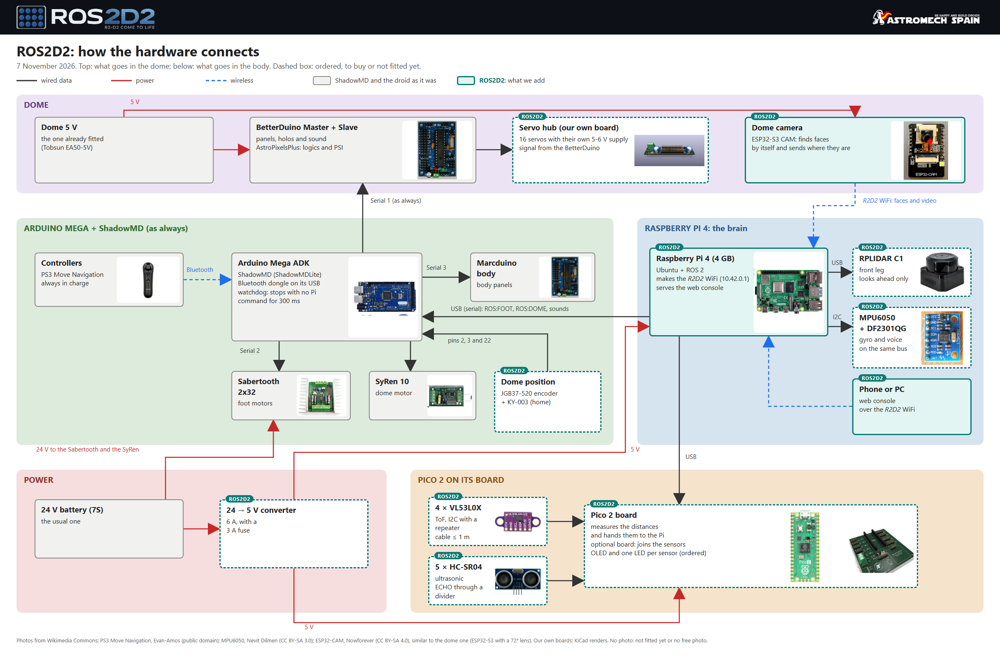

# ROS2D2 hardware

What ROS2D2 adds to an R2-D2 that already runs ShadowMD, and how it connects. Grey: the droid as
it was ([ShadowMD Lite](https://github.com/BeskarCode/ShadowMDLite) or the classic Shadow MD, [SHADOW_MD_EEBEL](https://github.com/BeskarCode/SHADOW_MD_EEBEL), on the Mega ADK, MarcDuino/BetterDuino, Sabertooth, SyRen, battery, controllers).
Teal: what ROS2D2 adds. Dashed: ordered, to buy or not fitted yet.

## Bill of materials

**This is an inventory of what we are using while testing, not a shopping list:** ROS2D2 is still
being tested on the droid. Only what we add to a ShadowMD droid. Status as of 7 November 2026; prices only where we have
paid or checked them.

### Brain

| Part | Qty | What for |
|---|---|---|
| Raspberry Pi 4 Model B, 4 GB | 1 | ROS 2, the web console, its own *R2D2* WiFi |
| microSD card, 32 GB or more (A1/A2) | 1 | Ubuntu Server 24.04 + ROS 2 |
| Heatsink or a case with a fan | 1 | The Pi works hard with the cameras on |

### Dome camera

| Part | Qty | What for |
|---|---|---|
| ESP32-S3 N16R8 CAM (Freenove or clone) | 1 | Finds faces itself and streams video over WiFi (`firmware/r2_domecam`) |
| 72° autofocus camera module (OV5640 or similar) | 1 | Replaces the 160° fisheye: faces come out bigger |

### Sensors

| Part | Qty | What for | Price |
|---|---|---|---|
| Slamtec RPLIDAR C1 (with USB adapter and cable) | 1 | Map and obstacles; on the front leg, looks ahead only | ~€70 (AliExpress, Oct 2026) |
| VL53L0X time-of-flight module (with XSHUT) | 4 | Close obstacles and steps; on the Pico | |
| HC-SR04 ultrasonic | 5 | Glass, mirrors and matt black; front and back; on the Pico | |
| MPU6050 (GY-521) | 1 | Turns for navigation; Pi I2C | |
| DFRobot DF2301QG-EN | 1 | Offline voice commands; same I2C bus as the MPU6050 | |

### Our own boards

| Part | Qty | What for | Price |
|---|---|---|---|
| Raspberry Pi Pico 2 | 1 | Reads the distance sensors, sends them to the Pi over USB (`firmware/r2_pico_sensors`) | |
| Pico 2 carrier board (`hardware/r2_pico_carrier`), assembled by JLCPCB: **optional** | 1 (order of 5) | Joins all the sensors to the Pico: connectors, I2C repeater, one LED per sensor, OLED. Without it, wire the sensors to the Pico by hand | |
| 0.96" SSD1306 I2C OLED, 128×64 | 1 | Sensor status on the Pico board (only with the board) | |
| Servo hub (our own board), assembled by JLCPCB | 1 (order of 5) | The dome's 16 servos with their own 5-6 V supply | |

### Dome position

| Part | Qty | What for |
|---|---|---|
| JGB37-520 333 rpm gear motor with encoder | 1 | Replaces the dome motor: the encoder tells how far it turned |
| KY-003 Hall sensor + magnet | 1 | Marks the front of the dome (home) |

### Power

| Part | Qty | What for |
|---|---|---|
| 24 → 5 V converter, 6 A (proposed: Mean Well RSD-30G-5) | 1 | The Pi and the Pico board, apart from the dome's 5 V |
| Fuse holder + 3 A fuse | 1 | Protects the 5 V output |

### Cables

| Part | Qty | What for |
|---|---|---|
| USB A → B | 1 | Pi → Mega ADK (`ROS:FOOT`, `ROS:DOME`, sounds) |
| USB A → micro-USB (data) | 1 | Pi → Pico 2 |
| Lidar USB (comes with the adapter) | 1 | Pi → RPLIDAR C1 |
| Dupont or JST leads for I2C | | Pi → MPU6050 and DF2301QG |
| 4-6 wire cable, ≤ 1 m per sensor | 9 | Pico board → VL53L0X and HC-SR04 |

### Optional, later

| Part | What for |
|---|---|
| BNO085 | Replaces the MPU6050, drifts less |
| VL53L5CX | 8×8-zone time-of-flight for low obstacles, if the VL53L0X fall short |
| Microphone array | Tell where a sound comes from |

Photo credits are at the foot of the diagram.
