

  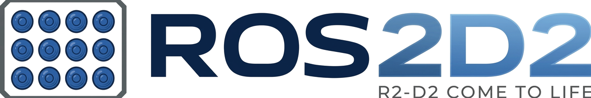

# ROS2D2 web console · User manual

[Versión en castellano](MANUAL_es.md)

The console is served by the Pi inside R2: open `http://<pi>:8080` in any browser on the same network
(the Pi's address on your home network, or `10.42.0.1` on R2's own WiFi). It has three pages, in the
bar at the top: **Console**, **Navigation** and **Setup**. The **Manual** button opens this manual at
the part about the page (or tab) you are on. Every button has a tooltip: hold the mouse over it.

The pills next to the menu say how things are: **rosbridge** (the console's link to ROS), the face
**tracker**, the automatic **mode**, the **Mega** and the **Pico** board. Green is fine, amber means
look, red means it is not there.

- [Console](#console)
- [Navigation](#navigation)
- [Setup](#setup): [Cameras](#setup--cameras) · [Sensors](#setup--sensors) · [Modes](#setup--modes) ·
  [System](#setup--system) · [File](#setup--file)

---

## Console

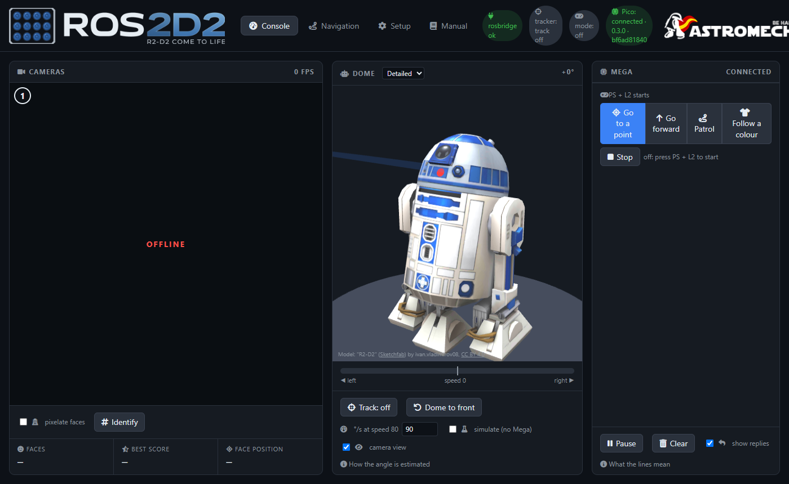

**Cameras**: the pictures of R2's cameras, numbered left to right. *Identify* shows each camera's
number on its picture. *Pixelate faces* blurs the faces it finds (for photos and videos of events).
Below: how many faces it sees, the best score and where the best one is.

**Dome**: R2 in 3D with the dome turned as the Pi believes it is.

- The bar under it is the dome's speed (left / right).
- *Track* turns face tracking on or off: the dome turns to look at the nearest face.
- *Dome to front* turns it back to the front.
- The dome has no position sensor: its angle is estimated from the speed commands. Time a full
  turn at speed 80 and type `360 ÷ seconds` in **°/s at speed 80**.
- *Simulate (no Mega)* tries the tracking with no Mega: the faces move as if the camera had turned.
- *Camera view* draws where the camera looks.

**Mega**: what goes to the Mega (→) and what it answers (←). *Pause* stops the list scrolling,
*Clear* empties it, *show replies* hides or shows the answers.

---

## Navigation

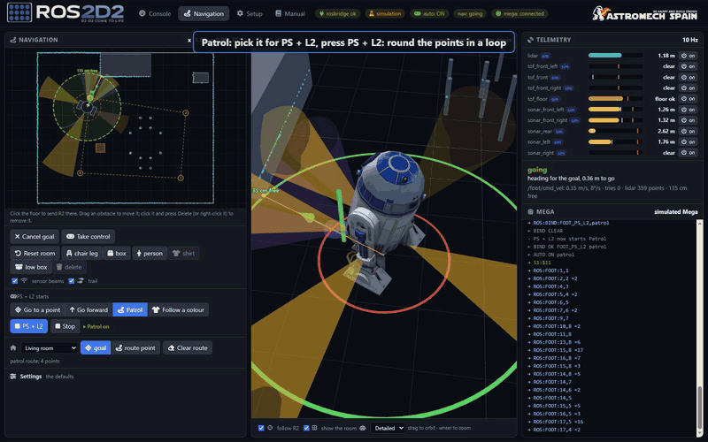

Video of every mode in the simulator: <https://youtu.be/Smfn6zQICm0>

**Navigation (map)**: the floor around R2 seen from above. The lidar's points are cyan, each
sensor's beam is drawn in its colour, and the green dashed circle is the free space round R2 (with
the distance, *36 cm free*). **Click the floor** to send R2 there (the goal is a green flag);
*Cancel goal* forgets it. *Sensor beams* and *trail* show or hide the beams and the way R2 has gone.
R2 only drives there when the automatic mode is on (Go to a point, see [Modes](#setup--modes)).

**PS + L2 starts** (also on the Console, in the Mega card): pick which mode PS + L2 on the foot
controller starts (Go to a point, Go forward, Patrol, Follow a colour); the green text says which one
is on. Only the controller switches a mode on: that keeps someone with the controller in hand
whenever R2 starts moving by itself. **Stop** switches it off from the page. Picking a mode here is
the same as giving it PS + L2 in [Modes](#setup--modes): the mode that had PS + L2 gets the picked
mode's old combination, so none is lost.

**Patrol route**: with *route point* on, each click on the floor adds a numbered point; in Patrol R2
goes round them in a loop (the point it heads for is filled). A point it cannot reach is skipped; if
it reaches none it stops. *Clear route* forgets it. *goal* puts clicks back to sending R2 somewhere.

**Go forward**: R2 drives straight on along the way it was facing, steering round things. When it is
boxed in (or the only way out is well off to a side) it turns slowly on the spot looking for a free
way and carries on along it; after a full turn with no way out it stops and plays the *give up* sound.

**Safety circle**: the red dashed circle round R2 (*safety circle* in Settings). R2 does not drive on
while something is inside it ahead (within *circle watched ahead*, 60° each side by default): it
turns away until it is clear. Something beside or behind (a wall it runs along) does not stop it.

**Settings**: every setting of how R2 moves on its own (nav.yaml), in groups: safety circle, speed,
what to do when blocked (Go to a point, Patrol), Go forward's slow search, and the distance sensors.
A change applies at once (try it in the simulator); **Save** keeps it in `~/.config/ros2d2/nav.yaml`,
**Defaults** brings back the package's values. Until you save, R2 uses the defaults; a setting you
changed from its default shows in amber.

**Only in simulation**:
- **Room**: load a living room (sofa, table and chair legs, a low box), a narrow corridor with a
  door, several rooms joined by doors, or an event with people (one wearing the colour) and
  barriers. R2 goes back to its start; you can still add chair legs, boxes and people on top.
- **PS + L2** (next to the mode buttons): the simulated controller's PS + L2, to start and stop the
  mode it is set to.
- **on / off** next to each reading: simulate that sensor unplugged, to see what R2 does without it
  (sensors.yaml is not touched).

**R2 in 3D**: the same in 3D, with the lidar's point cloud and the sensors' cones. Drag to orbit,
wheel to zoom. *Follow R2* keeps it in the middle; *Show the room* draws the simulated room (only in
simulation, where you can also add chair legs and boxes and drag them).

**Telemetry**: every sensor's reading. The bar fills as things get closer; the red mark is where R2
stops for that sensor, the thin mark the raw reading before filtering. Greyed with *ignored* means
that sensor is ignored (see [Sensors](#setup--sensors)). Below: what the navigator is doing and why,
and whether the Mega is connected (without it nothing reaches the feet).

---

## Setup

Setup has five tabs. **Save** keeps the tab's settings on the Pi (they apply at once);
**Save and restart** is only needed for the camera list.

### Setup → Cameras

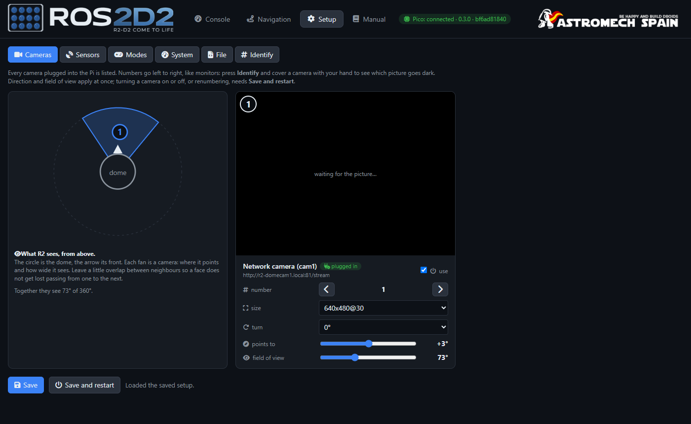

Every camera plugged into the Pi, with:

- **use** (on or off), **number** (the arrows move it left or right in the list), **size** and
  **turn** (0, 90, 180, 270°),
- **points to** and **field of view**: where it looks on R2, so the dome tracking knows where a face is.

*Identify* puts each number on its picture: cover a camera with your hand to see which picture goes
dark. Direction and field of view apply at once; turning a camera on or off or renumbering needs
**Save and restart**.

### Setup → Sensors

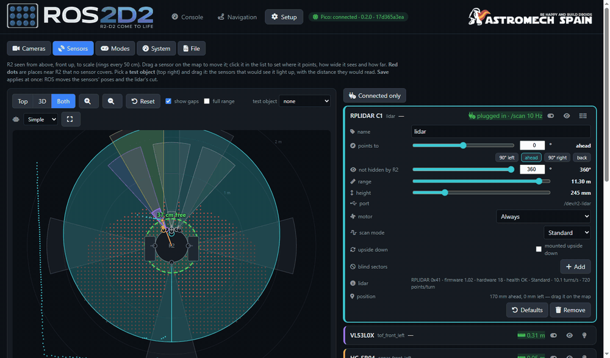

R2 seen from above, to scale (rings every 50 cm), and R2 in 3D (*Top*, *3D* or *Both*).

- **Drag a sensor** on the map to move it. Click its card to set where it **points**, how wide it
  sees (**field of view**), how far (**range**), its **height**, how much it **tilts down**, and at
  what distance R2 **stops** for it.
- **colour**: each sensor can take one of 9 fixed colours, used on the map, in 3D, on its card and next
  to its connector on the board (System); the ones another sensor uses look faded. The button next to it brings back its type's colour.
- **Red dots** are places near R2 that no sensor covers; the numbers under the map say how much of
  the floor is covered up to 50 cm and 1 m, and where R2 is blind.
- **Test object**: pick one (chair leg, person, wall, low box) and drag it: the sensors that would
  see it light up, with the distance they would read.
- **Add sensor** takes the first free connector of the Pico board; **Remove** takes it out.
- Each card says whether the sensor answers (*plugged in*, *not responding*...). The lightbulb makes
  its connector's LED blink on the board, to find it.

**In use / ignored**: the switch on each card. A sensor that gives false readings can be ignored in
one click: navigation and follow stop using it within a second or two, but it keeps measuring and its
reading stays on the card, greyed, so you can see when it is fine again and switch it back on. The
switch is saved at once (only that line); it stays ignored after a restart. If nothing in use is left
looking ahead, the console warns you: R2 will not move.

**The lidar's card** also sets the lidar itself:

- **Motor**: *Always*; *Only with an automatic mode* (R2 standing still is quiet; when a mode starts,
  it waits up to 5 s for the lidar before moving; the motor stops 5 s after the last mode); or *Off*.
- **Scan mode**: the modes the lidar says it has (a C1: *Standard*, 16 m; *DenseBoost*, 40 m).
  Changing it restarts only the lidar for a few seconds.
- **Upside down**: if it is mounted upside down.
- **Blind sectors**: angles of the lidar's own view to ignore (R2's leg), drawn red on the map.
- The **lidar** line: model, firmware, hardware, health, mode, turns per second and points per turn.
  The C1's speed cannot be changed (it turns at about 10 per second).

**Save** applies at once: ROS moves the sensors and the lidar's cut.

### Setup → Modes

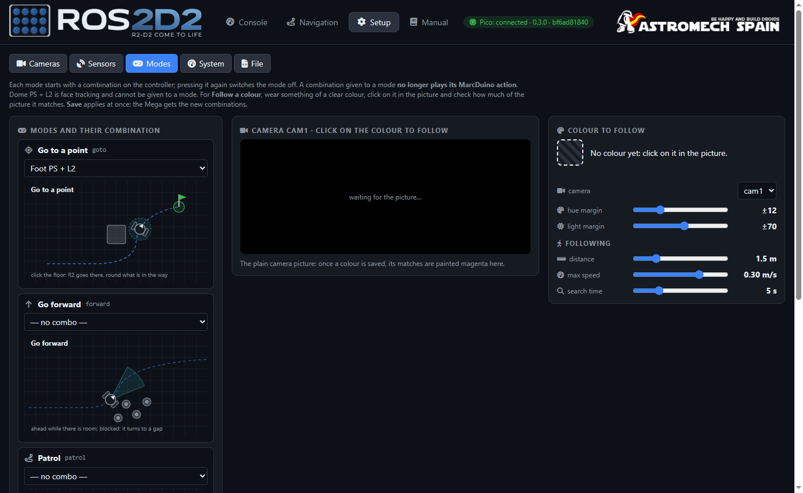

Each automatic mode starts with its own **controller combination**; pressing it again switches the
mode off, and touching the stick takes the control back at once. A combination given to a mode no
longer plays its MarcDuino action. *Dome PS + L2* is face tracking and cannot be given to a mode.

| | |
|---|---|
| 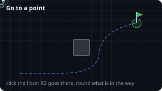 | 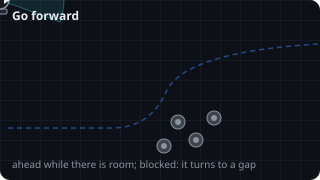 |
| 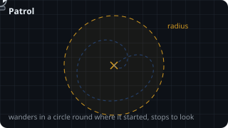 | 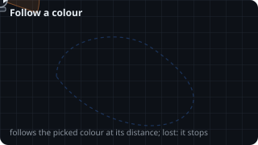 |

**Follow a colour**: wear something of a clear colour, **click on it in the camera picture** and
check how much of the picture it matches (the matches are painted magenta). Its sliders set how
close a colour must be, the distance to keep, the top speed and how long it searches when it loses
the colour. With the ESP32-P4 dome camera (`firmware/r2_domecam_p4`) the camera finds the colour
itself while R2 follows it, so no video goes over the WiFi; with other cameras the Pi finds it in
the video, as before.

### Setup → System

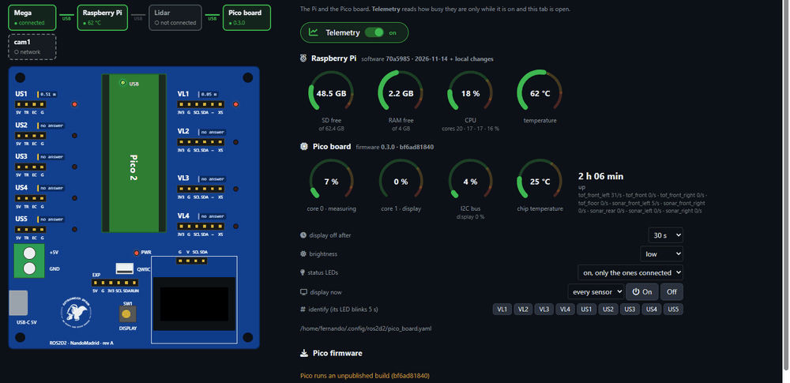

The tab has two columns: the strip and the board on the left, telemetry and the settings on the
right; on narrow screens, the board on top and the settings below it.

**On top, what the Pi finds**: a strip with the Mega, the Pi, the lidar, the Pico board and each
camera, green when found and grey when not, joined by the USB cables (green when both ends are
there). Sabertooth, SyRen, MarcDuino and the controllers do not show: the Pi cannot see them.

**The Pico board, live** (Pico firmware 0.3.0 or newer): a copy of the real board,
to scale and with each part where it is on the PCB: the connectors, the Pico, the DISPLAY button and
the 0.96" display on its module, at its real size. Each connector's
LED lights and blinks as the real one, with the sensor's reading beside it; the Pico's own green
LED too; the display shows the real display's picture, pixel for pixel. The **DISPLAY** button works
like the real one: a click is a press, holding it 3 s turns the display off (a bar fills while you
hold). Press the real button and the copy follows. PWR lights when an HC-SR04 answers (they need its
5 V); with none answering it shows dashed, as the Pico cannot tell. The board only sends this while
this tab is open.

**Telemetry** (the green switch): how busy the Pi and the Pico are, only while it is on and this tab
is open. Each value is a ring with its colour ranges (green, amber, red), filled up to the value in
its range's colour; hover it for the range seen and the limits.

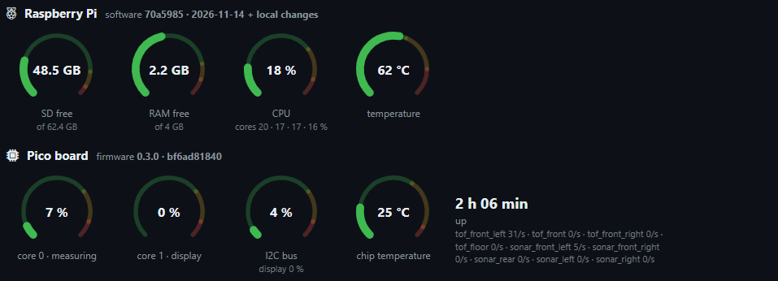

- **Raspberry Pi**: software version, free SD, free RAM, CPU, temperature (with its normal, warm and
  throttling zones) and voltage warnings.
- **Pico board**: firmware version, each core's load, the I2C bus, readings per second of each
  sensor and temperature.
- **Board settings**: how long the board's display stays on, its brightness and when its LEDs light
  (*only with the display on*, *always on*, *on, only the ones connected*, *always off*, *only the ones
  failing*); turn the display on (showing the screen you pick) or
  off; *Identify* makes a connector's LED blink.
- **Pico firmware**: *Check for update* asks GitHub; *Flash firmware* downloads, builds and flashes
  it from the Pi (a few minutes; not while an automatic mode drives). If the copy fails, *Retry*
  copies it again without building.

### Setup → File

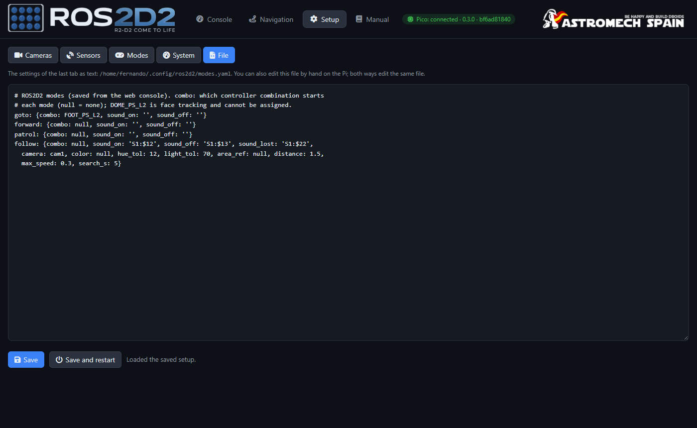

The settings of the last tab you used, as text (`sensors.yaml`, `modes.yaml`, `cameras.yaml`...).
You can edit them here or by hand on the Pi (`~/.config/ros2d2/`): both edit the same file. **Save**
checks the file first and does not save a broken one.
