

  

# Consola web de ROS2D2 · Manual de usuario

[English version](MANUAL.md)

La consola la sirve la Pi que va dentro de R2: abre `http://<pi>:8080` en cualquier navegador de la
misma red (la dirección de la Pi en la red de casa, o `10.42.0.1` en la WiFi propia de R2). Tiene tres
páginas, en la barra de arriba: **Console**, **Navigation** y **Setup**. El botón **Manual** (marcado
con ↗: sale de la consola) abre este manual (en inglés) en GitHub, en otra pestaña, por la parte de la
página o pestaña en la que estás. Todos los botones tienen una ayuda: deja el ratón encima; y cada
tarjeta o pestaña tiene arriba un **How it works** plegado.

Las píldoras junto al menú son las mismas en todas las páginas y dicen cómo están las cosas: **ROS**
(el enlace de la consola con ROS), el **Mega**, la placa de la **Pico** (con su versión de firmware),
el **Lidar**, la **Camera** (o cuántas de las cámaras contestan) y el **Mode** encendido (uno
automático o el seguimiento de caras). Verde está bien, ámbar hay que mirarlo, rojo es que no está.
Un clic en la píldora de Pico, Lidar, Camera o Mode abre su pestaña de Setup; cada pestaña de Setup
tiene su propia dirección (`setup.html#system`…). Si
R2 deja de contestar, una ventana lo avisa y se quita sola cuando vuelve. **Ctrl+S** guarda la página
en la que estás, desde cualquier parte de ella.

- [Console](#console)
- [Navigation](#navigation)
- [Mando a distancia](#mando-a-distancia): [Mandos](#mandos) · [Atajos](#atajos)
- [Móvil](#móvil)
- [Setup](#setup): [Cameras](#setup--cameras) · [Sensors](#setup--sensors) · [Modes](#setup--modes) ·
  [System](#setup--system) · [File](#setup--file)

---

## Console

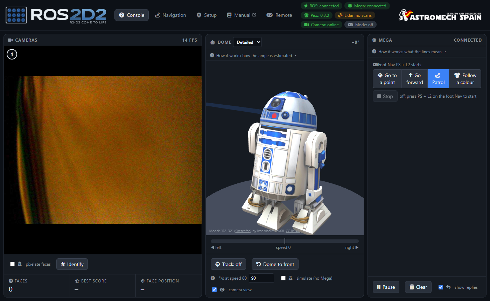

**Cameras**: lo que ven las cámaras de R2, numeradas de izquierda a derecha. *Identify* pone el
número de cada cámara sobre su imagen. *Pixelate faces* difumina las caras que encuentra (para fotos
y vídeos de eventos). Debajo: cuántas caras ve, la mejor puntuación y dónde está la mejor.

**Dome**: R2 en 3D con el dome girado como la Pi cree que está.

- La barra de debajo es la velocidad del dome (izquierda / derecha).
- *Track* enciende o apaga el seguimiento de caras: el dome gira para mirar a la cara más cercana. Con
  varias personas sigue mirando a la primera, aunque se acerque otra; cuando la pierde espera 2 s con
  el dome quieto (si vuelve, es la misma), y luego elige la cara más grande que vea y la saluda con un
  sonido (`sound_new_face` en `dome_tracker.yaml`).
- *Dome to front* lo vuelve a poner mirando al frente.
- El dome no tiene sensor de posición: su ángulo se calcula a partir de las órdenes de velocidad.
  Cronometra una vuelta entera a velocidad 80 y escribe `360 ÷ segundos` en **°/s at speed 80**.
- *Simulate (no Mega)* prueba el seguimiento sin Mega: las caras se mueven como si la cámara hubiera
  girado.
- *Camera view* dibuja hacia dónde mira la cámara.

**Mega**: lo que se manda al Mega (→) y lo que contesta (←). *Pause* para el desplazamiento de la
lista, *Clear* la vacía y *show replies* oculta o muestra las respuestas.

---

## Navigation

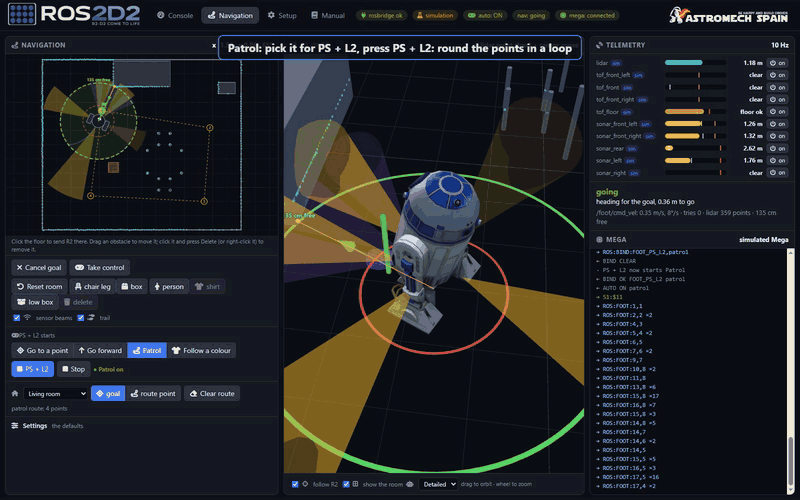

Vídeo de todos los modos en el simulador: <https://youtu.be/Smfn6zQICm0>

**Navigation (mapa)**: el suelo alrededor de R2 visto desde arriba. Los puntos del lidar son cian,
el haz de cada sensor va en su color, y el círculo verde discontinuo es el hueco libre alrededor de
R2 (con la distancia, *36 cm free*). **Haz clic en el suelo** para mandar a R2 allí (el destino es
una bandera verde); *Cancel goal* lo olvida. *Sensor beams* y *trail* muestran u ocultan los haces y
el camino que ha hecho R2. R2 solo va allí con el modo automático encendido (Go to a point, mira
[Modes](#setup--modes)).

**PS + L2 starts** (también en la Console, en la tarjeta del Mega): eliges qué modo arranca PS + L2
en el mando del foot (Go to a point, Go forward, Patrol, Follow a colour); el texto en verde dice cuál
está en marcha. Encender un modo solo se puede desde el mando: así siempre hay alguien con el mando
en la mano cuando R2 empieza a moverse solo. **Stop** lo apaga desde la página. Elegir un modo aquí
es lo mismo que darle PS + L2 en [Modes](#setup--modes): el modo que tenía PS + L2 se queda con la
combinación que tenía el elegido, así que no se pierde ninguna.

**Ruta de patrulla**: con *route point* activado, cada clic en el suelo añade un punto numerado; en
Patrol R2 los recorre en bucle (el punto al que va sale relleno). Un punto al que no llega se lo
salta; si no llega a ninguno, se para. *Clear route* la borra. *goal* hace que el clic vuelva a
mandar a R2 a un sitio.

**Go forward**: R2 avanza recto en la dirección en la que miraba, esquivando lo que encuentra. Si se
atasca (o la única salida queda muy a un lado) gira despacio sobre sí mismo buscando un hueco libre y
sigue por él; si da una vuelta entera sin encontrar salida, se para y suena el sonido de *give up*.

**Círculo de seguridad**: el círculo rojo discontinuo alrededor de R2 (*safety circle* en Settings).
R2 no avanza mientras haya algo dentro de él por delante (dentro de *circle watched ahead*, 60° a
cada lado por defecto): gira hacia el otro lado hasta que queda libre. Lo que tiene al lado o detrás
(una pared por la que va pegado) no lo para. Cuanto más rápido va, más crece el círculo por delante,
lo que necesita para frenar (*real braking*). Cuando tiene que parar por algo en el camino corta la
velocidad al momento, sin rampa.

**Sensores perdidos y odometría**: un sensor que estaba dando datos y se calla (la Pico
desenchufada, el lidar parado) no se toma como "no hay nada": R2 se para (estado *sensor lost*) y su
lectura sale **LOST** en rojo con los segundos desde su último dato (pasa el ratón por una lectura
para ver su edad). Sin odometría (*/odom*) tampoco se mueve (estado *no odom*); la línea bajo el
estado dice la edad de */odom*, en rojo si falta. En el droide la odometría sale de lo que se manda a
la Mega más la IMU (el nodo *dead_reckoning*); en el simulador, de la sala simulada.

**Settings**: todos los ajustes de cómo se mueve R2 solo (nav.yaml), por grupos: círculo de
seguridad, velocidad (con *slowing down* para las frenadas suaves y *real braking*, la deceleración con
la que R2 frena de verdad: mídela en el droide), qué hacer cuando se bloquea (Go to a point, Patrol:
cuánto espera, cuánto retrocede, cuándo cuenta un intento y cuánto tiempo debe quedar libre el
camino), la búsqueda lenta de Go forward y los sensores de distancia. El círculo de seguridad no puede
ser menor de 0,40 m (medio cuerpo son 0,36). Un cambio se aplica al momento (pruébalo en el simulador);
**Save** lo guarda en `~/.config/ros2d2/nav.yaml` y **Defaults** vuelve a los valores del paquete.
Hasta que guardes, R2 usa los de por defecto; un ajuste cambiado respecto al de por defecto sale en
ámbar.

**Solo donde ve**: en todos los modos automáticos R2 solo avanza hacia direcciones que cubre algún
sensor en uso y enviando datos, según dónde lo hayas colocado en Setup -> Sensors (la dirección y el
campo de visión de cada uno; no cuentan los sectores ciegos del lidar ni los sensores de suelo). Para
ir hacia delante necesita algo que mire al frente; para ir hacia donde no ve ningún sensor primero
gira y avanza cuando un sensor ya mira hacia allí. Para ir marcha atrás necesita un sensor trasero o
un lidar que vea detrás, con el camino libre: sin eso no retrocede, se para y gira (el estado dice
*no sensor looks behind*). Si nada mira al frente, se queda parado.

**Solo en simulación**:
- **Sala**: carga un salón (sofá, patas de mesa y sillas, una caja baja), un pasillo estrecho con
  puerta, varias salas unidas por puertas o un evento con gente (una con la camiseta del color) y
  vallas. R2 vuelve a su salida; encima puedes seguir añadiendo patas, cajas y personas.
- **PS + L2** (junto a los botones de modo): el PS + L2 del mando simulado, para arrancar y parar el
  modo que tenga asignado.
- **on / off** junto a cada lectura: simula ese sensor desconectado, para ver qué hace R2 sin él
  (no toca sensors.yaml).

**R2 en 3D**: lo mismo en 3D, con la nube de puntos del lidar y los conos de los sensores. Arrastra
para girar y usa la rueda para acercar. *Follow R2* lo mantiene en el centro; *Show the room* dibuja
la habitación simulada (solo en simulación, donde también se pueden añadir patas de silla y cajas y
arrastrarlas).

**Telemetry**: la lectura de cada sensor. La barra se llena cuanto más cerca está algo; la marca
roja es donde R2 se para por ese sensor, y la marca fina la lectura sin filtrar. En gris con
*ignored* es que ese sensor está ignorado (mira [Sensors](#setup--sensors)). Debajo: qué hace el
navegador y por qué, y si el Mega está conectado (sin él no llega nada a los foot).

---

## Mando a distancia

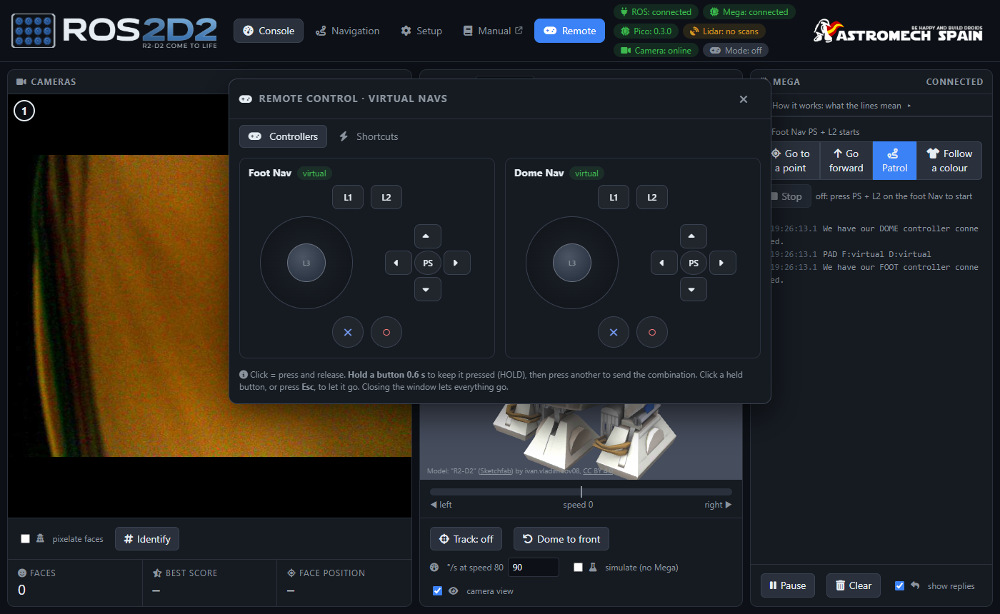

El botón **Remote**, en todas las páginas, abre dos PS3 Nav virtuales, el del **foot** y el del
**dome**, para probar cosas en casa sin sacar los mandos de verdad. El Mega los toma exactamente
como Navs reales: los mismos botones hacen lo mismo. Hace falta un firmware del Mega con el Nav
virtual (`ENABLE_VIRTUAL_PAD` en ShadowMD Lite o en el ShadowMD clásico); la etiqueta de cada Nav dice
cómo está:

| Etiqueta | Quiere decir |
|---|---|
| **virtual** | la ventana maneja este Nav |
| **real Nav connected** | hay un mando real encendido: la ventana avisa antes de la primera acción, y si alguien mueve el real, **manda el real** |
| **no Mega** / **this firmware has no virtual Nav** | no hay a quién mandarlo: el Nav sale en gris |

Mientras la ventana está abierta los dos Navs están "encendidos" (su estado sale 20 veces por
segundo, como un Nav real). **Cerrar la ventana, ocultar la pestaña o salir de la página los
apaga**: se suelta todo y el Mega para los motores y los modos él solo, como cuando se pierde un
mando real. Solo hay una ventana Remote abierta a la vez, entre todas las pestañas.

### Mandos

- **Clic** en un botón: pulsar y soltar.
- **Mantener un botón 0,6 s**: se queda pulsado (**HOLD**, en amarillo; se pone amarillo en cuanto
  llega al tiempo, así sabes que ya puedes soltar). Luego pulsa otro botón para mandar la
  **combinación**: los mantenidos y ese, a la vez. Mantén más de uno para combinaciones más largas
  (*L2* + *Cross* + una flecha…).
- **Clic en un botón mantenido**, o **Esc**, para soltarlo.
- **El stick**: arrastra la bola; vuelve al centro al soltarla. Un clic en la bola sin moverla es
  **L3**.

### Atajos

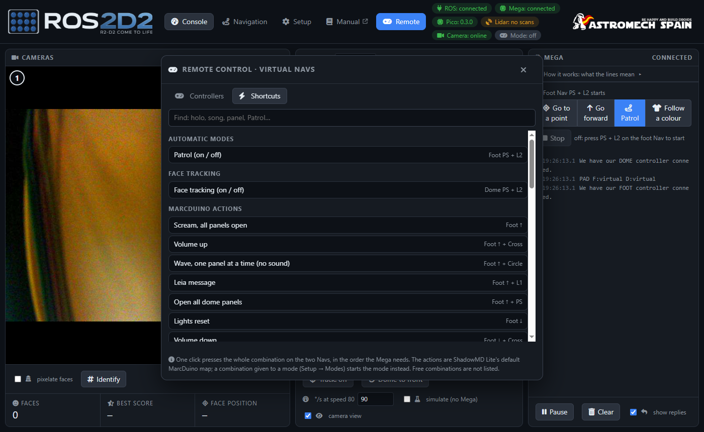

La pestaña **Shortcuts** tiene todas las combinaciones que hacen algo, y las manda ella sola con
**un clic**, con una caja para buscar (*holo*, *song*, *panel*, *Patrol*…). Van en tres grupos:

- **Automatic modes**: la combinación de cada modo en Setup → Modes (encender / apagar).
- **Face tracking**: Dome PS + L2 (encender / apagar).
- **MarcDuino actions**: el mapa por defecto de ShadowMD Lite (el de su `CheatSheet.md`). Una
  combinación dada a un modo sale como ese modo, porque ya no hace su acción; las combinaciones
  libres no salen.

La ventana pulsa los botones en el orden en que los lee el Mega: primero los modificadores (Cross,
Circle, PS, L1, L2, L3) y después la flecha; y con el Nav del dome conectado el modificador va en el
otro Nav, como dice la chuleta (*Foot ↑ + Cross* es la ↑ del foot con el Cross del dome). Después de
cada atajo la lista espera 1,2 s: el Mega no hace caso a una flecha que llega antes de un segundo
desde la anterior.

La ventana Remote y el móvil comparten los mismos dos Navs virtuales: solo maneja uno a la vez (el otro
dice *Another device is driving R2*), y sus sticks llegan solo hasta el límite de Setup → Modes.

---

## Móvil

| Drive | Actions | Modes |
|---|---|---|
| 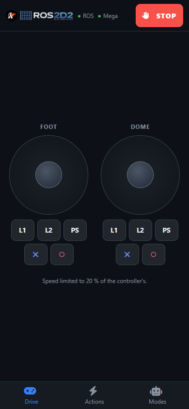 | 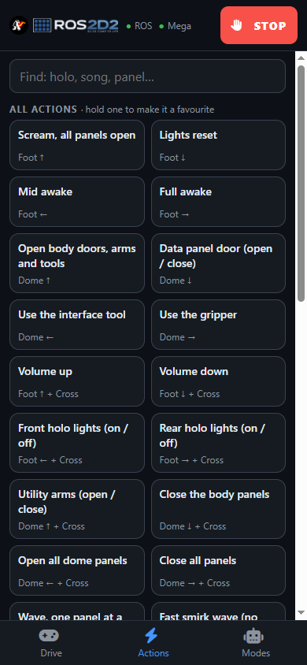 | 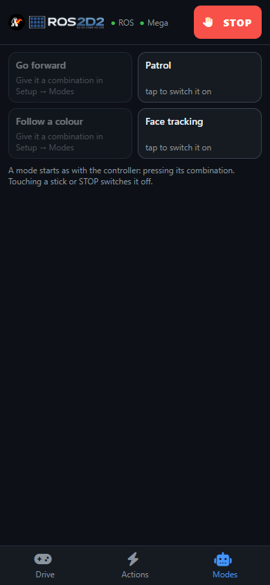 |

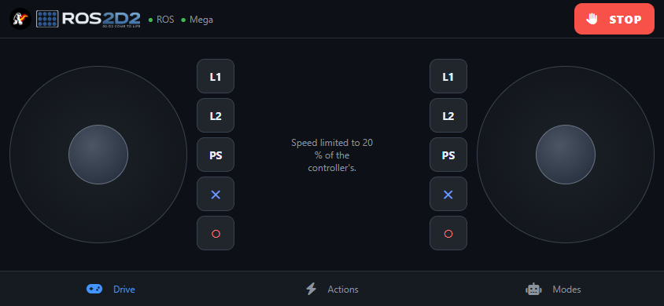

Una vista de la consola para el móvil, al estilo de la app R2 Touch de MarcDuino: conducir a R2, lanzar
sus acciones y encender sus modos. Conéctate a la WiFi de R2 (`R2D2`) y abre
**`http://10.42.0.1:8080/phone.html`** (o el enlace de Setup → Modes). En el iPhone, en Safari,
**Compartir → Añadir a pantalla de inicio** la deja como una app, a pantalla completa y con su icono;
en Android funciona igual.

- **Drive**: el stick del foot a la izquierda y el del dome a la derecha, cada uno con los botones de
  su Nav (L1, L2, PS, ✕, ○), pulsados mientras tienes el dedo encima. **Los sticks solo llegan hasta
  un punto**: el 20 % del recorrido del mando por defecto (Setup → Modes → Remote and phone), y la Pi
  los mantiene ahí mande lo que mande la página, así que desde el móvil R2 nunca va tan rápido como con
  el PS3 Nav. Un stick que vuelve al centro para ese motor. En horizontal cada stick queda en su borde
  de la pantalla, bajo el pulgar.
- **Actions**: todas las acciones de MarcDuino del mapa de ShadowMD Lite, con buscador; un toque la
  lanza. **Mantén una pulsada** para hacerla favorita y darle un nombre corto: las favoritas van arriba
  y se guardan en R2, para cualquier móvil. Una combinación dada a un modo no sale aquí: enciende el
  modo (Modes).
- **Modes**: los modos automáticos que tengan combinación en Setup → Modes, y el seguimiento de caras.
  Un toque pulsa la combinación, como en el mando; otro, lo apaga. *Go to a point* solo sale con el
  simulador.
- **STOP** (siempre arriba): lo suelta todo y apaga el modo y el seguimiento de caras.

Mientras la página está en pantalla, el móvil es los dos Navs, encendidos. **Con la pantalla bloqueada,
otra app delante o la página cerrada no manda nada**, y el Mega se para solo, como cuando se pierde un
mando real. Solo un dispositivo maneja a la vez: si está la ventana Remote u otro móvil, este lo avisa y
toma el relevo un segundo después de que el otro se calle. Un Nav real en uso siempre manda.

**Modo invitado** (Setup → Modes): el móvil solo enseña las acciones y STOP, para prestárselo a alguien.
Es una comodidad, no un candado: lo que mantiene a R2 despacio es el límite de velocidad.

---

## Setup

Setup tiene cinco pestañas, cada una con su dirección (`setup.html#cameras`, `#sensors`, `#modes`,
`#system`, `#file`). En la pantalla de un ordenador la página no hace scroll: cada pestaña llena la
ventana y sus columnas hacen scroll por dentro. **Save** guarda los ajustes de la pestaña en la Pi (se aplican al
momento); **Save and restart** solo hace falta para la lista de cámaras.

### Setup → Cameras

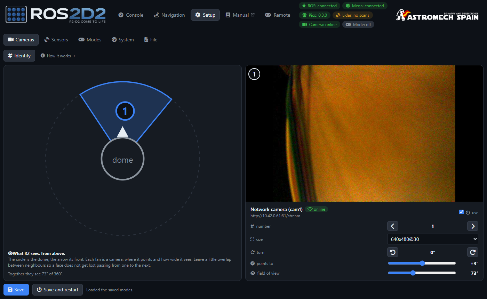

A la izquierda, R2 visto desde arriba con el abanico de cada cámara; a la derecha, cada cámara
enchufada a la Pi (o en la WiFi de R2), con:

- **use** (encendida o no), **number** (las flechas la mueven a la izquierda o a la derecha de la
  lista), **size** y **turn** (las dos flechas giran la imagen un cuarto de vuelta a cada lado: 0, 90,
  180, 270°, se ve al momento),
- **points to** y **field of view**: hacia dónde mira en R2, para que el seguimiento con el dome sepa
  dónde está una cara.

*Identify* pone cada número sobre su imagen: tapa una cámara con la mano para ver qué imagen se pone
negra. La dirección y el campo de visión se aplican al momento; encender o apagar una cámara o
cambiar el orden necesita **Save and restart**.

### Setup → Sensors

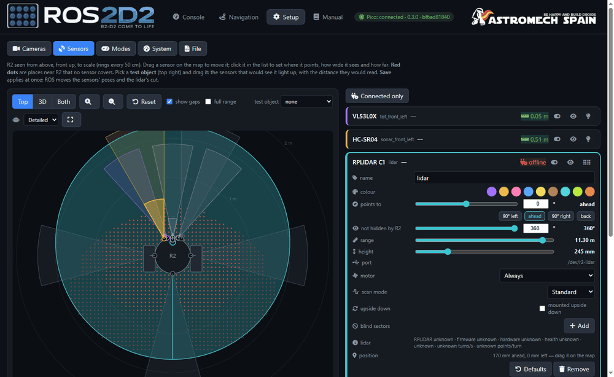

R2 visto desde arriba, a escala (anillos cada 50 cm), y R2 en 3D (*Top*, *3D* o *Both*).

- **Arrastra un sensor** por el mapa para moverlo. Haz clic en su tarjeta para ajustar hacia dónde
  **apunta**, lo ancho que ve (**field of view**), hasta dónde (**range**), su **altura**, cuánto se
  **inclina hacia abajo** y a qué distancia **se para** R2 por él.
- **colour**: cada sensor puede tomar uno de 9 colores fijos (los que ya usa otro salen apagados), que se usa en el mapa, en el 3D, en su
  tarjeta y junto a su conector en la placa (System). El botón de al lado le devuelve el color de su tipo.
- Los **puntos rojos** son sitios cerca de R2 que no cubre ningún sensor; los números bajo el mapa
  dicen cuánto suelo se cubre hasta 50 cm y hasta 1 m, y hacia dónde está ciego R2. El anillo rojo
  discontinuo es el **círculo de seguridad de la navegación**, para ajustar los sensores contra él.
- Encima de la lista: **Connected only** esconde los sensores que no están midiendo; **Hide all** y
  **Show all** esconden o enseñan de golpe todos los haces (y los puntos del lidar) en el mapa, como
  los ojos de cada tarjeta.
- **Test object**: elige uno (pata de silla, persona, pared, caja baja) y arrástralo: se iluminan
  los sensores que lo verían, con la distancia que leerían.
- **Add sensor** usa el primer conector libre de la placa de la Pico; **Remove** lo quita.
- Cada tarjeta dice si el sensor contesta (*plugged in*, *not responding*...). La bombilla hace
  parpadear el LED de su conector en la placa, para encontrarlo.

**In use / ignored**: el interruptor de cada tarjeta. Un sensor que da lecturas falsas se puede
ignorar con un clic: la navegación y el seguimiento dejan de usarlo en uno o dos segundos, pero sigue
midiendo y su lectura se queda en la tarjeta, en gris, para que veas cuándo vuelve a estar bien y lo
actives otra vez. El interruptor se guarda al momento (solo esa línea) y sigue ignorado tras
reiniciar. Si no queda ningún sensor en uso mirando hacia delante, la consola avisa: R2 no se moverá.

**La tarjeta del lidar** también ajusta el propio lidar:

- **USB**: *Disconnect* para el motor y desconecta el USB del lidar por software, como si quitaras el
  cable (su driver se para); *Connect* lo vuelve a conectar y el driver arranca en unos segundos.
  Se aplica al momento, sin Save, y al reiniciar la Pi vuelve conectado. El puerto sigue dando 5 V
  (una Pi 4 no puede apagar un solo puerto). Hace falta ejecutar una vez `setup/install_lidar_usb.sh`
  en la Pi.
- **Motor**: *Always*; *Only with an automatic mode* (con R2 quieto no hace ruido; al empezar un
  modo, espera hasta 5 s al lidar antes de moverse; el motor se para 5 s después del último modo);
  u *Off*.
- **Scan mode**: los modos que dice tener el lidar (un C1: *Standard*, 16 m; *DenseBoost*, 40 m).
  Cambiarlo reinicia solo el lidar unos segundos.
- **Upside down**: si va montado boca abajo.
- **Blind sectors**: ángulos de la vista del propio lidar que se ignoran (la pierna de R2), en rojo
  en el mapa.
- La línea **lidar**: modelo, firmware, hardware, salud, modo, vueltas por segundo y puntos por
  vuelta. La velocidad del C1 no se puede cambiar (gira a unas 10 vueltas por segundo).

**Save** se aplica al momento: ROS mueve los sensores y el recorte del lidar.

### Setup → Modes

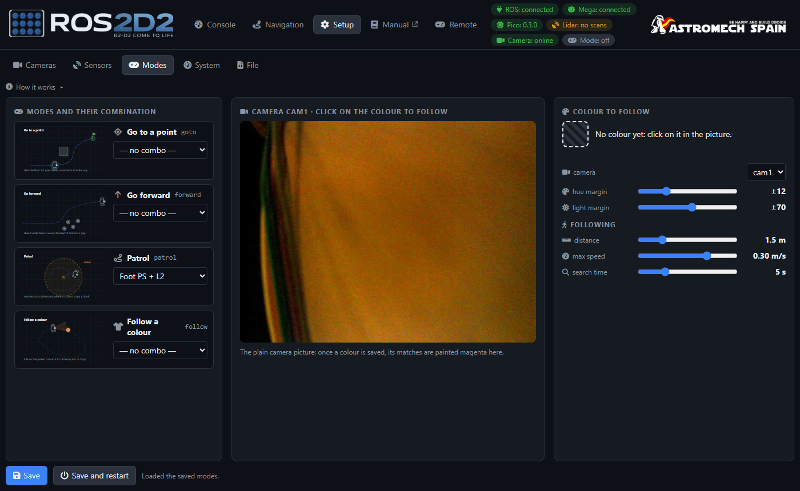

Cada modo automático se enciende con su propia **combinación del mando**; pulsarla otra vez lo
apaga, y tocar el stick devuelve el control al momento. Una combinación dada a un modo deja de hacer
su acción de MarcDuino. *Dome PS + L2* es el seguimiento de caras y no se puede dar a un modo.
*Go to a point* sirve para probar la distribución de los sensores (sobre todo en el simulador): sin
encoders en las ruedas, en el droide su posición deriva.

**Remote and phone** (debajo del color): hasta dónde llegan los sticks de los Navs virtuales (de 15 a
100 %, 20 % por defecto; por debajo de 15 % el stick del foot se quedaría en la zona muerta de ShadowMD), el modo invitado del móvil y el enlace a la vista del móvil. Se guarda en
cuanto cambia (`remote.yaml`).

| | |
|---|---|
| 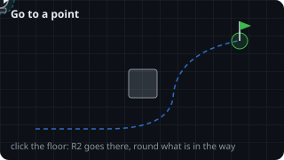 | 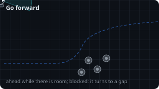 |
| 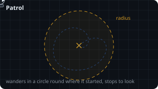 | 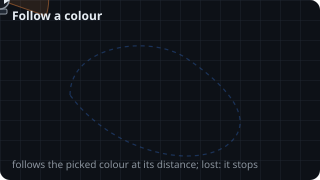 |

**Follow a colour**: ponte algo de un color claro, **haz clic sobre él en la imagen de la cámara** y
mira cuánto de la imagen coincide (lo que coincide se pinta en magenta). Sus deslizadores ajustan lo
parecido que tiene que ser el color, la distancia a mantener, la velocidad máxima y cuánto tiempo
busca cuando lo pierde. Con la cámara del dome ESP32-P4 (`firmware/r2_domecam_p4`) es la propia
cámara la que busca el color mientras R2 lo sigue, así que no viaja vídeo por la WiFi; con las demás
cámaras lo busca la Pi en el vídeo, como antes.

La pestaña va en tres columnas: los modos, cada uno con su combinación y un dibujo pequeño de lo que
hace; la imagen de la cámara para hacer clic en el color; y los ajustes del color.

### Setup → System

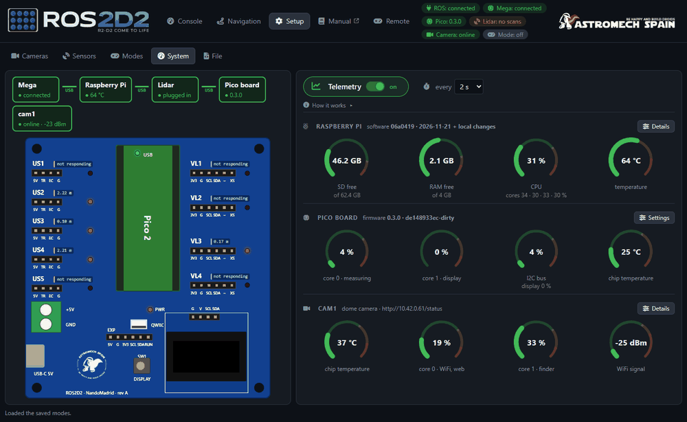

Dos tarjetas: a la izquierda, lo que la Pi detecta y la placa de la Pico en directo; a la derecha, un
bloque por cada parte (la Raspberry Pi, la placa de la Pico y cada cámara del dome) con su
telemetría, y un botón que abre sus detalles y ajustes en una ventana aparte.

**Arriba, lo que la Pi detecta**: una tira con el Mega, la Pi, el lidar, la placa de la Pico y cada
cámara, en verde si están y en gris si no, unidos por los cables USB (verdes cuando están los dos
extremos). Sabertooth, SyRen, MarcDuino y los mandos no salen: la Pi no los puede ver.

**La placa de la Pico, en directo** (firmware de la Pico 0.3.0 o posterior): una copia de la placa
real, a escala y con cada pieza en su sitio del PCB: los conectores, la Pico, el pulsador DISPLAY y
la pantalla de 0,96" en su módulo, a su tamaño. Mientras la pantalla enseña un sensor, su conector
lleva un marco amarillo y una flecha lo señala (en la pantalla *all*, todos los conectores con
sensor), para seguir fácilmente los pasos del botón DISPLAY. El LED de cada conector se enciende y
parpadea como el real, con la lectura del sensor al lado; también el LED verde de la propia Pico; la
pantalla enseña la imagen de la pantalla real, píxel a píxel. El botón **DISPLAY** funciona como el
real: un clic es una pulsación y mantenerlo 3 s apaga la pantalla (mientras lo mantienes se llena
una barra). Si pulsas el botón de la placa, la copia lo sigue. PWR se enciende cuando responde algún
HC-SR04 (necesitan sus 5 V); si no responde ninguno sale punteado, porque la Pico no lo puede saber.
La placa solo manda esto mientras esta pestaña está abierta.

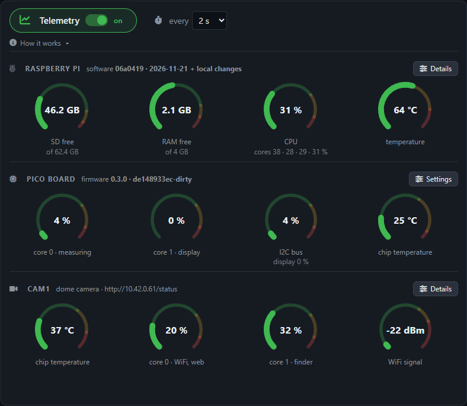

**Telemetry** (el interruptor verde): lo ocupada que va cada parte, leído solo mientras está
encendido y esta pestaña abierta. Los indicadores están siempre: **en color** mientras está
encendido, **en gris** con los últimos valores (o vacíos) mientras está apagado. Cada valor es un
anillo con sus zonas de color (verde, ámbar, rojo), relleno hasta el valor con el color de su zona;
al pasar el ratón se ven el rango visto y los límites. **every** elige cada cuánto se lee (de 1 a
30 s; a la Pico se le sigue pidiendo cada 2 s para que no deje de mandarla).

- **Raspberry Pi**: SD libre, RAM libre, CPU (y cada núcleo) y temperatura, con sus zonas normal,
  caliente y de freno; debajo sale el aviso de tensión si lo hay. **Details**: su nombre, cuánto
  lleva encendida, sus direcciones (cable y WiFi de R2), las versiones del sistema y de ROS 2, la del
  software, y **R2's WiFi**: el punto de acceso propio de R2 (al que se conecta la cámara del dome)
  elige el canal más tranquilo entre el 1, el 6 y el 11 cada vez que arranca; una barra por canal
  enseña lo ocupado que está (verde libre, ámbar ocupado, rojo muy ocupado; ● el que está en uso).
  **Check now** vuelve a mirar sin cortar nada; **Move to the quietest** reinicia el punto de acceso
  para que cambie (las cámaras se cortan unos segundos). Hace falta ejecutar una vez
  `setup/install_wifi_channel.sh` en la Pi.
- **Placa de la Pico**: la carga de cada núcleo, el bus I2C y la temperatura del chip. **Settings**:
  si está conectada, su firmware, cuánto lleva encendida, las lecturas por segundo de cada sensor, y
  - **sus ajustes**: cuánto tiempo sigue encendida su pantalla, el brillo y cuándo se encienden sus
    LEDs (*only with the display on*, *always on*, *on, only the ones connected*, *always off*,
    *only the ones failing*); encender la pantalla (con la pantalla que elijas) o apagarla;
    *Identify* hace parpadear el LED de un conector;
  - **su firmware**: *Check for update* pregunta a GitHub; *Flash firmware* lo descarga, compila y
    graba desde la Pi (unos minutos; no mientras conduce un modo automático); la ventana se queda
    abierta con una barra de progreso hasta que dice que ha terminado. Si la copia falla, *Retry* lo
    vuelve a copiar sin compilar.
- **Cada cámara del dome** (cada cámara de red de cameras.yaml, preguntada por la Pi): temperatura
  del chip, lo ocupado que va cada núcleo (núcleo 0: WiFi y web; núcleo 1: el buscador de caras o de
  color) y la señal WiFi. **Details**: cuánto lleva encendida, cuántas veces ha arrancado y por qué
  arrancó la última vez (*crash*, *watchdog* o *brownout* salen en rojo), cuántas veces se le ha
  caído la WiFi y por qué, lo rápido que contesta, qué está buscando y a qué ritmo, sus clientes, la
  memoria y el firmware. Una cámara con firmware antiguo enseña solo una parte.

### Setup → File

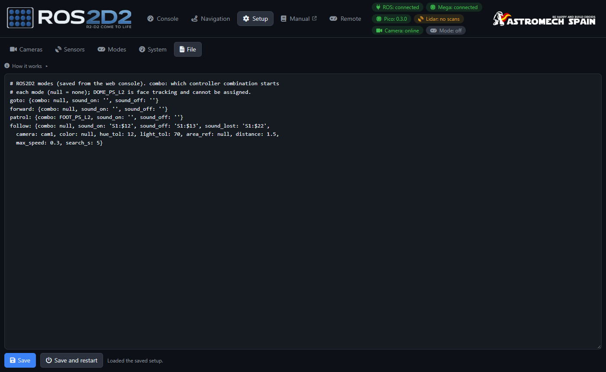

Los ajustes de la última pestaña que usaste, como texto (`sensors.yaml`, `modes.yaml`,
`cameras.yaml`...). Puedes editarlos aquí o a mano en la Pi (`~/.config/ros2d2/`): las dos cosas
editan el mismo fichero. **Save** comprueba el fichero antes y no guarda uno roto.
