

  

# Consola web de ROS2D2 · Manual de usuario

[English version](MANUAL.md)

La consola la sirve la Pi que va dentro de R2: abre `http://<pi>:8080` en cualquier navegador de la
misma red (la dirección de la Pi en la red de casa, o `10.42.0.1` en la WiFi propia de R2). Tiene tres
páginas, en la barra de arriba: **Console**, **Navigation** y **Setup**. El botón **Manual** abre este
manual (en inglés) por la parte de la página o pestaña en la que estás. Todos los botones tienen una
ayuda: deja el ratón encima.

Las píldoras junto al menú dicen cómo están las cosas: **rosbridge** (el enlace de la consola con
ROS), el **tracker** de caras, el **mode** automático, el **Mega** y la placa de la **Pico**. Verde
está bien, ámbar hay que mirarlo, rojo es que no está.

- [Console](#console)
- [Navigation](#navigation)
- [Setup](#setup): [Cameras](#setup--cameras) · [Sensors](#setup--sensors) · [Modes](#setup--modes) ·
  [System](#setup--system) · [File](#setup--file)

---

## Console

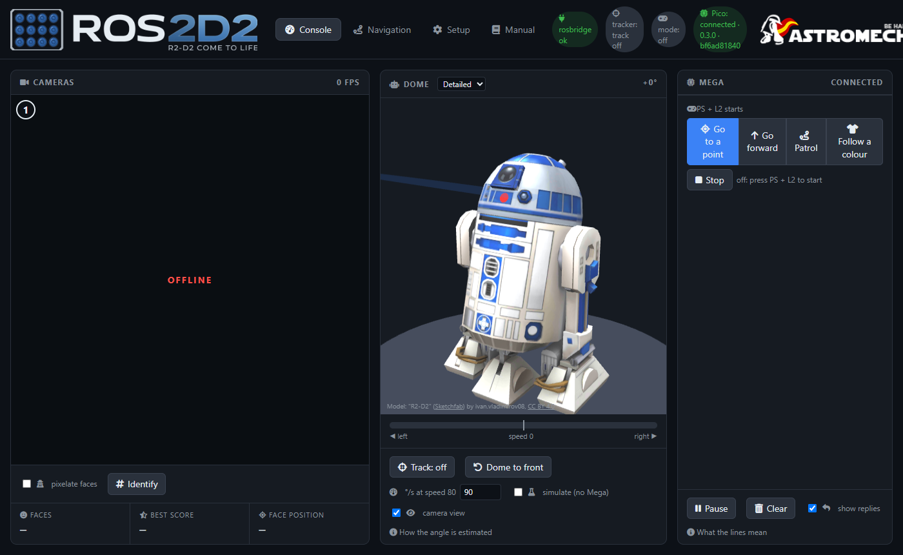

**Cameras**: lo que ven las cámaras de R2, numeradas de izquierda a derecha. *Identify* pone el
número de cada cámara sobre su imagen. *Pixelate faces* difumina las caras que encuentra (para fotos
y vídeos de eventos). Debajo: cuántas caras ve, la mejor puntuación y dónde está la mejor.

**Dome**: R2 en 3D con el dome girado como la Pi cree que está.

- La barra de debajo es la velocidad del dome (izquierda / derecha).
- *Track* enciende o apaga el seguimiento de caras: el dome gira para mirar a la cara más cercana.
- *Dome to front* lo vuelve a poner mirando al frente.
- El dome no tiene sensor de posición: su ángulo se calcula a partir de las órdenes de velocidad.
  Cronometra una vuelta entera a velocidad 80 y escribe `360 ÷ segundos` en **°/s at speed 80**.
- *Simulate (no Mega)* prueba el seguimiento sin Mega: las caras se mueven como si la cámara hubiera
  girado.
- *Camera view* dibuja hacia dónde mira la cámara.

**Mega**: lo que se manda al Mega (→) y lo que contesta (←). *Pause* para el desplazamiento de la
lista, *Clear* la vacía y *show replies* oculta o muestra las respuestas.

---

## Navigation

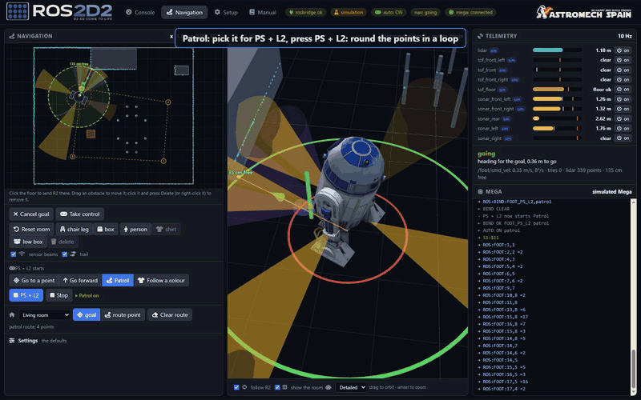

**Navigation (mapa)**: el suelo alrededor de R2 visto desde arriba. Los puntos del lidar son cian,
el haz de cada sensor va en su color, y el círculo verde discontinuo es el hueco libre alrededor de
R2 (con la distancia, *36 cm free*). **Haz clic en el suelo** para mandar a R2 allí (el destino es
una bandera verde); *Cancel goal* lo olvida. *Sensor beams* y *trail* muestran u ocultan los haces y
el camino que ha hecho R2. R2 solo va allí con el modo automático encendido (Go to a point, mira
[Modes](#setup--modes)).

**R2 en 3D**: lo mismo en 3D, con la nube de puntos del lidar y los conos de los sensores. Arrastra
para girar y usa la rueda para acercar. *Follow R2* lo mantiene en el centro; *Show the room* dibuja
la habitación simulada (solo en simulación, donde también se pueden añadir patas de silla y cajas y
arrastrarlas).

**Telemetry**: la lectura de cada sensor. La barra se llena cuanto más cerca está algo; la marca
roja es donde R2 se para por ese sensor, y la marca fina la lectura sin filtrar. En gris con
*ignored* es que ese sensor está ignorado (mira [Sensors](#setup--sensors)). Debajo: qué hace el
navegador y por qué, y si el Mega está conectado (sin él no llega nada a los foot).

---

## Setup

Setup tiene cinco pestañas. **Save** guarda los ajustes de la pestaña en la Pi (se aplican al
momento); **Save and restart** solo hace falta para la lista de cámaras.

### Setup → Cameras

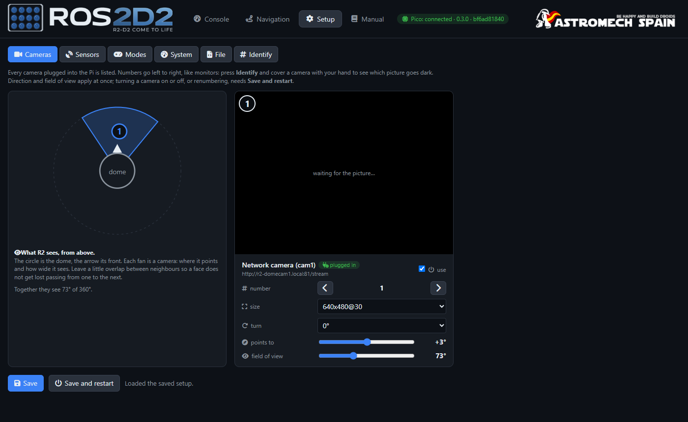

Cada cámara enchufada a la Pi, con:

- **use** (encendida o no), **number** (las flechas la mueven a la izquierda o a la derecha de la
  lista), **size** y **turn** (0, 90, 180, 270°),
- **points to** y **field of view**: hacia dónde mira en R2, para que el seguimiento con el dome sepa
  dónde está una cara.

*Identify* pone cada número sobre su imagen: tapa una cámara con la mano para ver qué imagen se pone
negra. La dirección y el campo de visión se aplican al momento; encender o apagar una cámara o
cambiar el orden necesita **Save and restart**.

### Setup → Sensors

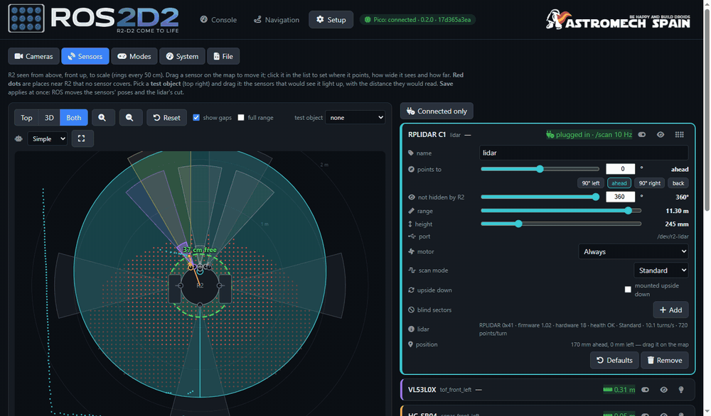

R2 visto desde arriba, a escala (anillos cada 50 cm), y R2 en 3D (*Top*, *3D* o *Both*).

- **Arrastra un sensor** por el mapa para moverlo. Haz clic en su tarjeta para ajustar hacia dónde
  **apunta**, lo ancho que ve (**field of view**), hasta dónde (**range**), su **altura**, cuánto se
  **inclina hacia abajo** y a qué distancia **se para** R2 por él.
- Los **puntos rojos** son sitios cerca de R2 que no cubre ningún sensor; los números bajo el mapa
  dicen cuánto suelo se cubre hasta 50 cm y hasta 1 m, y hacia dónde está ciego R2.
- **Test object**: elige uno (pata de silla, persona, pared, caja baja) y arrástralo: se iluminan
  los sensores que lo verían, con la distancia que leerían.
- **Add sensor** usa el primer conector libre de la placa de la Pico; **Remove** lo quita.
- Cada tarjeta dice si el sensor contesta (*plugged in*, *not responding*...). La bombilla hace
  parpadear el LED de su conector en la placa, para encontrarlo.

**In use / ignored**: el interruptor de cada tarjeta. Un sensor que da lecturas falsas se puede
ignorar con un clic: la navegación y el seguimiento dejan de usarlo en uno o dos segundos, pero sigue
midiendo y su lectura se queda en la tarjeta, en gris, para que veas cuándo vuelve a estar bien y lo
actives otra vez. El interruptor se guarda al momento (solo esa línea) y sigue ignorado tras
reiniciar. Si no queda ningún sensor en uso mirando hacia delante, la consola avisa: R2 no se moverá.

**La tarjeta del lidar** también ajusta el propio lidar:

- **Motor**: *Always*; *Only with an automatic mode* (con R2 quieto no hace ruido; al empezar un
  modo, espera hasta 5 s al lidar antes de moverse; el motor se para 5 s después del último modo);
  u *Off*.
- **Scan mode**: los modos que dice tener el lidar (un C1: *Standard*, 16 m; *DenseBoost*, 40 m).
  Cambiarlo reinicia solo el lidar unos segundos.
- **Upside down**: si va montado boca abajo.
- **Blind sectors**: ángulos de la vista del propio lidar que se ignoran (la pierna de R2), en rojo
  en el mapa.
- La línea **lidar**: modelo, firmware, hardware, salud, modo, vueltas por segundo y puntos por
  vuelta. La velocidad del C1 no se puede cambiar (gira a unas 10 vueltas por segundo).

**Save** se aplica al momento: ROS mueve los sensores y el recorte del lidar.

### Setup → Modes

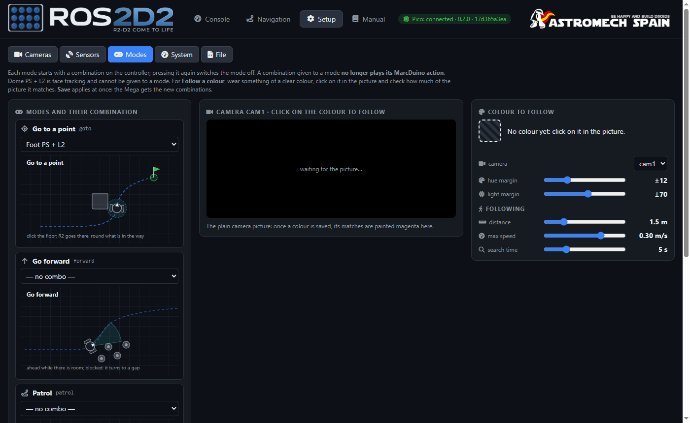

Cada modo automático se enciende con su propia **combinación del mando**; pulsarla otra vez lo
apaga, y tocar el stick devuelve el control al momento. Una combinación dada a un modo deja de hacer
su acción de MarcDuino. *Dome PS + L2* es el seguimiento de caras y no se puede dar a un modo.

| | |
|---|---|
| 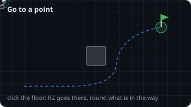 | 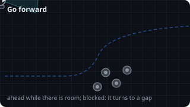 |
| 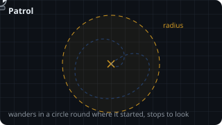 | 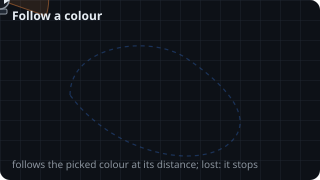 |

**Follow a colour**: ponte algo de un color claro, **haz clic sobre él en la imagen de la cámara** y
mira cuánto de la imagen coincide (lo que coincide se pinta en magenta). Sus deslizadores ajustan lo
parecido que tiene que ser el color, la distancia a mantener, la velocidad máxima y cuánto tiempo
busca cuando lo pierde. Con la cámara del dome ESP32-P4 (`firmware/r2_domecam_p4`) es la propia
cámara la que busca el color mientras R2 lo sigue, así que no viaja vídeo por la WiFi; con las demás
cámaras lo busca la Pi en el vídeo, como antes.

### Setup → System

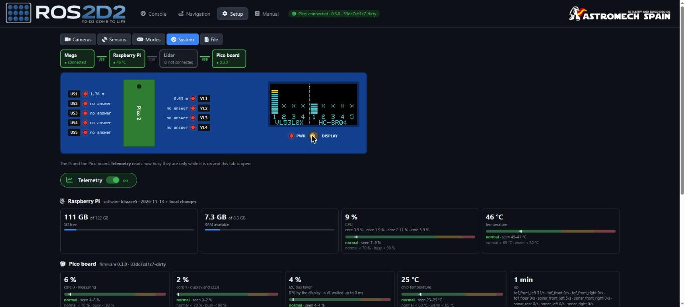

**Arriba, lo que la Pi detecta**: una tira con el Mega, la Pi, el lidar, la placa de la Pico y cada
cámara, en verde si están y en gris si no, unidos por los cables USB (verdes cuando están los dos
extremos). Sabertooth, SyRen, MarcDuino y los mandos no salen: la Pi no los puede ver.

**La placa de la Pico, en directo** (firmware de la Pico 0.3.0 o posterior): una copia de la placa
real. El LED de cada conector se enciende y parpadea como el real, con la lectura del sensor al
lado; también el LED verde de la propia Pico; la pantalla enseña la imagen de la pantalla real,
píxel a píxel. El botón **DISPLAY** funciona como el real: un clic es una pulsación y mantenerlo 3 s
apaga la pantalla (mientras lo mantienes se llena una barra). Si pulsas el botón de la placa, la
copia lo sigue. PWR se enciende cuando responde algún HC-SR04 (necesitan sus 5 V); si no responde
ninguno sale punteado, porque la Pico no lo puede saber. La placa solo manda esto mientras esta
pestaña está abierta.

**Telemetry** (el interruptor verde): lo ocupadas que van la Pi y la Pico, solo mientras está
encendido y esta pestaña abierta.

- **Raspberry Pi**: versión del software, SD libre, RAM libre, CPU, temperatura (con sus zonas
  normal, caliente y de freno) y avisos de tensión.
- **Placa de la Pico**: versión del firmware, carga de cada núcleo, el bus I2C, lecturas por segundo
  de cada sensor y temperatura.
- **Ajustes de la placa**: cuánto tiempo sigue encendida su pantalla, el brillo y cuándo se
  encienden sus LEDs (*only with the display on*, *always on*, *on, only the ones connected*,
  *always off*, *only the ones failing*); encender la pantalla (con la pantalla que elijas) o
  apagarla; *Identify* hace parpadear el LED de un conector.
- **Firmware de la Pico**: *Check for update* pregunta a GitHub; *Flash firmware* lo descarga,
  compila y graba desde la Pi (unos minutos; no mientras conduce un modo automático). Si la copia
  falla, *Retry* lo vuelve a copiar sin compilar.

### Setup → File

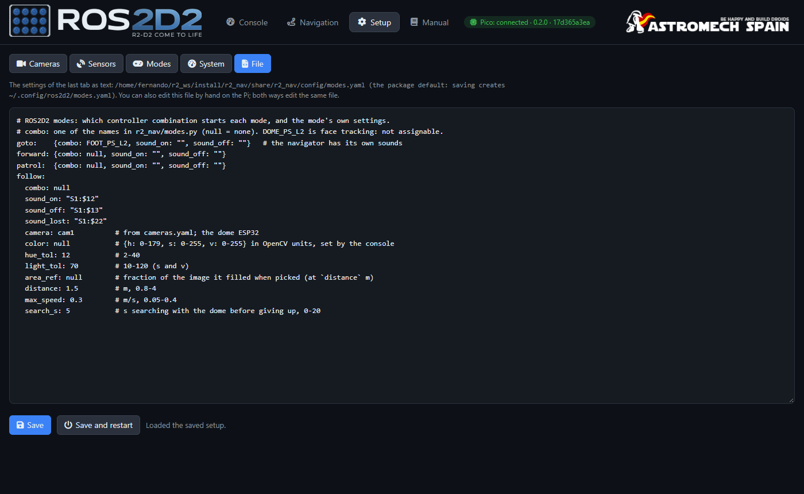

Los ajustes de la última pestaña que usaste, como texto (`sensors.yaml`, `modes.yaml`,
`cameras.yaml`...). Puedes editarlos aquí o a mano en la Pi (`~/.config/ros2d2/`): las dos cosas
editan el mismo fichero. **Save** comprueba el fichero antes y no guarda uno roto.
