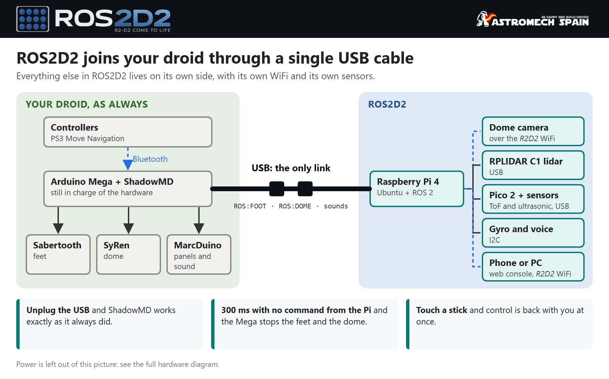
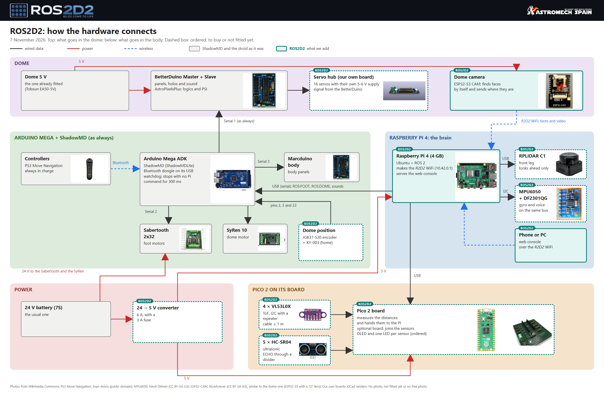

# ROS2D2

<picture>
  <source media="(prefers-color-scheme: dark)" srcset="media/ros2d2-logo-dark.png">
  
</picture>

> **Work in progress: everything here is still being tested.** Parts run in the simulator and on
> the bench; testing on the droid is under way. Not yet a recipe to follow on your own droid.

A ROS 2 brain for an R2-D2 that runs ShadowMD. It works with [ShadowMD Lite](https://github.com/BeskarCode/ShadowMDLite) or with the classic Shadow MD ([SHADOW_MD_EEBEL](https://github.com/BeskarCode/SHADOW_MD_EEBEL)); in both it is enabled with `ENABLE_ROS2D2`, off by default. A Raspberry Pi 4 sits on top of the
droid's Arduino Mega: the Pi handles the senses (cameras, voice, later a lidar) and
decides what to do, and the Mega keeps driving the motors, sounds and lights.

The controller always wins: touch the stick and control is back with you at once.
The Mega also stops the dome if the Pi goes quiet for 300 ms.



First demo: the dome turns to look at you. It is the [DomeTracker](https://github.com/BeskarCode/DomeTracker)
proof of concept, split into ROS 2 nodes.

```
 camera ──image_raw──> face detector ──faces──> dome tracker ──/dome/speed_cmd──> Mega bridge ──DM:<speed>──> Mega
```

## Hardware

What ROS2D2 adds to a ShadowMD droid, how it connects and the bill of materials: [HARDWARE.md](HARDWARE.md).

[](HARDWARE.md)

## Packages (`ros2_ws/src`)

| Package | Node | What it does |
|---|---|---|
| `r2_camera` | `camera_node` | USB or network (ESP32-CAM) camera, one instance per camera |
| `r2_vision` | `face_detector` | OpenCV YuNet face detector, closest face first |
| `r2_dome_tracker` | `dome_tracker` | Dome speed from the face position (control law tuned on the droid) |
| `r2_shadow_bridge` | `mega_bridge`, `foot_calibrate` | The only node that talks to the Mega over USB serial; the feet move only in autonomous mode (PS + L2 on the foot controller), the dome only with face tracking on (PS + L2 on the dome controller); the two are independent |
| `r2_imu` | `imu_node` | MPU6050 gyro and accelerometer over I2C, plus a Madgwick filter |
| `r2_sensors` | `sensor_tf`, `fake_lidar`, `scan_crop` | Where the lidar and the distance sensors (VL53L0X, HC-SR04 on a Pico) sit, from `sensors.yaml` (edited in the web console: Setup → Sensors), on `/tf_static`; the lidar's `/scan` cut to what the droid does not hide; a pretend lidar with `lidar:=sim` |
| `r2_pico_bridge` | `pico_bridge`, `fake_pico` | Talks to the Raspberry Pi Pico that reads the distance sensors (`firmware/r2_pico_sensors`, on `/dev/r2-pico`): sends it the sensors and pins from `sensors.yaml` (again on every save), publishes `/range/<name>` for each sensor that answers and `/pico/state` (JSON) for the console. Not started with `sim:=true` (the simulator has its own `/range`) or `pico:=false`. Flash the Pico from the PC with `firmware/r2_pico_sensors/flash.sh` |
| `r2_web` | `web_console` | Web console on port 8080: cameras, faces, 3D dome, camera and sensor setup |
| `r2_bringup` | | Launch files: `ros2 launch r2_bringup dome_tracker.launch.py` |

## Raspberry Pi setup

Ubuntu Server 24.04 (64-bit) on a Pi 4, then:

```
sudo bash setup/setup_r2_brain.sh
```

It installs ROS 2 Jazzy, the camera and web tools, and the serial port permissions.
Takes 1.5 to 2.5 hours, mostly waiting on the microSD: use a fast A2 card.

From then on, to put the code of this computer on the Pi (Git Bash on the computer):

```
PI=<your-user>@<pi-address> setup/deploy.sh              # every package, or name some: r2_web r2_nav
```

It copies `ros2_ws/src`, rebuilds what it copied and writes `~/r2_ws/VERSION` (the commit),
which the web console shows in Setup -> System.

So that the console can check GitHub for new Pico firmware and flash it (Setup -> System ->
Pico firmware), once, on the Pi as the ROS2D2 user (not root):

```
setup/install_pico_toolchain.sh
```

It installs `arduino-cli` with the Pico core and libraries (about 2 GB, a few minutes), a copy
of the repo's `firmware/` in `~/ros2d2-firmware`, and `/usr/local/sbin/r2-pico-flash` with a
sudoers rule for that one script. A build on a Pi 4 takes 2 to 3 minutes.

### Naming the USB devices (lidar, Mega, Pico)

ROS2D2 finds its USB serial devices by fixed names: `/dev/r2-mega`, `/dev/r2-lidar` and
`/dev/r2-pico`. Genuine Megas and the Pico get theirs on their own. The RPLIDAR C1's USB
adapter uses a common chip (CP210x) that a Mega clone can also have, so it is named by its
serial number, once:

```
./setup/r2-usb-names.sh                       # lists the ports: plug in the lidar and find its line
sudo ./setup/r2-usb-names.sh r2-lidar ttyUSB0 # the device now on ttyUSB0 is /dev/r2-lidar from now on
sudo systemctl restart r2d2
```

With `/dev/r2-lidar` present, the lidar starts with the droid (`lidar:=auto`) and its scan
shows in the web console (Sensors and Navigation). Its driver runs in its own service,
`r2d2-lidar` (installed by `setup_r2_brain.sh`): udev starts it when the lidar is plugged in and
systemd stops it when it is unplugged, so the lidar comes back on its own after being unplugged,
without restarting the rest (`journalctl -u r2d2-lidar -f` to watch it). If `/etc/default/r2d2` still has
`sim:=true` or `lidar:=sim` in `R2D2_ARGS` (from testing without the lidar), take it out:
in the simulation the real lidar is not started. The same command names a Mega clone
(`r2-mega`).

## Test bench on a PC (Docker)

The same ROS 2 Jazzy in a container, with a video file or a webcam instead of the
dome camera and a fake Mega (a socat pty pair) instead of the real one:

```
docker build -t ros2d2-dev docker
docker run --rm -v <this folder>:/r2 -v <video folder>:/media ros2d2-dev \
    bash /r2/docker/bench.sh /media/video.mp4 25
```

With a webcam on Windows, `python docker/webcam_mjpeg.py 1` serves it as an MJPEG
stream (the same format as an ESP32-CAM) and opens a test page at
<http://localhost:8081/> with Start and Stop buttons. See the top of `docker/bench.sh`.

## Credits

ROS2D2 is created by **NandoMadrid** ([R2-D2 by NandoMadrid](https://www.astromechspain.com/droides/r2-d2-nandomadrid/)), member of [Astromech Spain](https://www.astromechspain.com).
