# ROS2D2

<picture>
  <source media="(prefers-color-scheme: dark)" srcset="media/ros2d2-logo-dark.png">
  
</picture>

**Autonomy for an R2-D2 that runs ShadowMD.** A Raspberry Pi with ROS 2 adds the senses (camera,
lidar, distance sensors) and decides where to go; the droid's Arduino Mega keeps driving the
motors, sounds and lights. **The controller always wins.**

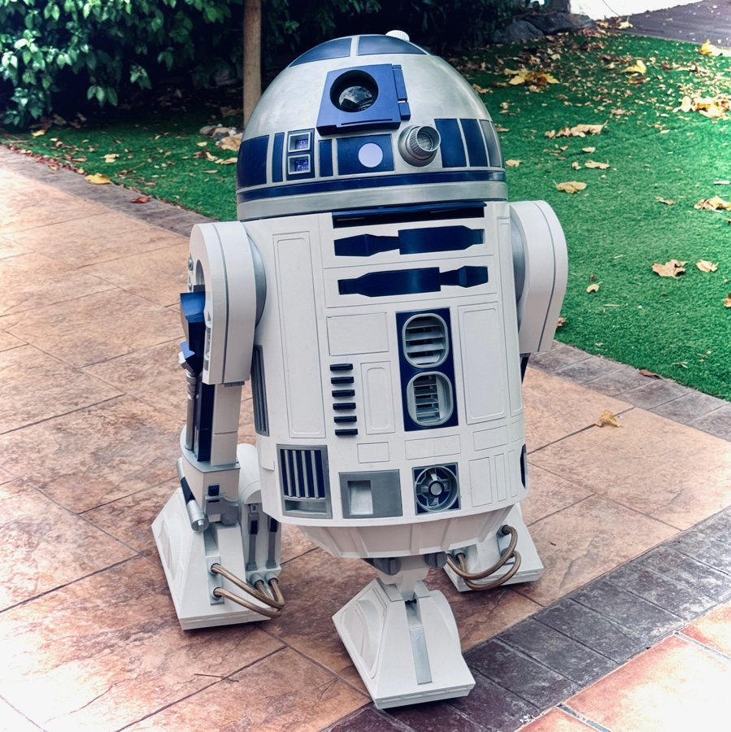

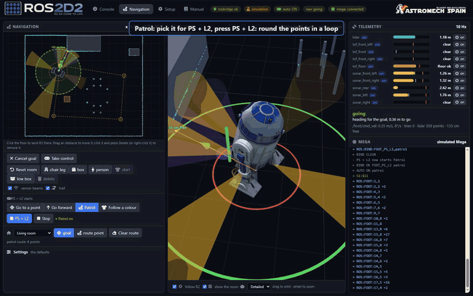

[Video](https://youtu.be/Smfn6zQICm0) · [Build thread on astromech.net](https://astromech.net/forums/showthread.php?47099) · [User manual](MANUAL.md) ([castellano](MANUAL_es.md)) · [Hardware](HARDWARE.md) · [The box](hardware/ros2_box_rack_v3)

## What it does

- **The dome follows your face**: a camera and the OpenCV YuNet face detector.
- **Four automatic modes**, each started from the controller: go to a point, go forward, patrol,
  follow a colour.
- **Sees around itself**: an RPLIDAR C1, VL53L0X and HC-SR04 distance sensors read by a
  Raspberry Pi Pico, and an MPU6050 IMU.
- **Web console** in any browser: the floor around R2 with the lidar's points, R2 in 3D, cameras,
  sensor setup, Pico firmware updates.
- **Safe by design**: touch the stick and control is back with you at once; the Mega stops the
  dome if the Pi goes quiet for 300 ms.
- **Plugs into your droid with one USB cable**: works with
  [ShadowMD Lite](https://github.com/BeskarCode/ShadowMDLite) (a fork of the original Shadow MD)
  or the classic Shadow MD ([SHADOW_MD_EEBEL](https://github.com/BeskarCode/SHADOW_MD_EEBEL));
  in both it is enabled with `ENABLE_ROS2D2`, off by default.
- **Printable hardware**: a rack box for the Pi, the Pico board and the 24 → 5 V converter, and
  tilting sensor mounts.
- **Try it without a droid**: a simulator with rooms, and a Docker test bench on a PC.

> **Status: work in progress.** It runs in the simulator and on the bench; testing on the droid is
> under way. Not yet a recipe to follow on your own droid, but questions and ideas are very
> welcome: open an issue or reply in the [build thread](https://astromech.net/forums/showthread.php?47099).

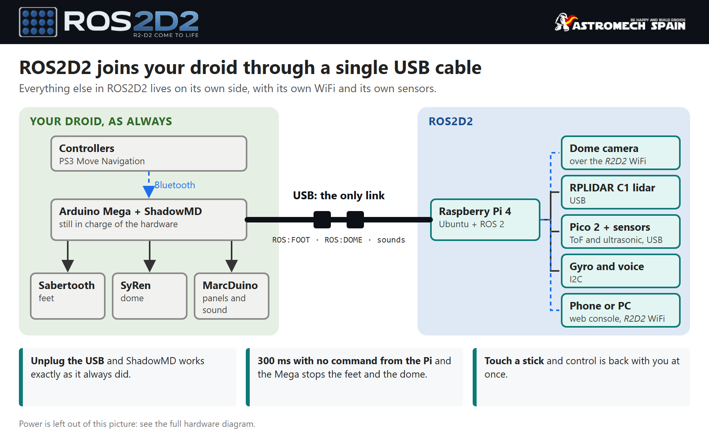

## How it works

A Raspberry Pi 4 sits on top of the droid's Arduino Mega and talks to it over USB serial. The first
demo, the dome turning to look at you, is the [DomeTracker](https://github.com/BeskarCode/DomeTracker)
proof of concept split into ROS 2 nodes:

```
 camera ──image_raw──> face detector ──faces──> dome tracker ──/dome/speed_cmd──> Mega bridge ──DM:<speed>──> Mega
```

## The web console

ROS2D2 has its own web console, served by the Pi (`http://<pi>:8080`), to watch and set up the droid
from any browser.
Everything it does, page by page: the **[user manual](MANUAL.md)** ([en castellano](MANUAL_es.md)); its
**Manual** button opens it at the page you are on.

**Navigation**: the floor around R2 seen from above with the lidar's points, the free circle and
each sensor's beam, R2 in 3D, and every sensor's reading. Click the floor to send R2 there.


**Setup → Sensors**: where each sensor sits and what it covers. Drag a test object round R2 and the
sensors that would see it light up; switch a sensor that gives false readings to *ignored* in one
click; set the lidar (motor, scan mode, blind sectors) and read what it says about itself.

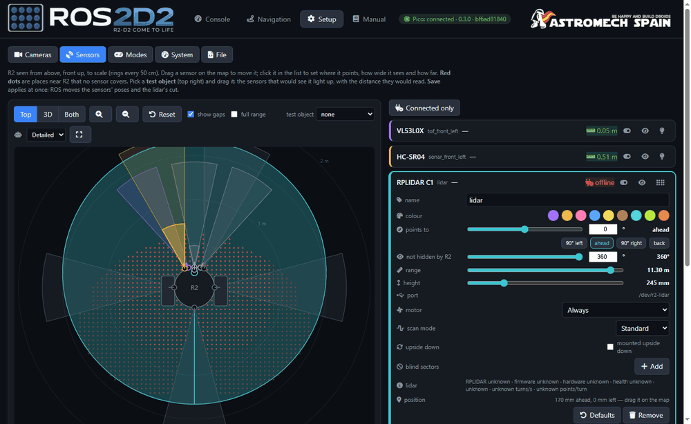

**Setup → Modes**: each automatic mode starts with its own controller combination. What each one does:

| | |
|---|---|
| 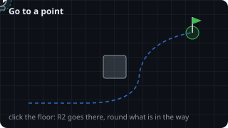 | 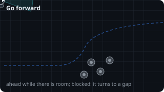 |
| 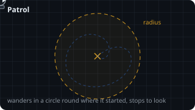 | 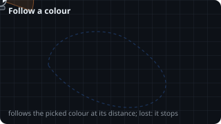 |

## Hardware

What ROS2D2 adds to a ShadowMD droid, how it connects and the bill of materials: [HARDWARE.md](HARDWARE.md).

[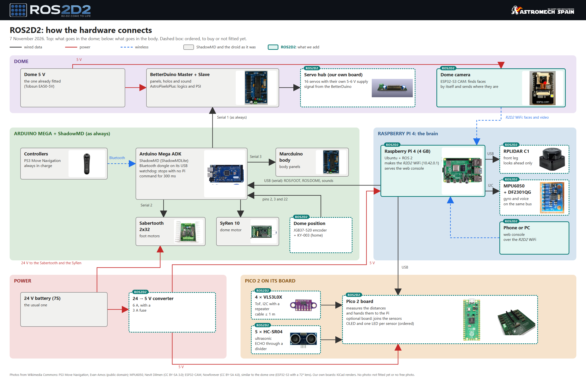](HARDWARE.md)

### The box

The Raspberry Pi, the Pico sensor board and the 24 → 5 V converter go in a 3D-printed rack box
(62 × 95 × 145 mm): the sensors plug in from outside through bays in its face, the XT60 and the switch sit
on a fixed front, and removable ears mount it standing or lying down. STL, print guide
([ES](hardware/ros2_box_rack_v3/print_guide/GUIA_IMPRESION.md) · [EN](hardware/ros2_box_rack_v3/print_guide/PRINT_GUIDE.md))
and step-by-step assembly ([ES](hardware/ros2_box_rack_v3/MONTAJE.md) · [EN](hardware/ros2_box_rack_v3/ASSEMBLY.md)) in
[`hardware/ros2_box_rack_v3`](hardware/ros2_box_rack_v3).

<a href="hardware/ros2_box_rack_v3">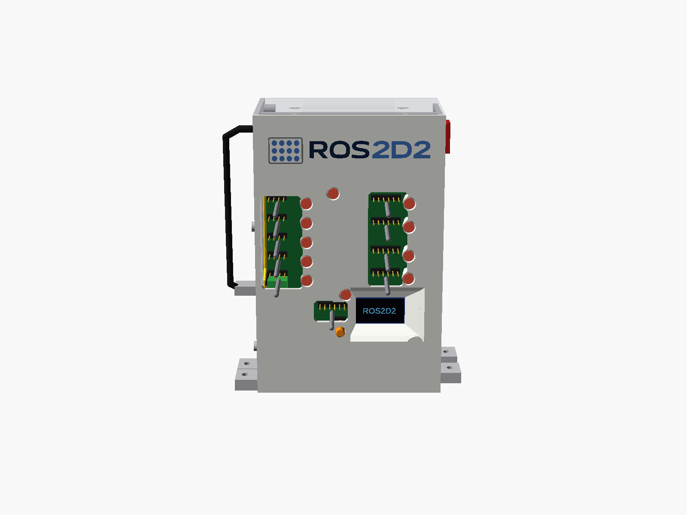</a>

### Sensor mounts

Tilting mounts for the HC-SR04 and the VL53L0X, adjustable in 10° steps from −30° to +90°:
[`hardware/sensor_mounts`](hardware/sensor_mounts).

<a href="hardware/sensor_mounts">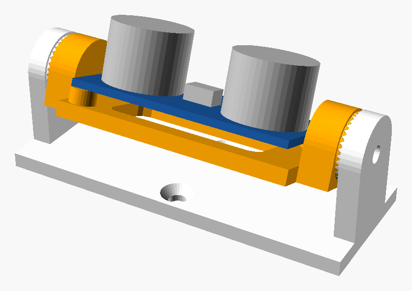</a>

## Packages (`ros2_ws/src`)

| Package | Node | What it does |
|---|---|---|
| `r2_camera` | `camera_node` | USB or network (ESP32-P4 dome) camera, one instance per camera |
| `r2_vision` | `face_detector` | OpenCV YuNet face detector, closest face first |
| `r2_dome_tracker` | `dome_tracker` | Dome speed from the face position (control law tuned on the droid) |
| `r2_shadow_bridge` | `mega_bridge`, `foot_calibrate` | The only node that talks to the Mega over USB serial; the feet move only in autonomous mode (PS + L2 on the foot controller), the dome only with face tracking on (PS + L2 on the dome controller); the two are independent |
| `r2_imu` | `imu_node` | MPU6050 gyro and accelerometer over I2C, plus a Madgwick filter |
| `r2_sensors` | `sensor_tf`, `fake_lidar`, `scan_crop`, `lidar_motor` | Where the lidar and the distance sensors (VL53L0X, HC-SR04 on a Pico) sit, from `sensors.yaml` (edited in the web console: Setup → Sensors), on `/tf_static`; the lidar's `/scan` cut to what the droid does not hide; a pretend lidar with `lidar:=sim` |
| `r2_pico_bridge` | `pico_bridge`, `fake_pico` | Talks to the Raspberry Pi Pico that reads the distance sensors (`firmware/r2_pico_sensors`, on `/dev/r2-pico`): sends it the sensors and pins from `sensors.yaml` (again on every save), publishes `/range/<name>` for each sensor that answers and `/pico/state` (JSON) for the console. Not started with `sim:=true` (the simulator has its own `/range`) or `pico:=false`. Flash the Pico from the PC with `firmware/r2_pico_sensors/flash.sh` |
| `r2_nav` | `navigator`, `follow` | The automatic modes: go to a point, go forward and patrol (`navigator`), follow a colour (`follow`); they stop for anything the lidar or the distance sensors see in their way |
| `r2_sim` | `sim_world`, `fake_mega` | Simulator: rooms, a pretend R2 and a pretend Mega, to try the modes and the console without a droid (`sim:=true`) |
| `r2_web` | `web_console` | Web console on port 8080: cameras, faces, 3D dome, camera and sensor setup |
| `r2_bringup` | | Launch files: `ros2 launch r2_bringup dome_tracker.launch.py` |

## Raspberry Pi setup

Ubuntu Server 24.04 (64-bit) on a Pi 4, then:

```
sudo bash setup/setup_r2_brain.sh
```

It installs ROS 2 Jazzy, the camera and web tools, and the serial port permissions.
Takes 1.5 to 2.5 hours, mostly waiting on the microSD: use a fast A2 card.

From then on, to put the code of this computer on the Pi (Git Bash on the computer):

```
PI=<your-user>@<pi-address> setup/deploy.sh              # every package, or name some: r2_web r2_nav
```

It copies `ros2_ws/src`, rebuilds what it copied and writes `~/r2_ws/VERSION` (the commit),
which the web console shows in Setup -> System.

So that the console can check GitHub for new Pico firmware and flash it (Setup -> System ->
Pico firmware), once, on the Pi as the ROS2D2 user (not root):

```
setup/install_pico_toolchain.sh
```

It installs `arduino-cli` with the Pico core and libraries (about 2 GB, a few minutes), a copy
of the repo's `firmware/` in `~/ros2d2-firmware`, and `/usr/local/sbin/r2-pico-flash` with a
sudoers rule for that one script. A build on a Pi 4 takes 2 to 3 minutes.

### Naming the USB devices (lidar, Mega, Pico)

ROS2D2 finds its USB serial devices by fixed names: `/dev/r2-mega`, `/dev/r2-lidar` and
`/dev/r2-pico`. Genuine Megas and the Pico get theirs on their own. The RPLIDAR C1's USB
adapter uses a common chip (CP210x) that a Mega clone can also have, so it is named by its
serial number, once:

```
./setup/r2-usb-names.sh                       # lists the ports: plug in the lidar and find its line
sudo ./setup/r2-usb-names.sh r2-lidar ttyUSB0 # the device now on ttyUSB0 is /dev/r2-lidar from now on
sudo systemctl restart r2d2
```

With `/dev/r2-lidar` present, the lidar starts with the droid (`lidar:=auto`) and its scan
shows in the web console (Sensors and Navigation). Its driver runs in its own service,
`r2d2-lidar` (installed by `setup_r2_brain.sh`): udev starts it when the lidar is plugged in and
systemd stops it when it is unplugged, so the lidar comes back on its own after being unplugged,
without restarting the rest (`journalctl -u r2d2-lidar -f` to watch it). If `/etc/default/r2d2` still has
`sim:=true` or `lidar:=sim` in `R2D2_ARGS` (from testing without the lidar), take it out:
in the simulation the real lidar is not started. The same command names a Mega clone
(`r2-mega`).

### Ignoring a sensor (Setup → Sensors)

Each sensor's card has an in use / ignored switch (next to its eye). A sensor that gives false
readings can be ignored at once: navigation and follow stop using it within a second or two, but it
keeps measuring and its card still shows its reading, greyed, so you can see when it is back and
switch it on again. The switch saves only that sensor's `enabled` line in `sensors.yaml` (any other
change in the cards still waits for Save); it stays ignored after a restart. Ignoring the last thing
that looks ahead shows a warning: with nothing ahead, navigation does not move. An ignored lidar
keeps spinning as its motor setting says, but the modes treat R2 as having no lidar.

### The lidar's settings (Setup → Sensors)

The lidar's card in the web console also sets the lidar itself, kept in `sensors.yaml`:

- **motor**: `always` (the default), `with_modes` (spins only while an automatic mode is on; a mode
  that starts waits up to 5 s for the first scan, then drives as without a lidar; the motor stops
  5 s after the last mode goes off) or `off`. The `lidar_motor` node does it with the driver's
  `start_motor` / `stop_motor`.
- **scan mode**: the modes the lidar says it has (a C1: Standard, 16 m; DenseBoost, 40 m).
  Changing it, or **upside down**, restarts only `r2d2-lidar`.
- **blind sectors**: angles of the lidar's own view `scan_crop` ignores (R2's leg); they mirror with
  upside down, and show shaded on the top-down map.
- the lidar's **info**: model, firmware, hardware, health, mode, turns per second and points per turn.

The speed of a C1's motor cannot be changed: asked for 480, 900 or 1200 rpm it keeps turning at
about 10.5 turns per second. The info and the mode list come from `/lidar/info`, which our fork of
`sllidar_ros2` publishes (`SLLIDAR_COMMIT` in `setup/setup_r2_brain.sh`); without it the card shows
`unknown` and the two C1 modes. Our fork also makes `start_motor` resume the configured scan mode
and `stop_motor` really stop a C1.

## Test bench on a PC (Docker)

The same ROS 2 Jazzy in a container, with a video file or a webcam instead of the
dome camera and a fake Mega (a socat pty pair) instead of the real one:

```
docker build -t ros2d2-dev docker
docker run --rm -v <this folder>:/r2 -v <video folder>:/media ros2d2-dev \
    bash /r2/docker/bench.sh /media/video.mp4 25
```

With a webcam on Windows, `python docker/webcam_mjpeg.py 1` serves it as an MJPEG
stream (the same format as an ESP32-CAM) and opens a test page at
<http://localhost:8081/> with Start and Stop buttons. See the top of `docker/bench.sh`.

## Credits and contact

Questions, ideas and build reports: the [ROS2D2 thread on astromech.net](https://astromech.net/forums/showthread.php?47099)
or a GitHub issue.

ROS2D2 is created by **NandoMadrid** ([R2-D2 by NandoMadrid](https://www.astromechspain.com/droides/r2-d2-nandomadrid/)), member of [Astromech Spain](https://www.astromechspain.com).

## License

[MIT](LICENSE). Bundled third-party files keep their own licenses: three.js and Font Awesome
(`ros2_ws/src/r2_web/www/vendor`), and the YuNet face detection model from the
[OpenCV Zoo](https://github.com/opencv/opencv_zoo) (`ros2_ws/src/r2_vision/models`).
