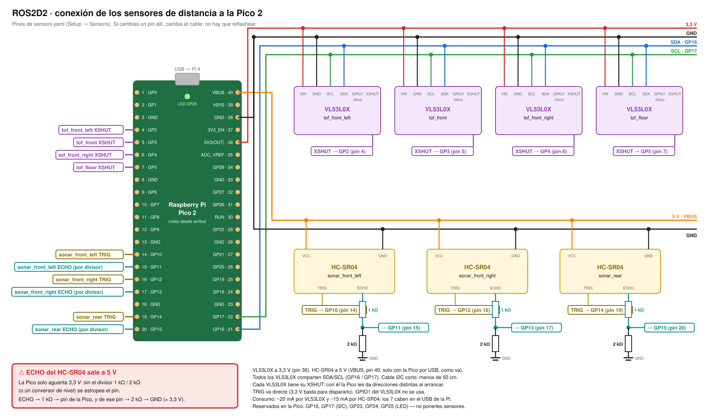

# r2_pico_sensors

A Raspberry Pi **Pico 2** (RP2350) that reads R2's distance sensors (VL53L0X ToF and
HC-SR04 ultrasonic) and sends the readings to the Pi 4 over USB. The Pico only measures:
stopping the feet is the Pi's job.

The Pico has no pins built in. The Pi sends it the sensors and their pins from
`sensors.yaml` (Setup → Sensors in the web console), so moving a sensor to another pin
needs no new firmware: change it in the console, save, and move the wire.

## Wiring



`wiring.svg` opens in any browser and prints on A4 landscape (`python wiring.py wiring.svg`
draws it again). With today's `sensors.yaml`:

| Sensor | Type | Pico pin | GPIO | Wire |
|---|---|---|---|---|
| all VL53L0X | VIN | 36 `3V3(OUT)` | — | red |
| all HC-SR04 | VCC | 40 `VBUS` (5 V) | — | orange |
| all | GND | 38 (or any GND) | — | black |
| all VL53L0X | SDA | 21 | GP16 | blue |
| all VL53L0X | SCL | 22 | GP17 | green |
| tof_front_left | XSHUT | 4 | GP2 | purple |
| tof_front | XSHUT | 5 | GP3 | purple |
| tof_front_right | XSHUT | 6 | GP4 | purple |
| tof_floor | XSHUT | 7 | GP5 | purple |
| sonar_front_left | TRIG / ECHO | 14 / 15 | GP10 / GP11 | yellow / teal |
| sonar_front_right | TRIG / ECHO | 16 / 17 | GP12 / GP13 | yellow / teal |
| sonar_rear | TRIG / ECHO | 19 / 20 | GP14 / GP15 | yellow / teal |

- **The HC-SR04's ECHO is 5 V; the Pico takes 3.3 V.** Always through a divider: ECHO →
  1 kΩ → Pico pin, and Pico pin → 2 kΩ → GND (or a level shifter). Without it the pin dies.
  TRIG goes straight (3.3 V triggers it).
- VBUS is 5 V only while the Pico is powered by USB (it is: from the Pi).
- About 20 mA per VL53L0X and 15 mA per HC-SR04: all seven fit on the Pi's USB.
- Wired straight to the Pico, keep the I2C wires (SDA/SCL) short, under 50 cm (on the carrier board
  every VL connector sits behind its I2C repeater and takes up to 1 m). The VL53L0X's GPIO1 is not used.
- **Reserved, never for a sensor:** GP16 and GP17 (I2C); GP0, GP1, GP6-GP9, GP22, GP27 and
  GP28 (the carrier board's status LEDs) and GP26 (its button); GP23, GP24, GP25 (the Pico's own: GP25 is the LED). The console does not
  offer them.

## The carrier board

`hardware/r2_pico_carrier` is a board to order assembled: the Pico plugs in, and each sensor
has its own connector (VL1-VL4, US1-US5), the ECHO dividers are on it, and it adds a 5 V input,
one status LED per connector, each on its own GPIO (VL1-VL4 = GP28, GP27, GP22, GP9;
US1-US5 = GP0, GP1, GP6, GP7, GP8), and an OLED display with a button (GP26). The firmware
handles them on the RP2350's second core; without the board, nothing changes. Those GPIOs are
therefore reserved too, which leaves GP2-5, GP10-15 and GP18-21 for sensors. See its README.

The display: off until the button is pressed; then the logo; the next press every sensor at
once, one bar each (taller the nearer the obstacle); then each press one connector, VL1 to US5,
and after US5 every sensor again. 30 s without a press: off. `wokwi/` runs it in the browser
(see its README).

## LED

- Slow blink (once a second): running, but the Pi has not sent the sensors yet.
- On, with a short flicker on each batch of readings: measuring.

## Build and flash

Once, on the computer: `arduino-cli` with the Pico core and the VL53L0X library:

```
arduino-cli config add board_manager.additional_urls https://github.com/earlephilhower/arduino-pico/releases/download/global/package_rp2040_index.json
arduino-cli core update-index
arduino-cli core install rp2040:rp2040
arduino-cli lib install VL53L0X
```

The first time, the Pico has no firmware: hold BOOTSEL while plugging it into the Pi. It
shows up as a USB drive labelled `RP2350`; copy `build/r2_pico_sensors.ino.uf2` onto it.

From then on, from Git Bash on the computer:

```
PI=<your-user>@<pi-address> firmware/r2_pico_sensors/flash.sh
```

It builds, copies the `.uf2` to the Pi, stops the `r2d2` service, restarts the Pico into
its USB loader (1200 baud on `/dev/r2-pico`), copies the file and starts the service again.
No BOOTSEL. Host test of the CFG parser: `g++ -std=c++17 -I. test/test_config.cpp && ./a.out`.

## Protocol (USB serial, one line each, ASCII)

Pi → Pico:

| Line | Answer |
|---|---|
| `HELLO` | `PICO r2_pico_sensors <fw> proto 1` |
| `CFG` + up to 12 items: `V:<xshut>` (VL53L0X) or `S:<trig>:<echo>` (HC-SR04); a sensor's index is its place in the line; `CFG` alone = none | `CFG OK <n>` or `CFG ERR <why>` (`bad item <k>`, `pin <p> reserved`, `pin <p> twice`, `too many`). After an error the Pico has no sensors until the next good `CFG`. |
| `BOOT` | none: the Pico restarts into its USB loader (for flashing) |
| anything else | `ERR unknown` (a line over 200 characters: `ERR too long`) |

Pico → Pi:

| Line | When |
|---|---|
| `HB <ms> <states>` | every second. `<states>` is `-` with no `CFG` yet, else one letter per sensor: `O` answers, `N` not answering. E.g. `HB 12034 NNNNNNN`. |
| `R <i>:<mm> <i>:<mm> …` | every 50 ms, the sensors with a new reading since the last `R`. `-1` = answers, nothing in range. |

The Pi (`r2_pico_bridge`) sends `HELLO` and `CFG` when it opens the port, and `CFG` again
when a `HB` shows `-` or a different number of sensors, or when `sensors.yaml` changes.
A sensor that does not answer is retried every 2 s, so one plugged in later shows up alone.
