# Caja ROS2 · Instrucciones de montaje

[English version](ASSEMBLY.md)

Caja mini torre para la Raspberry Pi 4, la placa de la Pico, el convertidor 24 → 5 V, el XT60 y el interruptor. Antes de imprimir mide lo que indica el README (XT60, interruptor, agujeros del convertidor, altura del pulsador y del ventilador).

| Montada | Por detrás |
|---|---|
| 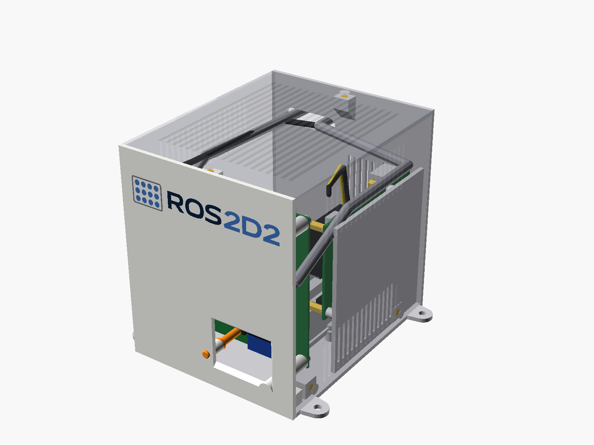 | 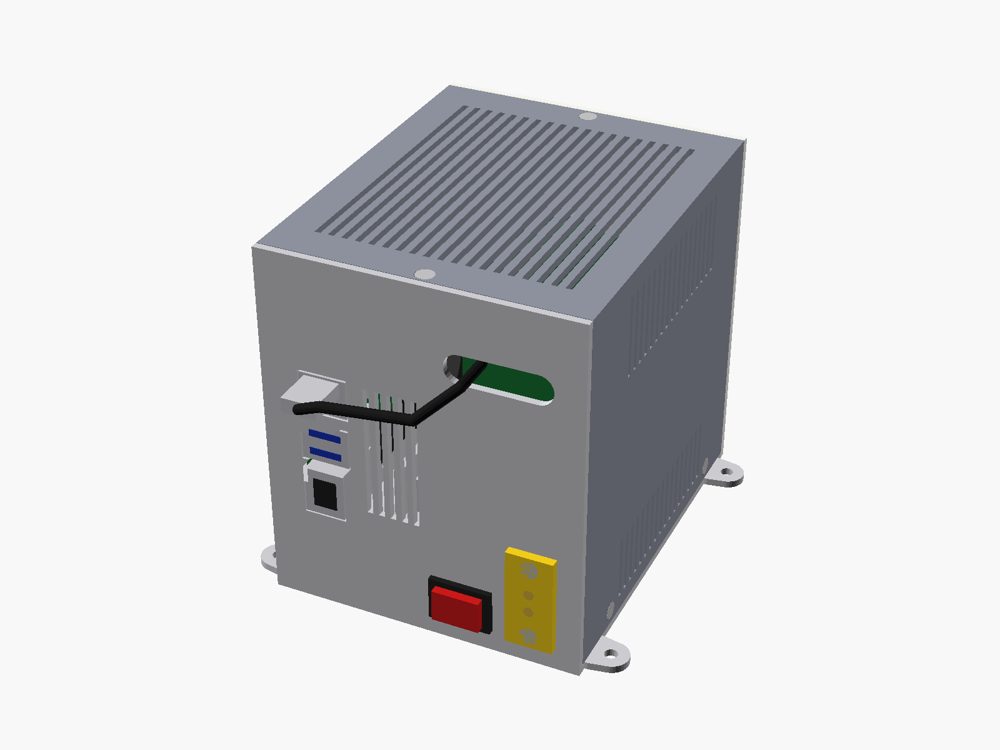 |

**Información actualizada, STL y fuentes:** <https://github.com/BeskarCode/ROS2D2/tree/main/hardware/caja_ros2>

## Tamaño frente al R2

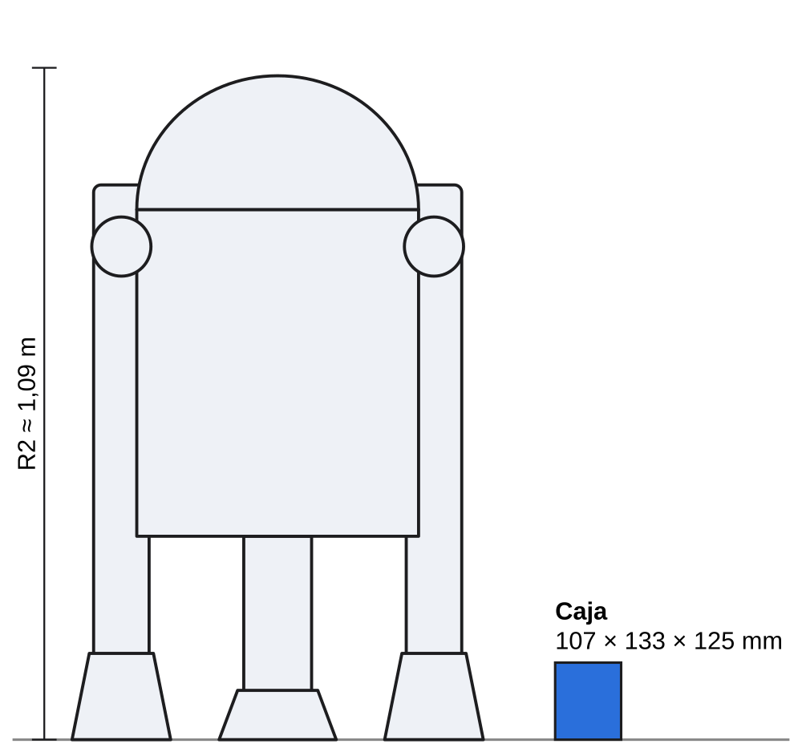

## Por dentro (sin carcasa)

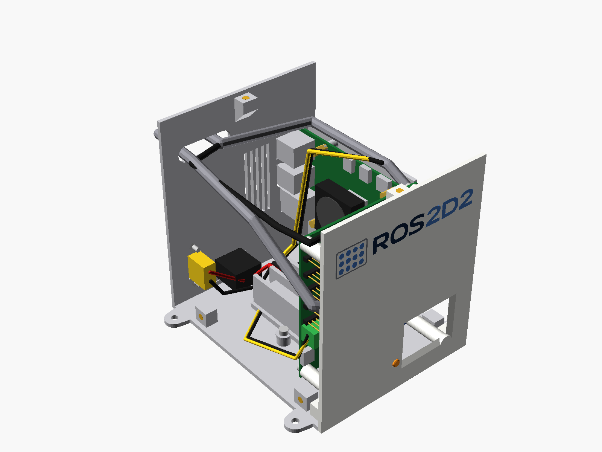

## Despiece

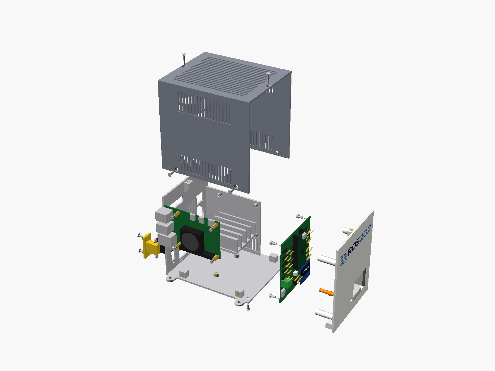

## Tornillería y material

### Piezas impresas

| Pieza | |
|---|---|
| `stl/frontal_multicolor_bambu.3mf` | Frontal con el logo en 4 colores (AMS: blanco, marino, azul, gris) |
| `stl/frontal_monocolor.stl` | o bien: frontal de un color, logo grabado |
| `stl/base.stl` | Base: suelo, trasera, soporte de la Pi |
| `stl/carcasa.stl` | Carcasa en U (techo + laterales) |
| `stl/pulsador.stl` | Varilla del pulsador DISPLAY |

| Cant. | Pieza | Paso |
|---|---|---|
| 14× | Inserto térmico M3 (5,7 mm de largo, agujero de 4,0 mm) | 1 |
| 8× | Tornillo M3 × 8 de cabeza avellanada (ISO 10642) | 6, 7 |
| 4× | Tornillo M3 × 6 de cabeza alomada (ISO 7380) | 5 |
| 2× | Tornillo M3 × 6 de cabeza cilíndrica (DIN 912) | 2 |
| 2× | Tornillo M3 × 10 de cabeza avellanada (ISO 10642) | 3 |
| 2× | Tuerca M3 (DIN 934) | 3 |
| 4× | Tornillo M2.5 × 6 (más largo si el ventilador de la Pi lleva separadores) | 4 |
| 4× | Tornillo M4 × 12 (o el que pida el soporte del R2) | 8 |

### Otro material

| Cant. | Pieza |
|---|---|
| 1 | Interruptor de balancín KCD1 (agujero de panel 19,2 × 13 mm) |
| 1 | Conector XT60E-F de panel (AMASS) |
| 1 | Cable micro-USB 2.0 a USB-A, codo lateral 90°, 30 cm (ver «Conectores acodados») |
| 1 | Cable USB-C macho con hilos (5 V a la Pi), 3 A, 15–20 cm; recto o acodado 90° |
| — | Cable de 0,5 mm² para los 5 V del borne J1 y de 1 mm² para los 24 V |
| 1 | Pasacables en tira para la ranura de 35 × 10 mm |

## Conexiones

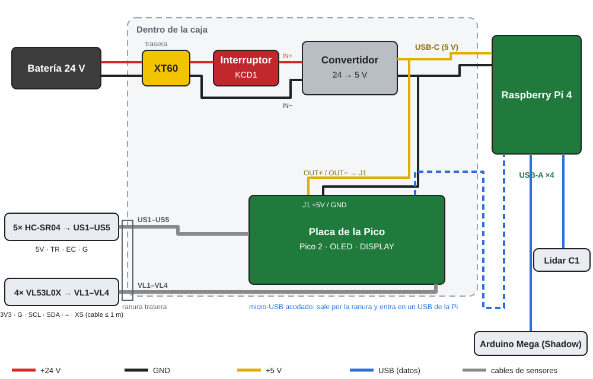

## Conectores acodados: hacia dónde sale el cable

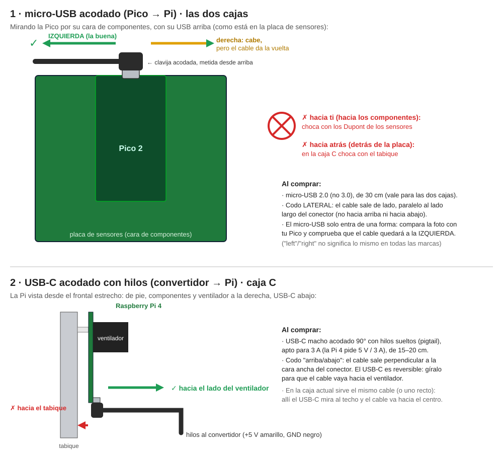

## 1 · Insertos térmicos

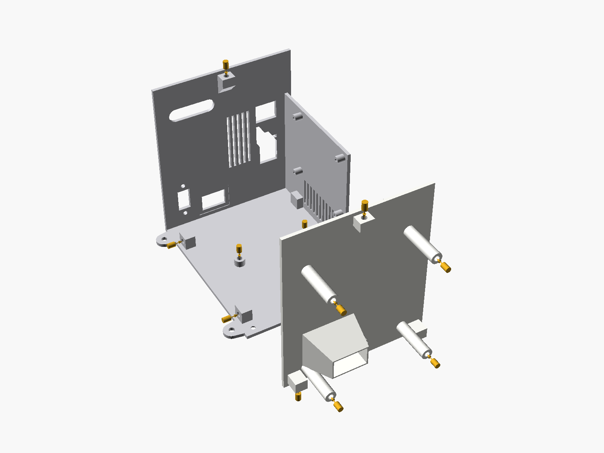

**Necesitas:** 14× inserto M3

Con el soldador a unos 220 °C, mete los insertos rectos y a ras: en el frontal, 4 en las columnas, 2 en las pestañas de abajo y 1 en la de arriba; en la base, 4 en los bloques del suelo, 2 en los tetones del convertidor y 1 en la pestaña de arriba.

## 2 · Convertidor 24 → 5 V

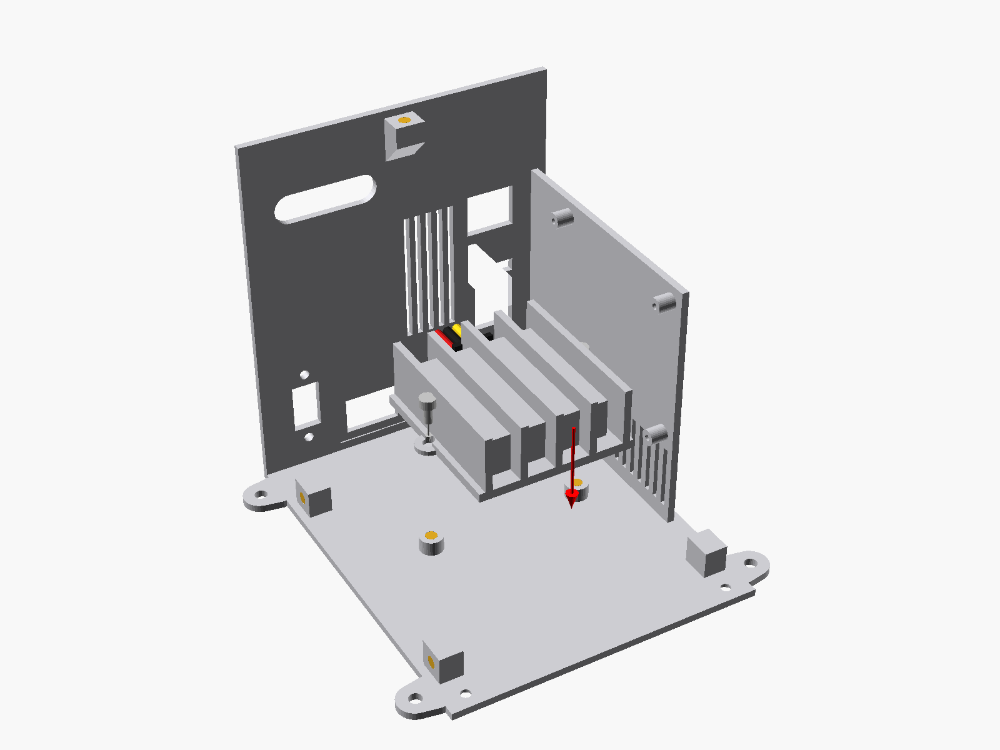

**Necesitas:** 2× M3 × 6 cilíndrico

Atorníllalo a sus dos tetones, con los cables hacia la trasera. Comprueba con el calibre la posición de sus agujeros (`conv_holes`) antes de imprimir la base.

## 3 · XT60 e interruptor

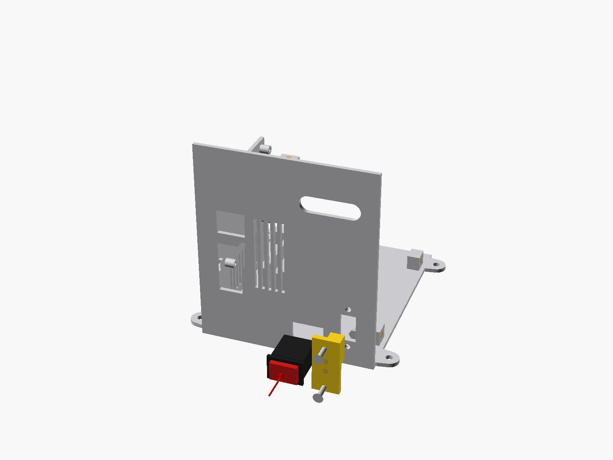

**Necesitas:** 2× M3 × 10 avellanado, 2× tuerca M3

Desde fuera: el XT60E-F con 2 tornillos y sus tuercas por dentro, y el interruptor a presión. Cablea los 24 V: XT60 → interruptor → entrada del convertidor.

## 4 · Raspberry Pi

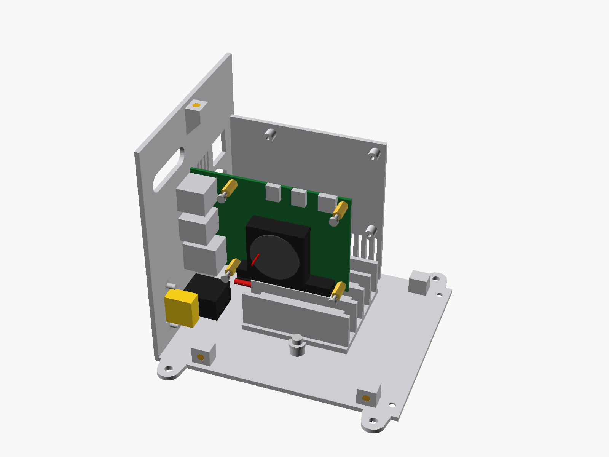

**Necesitas:** 4× M2.5 × 6

Ponla junto al soporte unos milímetros adelantada y deslízala hacia atrás hasta que los USB y el Ethernet asomen a ras por la trasera. Atorníllala y conecta el USB-C de 5 V del convertidor.

## 5 · Varilla y placa de la Pico

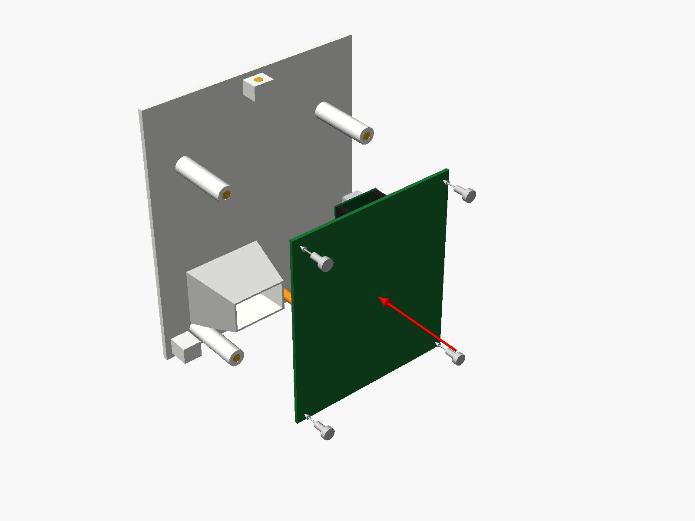

**Necesitas:** 4× M3 × 6

Mete la varilla del pulsador desde dentro por su guía. Atornilla la placa a las 4 columnas, con los componentes hacia el frontal. Con el frontal aún suelto: aprieta los 5 V en el borne J1, pincha el micro-USB acodado en la Pico y conecta los sensores.

## 6 · Frontal a la base

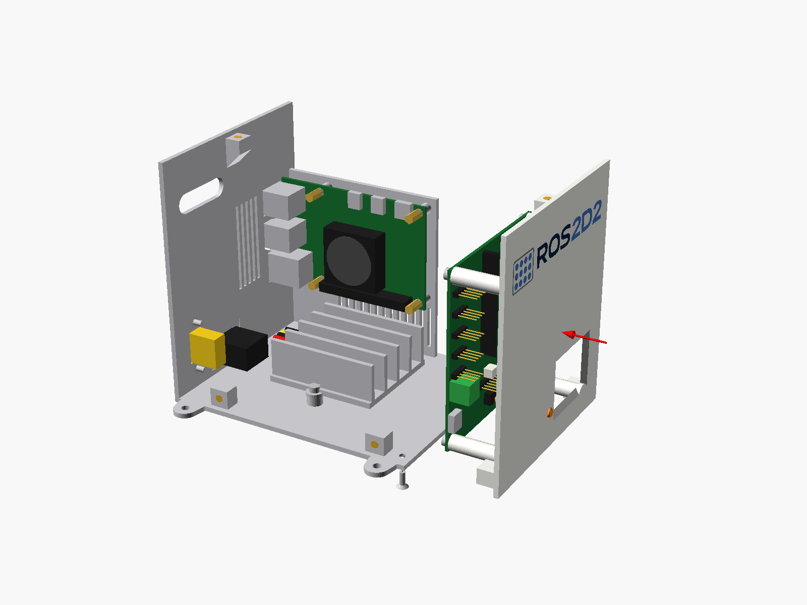

**Necesitas:** 2× M3 × 8 avellanado

Pasa los cables de sensores y el micro-USB por los canales de los lados de la placa hasta la ranura de la trasera. Atornilla el frontal desde debajo del suelo.

## 7 · Carcasa

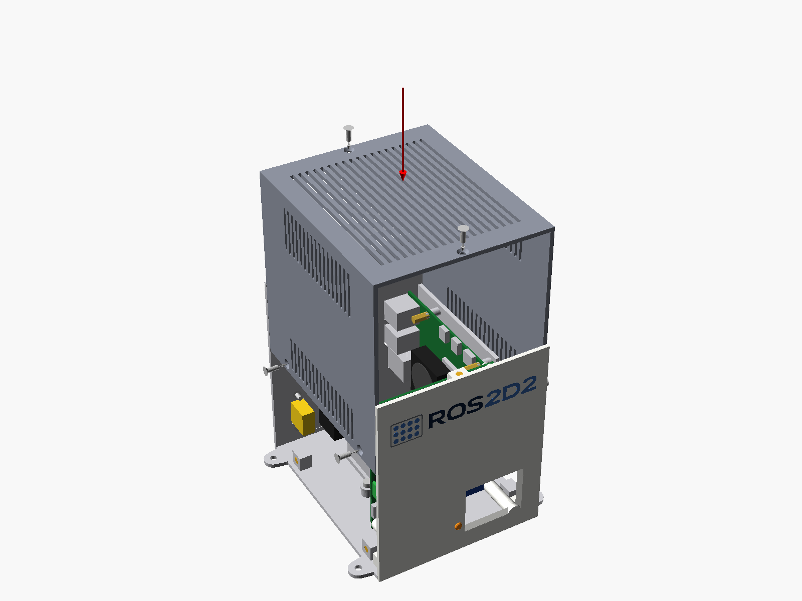

**Necesitas:** 6× M3 × 8 avellanado

Bájala desde arriba y pon los 4 tornillos de los laterales y los 2 del techo.

## 8 · USB y fijación al R2

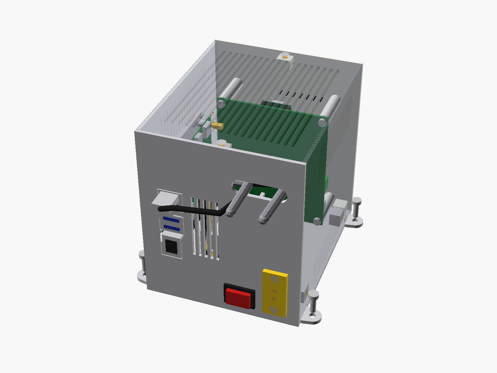

**Necesitas:** 4× M4 × 12

Saca el micro-USB por la ranura y enchúfalo en un USB de la Pi. Atornilla la caja al R2 por sus 4 orejetas (con llave Allen: quedan a 6 mm de la pared).
