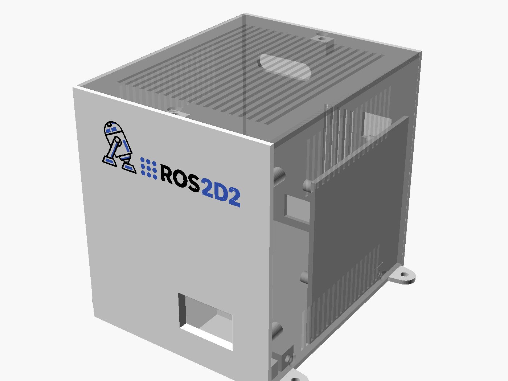

# Caja ROS2 (mini torre)

Caja imprimible para el sistema ROS 2 del R2: Raspberry Pi 4, placa de la Pico, convertidor
24 → 5 V, conector XT60E-F e interruptor general. Se parece a un mini PC de pie. En el frontal
van la OLED y el logo ROS2D2 en colores. Los USB/Ethernet de la Pi, el XT60, el interruptor y
la salida de los cables de sensores van detrás. Lleva rejillas en el techo y en los laterales.

Medidas exteriores: **107 × 133 × 125 mm** (ancho × fondo × alto), más las 4 orejetas de
fijación al R2.



## Piezas

| STL | Qué es | Cómo imprimir |
|---|---|---|
| `stl/frontal_multicolor.3mf` | frontal + logo negro + logo azul (un objeto, 3 partes) | **cara vista sobre la cama**; en Bambu Studio asigna blanco al `frontal`, negro a `logo_negro` y azul a `logo_azul` |
| `stl/frontal.stl`, `stl/logo_negro.stl`, `stl/logo_azul.stl` | lo mismo por separado | si importas los 3 STL a la vez, responde **Sí** a "¿cargar como un único objeto con varias partes?" |
| `stl/base.stl` | suelo, trasera, soporte de la Pi, tetones del convertidor y orejetas | suelo sobre la cama |
| `stl/carcasa.stl` | techo + laterales (U) con las rejillas | techo sobre la cama |

PETG recomendado (la Pi y el convertidor calientan), capa de 0.2 mm, boquilla 0.4. Ninguna
pieza necesita soportes.

## Tornillería

| Cantidad | Qué | Dónde |
|---|---|---|
| 14 | inserto térmico M3 × 5.7 (Ø exterior ~4 mm) | 4 columnas de la placa de la Pico, 2 pestañas inferiores y 1 superior del frontal, 1 pestaña superior de la trasera, 4 bloques del suelo para la carcasa, 2 tetones del convertidor |
| 4 | M3 × 6–8, cabeza alomada | placa de la Pico → columnas del frontal |
| 2 | M3 × 10, cabeza avellanada | desde debajo del suelo → pestañas inferiores del frontal |
| 4 | M3 × 8, cabeza avellanada | laterales de la carcasa → bloques del suelo |
| 2 | M3 × 8, cabeza avellanada | techo de la carcasa → pestañas superiores del frontal y la trasera |
| 2 | M3 × 8 | orejetas del convertidor → tetones del suelo |
| 2 | M3 × 10, avellanado + tuerca | XT60E-F (desde fuera) |
| 4 | M2.5 (largo según el soporte del ventilador + 5 mm) | Pi → columnas del soporte (rosca en el plástico, agujero de 2.2 mm) |
| 4 | M4 | orejetas de la base → R2 (agujero de 4.3 mm) |
| 1 | interruptor de balancín KCD1 (recorte 21 × 15 mm) | trasera |
| 1 | cable micro-USB **acodado 90°** | Pico → Pi (el micro-USB de la Pico apunta al techo) |
| 1 | pasacables en tira o pasamuros | ranura de los cables de sensores (35 × 10 mm) |

## Montaje

1. Pon todos los insertos térmicos.
2. **Base:** atornilla el convertidor a sus tetones. Monta el XT60E-F y el interruptor en la
   trasera y suelda/crimpa: XT60 → interruptor → entrada del convertidor.
3. **Pi:** atorníllala al soporte, con los USB/Ethernet en sus recortes de la trasera y el
   borde del USB-C hacia arriba. Conecta el USB-C de alimentación desde la salida de 5 V.
4. **Placa de la Pico:** atorníllala a las 4 columnas del frontal (componentes mirando al
   frontal; la OLED queda detrás de su ventana). Conecta los sensores ahora: con el frontal
   suelto llegas bien a los pines.
5. **Frontal a la base:** 2 tornillos desde debajo del suelo. Pasa los cables de sensores por
   los canales de los lados de la placa hasta la ranura de la trasera. Conecta los 5 V al
   borne J1 y el micro-USB acodado de la Pico a la Pi.
6. **Carcasa:** bájala desde arriba y pon los 4 tornillos de los laterales y los 2 del techo.

## Antes de imprimir: comprueba estas medidas

Están en `params.scad`; cambia el valor y vuelve a generar.

- `xt60_hole_pitch` (25.4): distancia entre los 2 agujeros de la brida del XT60E-F. No viene
  acotada en el datasheet y está medida sobre el dibujo. **Mídela con el calibre.** Con 25.4 los
  agujeros quedan pegados al recorte del cuerpo (`xt60_body`, 10.5 × 21.5), así que comprueba
  también la sección real del cuerpo.
- `sw_cut` (21 × 15): recorte del interruptor, si no es un KCD1.
- `pi_fan_clear` (25): altura del ventilador de la Pi sobre la placa.
- `pi_usbc_clear` (30): hueco sobre el USB-C de la Pi (con un USB-C acodado puede bajar).
- Imprime primero **solo el frontal** y prueba la placa de la Pico, la ventana de la OLED y los
  Dupont de los sensores.

## Generar los ficheros

Requiere OpenSCAD 2021.01 (`C:\Program Files\OpenSCAD\openscad.com` o la variable `OPENSCAD`)
y Python 3 con Pillow y numpy.

```bash
python -I hardware/caja_ros2/logo/gen_logo.py      # logo PNG -> logo/logo_negro.svg, logo/logo_azul.svg
python -I hardware/caja_ros2/build.py              # stl/, 3MF y renders/
python -m pytest hardware/caja_ros2/tests          # medidas, choques y alineaciones (~40 min la 1ª vez)
```

`gen_logo.py` lee `ROS2D2/docs/logo-horizontal.png`. Los SVG generados ya están en `logo/`.

Las pruebas modelan como "fantasmas" la Pi, la placa de la Pico, el convertidor, el XT60 y el
interruptor, cada uno con el hueco que necesitan sus conectores y cables (el Dupont de los
sensores, los canales laterales, el micro-USB, el USB-C...). Comprueban que ninguna pieza
impresa los toca, que los puertos de la Pi salen por la trasera, que la ventana coincide con la
OLED, que la carcasa entra deslizándose desde arriba y que cada pieza apoya plana en la cama.
