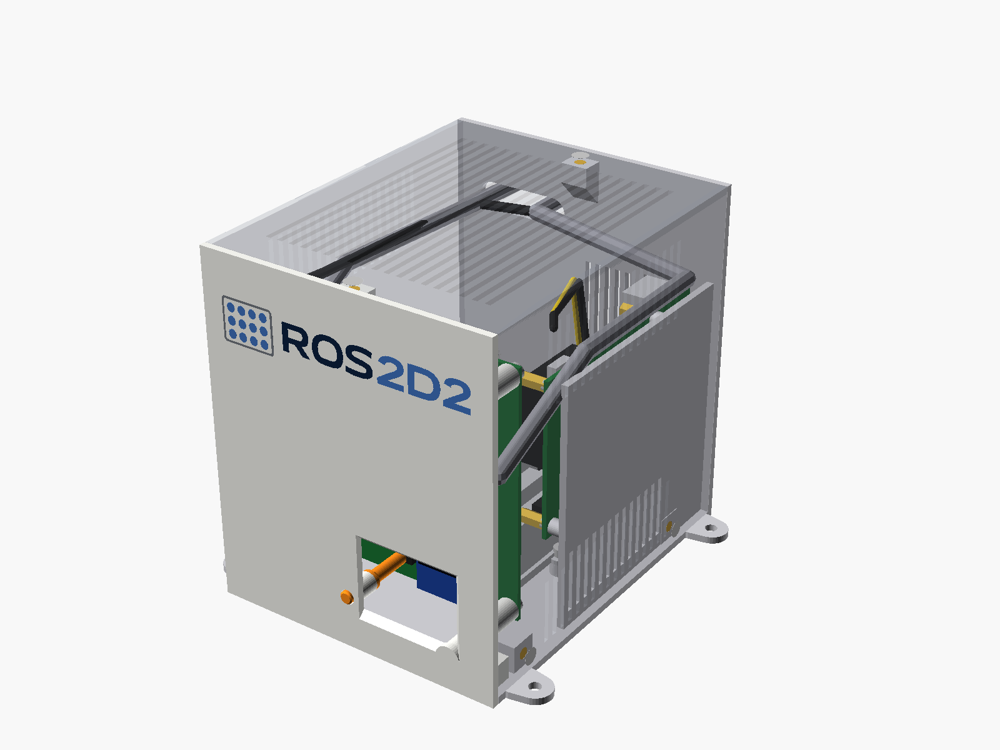

# Caja ROS2 (mini torre)

Caja imprimible para el sistema ROS 2 del R2: Raspberry Pi 4, placa de la Pico, convertidor
24 → 5 V, conector XT60E-F e interruptor general. Se parece a un mini PC de pie. En el frontal
van la OLED y el logo ROS2D2 en colores. Los USB/Ethernet de la Pi, el XT60, el interruptor y
la salida de los cables de sensores van detrás. Lleva rejillas en el techo y en los laterales.

Medidas exteriores: **107 × 133 × 125 mm** (ancho × fondo × alto), más las 4 orejetas de
fijación al R2.



**Instrucciones de montaje paso a paso, con despiece y lista de tornillería:**
[MONTAJE.md](MONTAJE.md) · [PDF](montaje/MONTAJE.pdf) — English: [ASSEMBLY.md](ASSEMBLY.md) · [PDF](montaje/ASSEMBLY.pdf)

## Piezas

| STL | Qué es | Cómo imprimir |
|---|---|---|
| `stl/frontal_multicolor.3mf` | frontal + logo negro + logo azul (un objeto, 3 partes) | **cara vista sobre la cama**; en Bambu Studio asigna blanco al `frontal`, negro a `logo_negro` y azul a `logo_azul` |
| `stl/frontal.stl`, `stl/logo_negro.stl`, `stl/logo_azul.stl` | lo mismo por separado | si importas los 3 STL a la vez, responde **Sí** a "¿cargar como un único objeto con varias partes?" |
| `stl/frontal_monocolor.stl` | frontal de **un solo color** (sin AMS): el logo va grabado 1 mm en hueco | cara vista sobre la cama |
| `stl/pulsador.stl` | varilla que acciona el pulsador DISPLAY (SW1) de la placa de la Pico desde el frontal | de pie, sobre su extremo plano |
| `stl/base.stl` | suelo, trasera, soporte de la Pi, tetones del convertidor y orejetas | suelo sobre la cama |
| `stl/carcasa.stl` | techo + laterales (U) con las rejillas | techo sobre la cama |

PETG recomendado (la Pi y el convertidor calientan), capa de 0.2 mm, boquilla 0.4. Ninguna
pieza necesita soportes.

## Tornillería

| Cantidad | Qué | Dónde |
|---|---|---|
| 14 | inserto térmico M3 × 5.7 (Ø exterior ~4 mm) | 4 columnas de la placa de la Pico, 2 pestañas inferiores y 1 superior del frontal, 1 pestaña superior de la trasera, 4 bloques del suelo para la carcasa, 2 tetones del convertidor |
| 4 | M3 × 6, cabeza alomada | placa de la Pico → columnas del frontal |
| 2 | M3 × 8, cabeza avellanada | desde debajo del suelo → pestañas inferiores del frontal (un M3 × 10 toca fondo) |
| 4 | M3 × 8, cabeza avellanada | laterales de la carcasa → bloques del suelo |
| 2 | M3 × 8, cabeza avellanada | techo de la carcasa → pestañas superiores del frontal y la trasera |
| 2 | M3 × 8 | orejetas del convertidor → tetones del suelo |
| 2 | M3 × 10, avellanado + tuerca | XT60E-F (desde fuera; el avellanado lo lleva la brida, la pared tiene agujero liso) |
| 4 | M2.5 (largo según el soporte del ventilador + 5 mm) | Pi → columnas del soporte (rosca en el plástico, agujero de 2.2 mm) |
| 4 | M4 | orejetas de la base → R2 (agujero de 4.3 mm) |
| 1 | interruptor de balancín KCD1 (agujero de panel 19.2 × 13 mm; la pared se adelgaza a 2 mm alrededor para sus pestañas) | trasera |
| 1 | cable micro-USB **acodado 90°** a USB-A, ~40 cm | Pico → Pi **por fuera**: sale por la ranura de sensores y entra en un USB de la Pi en la trasera |
| 1 | pasacables en tira o pasamuros | ranura de los cables de sensores (35 × 10 mm) |

## Montaje

1. Pon todos los insertos térmicos.
2. **Base:** atornilla el convertidor a sus tetones. Monta el XT60E-F y el interruptor en la
   trasera y suelda/crimpa: XT60 → interruptor → entrada del convertidor.
3. **Pi:** colócala junto al soporte unos milímetros adelantada y deslízala hacia atrás hasta
   que los USB/Ethernet asomen a ras por sus recortes de la trasera (borde del USB-C arriba).
   Atorníllala a las columnas y conecta el USB-C de alimentación desde la salida de 5 V.
4. **Placa de la Pico, con el frontal todavía suelto:** mete primero la varilla del pulsador
   desde dentro por su guía (la punta sale por el frontal; el collarín la retiene). Después
   atornilla la placa a las 4 columnas del
   frontal (componentes mirando al frontal; la OLED queda detrás de su ventana). Ahora, que
   llegas, aprieta en el borne **J1** el cable de 5 V (déjalo largo para llegar al convertidor),
   pincha el micro-USB acodado en la Pico y conecta los sensores.
5. **Frontal a la base:** 2 tornillos desde debajo del suelo. Pasa los cables de sensores y el
   micro-USB por los canales de los lados de la placa hasta la ranura de la trasera. Saca el
   micro-USB por la ranura y enchúfalo por fuera en un USB de la Pi.
6. **Carcasa:** bájala desde arriba y pon los 4 tornillos de los laterales y los 2 del techo.

Notas:

- El USB-C **J5** de la placa de la Pico no se puede usar dentro de la caja (hay ~11 mm hasta el
  lateral); dentro, la placa se alimenta por el borne J1.
- Las orejetas M4 quedan a 6 mm de la pared: usa llave Allen o un destornillador de caña larga.
- Para quitar el frontal hay que soltar antes la caja del R2 (sus tornillos van por debajo del
  suelo).

## Antes de imprimir: comprueba estas medidas

Están en `params.scad`; cambia el valor y vuelve a generar.

- `xt60_hole_pitch` (25.4): distancia entre los 2 agujeros de la brida del XT60E-F. No viene
  acotada en el datasheet y está medida sobre el dibujo. **Mídela con el calibre**, y también
  la sección del cuerpo que atraviesa la pared (`xt60_body`, 9.5 × 17).
- `sw_cut` (19.2 × 13): agujero de panel del interruptor (no el marco, que mide 21 × 15). Mídelo.
- `conv_holes`: posición de los 2 agujeros del convertidor desde su esquina delantera-izquierda.
  Están supuestos; **mídelos** antes de imprimir la base.
- `pi_fan_clear` (25): altura del ventilador de la Pi sobre la placa.
- `pi_usbc_clear` (30): hueco sobre el USB-C de la Pi (con un USB-C acodado puede bajar).
- La ventana de la OLED deja ver la pantalla entera desde unos 20° por la derecha, 12° por la
  izquierda (ese lado cede sitio a la guía de la varilla del pulsador) y 15° en vertical. Si tu
  módulo tiene la zona visible desplazada, ajusta `oled_view`.
- `sw1_h` (5): altura del pulsador DISPLAY sobre la placa. La varilla queda a 0.3 mm de él en
  reposo y lo aprieta con ~1.3 mm de recorrido; si tu pulsador es más alto o más bajo, cambia
  este valor y vuelve a generar `pulsador.stl`.
- Imprime primero **solo el frontal** y prueba la placa de la Pico, la ventana de la OLED y los
  Dupont de los sensores.

## Generar los ficheros

Requiere OpenSCAD 2021.01 (`C:\Program Files\OpenSCAD\openscad.com` o la variable `OPENSCAD`)
y Python 3 con Pillow y numpy.

```bash
python -I hardware/caja_ros2/logo/gen_logo.py      # logo PNG -> logo/logo_negro.svg, logo/logo_azul.svg
python -I hardware/caja_ros2/build.py              # stl/, 3MF y renders/
python -I hardware/caja_ros2/build_docs.py         # guía de montaje: imágenes, MONTAJE.md, ASSEMBLY.md y PDF
python -m pytest hardware/caja_ros2/tests          # medidas, choques y alineaciones (~40 min la 1ª vez)
```

`gen_logo.py` lee `ROS2D2/docs/logo-horizontal.png`. Los SVG generados ya están en `logo/`.

Las pruebas modelan como "fantasmas" la Pi, la placa de la Pico, el convertidor, el XT60 y el
interruptor, cada uno con el hueco que necesitan sus conectores y cables (el Dupont de los
sensores, los canales laterales, el micro-USB, el USB-C...). Comprueban que ninguna pieza
impresa los toca, que los puertos de la Pi salen por la trasera, que la ventana coincide con la
OLED, que la carcasa entra deslizándose desde arriba y que cada pieza apoya plana en la cama.
