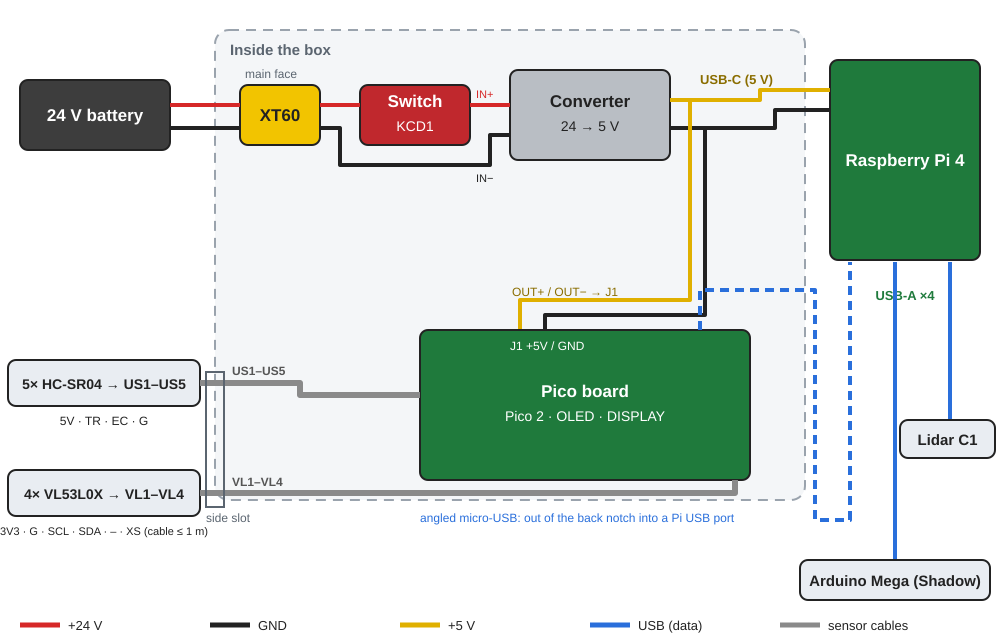
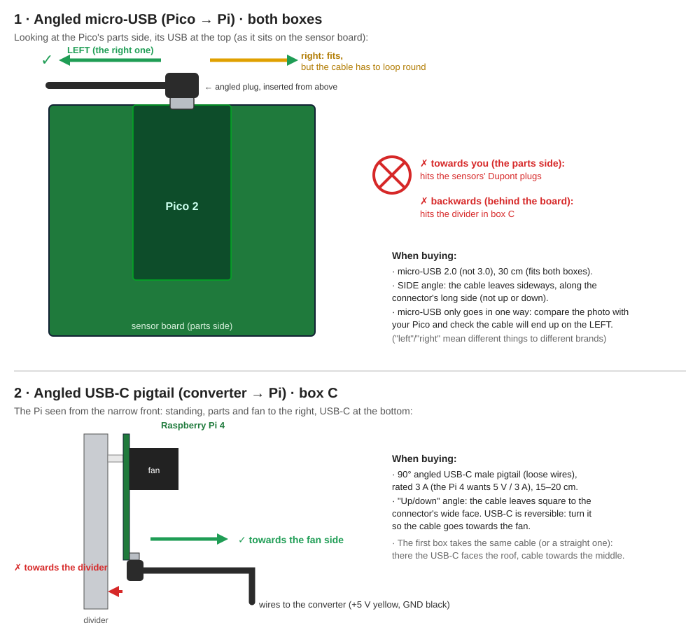

# ROS2 rack box · Assembly instructions

[Versión en castellano](MONTAJE.md)

Second box, rack style: the Pico board, the Pi and the converter stand on edge, side by side. 78 × 95 × 127 mm (0.94 L, about half the mini tower). OLED, logo, switch and XT60 are on the main face; the Pi's USB at the back. Before printing, measure what the README lists.

| Assembled | From the back |
|---|---|
|  |  |

## Inside (no shell)

## Exploded view

## Hardware and parts

### Printed parts

| Part | |
|---|---|
| `stl/pared_multicolor_bambu.3mf` | Main face with the logo in 4 colours (AMS: white, navy, blue, grey) |
| `stl/pared_monocolor.stl` | or: single-colour main face, engraved logo |
| `stl/base.stl` | Base: floor, back, central divider |
| `stl/tapa.stl` | Shell (roof + side + narrow front) |
| `stl/pulsador.stl` | DISPLAY push rod |

| Qty | Part | Step |
|---|---|---|
| 13× | M3 heat-set insert (5.7 mm long, 4.0 mm hole) | 1 |
| 7× | M3 × 8 countersunk screw (ISO 10642) | 6, 7 |
| 4× | M3 × 6 button head screw (ISO 7380) | 5 |
| 2× | M3 × 6 socket head cap screw (DIN 912) | 2 |
| 2× | M3 × 10 countersunk screw (ISO 10642) | 4 |
| 2× | M3 nut (DIN 934) | 4 |
| 4× | M2.5 × 6 screw (longer if the Pi's fan sits on spacers) | 3 |
| 4× | M4 × 12 screw (or what the R2's mount needs) | 8 |

### Other parts

| Qty | Part |
|---|---|
| 1 | KCD1 rocker switch (panel hole 19.2 × 13 mm) |
| 1 | XT60E-F panel connector (AMASS) |
| 1 | micro-USB 2.0 to USB-A cable, 90° side angle, 30 cm (see «Angled plugs») |
| 1 | USB-C male pigtail (5 V to the Pi), 3 A, 15–20 cm; straight or 90° angled |
| — | 0.5 mm² wire for the 5 V to terminal J1, 1 mm² for the 24 V |
| 1 | Edge grommet strip for the 35 × 10 mm slot |

## Wiring

## Angled plugs: which way the cable goes

## 1 · Heat-set inserts

**You need:** 13× M3 insert

With the iron at about 220 °C press the 13 inserts in straight and flush: on the main face, 4 in the columns, 2 in the bottom tabs and 1 in the top tab; on the base, 2 on top of the divider, 2 in the divider for the converter and 2 in the floor blocks.

## 2 · Converter onto the divider

**You need:** 2× M3 × 6 socket head

On edge, its base plate against the divider, fins outwards, wires to the front. Check its holes (`conv_holes`) with a caliper first.

## 3 · Raspberry Pi onto the divider

**You need:** 4× M2.5 × 6

On its 4 standoffs, USB and Ethernet flush with the back, USB-C at the bottom. Plug in the angled USB-C and join it to the converter's 5 V output.

## 4 · XT60 and switch on the main face

**You need:** 2× M3 × 10 countersunk, 2× M3 nut

From outside, low down: the XT60E-F turned on its side with 2 screws and their nuts inside, and the switch snapped in.

## 5 · Push rod and Pico board

**You need:** 4× M3 × 6

Slide the rod into its guide from inside and screw the board onto the 4 columns, parts towards the wall. Tighten the 5 V in terminal J1, plug the angled micro-USB into the Pico and connect the sensors: their cables leave through the slot at the top.

## 6 · Main face onto the base

**You need:** 2× M3 × 8 countersunk

Run the 24 V wires (XT60 → switch → converter) and the 5 V to terminal J1 through the gap at the bottom of the divider. Screw the face on from under the floor.

## 7 · Shell

**You need:** 5× M3 × 8 countersunk

Lower it from above and fit the 3 roof screws and the 2 side screws.

## 8 · USB and onto the R2

**You need:** 4× M4 × 12

Bring the micro-USB out of the notch in the back into a Pi USB port. Screw the box to the R2 through its 4 ears.
