# ROS2 rack box · Assembly instructions

[Versión en castellano](MONTAJE.md)

Second box, rack style: the Pico board, the Pi and the converter stand on edge, side by side. 78 × 95 × 145 mm (1.07 L). The Pi sits low and the converter high, so its heat does not rise into the Pi. It takes a Pi 4 or a Pi 5: only the back frame changes. OLED, logo, switch and XT60 are on the main face; the Pi's USB and an HDMI panel jack at the back. Every screw goes into an insert. Before printing, measure what the README lists.

| Assembled | From the back |
|---|---|
| 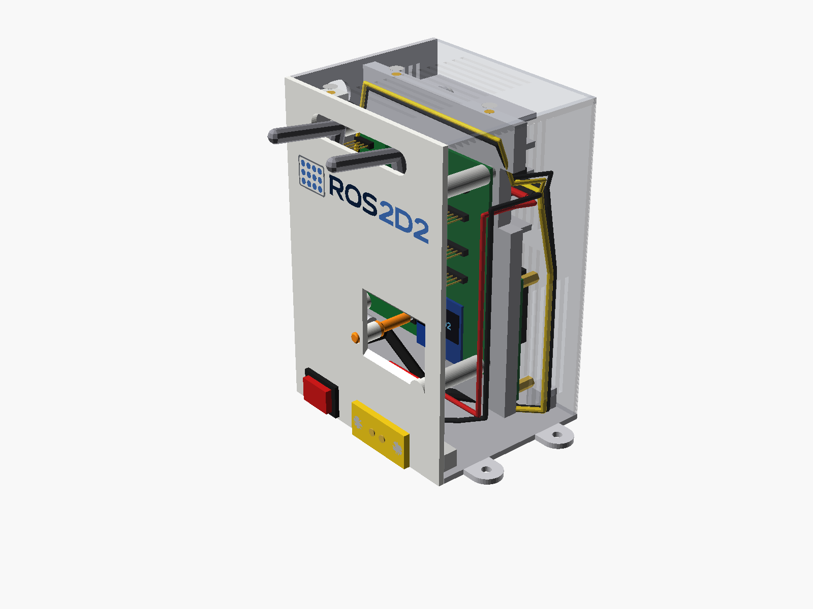 | 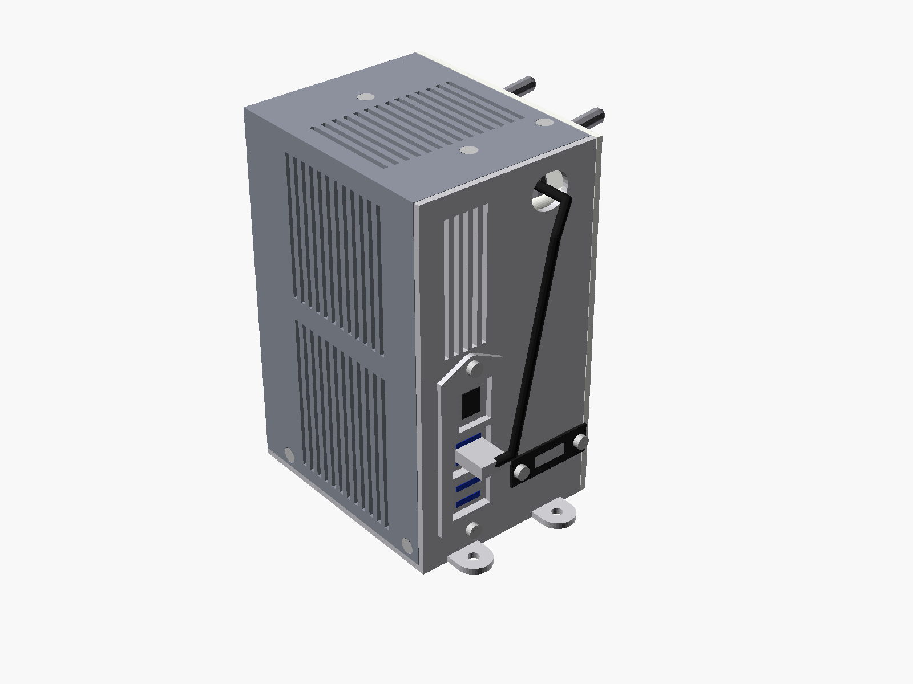 |

**Up-to-date guide, STL and sources:** <https://github.com/BeskarCode/ROS2D2/tree/main/hardware/caja_ros2_rack>

## Size next to the R2

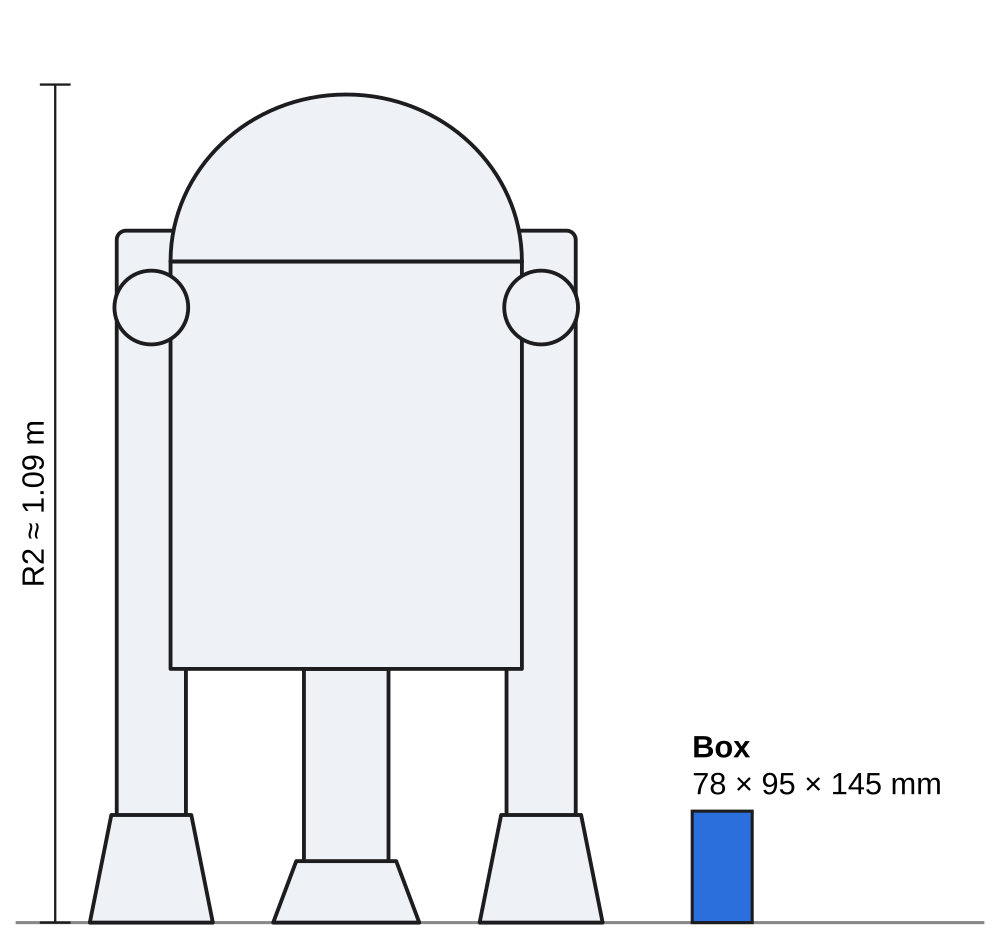

## Inside (no shell)

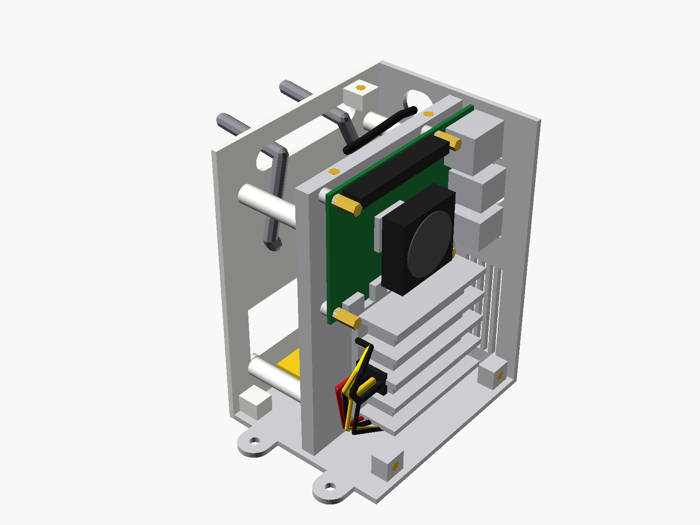

## Exploded view

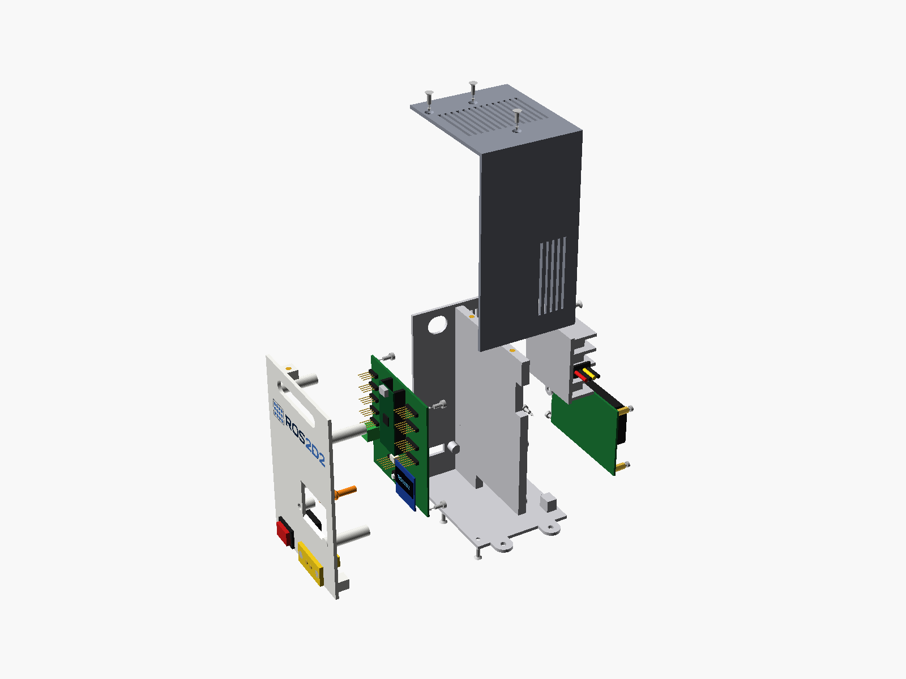

## Hardware and parts

### Printed parts

| Part | |
|---|---|
| `stl/pared_multicolor_bambu.3mf` | Main face with the logo in 4 colours (AMS: white, navy, blue, grey) |
| `stl/pared_monocolor.stl` | or: single-colour main face, engraved logo |
| `stl/pared_led_multicolor_bambu.3mf` | or: main face with a hole over each LED of the Pico board, logo lower down and the connector names (AMS: white, navy, blue, grey) |
| `stl/pared_led_monocolor.stl` | or: the LED face in one colour, logo and names engraved |
| `stl/guias_luz.stl` | Light pipes (optional, only with the LED face): one piece in translucent PLA (or clear PETG), outer ends on the bed, 100 % infill |
| `stl/prueba_luz.stl` | Light test rod: print it first and hold it on a lit LED to see whether your filament lets enough light through |
| `stl/base.stl` | Base: floor, back, central divider |
| `stl/tapa.stl` | Shell (roof + side + narrow front) |
| `stl/marco_pi4.stl` | Back frame for the Pi 4 (Ethernet at the top) |
| `stl/marco_pi5.stl` | or: back frame for the Pi 5 (Ethernet at the bottom) |
| `stl/pulsador.stl` | DISPLAY push rod |

| Qty | Part | Step |
|---|---|---|
| 19× | M3 heat-set insert (5.7 mm long, 4.0 mm hole) | 1 |
| 9× | M3 × 8 countersunk screw (ISO 10642) | 4, 6, 7 |
| 8× | M3 × 6 button head screw (ISO 7380) | 3, 5 |
| 2× | M3 × 6 socket head cap screw (DIN 912) | 2 |
| 4× | M2.5 × 6 screw | 3 |
| 4× | M4 × 12 screw (or what the R2's mount needs) | 8 |
| 4× | M2.5 heat-set insert (5 mm long, 3.6 mm hole) | 1 |

### Other parts

| Qty | Part |
|---|---|
| 1 | KCD1 rocker switch (panel hole 19.2 × 13 mm) |
| 1 | XT60E-F panel connector (AMASS) |
| 1 | micro-USB 2.0 to USB-A cable, 90° side angle, 30 cm (see «Angled plugs») |
| — | 0.5 mm² wire for the 5 V to terminal J1, 1 mm² for the 24 V |
| 1 | Edge grommet strip for the 35 × 10 mm slot |
| 1 | USB-C male pigtail (5 V to the Pi), 90° up/down angle, 15–20 cm; 3 A for a Pi 4, 5 A for a Pi 5 |
| 1 | Angled 90° micro-HDMI male to HDMI female panel-mount cable with 2 M3 screws, 30 cm (measure its flange: `hdmi_*`) |

## Wiring

## Angled plugs: which way the cable goes

## 1 · Heat-set inserts

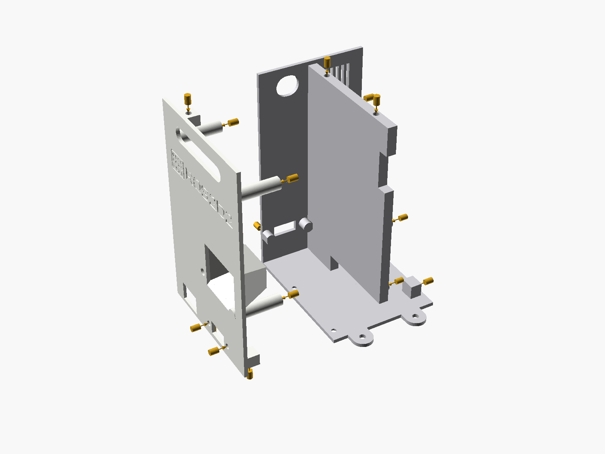

**You need:** 19× M3 insert, 4× M2.5 insert

With the iron at about 220 °C press the inserts in straight and flush. On the main face, 7 M3: 4 in the columns, 2 in the bottom tabs and 1 in the top tab; plus 2 M3 from outside in the XT60's holes. On the base, 10 M3: 2 on top of the divider, 2 in the divider for the converter, 2 in the floor blocks and 4 from outside the back (2 for the frame, 2 for the HDMI); and the 4 M2.5 in the Pi's standoffs.

## 2 · Converter onto the divider, high

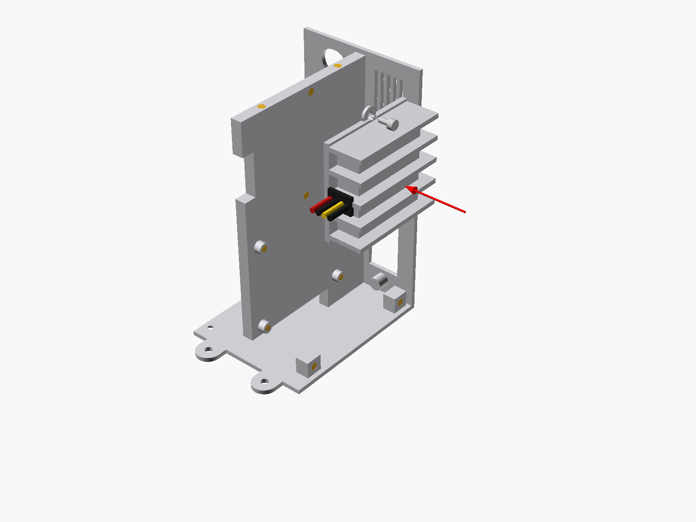

**You need:** 2× M3 × 6 socket head

On edge, at the very top, its base plate against the divider, fins outwards, wires to the front: they go through the top pass in the divider to the Pico side. Its heat rises out of the roof without passing the Pi. Check its holes (`conv_holes`) with a caliper first.

## 3 · Raspberry Pi, frame and HDMI

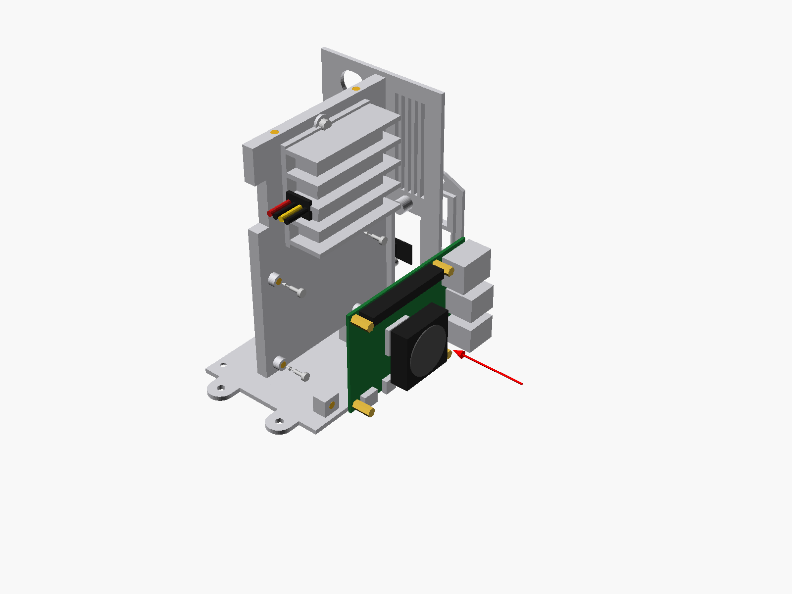

**You need:** 4× M2.5 × 6, 4× M3 × 6

Pi 4 or Pi 5 on its 4 standoffs, low down, USB and Ethernet in the back window, USB-C at the bottom. Plug in the angled USB-C (5 V from the converter, down in front of the Pi) and the angled micro-HDMI into HDMI 0; that cable runs under the Pi through the divider's bottom pass. Screw on, from outside, the frame for your Pi (`marco_pi4` or `marco_pi5`) and the HDMI panel jack.

## 4 · XT60 and switch on the main face

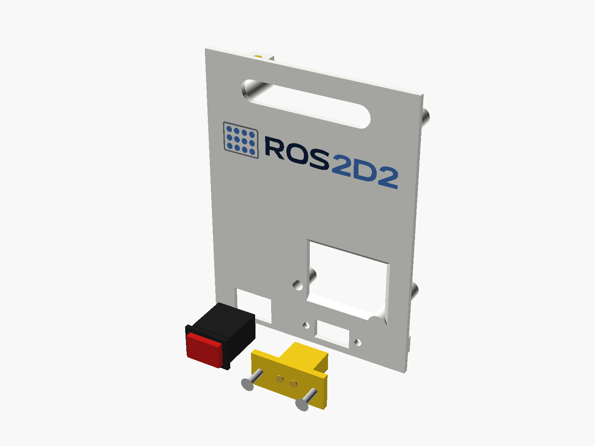

**You need:** 2× M3 × 8 countersunk

From outside, low down: the XT60E-F turned on its side with 2 screws into the inserts, and the switch snapped in.

## 5 · Push rod and Pico board

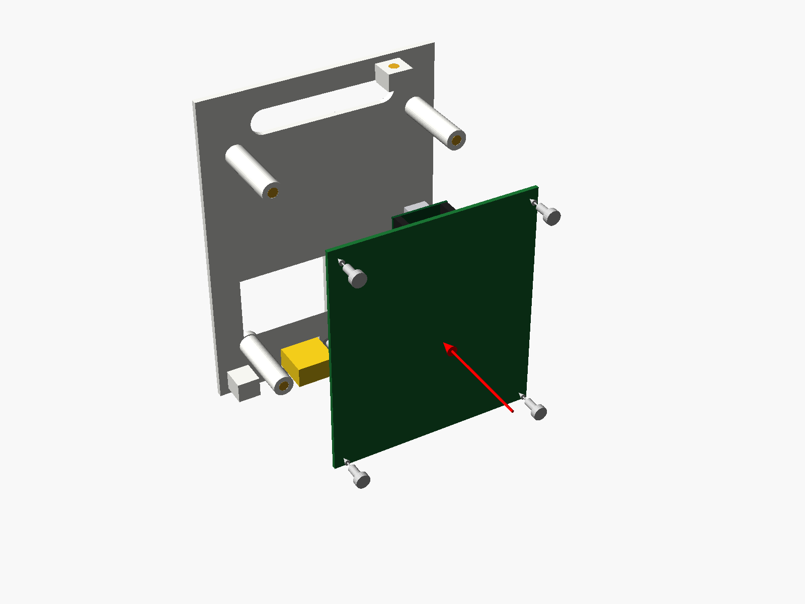

**You need:** 4× M3 × 6

With the LED face, the light pipes are optional (without them the LEDs show through the holes). If you fit them, they go in before hanging the board: from inside, slide the 10 rods into their holes and push the frame against the wall until the 4 hooks click. Slide the rod into its guide from inside. Before screwing, offer the board up without screws onto the 4 columns, parts towards the wall: it must sit on all four without rocking; if it rocks, a rod touches its LED: sand its tip. Then screw it on. To take it out, open the hooks two at a time with a small screwdriver. If you ever use J4 (EXP), its cable goes round the PWR rod. Tighten the 5 V in terminal J1, plug the angled micro-USB into the Pico and connect the sensors: their cables leave through the slot at the top.

## 6 · Main face onto the base

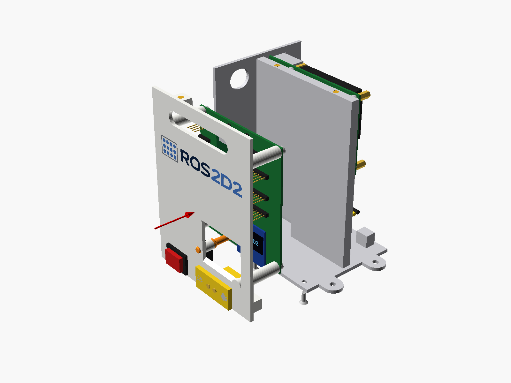

**You need:** 2× M3 × 8 countersunk

The 24 V (XT60 → switch → converter) run up in front of the Pico board and cross through the divider's top pass; the 5 V to terminal J1 come back through the same pass and over the board. Screw the face on from under the floor.

## 7 · Shell

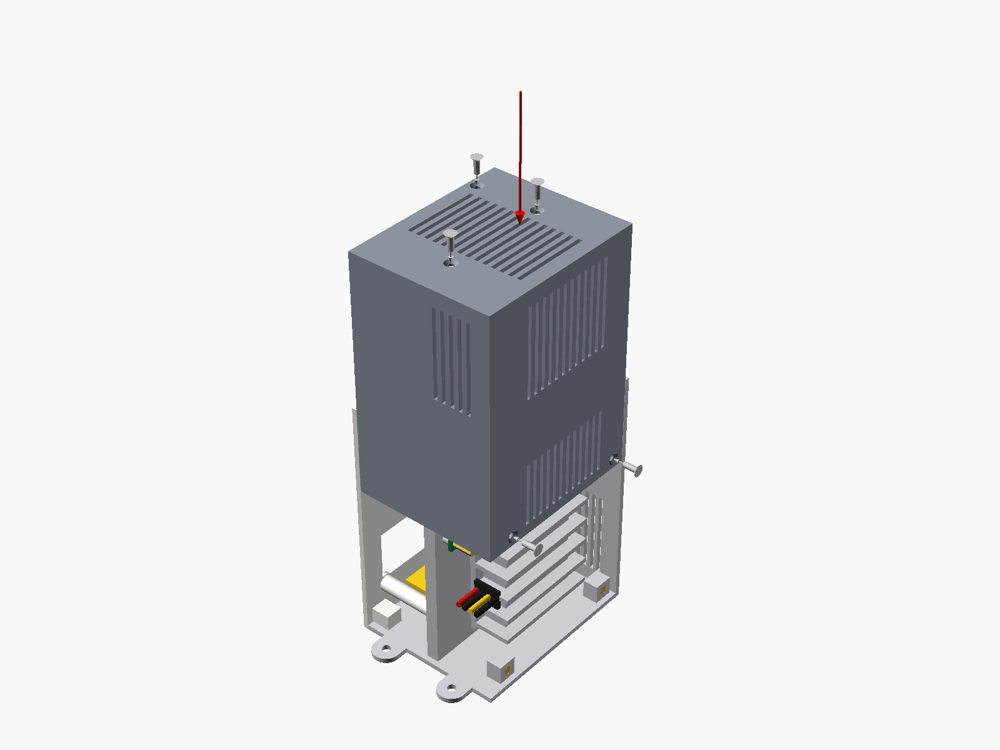

**You need:** 5× M3 × 8 countersunk

Lower it from above and fit the 3 roof screws and the 2 side screws. Air comes in through the low vents (front and side, by the Pi) and leaves through the high ones and the roof.

## 8 · USB and onto the R2

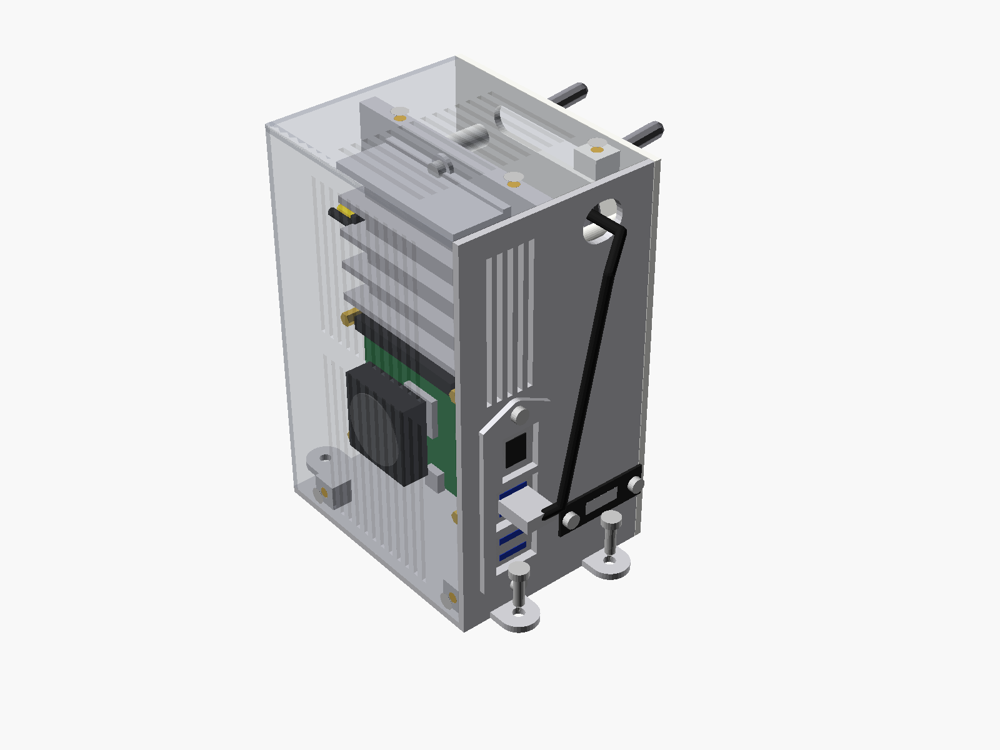

**You need:** 4× M4 × 12

Bring the micro-USB out of the notch in the back into a Pi USB port. Screw the box to the R2 through its 4 ears.
