# Caja ROS2 rack · Instrucciones de montaje

[English version](ASSEMBLY.md)

Segunda caja, tipo rack: la placa de la Pico, la Pi y el convertidor van de pie, en paralelo. 78 × 95 × 127 mm (0,94 L, casi la mitad que la mini torre). La OLED, el logo, el interruptor y el XT60 están en la pared principal; los USB de la Pi, detrás. Antes de imprimir mide lo que indica el README.

| Montada | Por detrás |
|---|---|
| 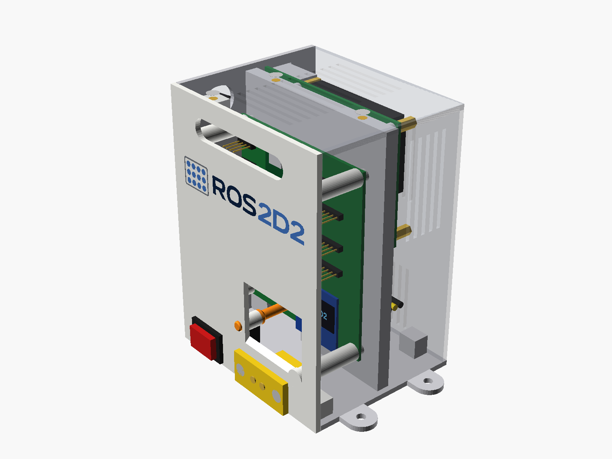 | 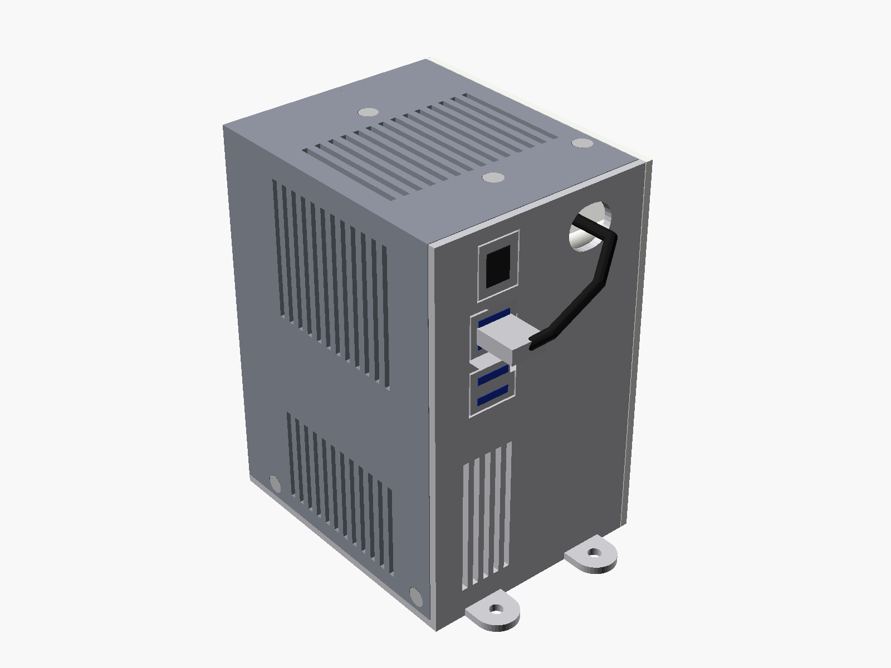 |

## Por dentro (sin carcasa)

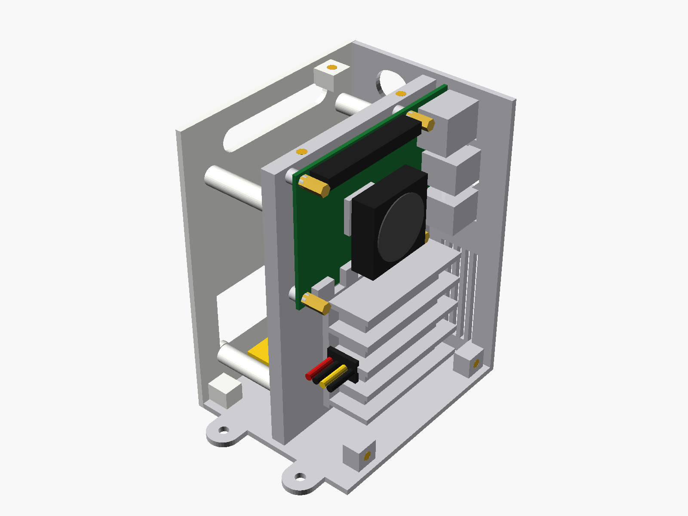

## Despiece

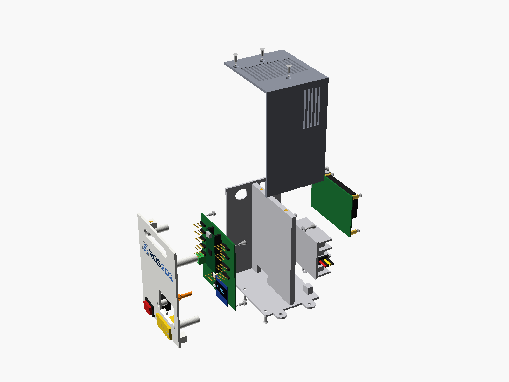

## Tornillería y material

### Piezas impresas

| Pieza | |
|---|---|
| `stl/pared_multicolor_bambu.3mf` | Pared principal con el logo en 4 colores (AMS: blanco, marino, azul, gris) |
| `stl/pared_monocolor.stl` | o bien: pared principal de un color, logo grabado |
| `stl/base.stl` | Base: suelo, trasera, tabique central |
| `stl/tapa.stl` | Tapa (techo + lateral + frontal estrecho) |
| `stl/pulsador.stl` | Varilla del pulsador DISPLAY |

| Cant. | Pieza | Paso |
|---|---|---|
| 13× | Inserto térmico M3 (5,7 mm de largo, agujero de 4,0 mm) | 1 |
| 7× | Tornillo M3 × 8 de cabeza avellanada (ISO 10642) | 6, 7 |
| 4× | Tornillo M3 × 6 de cabeza alomada (ISO 7380) | 5 |
| 2× | Tornillo M3 × 6 de cabeza cilíndrica (DIN 912) | 2 |
| 2× | Tornillo M3 × 10 de cabeza avellanada (ISO 10642) | 4 |
| 2× | Tuerca M3 (DIN 934) | 4 |
| 4× | Tornillo M2.5 × 6 (más largo si el ventilador de la Pi lleva separadores) | 3 |
| 4× | Tornillo M4 × 12 (o el que pida el soporte del R2) | 8 |

### Otro material

| Cant. | Pieza |
|---|---|
| 1 | Interruptor de balancín KCD1 (agujero de panel 19,2 × 13 mm) |
| 1 | Conector XT60E-F de panel (AMASS) |
| 1 | Cable micro-USB 2.0 a USB-A, codo lateral 90°, 30 cm (ver «Conectores acodados») |
| 1 | Cable USB-C macho con hilos (5 V a la Pi), 3 A, 15–20 cm; recto o acodado 90° |
| — | Cable de 0,5 mm² para los 5 V del borne J1 y de 1 mm² para los 24 V |
| 1 | Pasacables en tira para la ranura de 35 × 10 mm |

## Conexiones

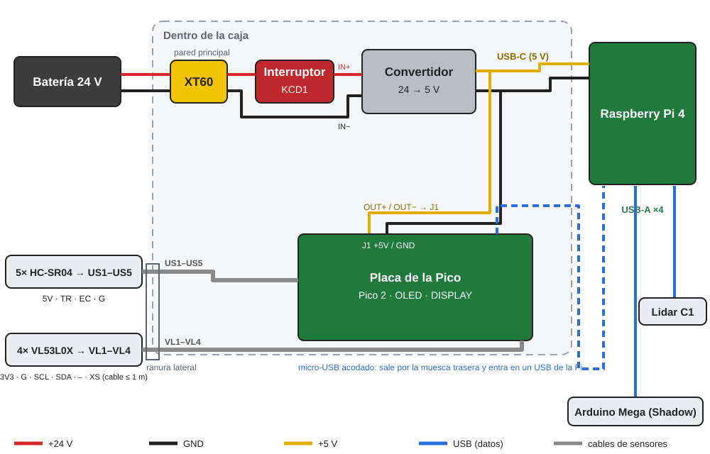

## Conectores acodados: hacia dónde sale el cable

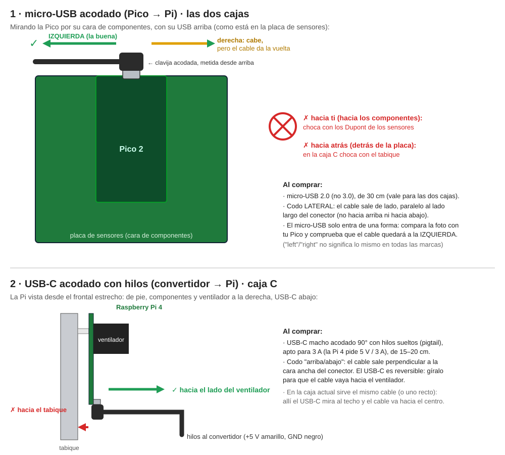

## 1 · Insertos térmicos

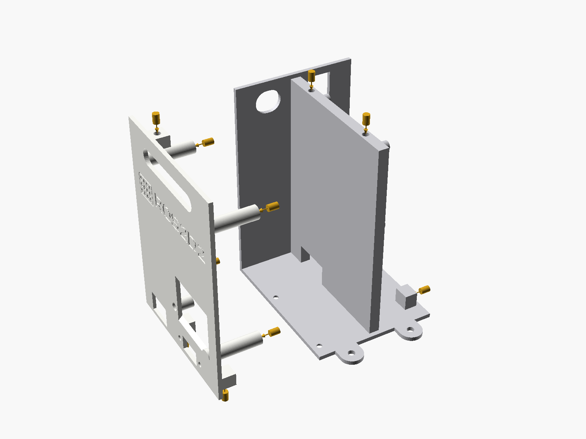

**Necesitas:** 13× inserto M3

Con el soldador a unos 220 °C mete los 13 insertos rectos y a ras: en la pared principal, 4 en las columnas, 2 en las pestañas de abajo y 1 en la de arriba; en la base, 2 en lo alto del tabique, 2 en el tabique para el convertidor y 2 en los bloques del suelo.

## 2 · Convertidor al tabique

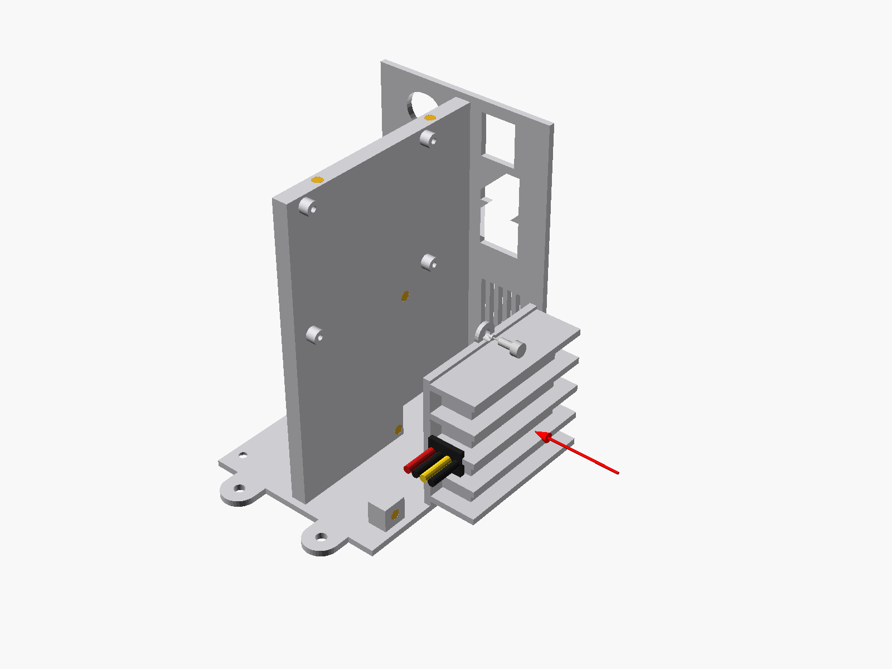

**Necesitas:** 2× M3 × 6 cilíndrico

De pie, con la base contra el tabique, las aletas hacia fuera y los cables hacia delante. Comprueba antes con el calibre sus agujeros (`conv_holes`).

## 3 · Raspberry Pi al tabique

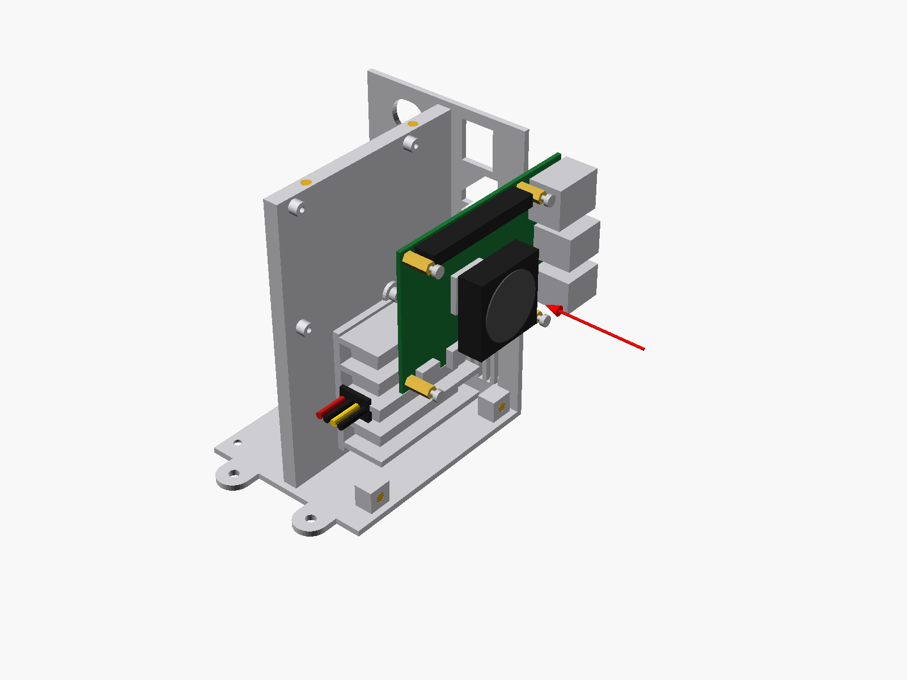

**Necesitas:** 4× M2.5 × 6

Sobre sus 4 columnas, con los USB y el Ethernet a ras de la trasera y el USB-C abajo. Conecta el USB-C acodado y empálmalo con la salida de 5 V del convertidor.

## 4 · XT60 e interruptor en la pared principal

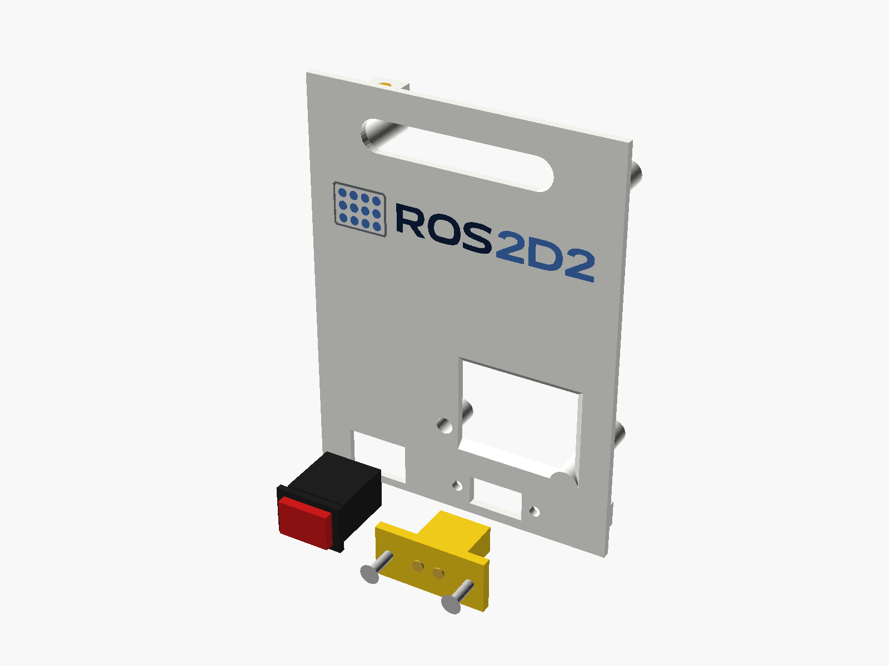

**Necesitas:** 2× M3 × 10 avellanado, 2× tuerca M3

Desde fuera, abajo: el XT60E-F girado, con 2 tornillos y sus tuercas por dentro, y el interruptor a presión.

## 5 · Varilla y placa de la Pico

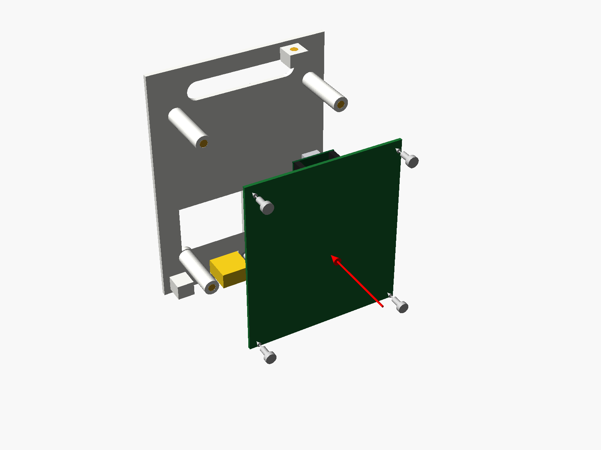

**Necesitas:** 4× M3 × 6

Mete la varilla desde dentro por su guía y atornilla la placa a las 4 columnas, componentes hacia la pared. Aprieta los 5 V en el borne J1, pincha el micro-USB acodado en la Pico y conecta los sensores: sus cables salen por la ranura de arriba.

## 6 · Pared principal a la base

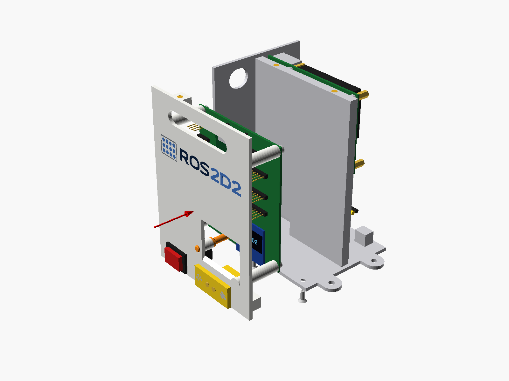

**Necesitas:** 2× M3 × 8 avellanado

Pasa los cables de 24 V (XT60 → interruptor → convertidor) y los 5 V del borne J1 por el hueco de abajo del tabique. Atornilla la pared desde debajo del suelo.

## 7 · Tapa

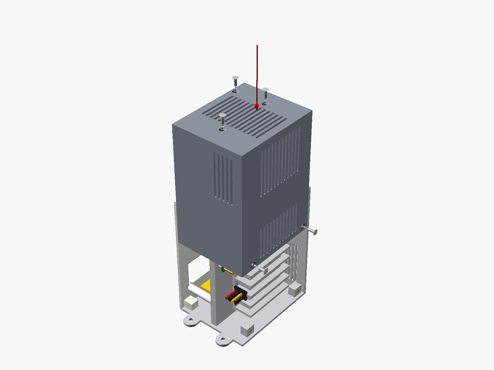

**Necesitas:** 5× M3 × 8 avellanado

Bájala desde arriba y pon los 3 tornillos del techo y los 2 del lateral.

## 8 · USB y fijación al R2

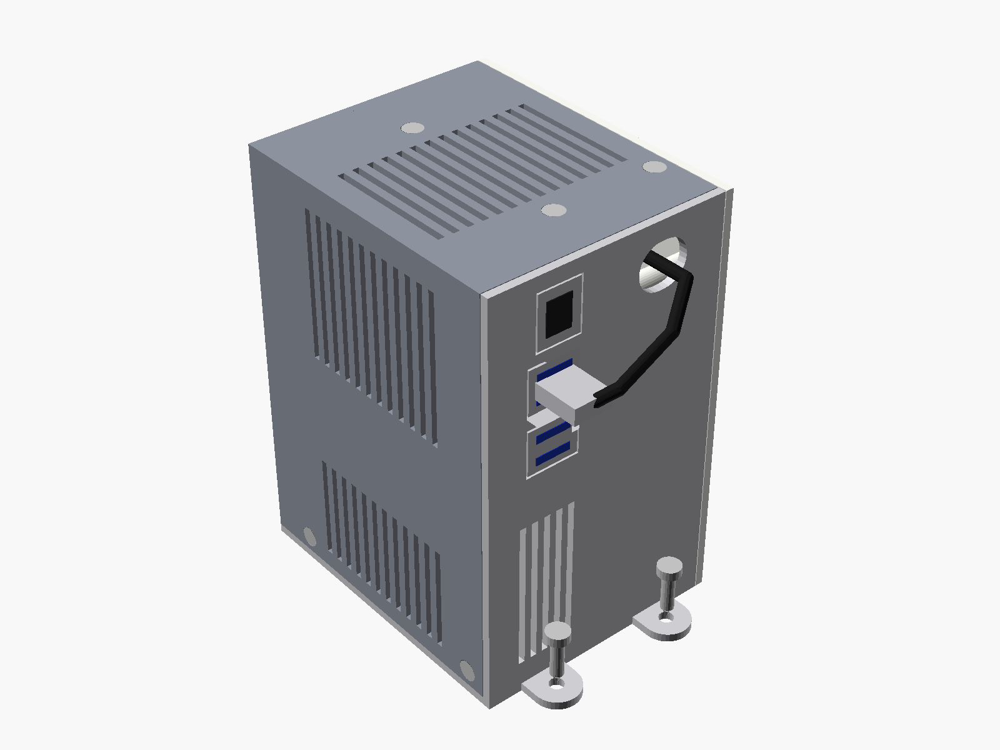

**Necesitas:** 4× M4 × 12

Saca el micro-USB por la muesca de la trasera y enchúfalo en un USB de la Pi. Atornilla la caja al R2 por sus 4 orejetas.
