# Caja ROS2 rack · Instrucciones de montaje

[English version](ASSEMBLY.md)

Segunda caja, tipo rack: la placa de la Pico, la Pi y el convertidor van de pie, en paralelo. 78 × 95 × 145 mm (1,07 L). La Pi va abajo y el convertidor arriba, para que su calor no suba hacia la Pi. Vale para la Pi 4 y la Pi 5: solo cambia el marco de la trasera. La OLED, el logo, el interruptor y el XT60 están en la pared principal; los USB de la Pi y un HDMI de panel, detrás. Todo va atornillado a insertos. Antes de imprimir mide lo que indica el README.

| Montada | Por detrás |
|---|---|
| 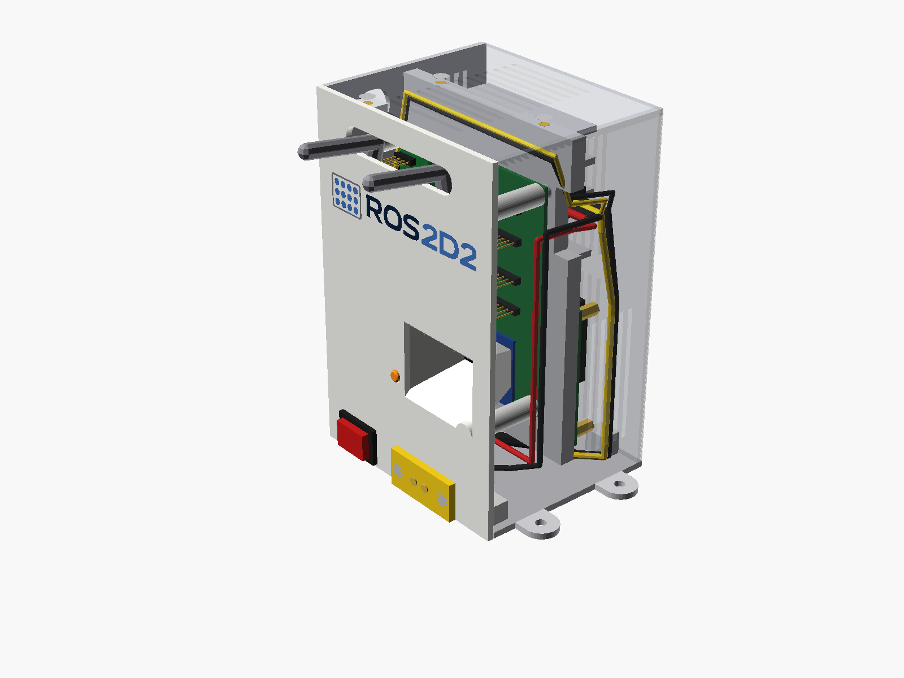 | 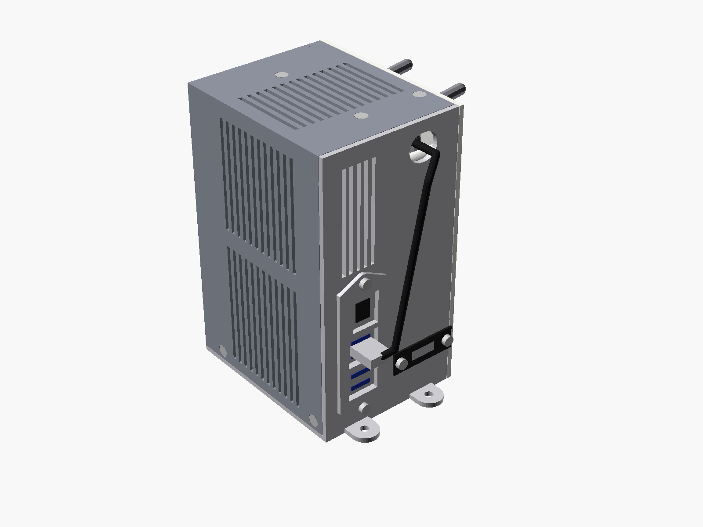 |

**Información actualizada, STL y fuentes:** <https://github.com/BeskarCode/ROS2D2/tree/main/hardware/caja_ros2_rack>

## Tamaño frente al R2

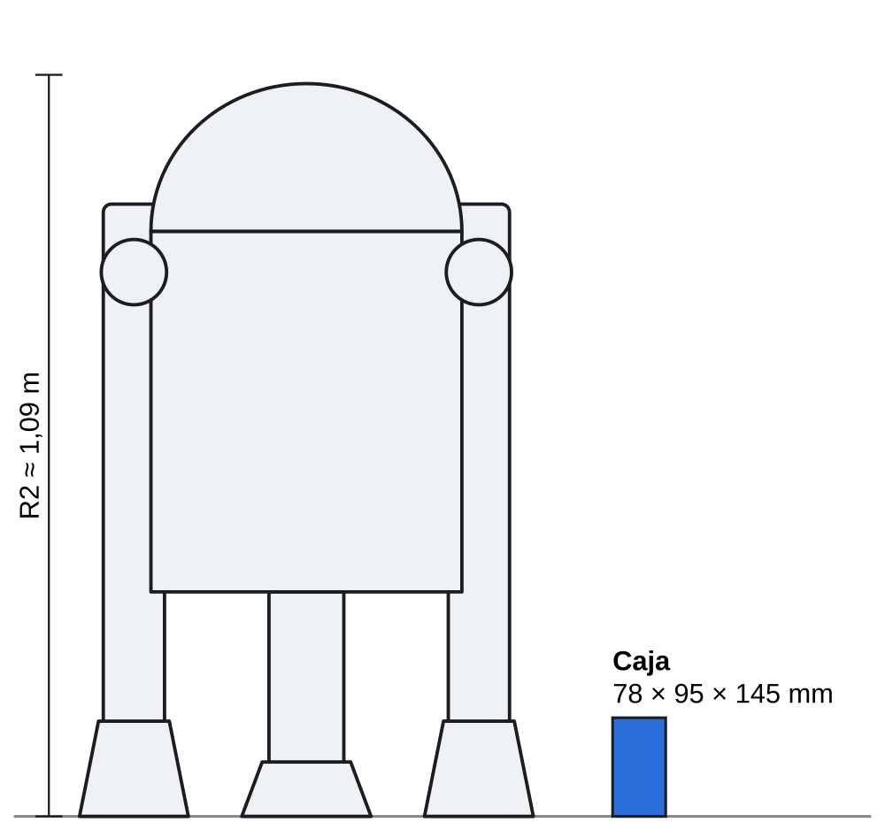

## Por dentro (sin carcasa)

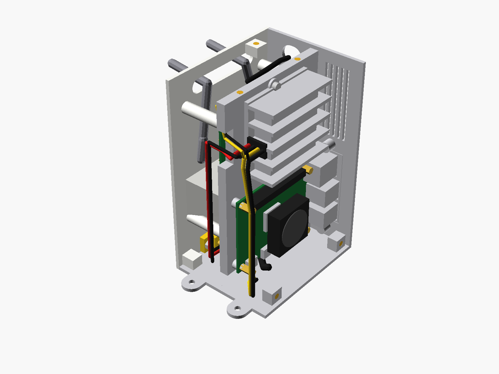

## Despiece

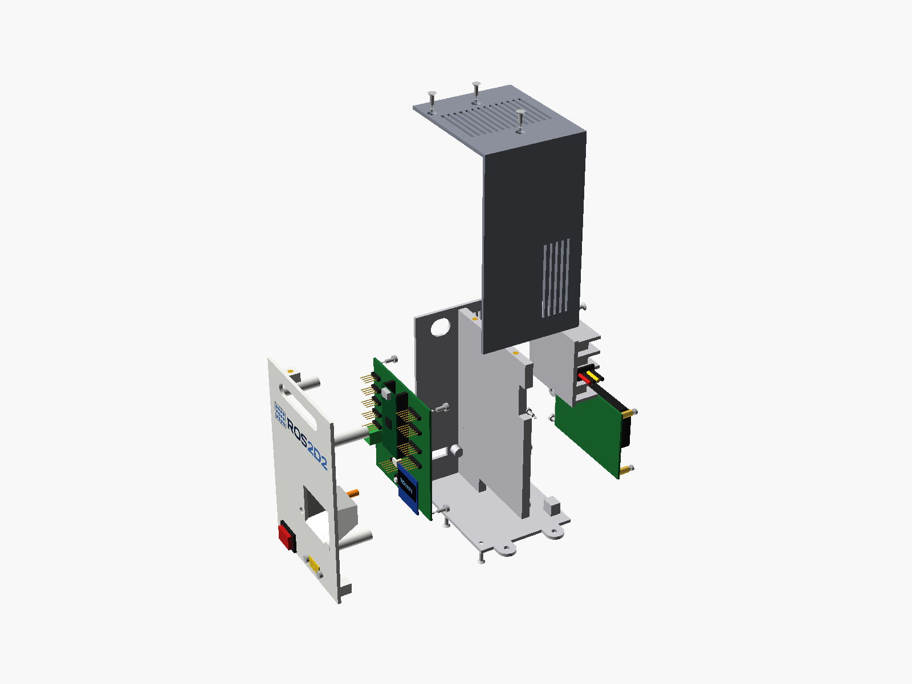

## Tornillería y material

### Piezas impresas

| Pieza | |
|---|---|
| `stl/pared_multicolor_bambu.3mf` | Pared principal con el logo en 4 colores (AMS: blanco, marino, azul, gris) |
| `stl/pared_monocolor.stl` | o bien: pared principal de un color, logo grabado |
| `stl/con_leds/pared_led_multicolor_bambu.3mf` | o bien: pared con un agujero sobre cada LED de la placa de la Pico, logo abajo y nombres de los conectores (AMS: blanco, marino, azul, gris) |
| `stl/con_leds/pared_led_monocolor.stl` | o bien: la pared con LEDs de un color, logo y nombres grabados |
| `stl/sin_ams/pared_led_sin_ams.stl` | o bien: la pared con LEDs sin AMS, logo y nombres en hueco de 1,5 mm, con sus 3 rellenos (sin_ams/relleno_marino.stl, relleno_azul.stl, relleno_gris.stl) impresos aparte y pegados |
| `stl/con_leds/lentes_led.stl` | Lentillas de los LEDs (solo con la pared con LEDs): 12 discos de PLA translúcido (o PETG transparente), 10 y 2 de repuesto, planos sobre la cama |
| `stl/base.stl` | Base: suelo, trasera, tabique central |
| `stl/tapa.stl` | Tapa (techo + lateral + frontal estrecho) |
| `stl/marco_pi4.stl` | Marco trasero para la Pi 4 (Ethernet arriba) |
| `stl/marco_pi5.stl` | o bien: marco trasero para la Pi 5 (Ethernet abajo) |
| `stl/pulsador.stl` | Varilla del pulsador DISPLAY |

| Cant. | Pieza | Paso |
|---|---|---|
| 17× | Inserto térmico M3 (5,7 mm de largo, agujero de 4,0 mm) | 1 |
| 7× | Tornillo M3 × 8 de cabeza avellanada (ISO 10642) | 6, 7 |
| 8× | Tornillo M3 × 6 de cabeza alomada (ISO 7380) | 3, 5 |
| 2× | Tornillo M3 × 6 de cabeza cilíndrica (DIN 912) | 2 |
| 2× | Tornillo M3 × 10 de cabeza alomada (ISO 7380) | 4 |
| 2× | Tuerca M3 (DIN 934) | 4 |
| 4× | Tornillo M2.5 × 6 | 3 |
| 4× | Tornillo M4 × 12 (o el que pida el soporte del R2) | 8 |
| 4× | Inserto térmico M2,5 (5 mm de largo, agujero de 3,6 mm) | 1 |

### Otro material

| Cant. | Pieza |
|---|---|
| 1 | Interruptor de balancín KCD1 (agujero de panel 19,2 × 13 mm) |
| 1 | Conector XT60E-F de panel (AMASS) |
| 1 | Cable micro-USB 2.0 a USB-A, codo lateral 90°, 30 cm (ver «Conectores acodados») |
| — | Cable de 0,5 mm² para los 5 V del borne J1 y de 1 mm² para los 24 V |
| 1 | Pasacables en tira para la ranura de 35 × 10 mm |
| 1 | Cable USB-C macho con hilos (5 V a la Pi), acodado 90° arriba/abajo, 15–20 cm; 3 A para la Pi 4, 5 A para la Pi 5 |
| 1 | Cable micro-HDMI macho acodado 90° a HDMI hembra de panel con 2 tornillos M3, 30 cm (mide su brida: `hdmi_*`) |

## Conexiones

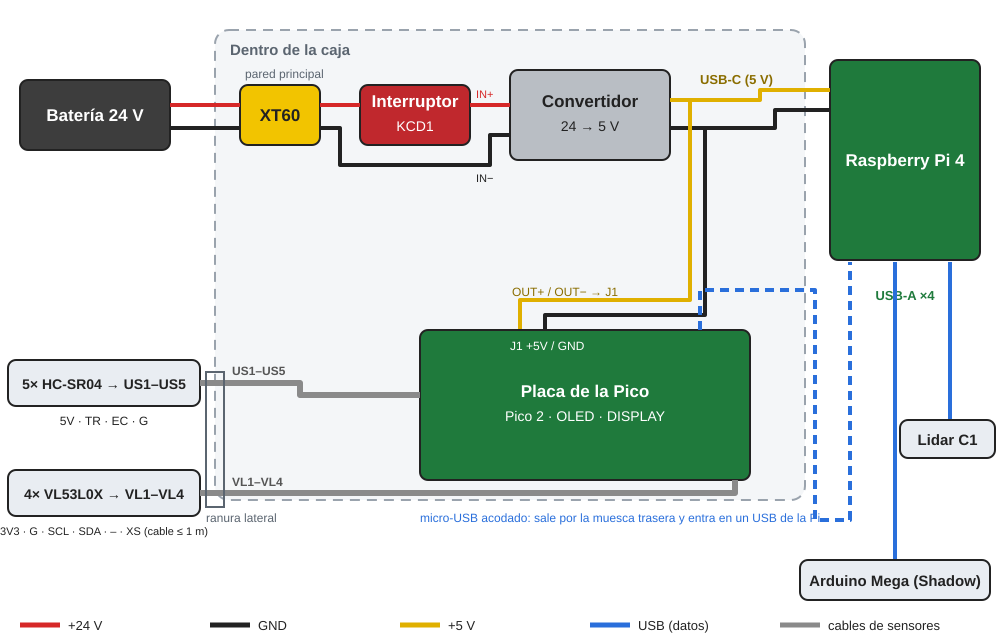

## Conectores acodados: hacia dónde sale el cable

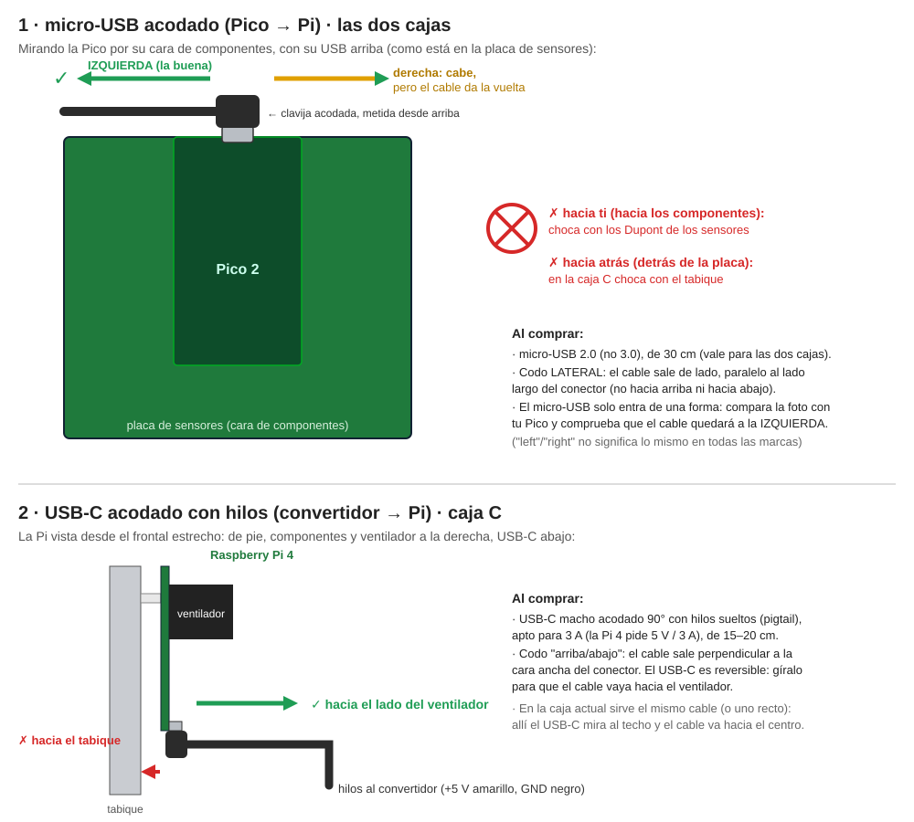

## 1 · Insertos térmicos

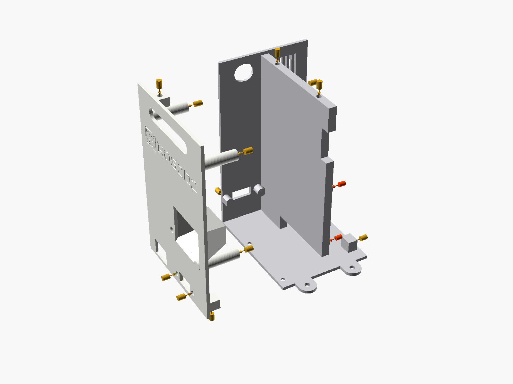

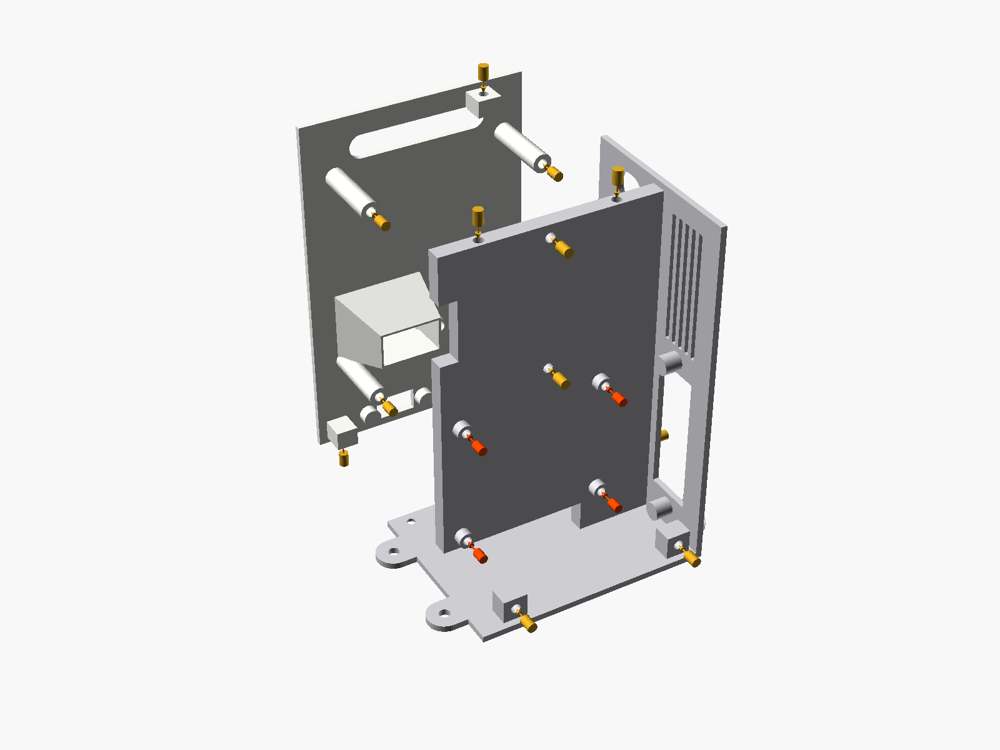

**Necesitas:** 17× inserto M3, 4× inserto M2,5

Con el soldador a unos 220 °C mete los insertos rectos y a ras. Hay dos tamaños y no se cambian entre sí: 17 M3 (5,7 mm de largo, agujero de 4,0 mm) y 4 M2,5 (5 mm de largo, agujero de 3,6 mm), que son los pequeños. En el dibujo, los M3 en dorado y los M2,5 en rojo.

- **M3** · pared principal, por dentro (7): 4 en las columnas de la placa de la Pico, 2 en las pestañas de abajo y 1 en la pestaña de arriba.
- **M3** · base, por dentro (6): 2 en lo alto del tabique, 2 en el tabique para el convertidor y 2 en los bloques del suelo.
- **M3** · trasera de la base, por fuera (4): 2 del marco de la Pi y 2 del HDMI.
- **M2,5** · base (4): las 4 columnas de la Pi. Son los únicos M2,5 de la caja.

## 2 · Convertidor al tabique, arriba

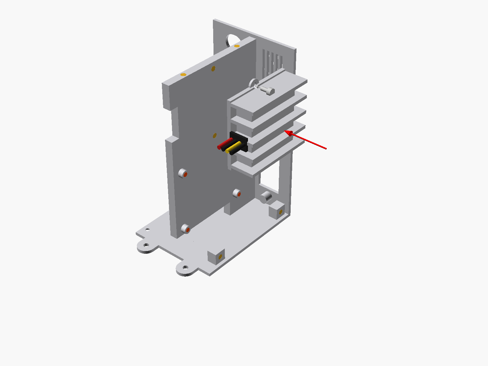

**Necesitas:** 2× M3 × 6 cilíndrico

De pie, arriba del todo, con la base contra el tabique, las aletas hacia fuera y los cables hacia delante: van por el hueco de arriba del tabique al lado de la Pico. Así su calor sube y sale por el techo sin pasar por la Pi. Comprueba antes con el calibre sus agujeros (`conv_holes`).

## 3 · Raspberry Pi, marco y HDMI

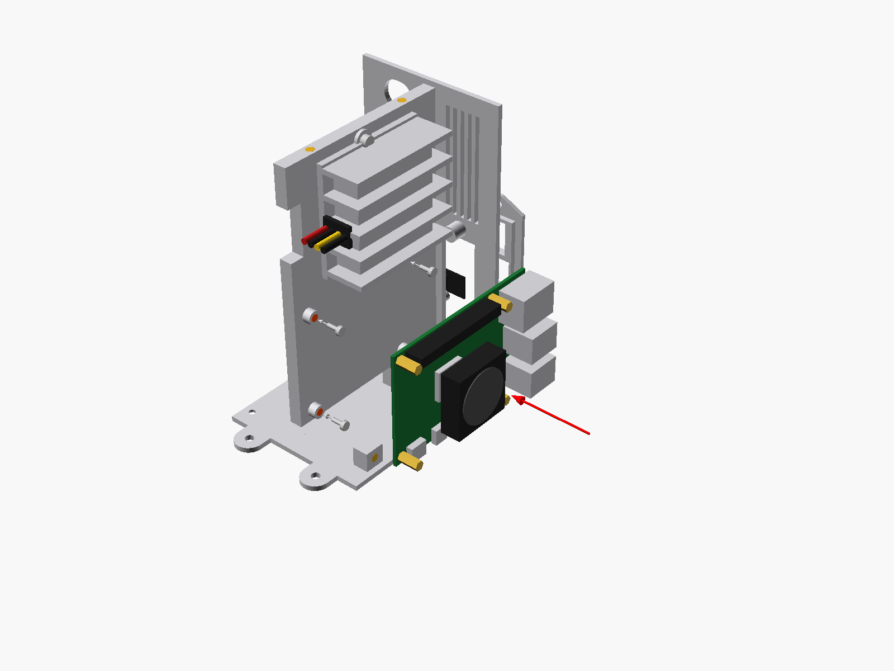

**Necesitas:** 4× M2.5 × 6, 4× M3 × 6

Pi 4 o Pi 5 sobre sus 4 columnas, abajo, con los USB y el Ethernet en la ventana de la trasera y el USB-C abajo. Pincha el USB-C acodado (5 V del convertidor, bajando por delante de la Pi) y el micro-HDMI acodado en el HDMI 0; ese cable pasa bajo la Pi por el hueco de abajo del tabique. Atornilla desde fuera el marco de tu Pi (`marco_pi4` o `marco_pi5`) y el conector HDMI de panel.

## 4 · XT60 e interruptor en la pared principal

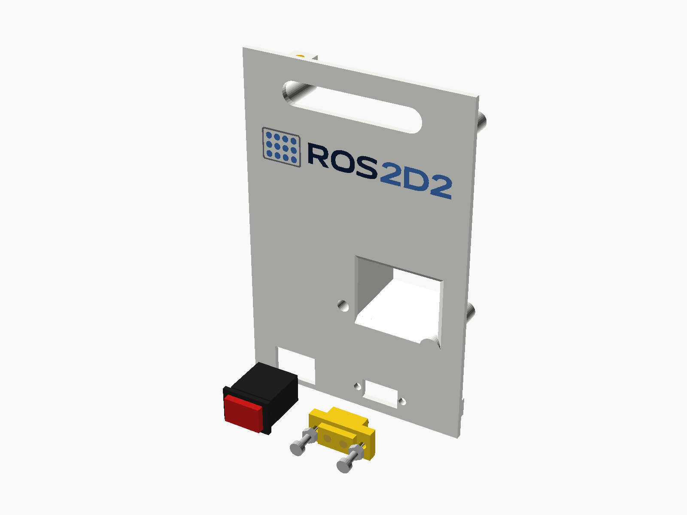

**Necesitas:** 2× M3 × 10, 2× tuerca M3

Abajo: el XT60 macho girado, desde dentro, con su frontal asomando por el hueco y la brida contra la pared. Pon los 2 tornillos M3 desde fuera, por los agujeros pasantes y la brida, hasta las tuercas de detrás. El interruptor entra a presión desde fuera.

## 5 · Varilla y placa de la Pico

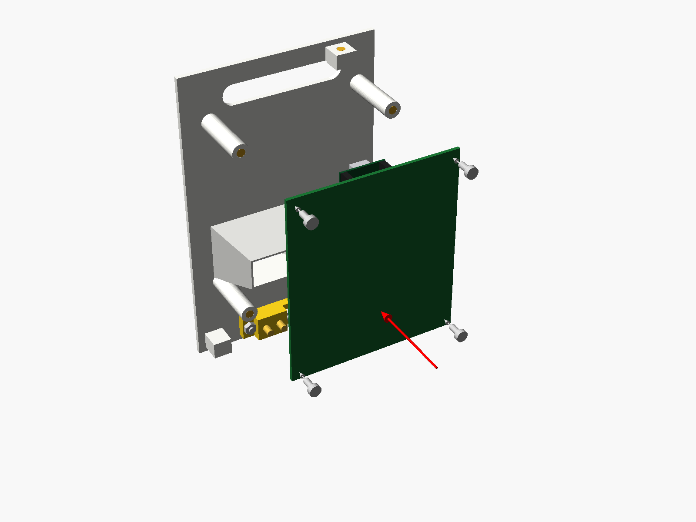

**Necesitas:** 4× M3 × 6

Con la pared con LEDs, mete desde fuera una lentilla en cada agujero, el tetón dentro del tubo, hasta que quede a ras; si alguna baila, una gota de pegamento. Mete la varilla desde dentro por su guía. Antes de atornillar, presenta la placa sin tornillos sobre las 4 columnas, componentes hacia la pared: debe asentar en las cuatro sin balancearse; si se balancea, algún tubo toca su LED: lija la punta. Luego atorníllala. Si algún día usas J4 (EXP), su cable rodea el tubo PWR. Aprieta los 5 V en el borne J1, pincha el micro-USB acodado en la Pico y conecta los sensores: sus cables salen por la ranura de arriba.

## 6 · Pared principal a la base

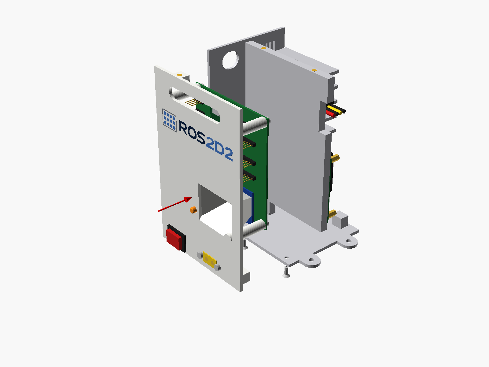

**Necesitas:** 2× M3 × 8 avellanado

Los 24 V (XT60 → interruptor → convertidor) suben por delante de la placa de la Pico y cruzan por el hueco de arriba del tabique; los 5 V del borne J1 vuelven por el mismo hueco y por encima de la placa. Atornilla la pared desde debajo del suelo.

## 7 · Tapa

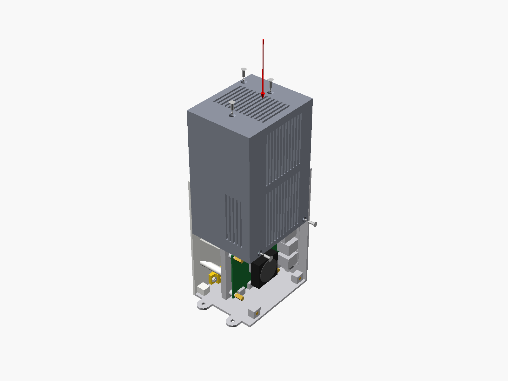

**Necesitas:** 5× M3 × 8 avellanado

Bájala desde arriba y pon los 3 tornillos del techo y los 2 del lateral. El aire entra por las rejillas de abajo (frontal y lateral, junto a la Pi) y sale por las de arriba y el techo.

## 8 · USB y fijación al R2

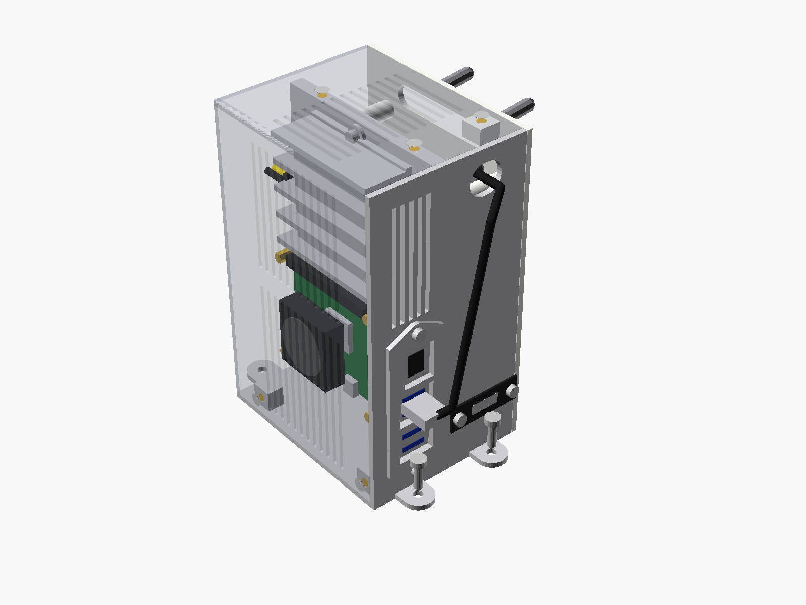

**Necesitas:** 4× M4 × 12

Saca el micro-USB por la muesca de la trasera, bájalo por fuera y enchufa su USB-A en un USB de la Pi: es el conector que se ve fuera de la caja en el dibujo (no está suelto). Por él la Pi recibe los sensores y flashea el firmware de la Pico. Atornilla la caja al R2 por sus 4 orejetas.
