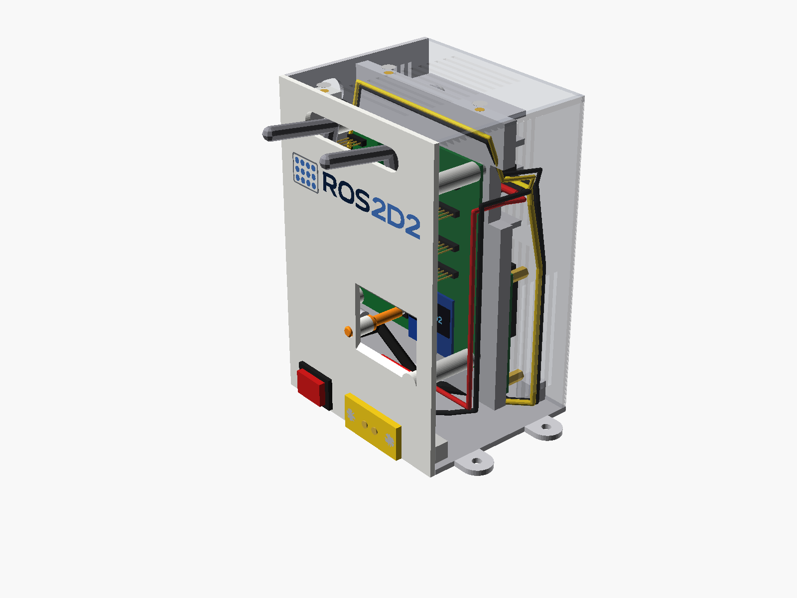
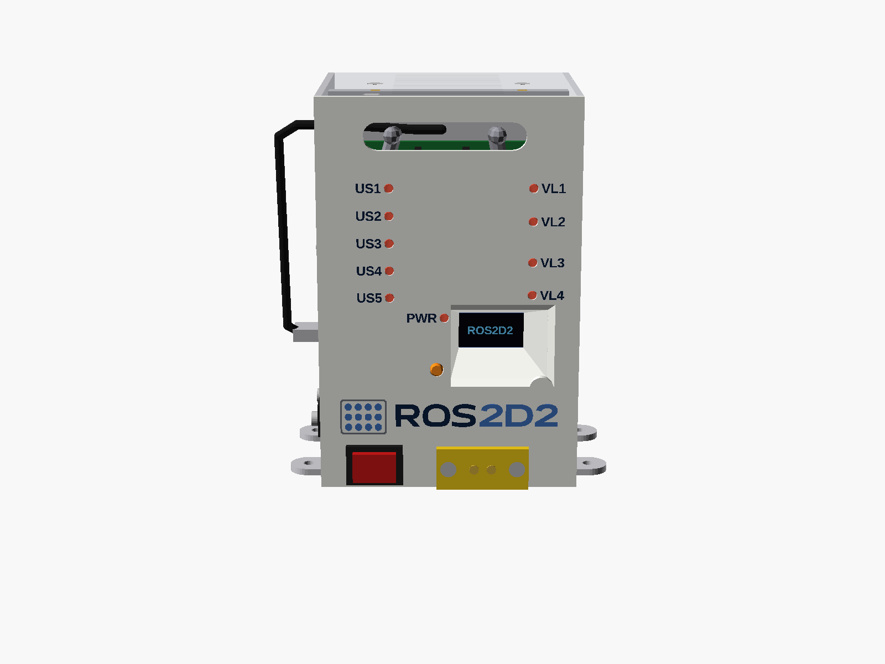

# ROS2 box · option C "rack blade"

*En castellano: [README_es.md](README_es.md)*

A second box for the same R2 ROS 2 system (Raspberry Pi 4 or Pi 5, the Pico board, a 24 → 5 V
converter, an XT60E-F and a switch), smaller than the mini tower in [`../caja_ros2`](../caja_ros2):
the boards stand **upright, side by side, like the blades of a rack**.

**78 × 95 × 145 mm · 1.07 L** (the mini tower: 107 × 133 × 125, 1.78 L), plus 4 lugs.

Every screw goes into a **heat-set insert**, the boards' too (M2.5 for the Pi, M3 for the rest).



**Step-by-step assembly instructions, with an exploded view, the list of screws and the wiring:**
[ASSEMBLY.md](ASSEMBLY.md) · [PDF](montaje/ASSEMBLY.pdf) — En castellano: [MONTAJE.md](MONTAJE.md) · [PDF](montaje/MONTAJE.pdf)

## What goes where inside

- **Main wall** (the large side): the OLED window, the logo in 4 colours, the DISPLAY button rod, a
  single slot for the sensor cables (at the top) and, at the bottom, the XT60E-F (turned) and the
  switch.
- **Pico board**: upright, hanging from 4 columns of the main wall, parts facing it (30 mm for the
  Dupont connectors).
- **Middle divider**: holds the Pi (columns with M2.5 inserts) and the converter (M3 inserts). It has
  two cable passes: top front, where the converter's wires go out towards the Pico side; and bottom,
  under the Pi, for the HDMI (and the USB-C if you want to route it there).
- **Raspberry Pi 4 or Pi 5**: upright, **at the bottom**, with the USB and Ethernet in the window at
  the back and the USB-C facing down (15 mm free for angled USB-C and micro-HDMI plugs).
- **Converter**: upright, **at the top**, with 5 mm of air above the Pi and its wires facing forward.
  Its heat rises and leaves through the roof and the side's upper vent without passing the Pi; the Pi
  takes fresh air through the lower vents of the front and the side.
- **Back**: a single window for both Pis' connectors, closed with a **swappable frame** (`marco_pi4`
  or `marco_pi5`: the Pi 5 has the Ethernet and the USB the other way round). The USB openings are
  0.5 mm bigger on each side for the tabs of the connector's shell. Next to it, an **HDMI panel
  socket** wired to the Pi's HDMI 0, to plug in a monitor.
- **Lid**: roof, right side and narrow front in one piece that comes down from above.

## Parts

| STL | What it is | How to print |
|---|---|---|
| `stl/pared_multicolor_bambu.3mf` | main wall + navy, blue and grey logo (4 parts with their filament) | logo face on the bed; AMS: 1 white, 2 navy, 3 blue, 4 grey |
| `stl/pared_multicolor.3mf` | the same, generic 3MF for other slicers | |
| `stl/pared_monocolor.stl` | single-colour main wall, logo engraved 1 mm | logo face on the bed |
| `stl/base.stl` | floor, back, divider and lugs | floor on the bed |
| `stl/tapa.stl` | roof, side and narrow front | roof on the bed |
| `stl/pulsador.stl` | DISPLAY button rod | standing |
| `stl/marco_pi4.stl` | back frame for the Pi 4 | outer face on the bed |
| `stl/marco_pi5.stl` | back frame for the Pi 5 | outer face on the bed |

PETG, 0.2 mm, 0.4 nozzle, no supports.

## Main wall with LEDs (optional)



Another version of the main wall, to see the Pico board's 10 LEDs from outside: a hole over each one
(VL1–VL4, US1–US5 and PWR) with its name beside it, and the logo lower down, between the OLED window
and the XT60. Its parts are in `stl/con_leds/`. Print **one** of the two walls: the one above or this
one. The other parts are the same.

| STL | What it is | How to print |
|---|---|---|
| `stl/con_leds/pared_led_multicolor_bambu.3mf` | wall with LEDs + logo and names in navy, blue and grey | logo face on the bed; AMS: 1 white, 2 navy, 3 blue, 4 grey |
| `stl/con_leds/pared_led_multicolor.3mf` | the same, generic 3MF | |
| `stl/con_leds/pared_led_monocolor.stl` | single-colour wall with LEDs, logo and names engraved 1 mm | logo face on the bed |
| `stl/con_leds/guias_luz.stl` | light pipes: a frame with the 10 rods of 3 mm (optional) | **translucent PLA**, outer ends on the bed, 100 % infill |
| `stl/con_leds/prueba_luz.stl` | a single rod to try the filament | translucent PLA, standing, 100 % infill |

The light pipes are **optional**: without them the LEDs show through the holes. If you fit them, they
clip onto the wall (4 hooks) **before the board is hung**, and they never touch the board: each rod
ends 0.7 mm above its LED. Before printing the piece, try your filament with `prueba_luz.stl` over a
lit LED (translucent PLA works well; if yours does not, try clear PETG). When assembling, rest the
board on its 4 columns without screws: it must sit without rocking; if it rocks, a rod touches its
LED: sand the tip. To take the piece out, open the hooks two at a time with a small screwdriver.

## Before printing: check these measurements

In `params.scad` (change the value and generate again):

- `conv_holes`: the holes in the converter's ears (taken from RCNUN's drawing; check with a caliper
  the distance to the tip of the ear).
- `xt60_hole_pitch` and `xt60_body`: XT60E-F (the hole pitch is not given in its drawing).
- `sw_cut`: the switch's panel hole (19.2 × 13 for a KCD1).
- `sw1_h`: height of the DISPLAY button.
- `pi_fan_clear`: height of the Pi's fan.
- `hdmi_body`, `hdmi_flange`, `hdmi_pitch`: the HDMI panel socket you buy (body, flange and distance
  between its 2 M3 screws).

Cables: the **30 cm side-angled micro-USB** and the **angled USB-C pigtail** are the same as in the
mini tower (3 A for the Pi 4; **5 A for the Pi 5**); see "Angled connectors" in the guide. For the
monitor, an **angled male micro-HDMI → HDMI panel socket** cable, about 30 cm.

## Generating the files

```bash
python -I hardware/caja_ros2_rack/build.py         # stl/ and the 3MFs
python -I hardware/caja_ros2_rack/build_docs.py    # images, MONTAJE.md, ASSEMBLY.md and PDF
python -m pytest hardware/caja_ros2_rack/tests     # clashes, fits, screws, printing
```

The logo and its SVGs are shared with the mini tower (`../caja_ros2/logo`), scaled to 80 mm.
