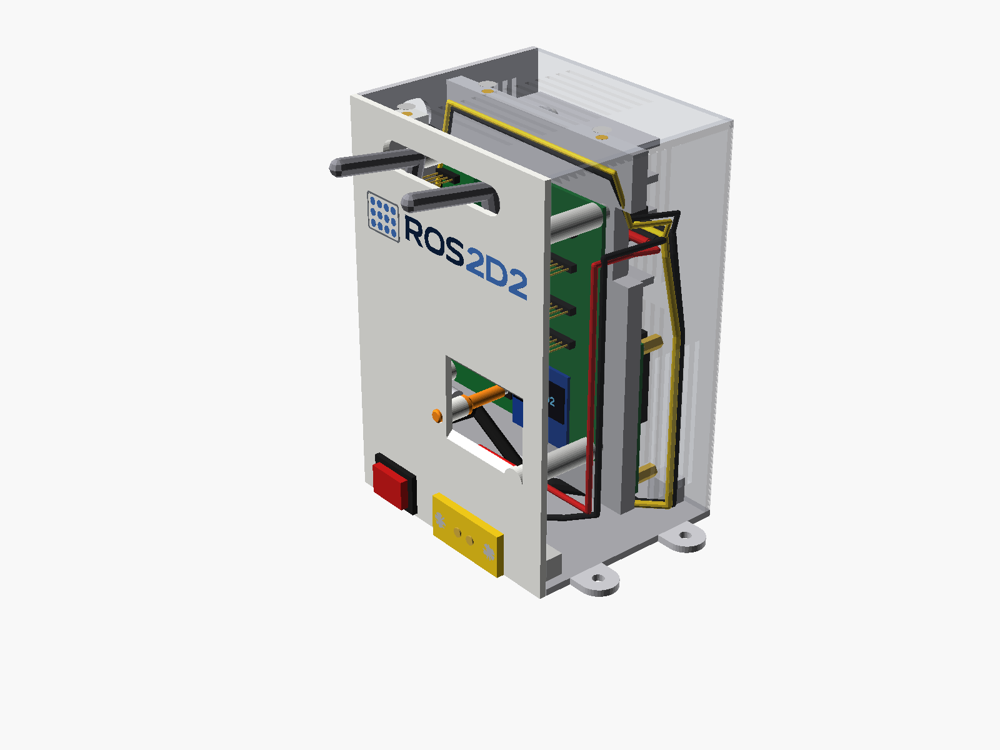
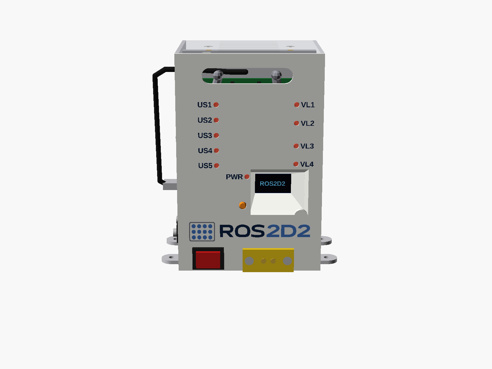

# Caja ROS2 · opción C "rack blade"

*In English: [README.md](README.md)*

Segunda caja para el mismo sistema ROS 2 del R2 (Raspberry Pi 4 o Pi 5, placa de la Pico, convertidor
24 → 5 V, XT60E-F e interruptor), más pequeña que la mini torre de [`../caja_ros2`](../caja_ros2):
las placas van **de pie, en paralelo, como cuchillas de un rack**.

**78 × 95 × 145 mm · 1,07 L** (la mini torre: 107 × 133 × 125, 1,78 L), más 4 orejetas.

Todos los tornillos van a **insertos térmicos**, también los de las placas (M2,5 en la Pi, M3 en el resto).



**Instrucciones de montaje paso a paso, con despiece, lista de tornillería y plano de conexiones:**
[MONTAJE.md](MONTAJE.md) · [PDF](montaje/MONTAJE.pdf) — English: [ASSEMBLY.md](ASSEMBLY.md) · [PDF](montaje/ASSEMBLY.pdf)

## Cómo va por dentro

- **Pared principal** (el lateral grande): ventana de la OLED, logo en 4 colores, varilla del
  pulsador DISPLAY, ranura única para los cables de los sensores (arriba) y, abajo, el XT60E-F
  (girado) y el interruptor.
- **Placa de la Pico**: de pie, colgada de 4 columnas de la pared principal, con los componentes
  hacia ella (30 mm para los Dupont).
- **Tabique central**: sujeta la Pi (columnas con insertos M2,5) y el convertidor (insertos M3).
  Tiene dos pasos de cables: arriba y delante, donde salen los cables del convertidor hacia el lado
  de la Pico; y abajo, bajo la Pi, para el HDMI (y el USB-C si se quiere llevar por ahí).
- **Raspberry Pi 4 o Pi 5**: de pie, **abajo**, con los USB y el Ethernet en la ventana de la
  trasera y el USB-C hacia abajo (15 mm libres para las clavijas acodadas USB-C y micro-HDMI).
- **Convertidor**: de pie, **arriba**, con 5 mm de aire sobre la Pi y los cables hacia delante.
  Su calor sube y sale por el techo y la rejilla alta del lateral sin pasar por la Pi; la Pi
  toma aire fresco por las rejillas bajas del frontal y del lateral.
- **Trasera**: una sola ventana para los conectores de las dos Pi, cerrada con un **marco
  intercambiable** (`marco_pi4` o `marco_pi5`: la Pi 5 tiene el Ethernet y los USB al revés). Los
  huecos de los USB tienen 0,5 mm más por cada lado para las pestañas de la carcasa del conector.
  Al lado, un **HDMI hembra de panel** conectado al HDMI 0 de la Pi, para enchufar un monitor.
- **Tapa**: techo, lateral derecho y frontal estrecho en una pieza que baja desde arriba.

## Piezas

| STL | Qué es | Cómo imprimir |
|---|---|---|
| `stl/pared_multicolor_bambu.3mf` | pared principal + logo marino, azul y gris (4 partes con su filamento) | cara del logo sobre la cama; AMS: 1 blanco, 2 marino, 3 azul, 4 gris |
| `stl/pared_multicolor.3mf` | lo mismo, 3MF genérico para otros laminadores | |
| `stl/pared_monocolor.stl` | pared principal de un color, logo grabado 1 mm | cara del logo sobre la cama |
| `stl/base.stl` | suelo, trasera, tabique y orejetas | suelo sobre la cama |
| `stl/tapa.stl` | techo, lateral y frontal estrecho | techo sobre la cama |
| `stl/pulsador.stl` | varilla del pulsador DISPLAY | de pie |
| `stl/marco_pi4.stl` | marco trasero para la Pi 4 | cara exterior sobre la cama |
| `stl/marco_pi5.stl` | marco trasero para la Pi 5 | cara exterior sobre la cama |

PETG, 0,2 mm, boquilla 0,4, sin soportes.

## Pared con LEDs (opcional)



Otra versión de la pared principal, para ver desde fuera los 10 LEDs de la placa de la Pico: un
agujero sobre cada uno (VL1–VL4, US1–US5 y PWR) con su nombre al lado, y el logo más abajo, entre
la ventana de la OLED y el XT60. Sus piezas están en `stl/con_leds/`. Imprime **una** de las dos paredes: la de arriba o esta.
El resto de piezas es el mismo.

| STL | Qué es | Cómo imprimir |
|---|---|---|
| `stl/con_leds/pared_led_multicolor_bambu.3mf` | pared con LEDs + logo y nombres en marino, azul y gris | cara del logo sobre la cama; AMS: 1 blanco, 2 marino, 3 azul, 4 gris |
| `stl/con_leds/pared_led_multicolor.3mf` | lo mismo, 3MF genérico | |
| `stl/con_leds/pared_led_monocolor.stl` | pared con LEDs de un color, logo y nombres grabados 1 mm | cara del logo sobre la cama |
| `stl/con_leds/guias_luz.stl` | guías de luz: un marco con las 10 barras de 3 mm (opcional) | **PLA translúcido**, extremos exteriores sobre la cama, relleno 100 % |
| `stl/con_leds/prueba_luz.stl` | una barra suelta para probar el filamento | PLA translúcido, de pie, relleno 100 % |

Las guías de luz son **opcionales**: sin ellas los LEDs se ven por los agujeros. Si las pones, se
enganchan en la pared (4 ganchos) **antes de colgar la placa**, y nunca tocan la placa: cada barra
acaba 0,7 mm por encima de su LED. Antes de imprimir la pieza, prueba tu filamento con
`prueba_luz.stl` sobre un LED encendido (el PLA translúcido se ve bien; si el tuyo no, prueba PETG
transparente). Al montar, presenta la placa sin tornillos sobre sus 4 columnas: debe asentar sin
balancearse; si se balancea, alguna barra toca su LED: lija la punta. Para sacar la pieza, abre los
ganchos de dos en dos con un destornillador pequeño.

## Antes de imprimir: comprueba estas medidas

En `params.scad` (cambia el valor y vuelve a generar):

- `conv_holes`: agujeros de las orejetas del convertidor (sacados del plano de RCNUN; comprueba con
  calibre la distancia a la punta de la orejeta).
- `xt60_hole_pitch` y `xt60_body`: XT60E-F (paso entre agujeros sin acotar en su plano).
- `sw_cut`: agujero de panel del interruptor (19,2 × 13 para un KCD1).
- `sw1_h`: altura del pulsador DISPLAY.
- `pi_fan_clear`: altura del ventilador de la Pi.
- `hdmi_body`, `hdmi_flange`, `hdmi_pitch`: el HDMI hembra de panel que compres (cuerpo, brida y
  distancia entre sus 2 tornillos M3).

Cables: el **micro-USB acodado lateral de 30 cm** y el **USB-C acodado con hilos** son los mismos
que en la mini torre (3 A para la Pi 4; **5 A para la Pi 5**); mira «Conectores acodados» en el
manual. Para el monitor, un cable **micro-HDMI macho acodado → HDMI hembra de panel**, de unos 30 cm.

## Generar los ficheros

```bash
python -I hardware/caja_ros2_rack/build.py         # stl/ y los 3MF
python -I hardware/caja_ros2_rack/build_docs.py    # imágenes, MONTAJE.md, ASSEMBLY.md y PDF
python -m pytest hardware/caja_ros2_rack/tests     # choques, encajes, tornillería, impresión
```

El logo y sus SVG se comparten con la mini torre (`../caja_ros2/logo`), escalados a 80 mm.
