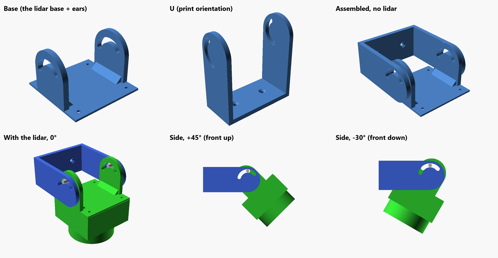

# RPLIDAR C1 tilt mount

A mount for the RPLIDAR C1, hanging upside down from the droid, with an adjustable tilt to level
the lidar's scan or aim it a little at the floor.



Two printed parts:

| File | Part | Print |
|---|---|---|
| `lidar-base.stl` | The lidar base (the C1's 4 x M2.5 holes, 43 x 43 mm) with two ears on top, each with a long arc slot | Plate on the bed, ears up |
| `lidar-u.stl` | The U: its web screws to the droid (2 x M3 countersunk, 30 mm apart), its wings, also slotted, go outside the ears. 72.6 mm long | Web on the bed, already oriented |
| `lidar-u-short.stl` | The same U, 1 cm shorter (62.6 mm), for where the long one does not fit (inside the skirt) | Web on the bed, already oriented |

Pick one of the two U's:

| U | Length | Tilts up | Tilts down (front to the floor) |
|---|---|---|---|
| `lidar-u.stl` | 72.6 mm (stands 25 mm off the base) | 45° and more | about 27° |
| `lidar-u-short.stl` | 62.6 mm (stands 15 mm off the base) | 45° and more | about 14° |

The slots (4.4 mm wide, for the M4) run 125° around the pivot, 75° of it towards the U, so they
are not what stops the tilt. Tilting the front down swings the bottom of the (upside down) lidar
towards the U's web and the droid; with the short U it touches sooner. To level the lidar, or aim it a little at the floor, either is enough.

One M4 bolt with a wing nut on each side goes through the slot of the ear and the slot of the
wing: loosen, set the angle, tighten.

## Assembly

1. Screw the U to the droid first (the M3 heads sit inside the U; with the base in place you
   cannot reach them).
2. Screw the lidar under the base, upside down.
3. Put the base between the wings and fit the two M4 bolts and wing nuts.

Hardware: 4 x M2.5 for the lidar, 2 x M3 countersunk for the droid, 2 x M4 x ~16 mm with wing nuts.

## Changing it

`lidar_mount.scad` (OpenSCAD) has every size at the top: ear height, slot width and angle, the
play between ear and wing, how far the U stands off the droid, the M3 spacing. It is built on
`baselidar.stl`, the lidar base it started from.

```
openscad -o lidar-base.stl -D 'part="base"' lidar_mount.scad
openscad -o lidar-u.stl    -D 'part="u"'    lidar_mount.scad
openscad -o lidar-u-short.stl -D 'part="u"' -D 'STANDOFF=15' lidar_mount.scad
```

`part="mount"` gives both parts assembled (no lidar), `part="assembly"` with a rough C1 and
`tilt=<degrees>` to check the clearances.

Notes:

- `baselidar.stl` has 8 non-manifold edges that OpenSCAD's CGAL refuses, so the base is rebuilt
  from its own outline (same size and holes, its 1.55 mm thickness); its top only wobbled by 0.06 mm.
- The long U stands 25 mm off the base's back edge so that the lidar (41.3 mm tall, upside
  down) clears the U's web down to almost -30°; the short one, 15 mm, trades tilt down for 1 cm less.
- One bolt per side means the angle is held by the wing nuts alone. If the droid's knocks move
  it, a second bolt per side as a fixed pivot is the next step.

The first version (±30° slots) was printed and test-fitted under the skirt; this one, with the
longer slots, is still to be printed. Still to be tried with R2 on the move.
