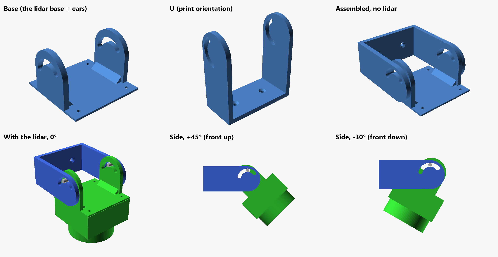

# Soporte basculante para el RPLIDAR C1

*In English: [README.md](README.md)*

Un soporte para el RPLIDAR C1, colgado boca abajo del droide, con inclinación ajustable para nivelar
el barrido del lidar o apuntarlo un poco al suelo.



Dos piezas impresas:

| Fichero | Pieza | Impresión |
|---|---|---|
| `lidar-base.stl` | La base del lidar (los 4 agujeros M2.5 del C1, 43 x 43 mm) con dos orejas arriba, cada una con una ranura larga en arco | La placa sobre la cama, orejas arriba |
| `lidar-u.stl` | La U: su alma se atornilla al droide (2 x M3 avellanados, a 30 mm), sus alas, también ranuradas, van por fuera de las orejas. 72,6 mm de largo | El alma sobre la cama, ya orientada |
| `lidar-u-short.stl` | La misma U, 1 cm más corta (62,6 mm), para donde la larga no cabe (dentro de la falda) | El alma sobre la cama, ya orientada |

Elige una de las dos U:

| U | Largo | Inclina hacia arriba | Inclina hacia abajo (el frente al suelo) |
|---|---|---|---|
| `lidar-u.stl` | 72,6 mm (se separa 25 mm de la base) | 45° y más | unos 27° |
| `lidar-u-short.stl` | 62,6 mm (se separa 15 mm de la base) | 45° y más | unos 14° |

Las ranuras (4,4 mm de ancho, para el M4) recorren 125° alrededor del eje, 75° de ellos hacia la U, así
que no son lo que limita la inclinación. Al bajar el frente, la parte de abajo del lidar (que va boca
abajo) se acerca al alma de la U y al droide; con la U corta toca antes. Para nivelar el lidar, o
apuntarlo un poco al suelo, vale cualquiera.

Un tornillo M4 con una tuerca de mariposa a cada lado pasa por la ranura de la oreja y la del ala:
afloja, pon el ángulo y aprieta.

## Montaje

1. Atornilla primero la U al droide (las cabezas de los M3 quedan dentro de la U; con la base puesta
   ya no llegas).
2. Atornilla el lidar debajo de la base, boca abajo.
3. Mete la base entre las alas y pon los dos tornillos M4 con sus mariposas.

Tornillería: 4 x M2.5 para el lidar, 2 x M3 avellanados para el droide, 2 x M4 x ~16 mm con tuercas de
mariposa.

## Cambiarlo

`lidar_mount.scad` (OpenSCAD) tiene todas las medidas arriba: alto de las orejas, ancho y ángulo de las
ranuras, la holgura entre oreja y ala, cuánto se separa la U del droide, la distancia entre los M3. Está
hecho sobre `baselidar.stl`, la base del lidar de la que partió.

```
openscad -o lidar-base.stl -D 'part="base"' lidar_mount.scad
openscad -o lidar-u.stl    -D 'part="u"'    lidar_mount.scad
openscad -o lidar-u-short.stl -D 'part="u"' -D 'STANDOFF=15' lidar_mount.scad
```

`part="mount"` saca las dos piezas montadas (sin lidar), y `part="assembly"` con un C1 aproximado y
`tilt=<grados>` para comprobar las holguras.

Notas:

- `baselidar.stl` tiene 8 aristas no-manifold que el CGAL de OpenSCAD rechaza, así que la base se
  rehace desde su propio contorno (mismo tamaño y agujeros, su grosor de 1,55 mm); su cara de arriba
  solo variaba 0,06 mm.
- La U larga se separa 25 mm del borde trasero de la base para que el lidar (41,3 mm de alto, boca
  abajo) libre el alma de la U hasta casi -30°; la corta, 15 mm, cambia inclinación hacia abajo por
  1 cm menos.
- Un tornillo por lado significa que el ángulo lo aguantan solo las mariposas. Si los golpes del
  droide lo mueven, el siguiente paso es un segundo tornillo por lado como eje fijo.

La primera versión (ranuras de ±30°) se imprimió y se probó bajo la falda; esta, con las ranuras más
largas, está por imprimir. Falta probarla con R2 en marcha.
