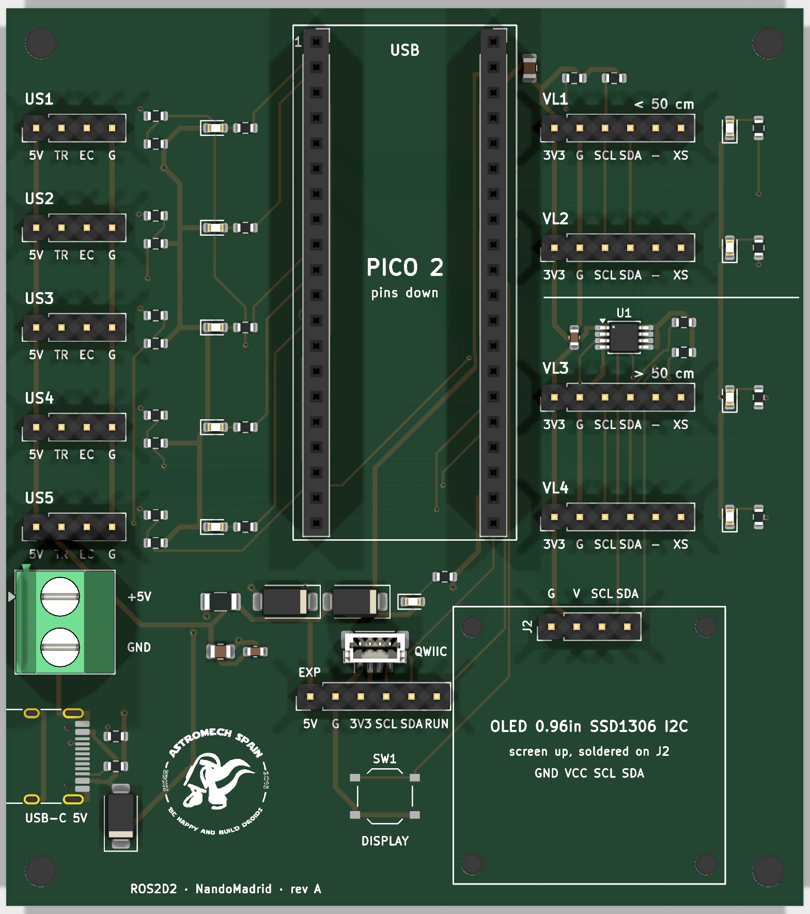

# R2 Pico carrier

*En castellano: [README_es.md](README_es.md)*

A carrier board for the **Raspberry Pi Pico 2** that reads R2's distance sensors (firmware:
`firmware/r2_pico_sensors`). It is ordered **already assembled**: you only plug in the Pico (with its
pins soldered facing down) and the sensor cables.

- 80 × 90 mm, 2 layers, 4 M3 holes in the corners.
- Arrives **assembled at the factory**: only the Pico and the display are missing.
- On the back: Astromech Spain's round logo, **ROS2D2**, **by NandoMadrid**, www.astromechspain.com.
- Schematic: [`renders/schematic.pdf`](renders/schematic.pdf). 3D view: [`renders/3d.png`](renders/3d.png).

## Connectors

Each connector has its pins **in the same order as the module**, so a straight female-female Dupont
cable goes directly, without crossing anything. Pin 1 is the one on the left (square pad).

| Connector | Pins (left → right) | For |
|---|---|---|
| **VL1 … VL4** | 3V3 · GND · SCL · SDA · — (GPIO1, free) · XSHUT | VL53L0X (GY-530) with a cable up to 1 m: all four go through the I2C repeater (PCA9517A) |
| **US1 … US5** | 5V · TRIG · ECHO · GND | HC-SR04. The ECHO divider (1 kΩ / 2 kΩ) is already on the board |
| **OLED** (J2, male header) | GND · VCC · SCL · SDA | 0.96" SSD1306/SSD1315 4-pin I2C display: soldered on top, lying flat, screen up |
| **+5V / GND** (terminal) | 5 V from the droid's supply | Powers the HC-SR04 and the Pico |
| **USB-C 5V** (J5, left edge) | power only | The same as the terminal, with any USB-C or USB-A→C charger (5 V) |
| **QWIIC** (J3, JST-SH 1 mm) | GND · 3V3 · SDA · SCL | Any Qwiic/STEMMA QT module at 3.3 V (IMU, more ToF, GPIO expander, ADC…) |
| **EXP** (J4, 2.54 header) | 5V · GND · 3V3 · SCL · SDA · RUN | Add-ons: the same I2C bus, 5 V and 3.3 V, and RUN (to GND resets the Pico) |
| **DISPLAY** | push button | Turns the display on and steps through the sensors |

With today's `sensors.yaml`: `tof_front_left` → VL1, `tof_front` → VL2, `tof_front_right` → VL3,
`tof_floor` → VL4, `sonar_front_left` → US1, `sonar_front_right` → US2, `sonar_rear` → US3. US4 and
US5 are for the two spare HC-SR04 (GP18/19 and GP20/21).

**Cable rule:** any VL53L0X on any VL, with a cable up to **1 m** (all four at once too: 4 × 1 m fit
with room to spare on the repeater's bus). The HC-SR04 take long cables on any US.

## Power

- **+5V / GND terminal** or **USB-C**: 5 V from the droid's supply or from any USB-C charger (the two
  5.1 kΩ resistors on CC ask it for the 5 V; there is no data). Each input has its own diode, so both
  can be connected at once without one feeding the other, and both go through the same resettable
  fuse (750 mA). The terminal's diode also protects against reversed polarity. The red LED next to
  the terminal (D4) says there are 5 V.
- **Connect the terminal with the Pico's USB unplugged, and check the polarity.** The diode only
  protects if the board has no other ground: with the USB plugged in, the Pi's ground is the board's
  ground too, and reversed wires would short through the USB cable, past both the fuse and the diode.
- The Pico's **USB** goes to the Pi 4 for data. The Pico works on the USB or on the terminal; the
  HC-SR04 **only on the terminal or the USB-C** (the LEDs and the display run on 3.3 V: they also work
  on the USB alone).

## Plugging in the Pico

With the **USB towards the top edge** (where it says USB) and pin 1 next to the "1". The wrong way
round, or one row off, **it can be damaged**: VSYS's 5 V would land on a GPIO or on GND. Look twice
before powering it.

## Display and LEDs

Off until you press **DISPLAY**: the first press, the logo; the next, the last sensor seen; each
press, the next one. After 30 s without a press everything goes off.

One red 0603 LED per connector, next to it, each on its own GPIO (GPIO → 1 kΩ → LED → GND, ~1.3 mA).
The states are told by blinking:

| LED | Means |
|---|---|
| steady on | that sensor is measuring |
| blinking (0.4 s) | configured but not answering |
| off | no sensor configured on that connector |
| short flash every 2 s, all of them | waiting for the Pi to send the setup |
| a short inverted blink every second | it is the connector on the display |

| Connector | VL1 | VL2 | VL3 | VL4 | US1 | US2 | US3 | US4 | US5 |
|---|---|---|---|---|---|---|---|---|---|
| LED GPIO | GP28 | GP27 | GP22 | GP9 | GP0 | GP1 | GP6 | GP7 | GP8 |

That is why those GPIOs are reserved: the firmware and the console do not offer them for sensors.

## Add-ons

The Pico has no free GPIOs left, so anything added goes over **I2C**: the **QWIIC** connector (a
4-wire JST-SH cable, no soldering) or the **EXP** header. Both are on the Pico's short bus (GP16
SDA, GP17 SCL, 4.7 kΩ pull-ups on the board), together with VL1, VL2 and the display: do not use
addresses 0x29 (VL53L0X) or 0x3C (display), and keep cables short (< 50 cm). An I2C expander
(PCF8574, MCP23017…) gives plenty of GPIOs if needed. Do not connect other I2C repeaters or
accelerators (PCA9515/9517, LTC4311…) on QWIIC/EXP: U1's B side cannot share a bus with them.

## Ordering it

> **Tested and working** (November 2026): the boards JLCPCB assembled for us read the VL53L0X and
> the HC-SR04, and the LEDs, the display and its button work.

The files to make it (Gerber, BOM, placement and the board design) are not published in this repo.
The schematic ([`renders/schematic.pdf`](renders/schematic.pdf)) and the renders are here so you can
see how it is wired. Without the board, the sensors can be wired to the Pico by hand:
[`firmware/r2_pico_sensors/wiring.svg`](../../firmware/r2_pico_sensors/wiring.svg).

## What to buy separately

- 0.96" OLED display, **128×64 SSD1306 (or SSD1315) 4-pin I2C**, in the order **GND-VCC-SCL-SDA**
  (some come as VCC-GND: check it), **without the header soldered** (it usually comes loose). J2
  already comes with 4 male pins: put the display on them, screen up and lying on its outline,
  resting on the header's plastic (2.5 mm), solder the 4 pins from the top and cut what is left. If
  you like, also fix it with 4 M2 2.5 mm spacers in H5-H8. Once soldered it does not come off easily.
- Female-female Dupont cables.
- 1×20 male pin headers to solder to your Pico 2 (facing down), if it has none.
