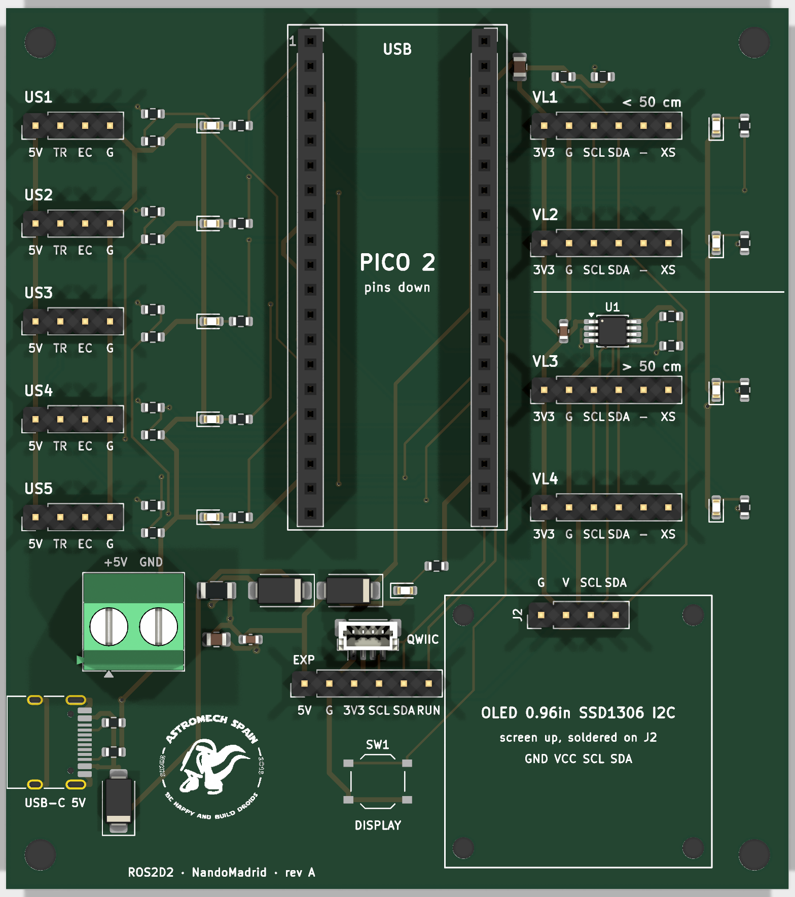

# R2 Pico carrier

Placa base para la **Raspberry Pi Pico 2** que lee los sensores de distancia de R2
(firmware: `firmware/r2_pico_sensors`). Se encarga **ya montada**: tú solo pinchas la Pico
(con sus pines soldados hacia abajo) y los cables de los sensores.



- 80 × 90 mm, 2 capas, 4 agujeros M3 en las esquinas.
- Llega **montada de fábrica**: solo falta pinchar la Pico y la pantalla.
- Detrás: el logo redondo de Astromech Spain, **ROS2D2**, **by NandoMadrid**, www.astromechspain.com.
- Esquema: [`renders/schematic.pdf`](renders/schematic.pdf). Vista 3D: [`renders/3d.png`](renders/3d.png).

## Conectores

Cada conector tiene los pines **en el mismo orden que el módulo**, así que un cable Dupont
hembra-hembra recto va directo, sin cruzar nada. El pin 1 es el de la izquierda (pad cuadrado).

| Conector | Pines (izquierda → derecha) | Para |
|---|---|---|
| **VL1, VL2** (< 50 cm) | 3V3 · GND · SCL · SDA · — (GPIO1, libre) · XSHUT | VL53L0X (GY-530) con cable corto |
| **VL3, VL4** (> 50 cm) | igual | VL53L0X con cable largo: van por un repetidor I2C (PCA9517A) |
| **US1 … US5** | 5V · TRIG · ECHO · GND | HC-SR04. El divisor de ECHO (1 kΩ / 2 kΩ) ya está en la placa |
| **OLED** (J2, tira macho) | GND · VCC · SCL · SDA | Pantalla 0,96" SSD1306/SSD1315 I2C de 4 pines: se suelda encima, tumbada, pantalla arriba |
| **+5V / GND** (borna) | 5 V de la fuente del droide | Alimenta los HC-SR04 y la Pico |
| **USB-C 5V** (J5, borde izquierdo) | solo alimentación | Lo mismo que la borna, con cualquier cargador USB-C o USB-A→C (5 V) |
| **QWIIC** (J3, JST-SH 1 mm) | GND · 3V3 · SDA · SCL | Cualquier módulo Qwiic/STEMMA QT a 3,3 V (IMU, más ToF, expansor de GPIO, ADC…) |
| **EXP** (J4, tira 2,54) | 5V · GND · 3V3 · SCL · SDA · RUN | Ampliaciones: el mismo bus I2C, 5 V y 3,3 V, y RUN (a GND reinicia la Pico) |
| **DISPLAY** | pulsador | Enciende la pantalla y pasa de sensor |

Con el `sensors.yaml` de hoy: `tof_front_left` → VL1, `tof_front` → VL2, `tof_front_right` → VL3,
`tof_floor` → VL4, `sonar_front_left` → US1, `sonar_front_right` → US2, `sonar_rear` → US3.
US4 y US5 son para los dos HC-SR04 de repuesto (GP18/19 y GP20/21).

**Regla del cable:** si el cable de un VL53L0X mide más de 50 cm, enchúfalo en VL3 o VL4. Los
HC-SR04 aguantan cables largos en cualquier US.

## Alimentación

- **Borna +5V / GND** o **USB-C**: 5 V de la fuente del droide o de cualquier cargador USB-C
  (las dos resistencias de 5,1 kΩ en CC le piden los 5 V; no hay datos). Cada entrada tiene su
  diodo, así que se pueden conectar las dos a la vez sin que una alimente a la otra, y las dos
  pasan por el mismo fusible rearmable (750 mA). El diodo de la borna protege además contra la
  polaridad invertida. El LED rojo junto a la borna (D4) dice que hay 5 V.
- **Conecta la borna con el USB de la Pico desenchufado y comprueba la polaridad.** El diodo
  solo protege si la placa no tiene otra masa: con el USB puesto, la masa de la Pi también es
  la de la placa, y unos cables al revés harían un corto por el cable USB que no pasa ni por el
  fusible ni por el diodo.
- El **USB** de la Pico va a la Pi 4 para los datos. La Pico funciona con el USB o con la borna;
  los HC-SR04 **solo con la borna o el USB-C** (los LEDs y la pantalla van a 3,3 V: funcionan también
  solo con USB).

## Pinchar la Pico

Con el **USB hacia el borde de arriba** (donde pone USB) y el pin 1 junto al "1". Al revés o
desplazada una fila **sí se puede estropear**: los 5 V de VSYS caerían en un GPIO o en GND.
Míralo dos veces antes de dar corriente.

## Pantalla y LEDs

Apagados hasta que pulsas **DISPLAY**: primera pulsación, el logo; la siguiente, el último
sensor visto; cada pulsación, el siguiente. A los 30 s sin pulsar se apaga todo.

Un LED rojo 0603 por conector, junto a él, cada uno en su propio GPIO (GPIO → 1 kΩ → LED → GND,
~1,3 mA). Los estados van por parpadeo:

| LED | Significa |
|---|---|
| encendido fijo | ese sensor mide |
| parpadeando (0,4 s) | configurado pero no responde |
| apagado | no hay sensor configurado en ese conector |
| destello corto cada 2 s, todos | esperando a que la Pi mande la configuración |
| un parpadeo breve invertido cada segundo | es el conector que sale en la pantalla |

| Conector | VL1 | VL2 | VL3 | VL4 | US1 | US2 | US3 | US4 | US5 |
|---|---|---|---|---|---|---|---|---|---|
| GPIO del LED | GP28 | GP27 | GP22 | GP9 | GP0 | GP1 | GP6 | GP7 | GP8 |

Por eso esos GPIO quedan reservados: el firmware y la consola no los ofrecen para sensores.

## Ampliaciones

La Pico ya no tiene GPIO libres, así que lo que se añada va por **I2C**: el conector **QWIIC**
(cable JST-SH de 4 hilos, sin soldar) o la tira **EXP**. Los dos están en el bus corto de la
Pico (GP16 SDA, GP17 SCL, pull-ups de 4,7 kΩ en la placa), junto con VL1, VL2 y la pantalla: no
uses las direcciones 0x29 (VL53L0X) ni 0x3C (pantalla), y cables cortos (< 50 cm). Un expansor
I2C (PCF8574, MCP23017…) da GPIO de sobra si hacen falta.

## Pedirla

Hay dos paquetes, uno por fábrica. **Revisa siempre la vista previa del montaje antes de pagar.**

### JLCPCB (`jlcpcb/`)

1. jlcpcb.com → *Order now* → *Add gerber file* → `jlcpcb/gerber.zip`. Deja 2 capas, 1,6 mm.
2. Activa **PCB Assembly**, cara **Top**, tipo *Economic* si lo permite (si no, *Standard*:
   las tiras y zócalos son de agujero pasante).
3. Sube `jlcpcb/bom.csv` y `jlcpcb/cpl.csv`.
4. En la vista previa de colocación mira **la orientación** de D1, D2 y D5 (raya = cátodo), LED1-LED9,
   U1, D4, **J5** (la boca del USB-C hacia el borde), J3 y **SW1** (si el pulsador sale girado 90°, queda siempre pulsado). Si alguna está
   girada, corrígela allí mismo. Los zócalos y tiras pueden verse desplazados en la vista previa
   (su posición es la del pin 1): es normal.
5. Comprueba que las 19 líneas del BOM tienen pieza y stock. No pagues nada que no cuadre.

### PCBWay (`pcbway/`)

1. pcbway.com → *PCB Instant Quote* → *Quick-order PCB* → sube `pcbway/gerber.zip`.
2. Marca **Assembly** (Turnkey), cara Top.
3. Sube `pcbway/bom.csv` y `pcbway/centroid.csv`. El BOM lleva fabricante y referencia de
   fabricante (y, de nota, el número LCSC por si lo buscan allí).
4. PCBWay revisa el BOM a mano y te da el precio final por correo; revisa las orientaciones en su
   vista previa igual que arriba.

## Qué comprar aparte

- Pantalla OLED 0,96" **128×64 SSD1306 (o SSD1315) I2C de 4 pines**, en orden
  **GND-VCC-SCL-SDA** (algunas traen VCC-GND: compruébalo), **sin la tira soldada** (suelen
  traerla suelta). J2 ya viene con 4 pines macho: mete la pantalla por ellos, pantalla arriba y
  tumbada sobre su silueta, apoyada en el plástico de la tira (2,5 mm), suelda los 4 pines por
  arriba y corta lo que sobre. Si quieres, fíjala además con 4 separadores M2 de 2,5 mm en
  H5-H8. Una vez soldada ya no se quita fácilmente.
- Cables Dupont hembra-hembra.
- Tiras de pines macho 1×20 para soldar a tu Pico 2 (hacia abajo), si no las tiene.

## Rehacerla

Todo sale de `gen/parts.py` (piezas, huellas, LCSC y la red de cada pad), con el Python de KiCad 10:

```
$KPY gen/make_sch.py     # esquema (ERC limpio)
$KPY gen/make_pcb.py     # placa sin pistas: contorno, colocación, serigrafía
$KPY gen/route.py        # ruteo con Freerouting (Java 25 + freerouting-2.5.0.jar)
$KPY gen/make_fab.py     # paquetes jlcpcb/ y pcbway/
$KPY -m pytest gen       # comprobaciones (conexiones, esquema = parts.py, paquetes)
kicad-cli pcb drc --schematic-parity --severity-all r2_pico_carrier.kicad_pcb
```

`$KPY` = `C:\Users\Usuario\AppData\Local\Programs\KiCad\10.0\bin\python.exe`.
