# ROS2 rack box · Assembly instructions

[Versión en castellano](MONTAJE.md)

Second box, rack style: the Pico board, the Pi and the converter stand on edge, side by side. 62 × 95 × 145 mm (0.85 L). The Pi sits low and the converter high, so its heat does not rise into the Pi. It takes a Pi 4 or a Pi 5: only the back frame changes. OLED, logo and the sensors' bays are on the main face; XT60 and switch on the fixed front; the Pi's USB and an HDMI panel jack at the back. It mounts on the R2 standing or lying down, with removable ears. Every screw goes into an insert. Before printing, measure what the README lists.

| Assembled | From the back |
|---|---|
| 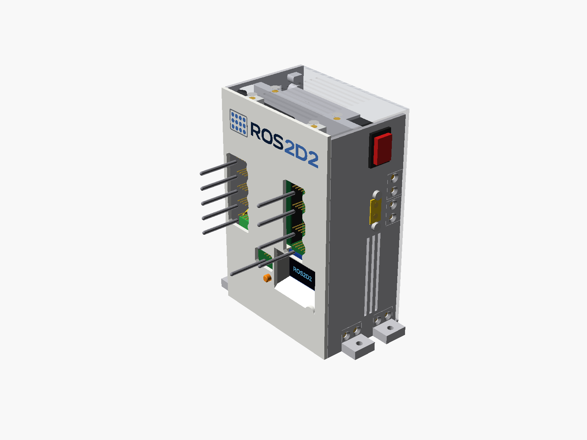 | 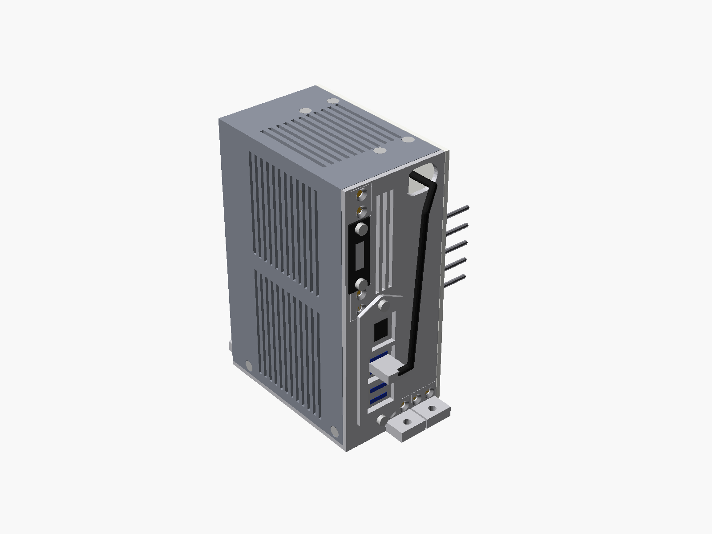 |

**Up-to-date guide, STL and sources:** <https://github.com/BeskarCode/ROS2D2/tree/main/hardware/ros2_box_rack_v3>

## Size next to the R2

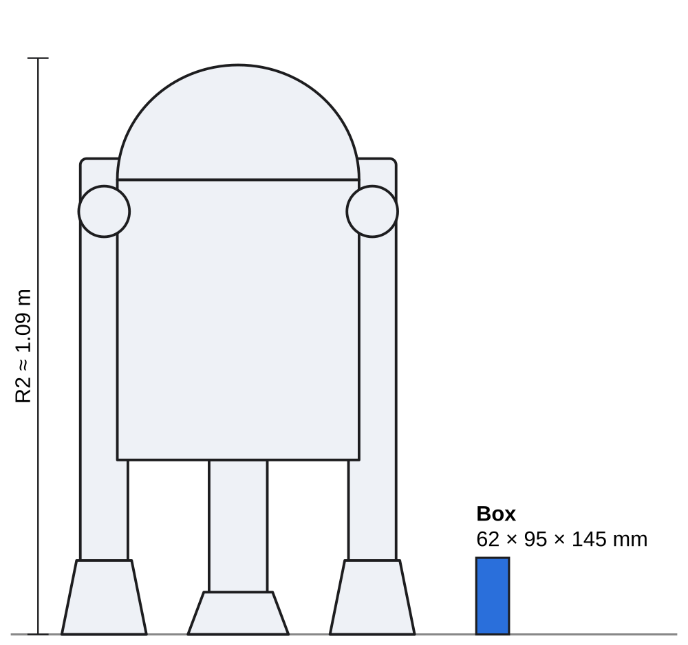

## Inside (no shell)

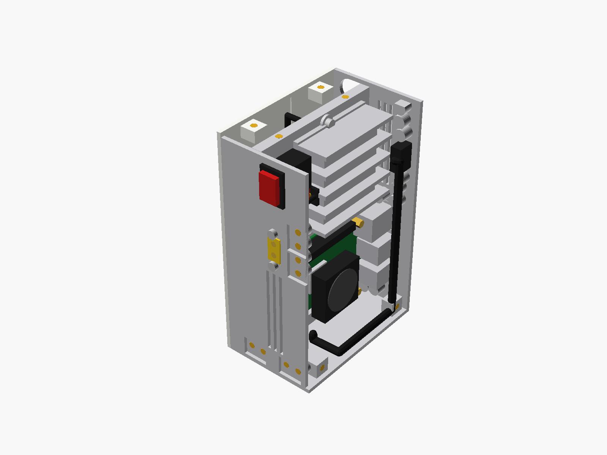

## Exploded view

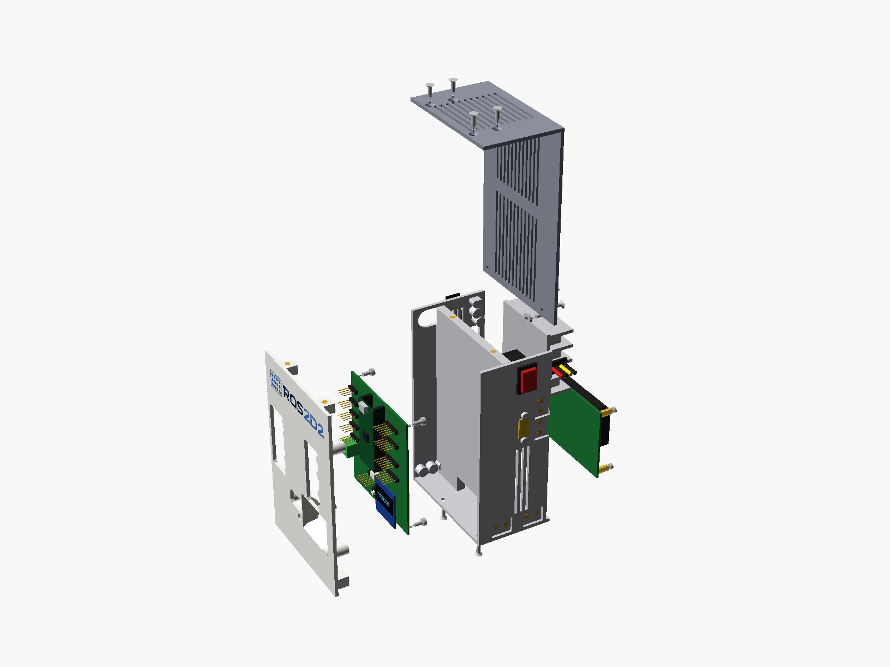

## Hardware and parts

### Printed parts

| Part | |
|---|---|
| `stl/wall_multicolor_bambu.3mf` | Main face with the logo in 4 colours (AMS: white, navy, blue, grey) |
| `stl/wall_monocolor.stl` | or: single-colour main face, engraved logo |
| `stl/leds/wall_led_multicolor_bambu.3mf` | or: main face with a hole over each LED of the Pico board and one over the Pico's own (AMS: white, navy, blue, grey) |
| `stl/leds/wall_led_monocolor.stl` | or: the LED face in one colour, logo engraved |
| `stl/no_ams/wall_led_no_ams.stl` | or: the LED face without AMS, logo as 1.4 mm pockets, with its 3 fillings (no_ams/inlay_navy.stl, inlay_blue.stl, inlay_grey.stl) printed apart and glued in |
| `stl/leds/led_lenses.stl` | LED lenses (only with the LED face): 13 discs in translucent PLA (or clear PETG), 11 and 2 spares, flat on the bed |
| `stl/base.stl` | Base: floor, front (XT60, switch), back, central divider and the ear pockets |
| `stl/shell.stl` | Shell (roof + side) |
| `stl/ear.stl` | 5 mounting ears (4 and 1 spare), on edge |
| `stl/ear_blank.stl` | 4 blanks for the pockets without an ear |
| `stl/frame_pi4.stl` | Back frame for the Pi 4 (Ethernet at the top) |
| `stl/frame_pi5.stl` | or: back frame for the Pi 5 (Ethernet at the bottom) |
| `stl/push_rod.stl` | DISPLAY push rod |
| `stl/shell_fan.stl` | Optional, instead of `shell.stl`: the shell with an opening for a 30 mm fan over the Pi (step 9) |
| `stl/imu_bracket.stl` | Optional: the BNO085 IMU's bracket on the Pi (step 9) |

| Qty | Part | Step |
|---|---|---|
| 34× | M3 heat-set insert (5.7 mm long, 4.0 mm hole) | 1 |
| 24× | M3 × 8 countersunk screw (ISO 10642) | 6, 7, 8 |
| 8× | M3 × 6 button head screw (ISO 7380) | 3, 5 |
| 2× | M3 × 6 socket head cap screw (DIN 912) | 2 |
| 2× | M3 × 10 button head screw (ISO 7380) | 4 |
| 2× | M3 nut (DIN 934) | 4 |
| 4× | M2.5 × 6 screw | 3 |
| 4× | M4 × 12 screw (or what the R2's mount needs) | 8 |
| 4× | M2.5 heat-set insert (5 mm long, 3.6 mm hole) | 1 |

### Other parts

| Qty | Part |
|---|---|
| 1 | KCD1 rocker switch (panel hole 19.2 × 13 mm) |
| 1 | XT60E-F panel connector (AMASS) |
| — | 0.5 mm² wire for the 5 V to terminal J1, 1 mm² for the 24 V |
| 1 | micro-USB 2.0 to USB-A cable with a straight plug, about 30 cm (see «Plugs») |
| 1 | USB-C male pigtail (5 V to the Pi), 90° up/down angle, 15–20 cm; 3 A for a Pi 4, 5 A for a Pi 5 |
| 1 | Angled 90° micro-HDMI male to HDMI female panel-mount cable with 2 M3 screws, 30 cm (measure its flange: `hdmi_*`) |
| 1 | Optional (step 9): 30 × 30 × 7 mm 5 V fan (LD3007MS or similar) |
| 1 | Optional (step 9): Adafruit BNO085 IMU (product 4754) |
| 2 | Optional (step 9): 10 mm M2.5 male-female standoff |

## Wiring

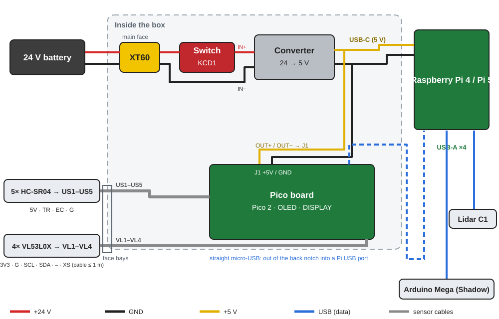

## Plugs: which way each cable goes

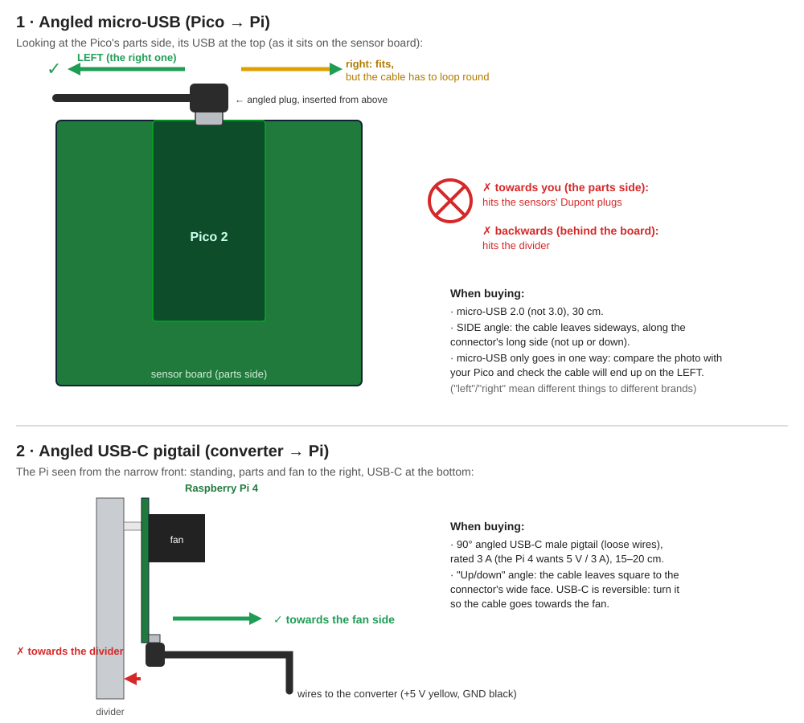

## 1 · Heat-set inserts

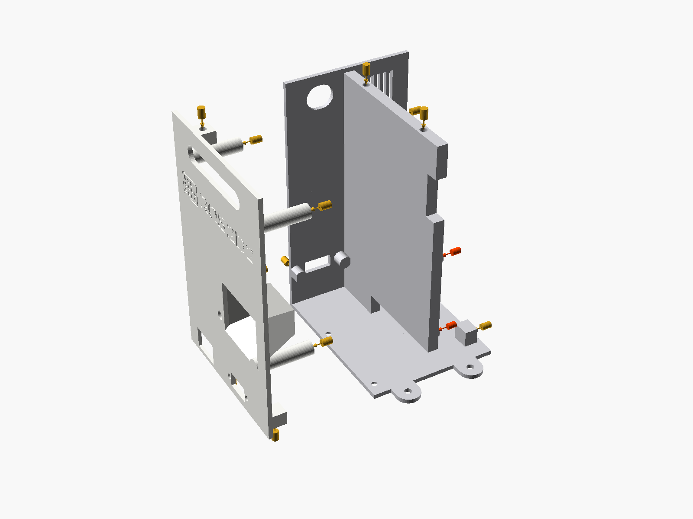

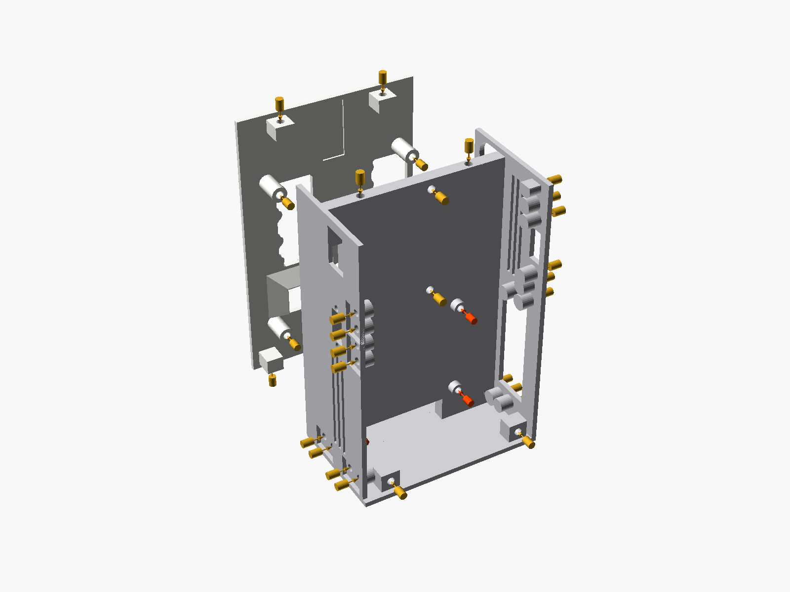

**You need:** 34× M3 insert, 4× M2.5 insert

With the iron at about 220 °C press the inserts in straight and flush. There are two sizes and they don't swap: 34 M3 (5.7 mm long, 4.0 mm hole) and 4 M2.5 (5 mm long, 3.6 mm hole), the small ones. In the picture, M3 in gold and M2.5 in red.

- **M3** · main face, inside (8): 4 in the Pico board's columns, 2 in the bottom tabs and 2 in the top ones.
- **M3** · base, inside (6): 2 on top of the divider, 2 in the divider for the converter and 2 in the floor blocks.
- **M3** · back of the base, outside (4): 2 for the Pi's frame and 2 for the HDMI.
- **M3** · ear pockets, outside (16): 2 in each of the 8 pockets, 4 on the front and 4 on the back.
- **M2.5** · base (4): the Pi's 4 standoffs. They are the box's only M2.5.

## 2 · Converter onto the divider, high

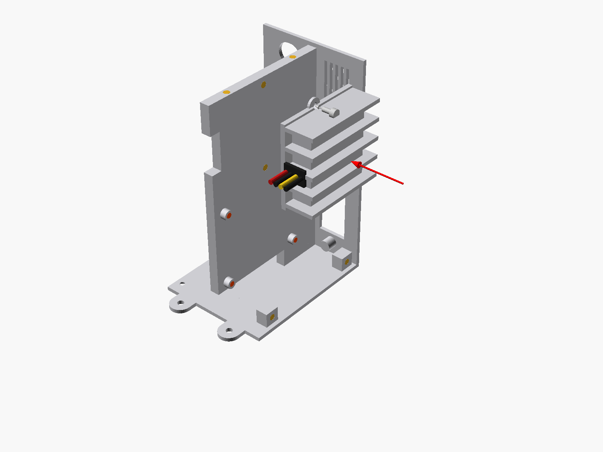

**You need:** 2× M3 × 6 socket head

On edge, at the very top, its base plate against the divider, fins outwards, wires to the front: they go through the top pass in the divider to the Pico side. Its heat rises out of the roof without passing the Pi. Check its holes (`conv_holes`) with a caliper first.

## 3 · Raspberry Pi, frame and HDMI

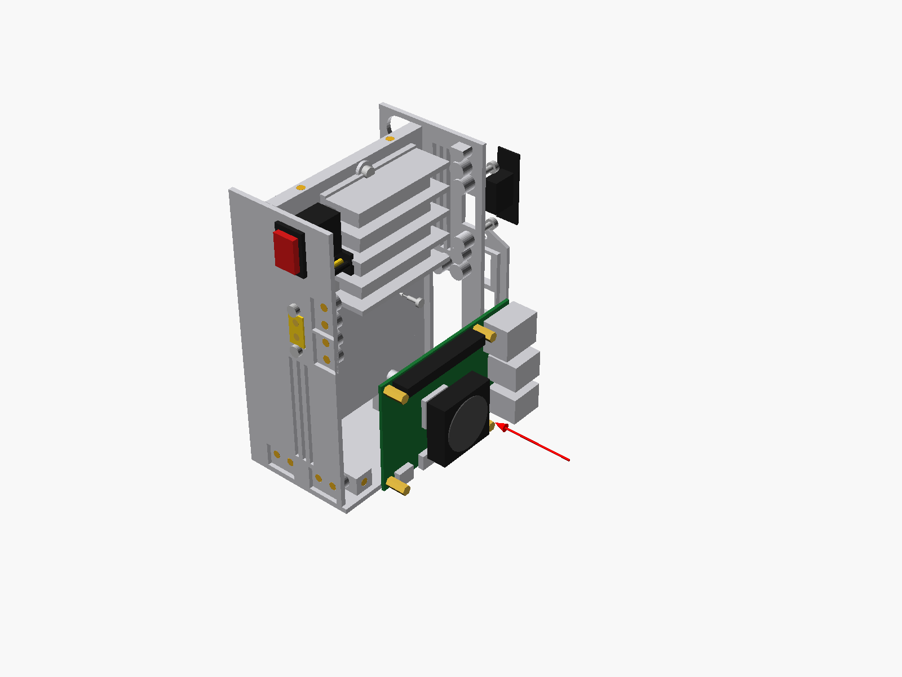

**You need:** 4× M2.5 × 6, 4× M3 × 6

Pi 4 or Pi 5 on its 4 standoffs, low down, USB and Ethernet in the back window, USB-C at the bottom. Plug in the angled USB-C (5 V from the converter, down in front of the Pi) and the angled micro-HDMI into HDMI 0; that cable runs under the Pi through the divider's bottom pass. Screw on, from outside, the frame for your Pi (`frame_pi4` or `frame_pi5`) and the HDMI panel jack.

## 4 · XT60 and switch on the front

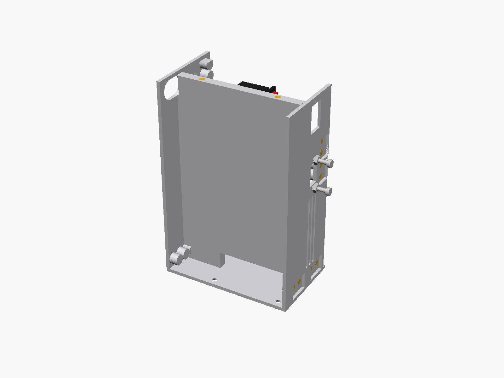

**You need:** 2× M3 × 10, 2× M3 nut

On the narrow front, which is part of the base, on the Pi's side: the male XT60, just above the Pi, from inside, its front showing through the opening and its flange against the front. Fit the 2 M3 screws from outside, through the holes and the flange, into the nuts behind. At the very top, the switch snaps in from outside. Solder and insulate their wires first: there is little depth behind them and they bend as soon as they come out.

## 5 · Push rod and Pico board

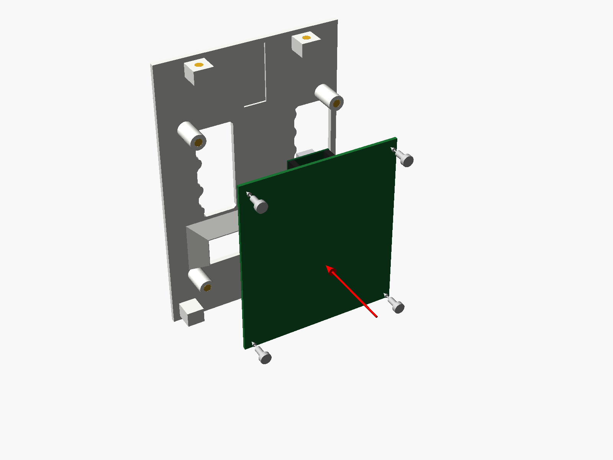

**You need:** 4× M3 × 6

With the LED face, press a lens into each of the 11 holes from outside (the top one, by the USB, is the Pico's own LED and has no tube), its stem in, until it sits flush; if one is loose, a drop of glue. Slide the rod into its guide from inside. Before screwing, offer the board up without screws onto the 4 columns, parts towards the wall: it must sit on all four without rocking; if it rocks, a tube touches its LED: sand its tip. Then screw it on. If you ever use J4 (EXP), its cable goes round the PWR tube. Tighten the 5 V in terminal J1 and plug the straight micro-USB into the Pico: it goes straight up and bends under the roof towards the back. The sensors plug in later, from outside, through the face's bays.

## 6 · Main face onto the base

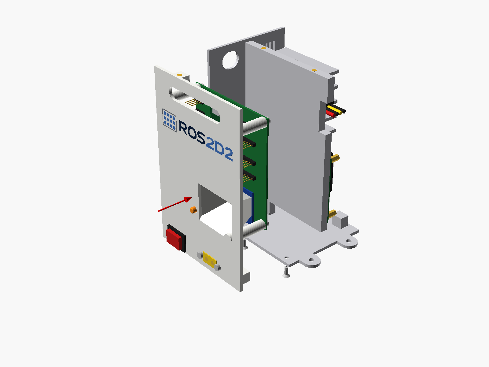

**You need:** 2× M3 × 8 countersunk

The 24 V (XT60 → switch → converter) stay on the Pi's side, by the front; the 5 V to terminal J1 cross through the divider's top pass and over the board. Screw the face on from under the floor.

## 7 · Shell

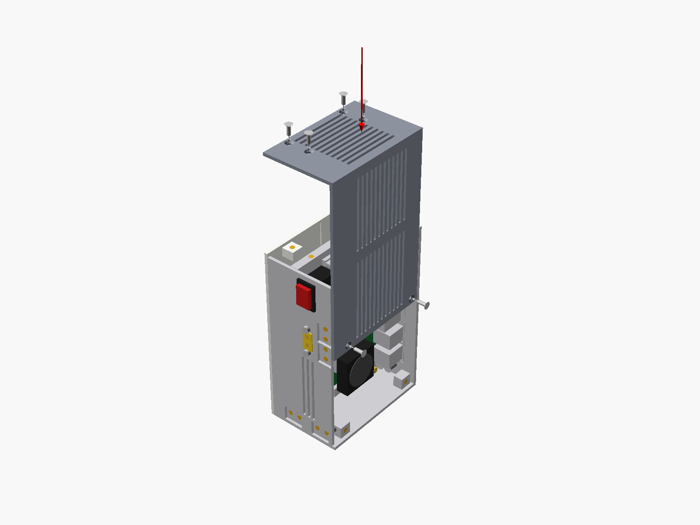

**You need:** 6× M3 × 8 countersunk

It is the roof and the side: the front stays with the base. Lower it from above and fit the 4 roof screws and the 2 side screws. Air comes in through the low vents (front and side, by the Pi) and leaves through the high ones and the roof.

## 8 · USB, ears and onto the R2

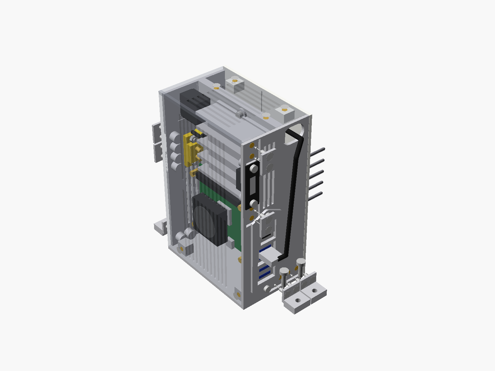

**You need:** 16× M3 × 8 countersunk, 4× M4 × 12

Bring the micro-USB out of the notch in the back, down the outside, and plug its USB-A into a Pi USB port: it is the plug you see outside the box in the picture (it is not loose). Through it the Pi gets the sensor data and flashes the Pico firmware. Choose how the box sits: standing, with the 4 ears in the pockets by the floor, or lying on the shell's side, with the 4 in the pockets by that side. Each ear sits flush in its pocket with 2 M3 × 8 countersunk; the other 4 pockets take a blank with its 2 screws. Then screw the box to the R2 through the 4 lugs.

## 9 · Optional: fan and IMU

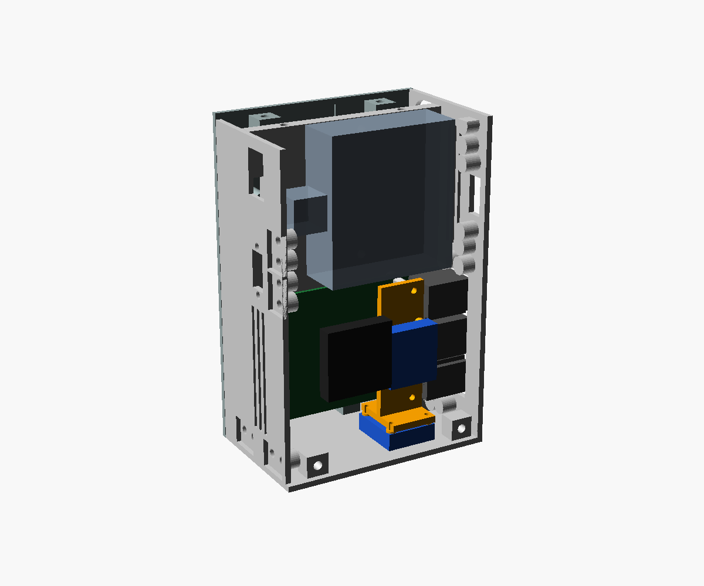

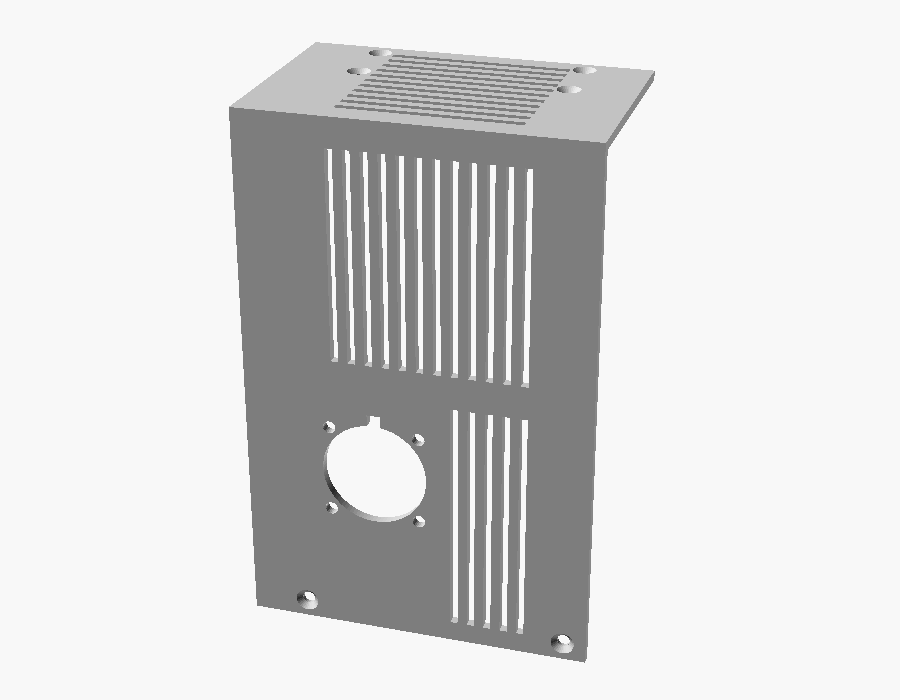

**You need:** 4× M3 × 12, 4× M3 nut, 2× M2.5 × 10 standoff, 6× M2.5 × 6

With `shell_fan.stl` instead of `shell.stl`, the 30 mm fan goes on the side right over the Pi's processor, inside (blowing onto the Pi, screw from outside and the nut on the fan's side) or outside (it sticks out 7 mm; its wire goes in through the slot running up from the circle). Red to the Pi's pin 4 (5 V), black to pin 6 (GND). With the box lying on that side it is covered: use it with the box standing. The IMU bracket (`imu_bracket.stl`, orange in the picture) goes on the Pi's two holes on the USB side: swap their screws for the 2 standoffs, screw the bracket onto them with 2 M2.5 and the IMU board (blue) with 4 M2.5 × 6 where it lies flat: **on the arm** with the box lying, **hanging under the shelf** with the box standing. Do it before step 7: with the shell on you cannot reach it. Upside down or a few degrees off does not matter: it is zeroed from the console.
