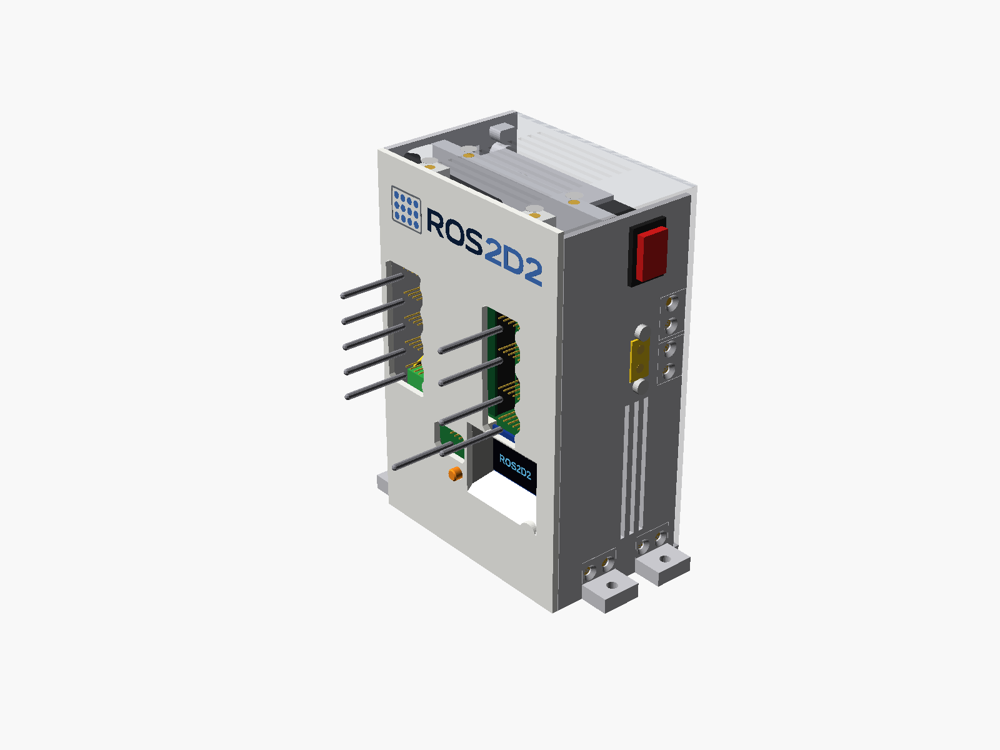
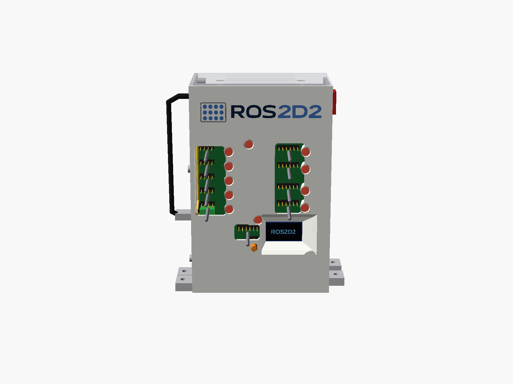
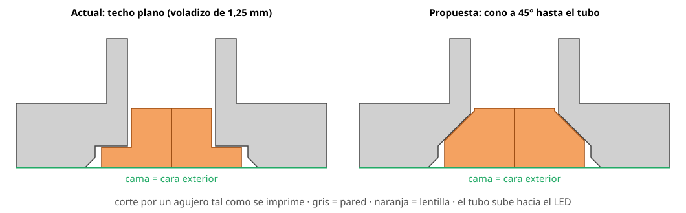

# ROS2 box (rack)

*En castellano: [README_es.md](README_es.md)*

The box for the R2's ROS 2 system (Raspberry Pi 4 or Pi 5, Pico board, 24 → 5 V converter, XT60E-F
and switch): the boards stand **on edge, side by side, like the blades of a rack**.

**62 × 95 × 145 mm · 0.85 L**, plus the removable ears (standing or lying down).

Every screw goes into a **heat-set insert**, the boards' too (M2.5 for the Pi, M3 for the rest).



**Step-by-step assembly, with exploded views, the hardware list and the wiring plan:**
[ASSEMBLY.md](ASSEMBLY.md) · [PDF](assembly/ASSEMBLY.pdf) — Castellano: [MONTAJE.md](MONTAJE.md) · [PDF](assembly/MONTAJE.pdf)

**Print guide** (which wall, frame and parts to print for your case, with a picture of each): [PRINT_GUIDE.md](print_guide/PRINT_GUIDE.md) · [PDF](print_guide/PRINT_GUIDE.pdf) — Castellano: [GUIA_IMPRESION.md](print_guide/GUIA_IMPRESION.md) · [PDF](print_guide/GUIA_IMPRESION.pdf)

## Inside

- **Main face** (the large side, flat): OLED window, 4-colour logo at the top, DISPLAY push rod and a
  **bay** over each group of connectors: the sensors plug in from outside, without opening the box. No
  connector names.
- **Pico board**: on edge, hanging from 4 columns on the main face, parts towards it (14 mm: the Pico
  on its sockets). Above it, 30 mm free for a **straight micro-USB**, which goes up and bends under the
  roof towards the notch in the back.
- **Central divider**: holds the Pi (standoffs with M2.5 inserts) and the converter (M3 inserts). It has
  two cable passes: at the top, where the converter's 5 V go to the Pico's side; and at the bottom,
  under the Pi, for the HDMI (and the USB-C if you want to run it there).
- **Raspberry Pi 4 or Pi 5**: on edge, **low down**, USB and Ethernet in the back window and USB-C
  downwards (15 mm free for the angled USB-C and micro-HDMI plugs).
- **Converter**: on edge, **high up**, 5 mm of air above the Pi, wires to the front. Its heat rises out
  of the roof and the side's high vent without passing the Pi; the Pi takes fresh air from the low
  vents in the front and the side.
- **Narrow front**: fixed, part of the base. On the Pi's side it carries the **XT60E-F** (just above the
  Pi) and the **switch** (at the very top), and in front of the Pi the air inlet.
- **Back**: one window for both Pis' jacks, closed with a **swappable frame** (`frame_pi4` or
  `frame_pi5`: the Pi 5 has its Ethernet and USB the other way round). Beside the converter, turned, an
  **HDMI panel jack** wired to the Pi's HDMI 0.
- **Shell**: roof and right side in one piece that slides down from above; the front does not move,
  so it opens with the XT60 and the switch wired.
- **Removable ears**: 8 pockets, 4 on the front and 4 on the back. With the box **standing**, 4 ears
  in the pockets by the floor (lugs on the floor's plane); **lying** on the shell's side, 4 in the
  pockets by that side. The other 4 pockets take a blank. Each ear or blank sits flush with 2
  countersunk M3 into inserts.

## Parts

| STL | What it is | How to print |
|---|---|---|
| `stl/wall_multicolor_bambu.3mf` | main face + navy, blue and grey logo (4 bodies with their filament) | logo face on the bed; AMS: 1 white, 2 navy, 3 blue, 4 grey |
| `stl/wall_multicolor.3mf` | the same, generic 3MF for other slicers | |
| `stl/wall_monocolor.stl` | single-colour main face, logo engraved 1 mm | logo face on the bed |
| `stl/base.stl` | floor, front (XT60, switch, vent), back, divider and the ear pockets | floor on the bed |
| `stl/shell.stl` | roof and side | roof on the bed |
| `stl/push_rod.stl` | DISPLAY push rod | standing |
| `stl/frame_pi4.stl` | back frame for the Pi 4 | outer face on the bed |
| `stl/frame_pi5.stl` | back frame for the Pi 5 | outer face on the bed |
| `stl/ear.stl` | mounting ear: print 5 (4 and 1 spare) | on edge, the L's profile on the bed |
| `stl/ear_blank.stl` | blank for the pockets without an ear: print 4 | flat, visible face on the bed |
| `stl/blanks/blank_US1.stl` … `blank_EXP.stl` | optional, looks only: a blank for each sensor connector you don't use (US1–US5, VL1–VL4, EXP); it plugs onto the connector's pins and closes its strip of the opening flush. `blanks_all.stl` has the ten on one plate | visible face on the bed, wall's colour |

PETG, 0.2 mm, 0.4 nozzle, no supports.

## LED face (optional)



Another version of the main face, to see the board's LEDs from outside: a hole over each of its 10 LEDs
(VL1–VL4, US1–US5 and PWR) and one over the Pico's own LED. Its parts are in `stl/leds/`. Print **one**
of the two faces: the one above or this one. The other parts are the same.

| STL | What it is | How to print |
|---|---|---|
| `stl/leds/wall_led_multicolor_bambu.3mf` | LED face + navy, blue and grey logo | logo face on the bed; AMS: 1 white, 2 navy, 3 blue, 4 grey |
| `stl/leds/wall_led_multicolor.3mf` | the same, generic 3MF | |
| `stl/leds/wall_led_monocolor.stl` | single-colour LED face, logo engraved 1 mm | logo face on the bed |
| `stl/leds/led_lenses.stl` | 13 lenses (11 and 2 spares) | **translucent PLA** (or clear PETG), discs flat on the bed |

Each of the board's holes has a dark tube inside, printed with the face, that carries its LED's light
out without losing it; it ends 0.7 mm above the LED and never touches the board. The Pico's LED is just
over 1 mm from the face and has no tube, only the hole. In the mouth of each hole, with a 0.4 mm chamfer,
a translucent PLA lens (Ø 4.4) sits flush with the face with 0.15 mm of play; its rim carries the same chamfer, so it
fills the mouth all round and does not wobble (if one is loose, a drop of glue).
The chamfer is closed all round: 0.6 mm of whole face is left round it before any bay starts.
When assembling, offer the board up without screws onto its 4 columns: it must sit without rocking; if
it rocks, a tube touches its LED: sand the tip.

### Proposal: LED face with cones (no supports)

The face prints with its outer side on the bed, and in the version above each lens recess ends in a
flat 1.25 mm ceiling round the tube, printed in mid-air. In this proposal that floor is a **45° cone**
from the lens recess (Ø 4.9) down to the tube (Ø 3.4): it prints with no supports and no bridging. The
lenses carry the same cone (0.1 mm of play on the diameter), so they centre themselves and lead the
light to the face. Everything else is as the LED face above (tubes, inserts and the same `logo_*_led.stl`).

| STL | What it is | How to print |
|---|---|---|
| `stl/leds/wall_led_cone_multicolor_bambu.3mf` | cone LED face + navy, blue and grey logo | logo face on the bed; AMS: 1 white, 2 navy, 3 blue, 4 grey |
| `stl/leds/wall_led_cone_multicolor.3mf` | the same, generic 3MF | |
| `stl/leds/wall_led_cone_monocolor.stl` | single-colour cone LED face, logo engraved 1 mm | logo face on the bed |
| `stl/leds/led_lenses_cone.stl` | 13 cone lenses (11 and 2 spares) | **translucent PLA**, disc on the bed, cone up |

The flat lenses (`led_lenses.stl`) do not fit this face, nor the cone lenses the other one.



## LED face without AMS (optional)

The same LED face (same tubes, lenses and inserts) for printers without an AMS: the logo is a 1.4 mm
deep pocket and what fills it is printed apart, one part per colour. Its parts are in `stl/no_ams/`;
the lenses are `stl/leds/led_lenses.stl`.

| STL | What it is | How to print |
|---|---|---|
| `stl/no_ams/wall_led_no_ams.stl` | LED face, logo as a 1.4 mm pocket | white, logo face on the bed |
| `stl/no_ams/inlay_navy.stl` | "ROS" | navy, visible face on the bed |
| `stl/no_ams/inlay_blue.stl` | "2D2" and the 12 dots | blue, visible face on the bed |
| `stl/no_ams/inlay_grey.stl` | the dots' frame | grey, visible face on the bed |

The fillings come out in place, as seen from outside but mirrored (visible face down): turn them over
and press them into their pocket. The pocket has 0.3 mm of play per side and each filling is 0.1 mm smaller per side (a small seam between colours); they sit flush with the face; fix
them with a drop of cyanoacrylate. The grey frame is wider than in the AMS version (1.7 mm inwards, 1.2
under the bottom row of dots) so it prints and handles on its own. 0.2 mm layers (7 layers), no brim.

## Before printing: check these measurements

In `params.scad` (change the value and regenerate):

- `conv_holes`: the converter's ear holes (from RCNUN's drawing; check the distance to the ear's tip
  with a caliper).
- `xt60_hole_pitch` and `xt60_body`: XT60E-F (the hole pitch is not dimensioned on its drawing).
- `sw_cut`: the switch's panel cut-out (19.2 × 13 for a KCD1).
- `sw1_h`: height of the DISPLAY button.
- `pi_fan_clear`: height of the Pi's fan.
- `pico_usb_clear` and `usb_plug`: your micro-USB cable's straight plug (30 mm free above the board).
- `hdmi_body`, `hdmi_flange`, `hdmi_pitch`: the HDMI panel jack you buy (body, flange and the distance
  between its 2 M3 screws).

Cables: a **straight-plug micro-USB, about 30 cm** and the **angled USB-C pigtail** (3 A for a Pi 4;
**5 A for a Pi 5**). For a monitor, an **angled micro-HDMI male → HDMI female panel jack** cable, about
30 cm.

## Generating the files

```bash
python -I hardware/ros2_box_rack_v3/build.py         # stl/ and the 3MFs
python -I hardware/ros2_box_rack_v3/build_docs.py    # images, MONTAJE.md, ASSEMBLY.md and PDFs
python -m pytest hardware/ros2_box_rack_v3/tests     # collisions, fits, hardware, printability
```

The logo and its SVGs are in `logo/`, scaled to 80 mm; the no-AMS face's wide grey frame is made by
`logo/gen_na_grey.py`.
