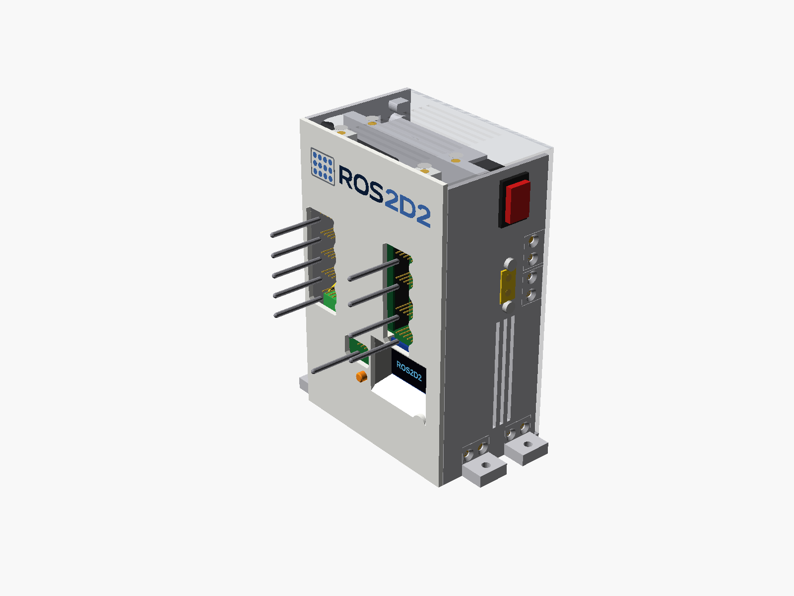
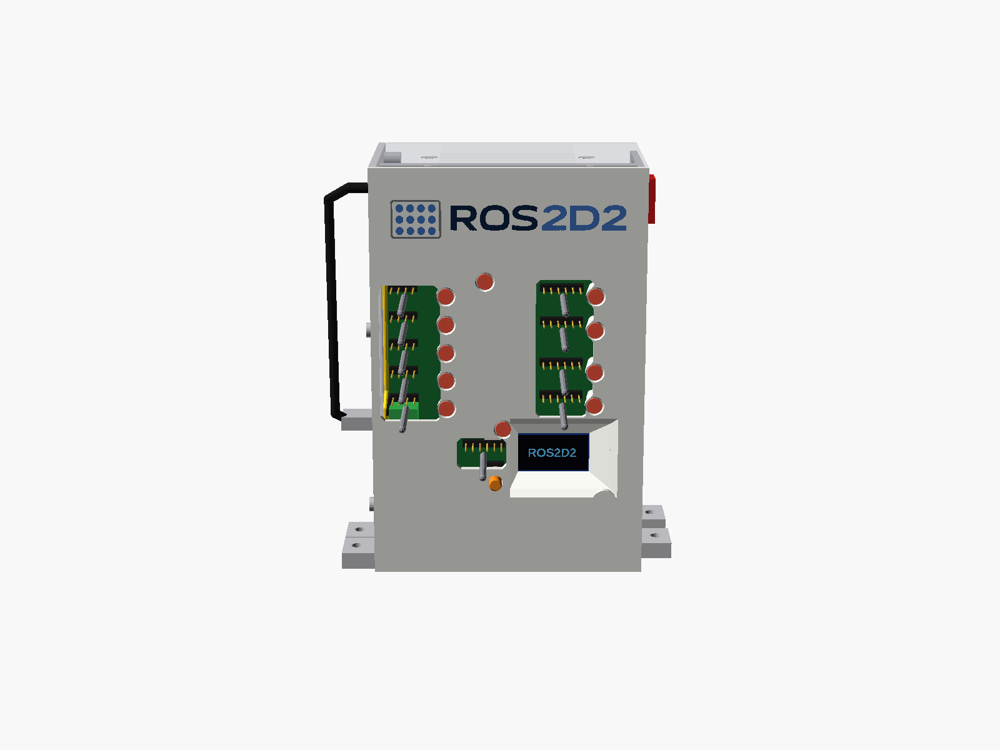
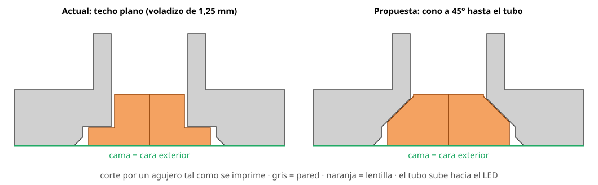

# Caja ROS2 (rack)

*In English: [README.md](README.md)*

La caja del sistema ROS 2 del R2 (Raspberry Pi 4 o Pi 5, placa de la Pico, convertidor
24 → 5 V, XT60E-F e interruptor): las placas van **de pie, en paralelo, como cuchillas de un rack**.

**62 × 95 × 145 mm · 0,85 L**, más las orejas desmontables (de pie o tumbada).

Todos los tornillos van a **insertos térmicos**, también los de las placas (M2,5 en la Pi, M3 en el resto).



**Instrucciones de montaje paso a paso, con despiece, lista de tornillería y plano de conexiones:**
[MONTAJE.md](MONTAJE.md) · [PDF](assembly/MONTAJE.pdf) — English: [ASSEMBLY.md](ASSEMBLY.md) · [PDF](assembly/ASSEMBLY.pdf)

**Guía de impresión** (qué pared, marco y piezas imprimir según tu caso, con una imagen de cada una): [GUIA_IMPRESION.md](print_guide/GUIA_IMPRESION.md) · [PDF](print_guide/GUIA_IMPRESION.pdf) — English: [PRINT_GUIDE.md](print_guide/PRINT_GUIDE.md) · [PDF](print_guide/PRINT_GUIDE.pdf)

## Cómo va por dentro

- **Pared principal** (el lateral grande, plana): ventana de la OLED, logo en 4 colores arriba, varilla
  del pulsador DISPLAY y una **bahía** sobre cada grupo de conectores: los sensores se enchufan desde
  fuera, sin abrir la caja. Sin nombres de conectores.
- **Placa de la Pico**: de pie, colgada de 4 columnas de la pared principal, con los componentes
  hacia ella (14 mm: la Pico en sus zócalos). Encima, 30 mm libres para un **micro-USB recto**, que
  sube y se dobla bajo el techo hacia la muesca de la trasera.
- **Tabique central**: sujeta la Pi (columnas con insertos M2,5) y el convertidor (insertos M3).
  Tiene dos pasos de cables: arriba, donde salen los 5 V del convertidor hacia el lado de la Pico; y
  abajo, bajo la Pi, para el HDMI (y el USB-C si se quiere llevar por ahí).
- **Raspberry Pi 4 o Pi 5**: de pie, **abajo**, con los USB y el Ethernet en la ventana de la
  trasera y el USB-C hacia abajo (15 mm libres para las clavijas acodadas USB-C y micro-HDMI).
- **Convertidor**: de pie, **arriba**, con 5 mm de aire sobre la Pi y los cables hacia delante.
  Su calor sube y sale por el techo y la rejilla alta del lateral sin pasar por la Pi; la Pi
  toma aire fresco por las rejillas bajas de la frontal y del lateral.
- **Frontal estrecha**: fija, parte de la base. En el lado de la Pi lleva el **XT60E-F** (justo encima
  de la Pi) y el **interruptor** (arriba del todo), y delante de la Pi la rejilla de entrada de aire.
- **Trasera**: una sola ventana para los conectores de las dos Pi, cerrada con un **marco
  intercambiable** (`frame_pi4` o `frame_pi5`: la Pi 5 tiene el Ethernet y los USB al revés). Junto
  al convertidor, girado, un **HDMI hembra de panel** conectado al HDMI 0 de la Pi.
- **Tapa**: techo y lateral derecho en una pieza que baja desde arriba; la frontal no se mueve, así
  que se abre con el XT60 y el interruptor conectados.
- **Orejas desmontables**: 8 rebajes, 4 en la frontal y 4 en la trasera. Para la caja **de pie**,
  4 orejas en los rebajes junto al suelo (lengüetas en el plano del suelo); **tumbada** sobre el
  lateral de la tapa, 4 en los rebajes junto a ese lateral. Los otros 4 rebajes llevan una tapa
  ciega. Cada oreja o tapa va a ras con 2 M3 avellanados a insertos.

## Piezas

| STL | Qué es | Cómo imprimir |
|---|---|---|
| `stl/wall_multicolor_bambu.3mf` | pared principal + logo marino, azul y gris (4 partes con su filamento) | cara del logo sobre la cama; AMS: 1 blanco, 2 marino, 3 azul, 4 gris |
| `stl/wall_multicolor.3mf` | lo mismo, 3MF genérico para otros laminadores | |
| `stl/wall_monocolor.stl` | pared principal de un color, logo grabado 1 mm | cara del logo sobre la cama |
| `stl/base.stl` | suelo, frontal (XT60, interruptor, rejilla), trasera, tabique y rebajes de las orejas | suelo sobre la cama |
| `stl/shell.stl` | techo y lateral | techo sobre la cama |
| `stl/push_rod.stl` | varilla del pulsador DISPLAY | de pie |
| `stl/frame_pi4.stl` | marco trasero para la Pi 4 | cara exterior sobre la cama |
| `stl/frame_pi5.stl` | marco trasero para la Pi 5 | cara exterior sobre la cama |
| `stl/ear.stl` | oreja de fijación: imprime 5 (4 y 1 de repuesto) | de canto, el perfil de la L sobre la cama |
| `stl/ear_blank.stl` | tapa ciega para los rebajes sin oreja: imprime 4 | plana, cara vista sobre la cama |
| `stl/blanks/blank_US1.stl` … `blank_EXP.stl` | opcional, solo estética: una tapa por cada conector de sensor que no uses (US1–US5, VL1–VL4, EXP); se clava en los pines del conector y cierra a ras su franja de la abertura. `blanks_all.stl` lleva las diez en una placa | cara vista sobre la cama, color de la pared |

PETG, 0,2 mm, boquilla 0,4, sin soportes.

## Pared con LEDs (opcional)



Otra versión de la pared principal, para ver desde fuera los LEDs de la placa: un agujero sobre cada
uno de sus 10 LEDs (VL1–VL4, US1–US5 y PWR) y otro sobre el LED de la propia Pico. Sus piezas están en
`stl/leds/`. Imprime **una** de las dos paredes: la de arriba o esta. El resto de piezas es el mismo.

| STL | Qué es | Cómo imprimir |
|---|---|---|
| `stl/leds/wall_led_multicolor_bambu.3mf` | pared con LEDs + logo en marino, azul y gris | cara del logo sobre la cama; AMS: 1 blanco, 2 marino, 3 azul, 4 gris |
| `stl/leds/wall_led_multicolor.3mf` | lo mismo, 3MF genérico | |
| `stl/leds/wall_led_monocolor.stl` | pared con LEDs de un color, logo grabado 1 mm | cara del logo sobre la cama |
| `stl/leds/led_lenses.stl` | 13 lentillas (11 y 2 de repuesto) | **PLA translúcido** (o PETG transparente), discos planos sobre la cama |

Cada agujero de la placa tiene por dentro un tubo oscuro, impreso con la pared, que lleva la luz de su
LED hasta fuera sin que se pierda; acaba 0,7 mm por encima del LED y nunca toca la placa. El LED de la
Pico queda a poco más de 1 mm de la pared y no lleva tubo, solo el agujero. En la boca de cada agujero,
con un chaflán de 0,4 mm, va una lentilla de PLA translúcido (Ø 4,4) a ras de la pared, con 0,15 mm de holgura; su borde lleva el
mismo chaflán, así que llena la boca alrededor y no baila
(si alguna baila, una gota de pegamento). El chaflán rodea todo el hueco: quedan 0,6 mm de pared entera
alrededor antes de que empiece ninguna bahía. Al montar, presenta la placa sin tornillos sobre sus 4
columnas: debe asentar sin balancearse; si se balancea, algún tubo toca su LED: lija la punta.

### Propuesta: pared con LEDs con cono (sin soportes)

La pared se imprime con la cara exterior sobre la cama, y en la versión de arriba el fondo de cada
hueco de lentilla es un techo plano de 1,25 mm alrededor del tubo, que queda en el aire. En esta
propuesta ese fondo es un **cono a 45°** que baja desde el hueco de la lentilla (Ø 4,9) hasta el tubo
(Ø 3,4): se imprime sin soportes ni puentes. Las lentillas llevan el mismo cono (0,1 mm de holgura en el
diámetro), así que se centran solas y guían la luz hacia la cara. Todo lo demás es igual que la pared
con LEDs de arriba (tubos, insertos y los mismos logos `logo_*_led.stl`).

| STL | Qué es | Cómo imprimir |
|---|---|---|
| `stl/leds/wall_led_cone_multicolor_bambu.3mf` | pared con LEDs con cono + logo en marino, azul y gris | cara del logo sobre la cama; AMS: 1 blanco, 2 marino, 3 azul, 4 gris |
| `stl/leds/wall_led_cone_multicolor.3mf` | lo mismo, 3MF genérico | |
| `stl/leds/wall_led_cone_monocolor.stl` | pared con LEDs con cono, un color, logo grabado 1 mm | cara del logo sobre la cama |
| `stl/leds/led_lenses_cone.stl` | 13 lentillas con cono (11 y 2 de repuesto) | **PLA translúcido**, disco sobre la cama, cono hacia arriba |

Las lentillas planas (`led_lenses.stl`) no valen para esta pared ni las de cono para la otra.



## Pared con LEDs sin AMS (opcional)

La misma pared con LEDs (tubos, lentillas e insertos iguales) para impresoras sin AMS: el logo es un
hueco de 1,4 mm de fondo, y lo que lo rellena se imprime aparte, una pieza por color. Sus piezas están
en `stl/no_ams/`; las lentillas son las de `stl/leds/led_lenses.stl`.

| STL | Qué es | Cómo imprimir |
|---|---|---|
| `stl/no_ams/wall_led_no_ams.stl` | pared con LEDs, logo en hueco de 1,4 mm | blanco, cara del logo sobre la cama |
| `stl/no_ams/inlay_navy.stl` | "ROS" | marino, cara vista sobre la cama |
| `stl/no_ams/inlay_blue.stl` | "2D2" y los 12 puntos | azul, cara vista sobre la cama |
| `stl/no_ams/inlay_grey.stl` | el marco de los puntos | gris, cara vista sobre la cama |

Los rellenos salen en su sitio, como se ven desde fuera pero en espejo (la cara vista abajo): dales
la vuelta y mételos en su hueco. El hueco tiene 0,3 mm de holgura por lado y cada relleno es 0,1 mm más pequeño por lado (una junta fina entre colores); quedan a ras de la pared; fíjalos
con una gota de pegamento de cianoacrilato. El marco gris es más ancho que en la versión con AMS
(1,7 mm hacia dentro, 1,2 bajo la fila de puntos de abajo) para que se pueda imprimir y manejar suelto.
Capas de 0,2 mm (7 capas) y sin borde.

## Antes de imprimir: comprueba estas medidas

En `params.scad` (cambia el valor y vuelve a generar):

- `conv_holes`: agujeros de las orejetas del convertidor (sacados del plano de RCNUN; comprueba con
  calibre la distancia a la punta de la orejeta).
- `xt60_hole_pitch` y `xt60_body`: XT60E-F (paso entre agujeros sin acotar en su plano).
- `sw_cut`: agujero de panel del interruptor (19,2 × 13 para un KCD1).
- `sw1_h`: altura del pulsador DISPLAY.
- `pi_fan_clear`: altura del ventilador de la Pi.
- `pico_usb_clear` y `usb_plug`: la clavija recta de tu cable micro-USB (30 mm libres sobre la placa).
- `hdmi_body`, `hdmi_flange`, `hdmi_pitch`: el HDMI hembra de panel que compres (cuerpo, brida y
  distancia entre sus 2 tornillos M3).

Cables: un **micro-USB de clavija recta, de unos 30 cm** y el **USB-C acodado con hilos** (3 A para la
Pi 4; **5 A para la Pi 5**). Para el monitor, un cable **micro-HDMI macho acodado → HDMI hembra de
panel**, de unos 30 cm.

## Generar los ficheros

```bash
python -I hardware/ros2_box_rack_v3/build.py         # stl/ y los 3MF
python -I hardware/ros2_box_rack_v3/build_docs.py    # imágenes, MONTAJE.md, ASSEMBLY.md y PDF
python -m pytest hardware/ros2_box_rack_v3/tests     # choques, encajes, tornillería, impresión
```

El logo y sus SVG están en `logo/`, escalados a 80 mm; el marco gris ancho de la versión sin AMS lo
genera `logo/gen_na_grey.py`.
