 

# Caja ROS2 rack · Guía de impresión

*In English: [PRINT_GUIDE.md](PRINT_GUIDE.md)*

Qué ficheros imprimir y cuándo elegir uno u otro. Solo para la caja rack (`hardware/ros2_box_rack_v3`). Todos los ficheros están en su carpeta `stl/`.

**Versión al día:** <https://github.com/BeskarCode/ROS2D2/tree/main/hardware/ros2_box_rack_v3>

## Qué imprimir

- **Siempre:** `base.stl`, `shell.stl` y `push_rod.stl`.
- **Una pared principal** de las cinco opciones (tabla de abajo).
- **Lentillas** `leds/led_lenses.stl`, solo si la pared que eliges es con LEDs.
- **Un marco trasero:** `frame_pi4.stl` o `frame_pi5.stl`, según tu Raspberry Pi.
- **HDMI trasero (opcional):** `hdmi_holder.stl` o `hdmi_cover.stl`, o ninguno (ver su apartado).
- **Orejas y tapas ciegas:** 5 × `ear.stl` (4 y 1 de repuesto) y 4 × `ear_blank.stl`.

### ¿Qué pared?

| ¿Ver los LEDs de la placa de la Pico? | ¿Tienes AMS? | Imprime |
|---|---|---|
| No | Sí | A · `wall_multicolor_bambu.3mf` |
| No | No | B · `wall_monocolor.stl` (logo grabado, un color) |
| Sí | Sí | C · `leds/wall_led_multicolor_bambu.3mf` + lentillas |
| Sí | No, pero quiero el logo en colores | D · `no_ams/wall_led_no_ams.stl` + 3 rellenos + lentillas |
| Sí | No, un solo color me vale | E · `leds/wall_led_monocolor.stl` + lentillas |

PETG, capa de 0,2 mm, boquilla de 0,4, sin soportes, salvo donde se indica otra cosa. Los insertos térmicos y los tornillos son los mismos con cualquier pared: mira la guía de montaje.

## 1 · Pared principal (elige una)

La pared grande con la ventana de la OLED, el pulsador DISPLAY y las bahías por donde se conectan los sensores desde fuera. Las cinco tienen los mismos insertos y encajan igual con la base y la tapa: solo cambian el logo y los LEDs.

### A · Pared con logo en 4 colores

**Ficheros:** `stl/wall_multicolor_bambu.3mf` · `stl/wall_multicolor.3mf`

**Qué es:** Pared sin agujeros de LEDs, logo marino, azul y gris incrustado a ras.

**Cuándo:** Tienes AMS (o cualquier multimaterial) y no te interesa ver los LEDs de la placa.

**Cómo imprimir:** Cara del logo sobre la cama. AMS: 1 blanco, 2 marino, 3 azul, 4 gris. `_bambu.3mf` para Bambu Studio; el `.3mf` genérico para otros laminadores.

### B · Pared de un color

**Ficheros:** `stl/wall_monocolor.stl`

**Qué es:** La misma pared, con el logo grabado 1 mm en vez de incrustado.

**Cuándo:** No tienes AMS y no necesitas los LEDs. La más sencilla de imprimir.

**Cómo imprimir:** Cara del logo sobre la cama, un solo filamento.

### C · Pared con LEDs, logo en 4 colores

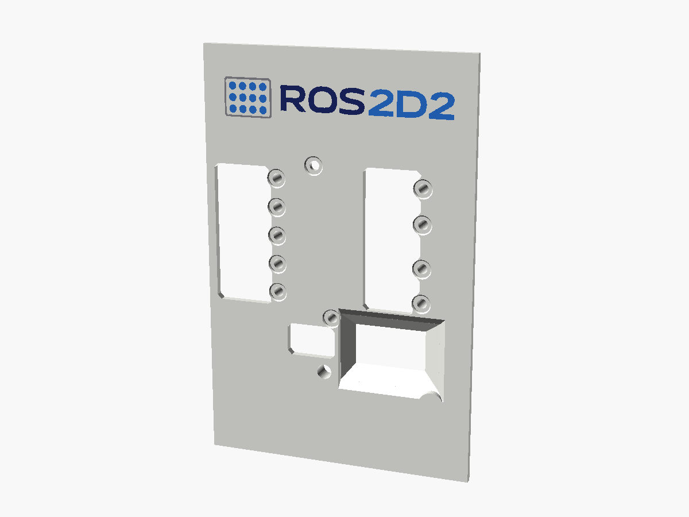

**Ficheros:** `stl/leds/wall_led_multicolor_bambu.3mf` · `stl/leds/wall_led_multicolor.3mf`

**Qué es:** Un agujero sobre cada uno de los 10 LEDs de la placa de la Pico (VL1–VL4, US1–US5, PWR), con un tubo por dentro hasta el LED, y otro sobre el LED de la propia Pico. Cada boca lleva un chaflán de 0,4 mm.

**Cuándo:** Quieres ver desde fuera qué sensores están activos y tienes AMS.

**Cómo imprimir:** Cara del logo sobre la cama. AMS: 1 blanco, 2 marino, 3 azul, 4 gris. Necesita las lentillas.

### D · Pared con LEDs sin AMS

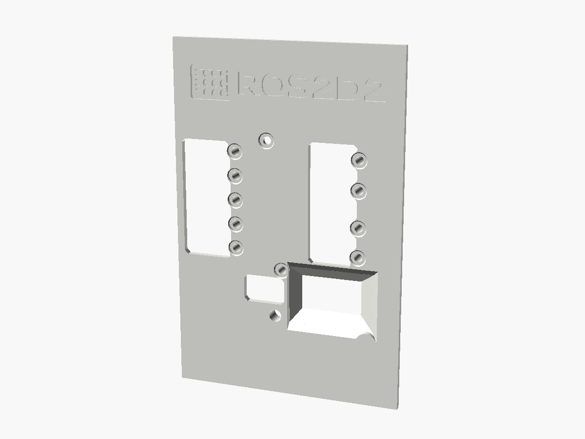

**Ficheros:** `stl/no_ams/wall_led_no_ams.stl`

**Qué es:** La pared C con el logo en hueco de 1,4 mm, para rellenarlo con piezas impresas aparte. Tubos, lentillas e insertos iguales que en C.

**Cuándo:** Quieres los LEDs y el logo en colores, pero tu impresora no tiene AMS.

**Cómo imprimir:** Blanco, cara del logo sobre la cama. Necesita los 3 rellenos y las lentillas.

### D · Rellenos del logo

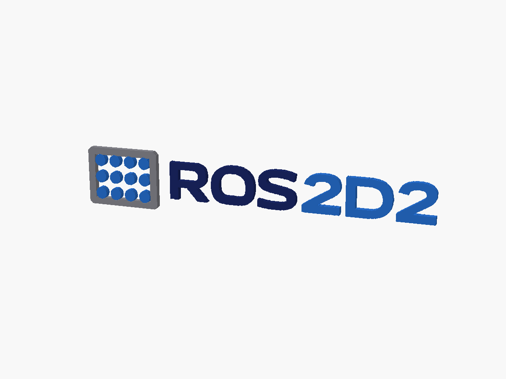

**Ficheros:** `stl/no_ams/inlay_navy.stl` · `stl/no_ams/inlay_blue.stl` · `stl/no_ams/inlay_grey.stl`

**Qué es:** Marino: «ROS». Azul: «2D2» y los 12 puntos. Gris: el marco de los puntos, ensanchado hacia dentro a 1,7 mm (1,2 bajo la fila de abajo) para que se pueda imprimir y manejar. 1,4 mm de grueso (7 capas), 0,1 mm de holgura por lado, a ras de la pared.

**Cuándo:** Solo con la pared D.

**Cómo imprimir:** Una placa por color, cara vista sobre la cama, capas de 0,2 mm, sin borde. Salen en su sitio y en espejo: dales la vuelta, mételos en su hueco y fíjalos con una gota de cianoacrilato.

### E · Pared con LEDs de un color

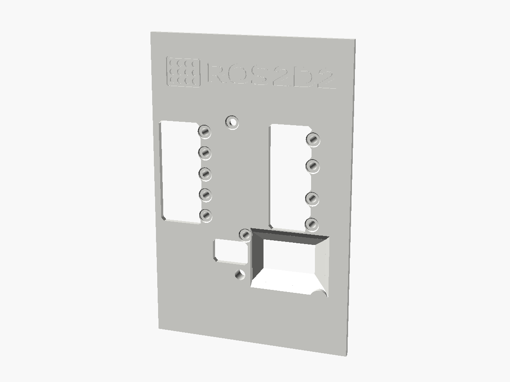

**Ficheros:** `stl/leds/wall_led_monocolor.stl`

**Qué es:** La pared C con el logo grabado 1 mm.

**Cuándo:** Quieres los LEDs, no tienes AMS y un solo color te vale.

**Cómo imprimir:** Cara del logo sobre la cama, un solo filamento. Necesita las lentillas.

### Lentillas de los LEDs

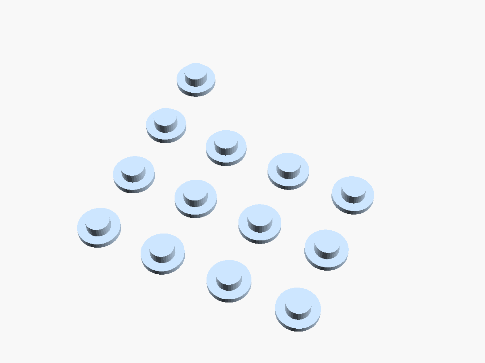

**Ficheros:** `stl/leds/led_lenses.stl`

**Qué es:** 13 discos (11 y 2 de repuesto) que se meten en la boca de cada agujero, a ras de la pared, con 0,25 mm de holgura; si alguno baila, una gota de pegamento.

**Cuándo:** Con cualquier pared con LEDs: C, D o E.

**Cómo imprimir:** PLA translúcido (o PETG transparente), discos planos sobre la cama.

## 2 · Piezas comunes (siempre)

Las mismas con cualquier pared.

### Base

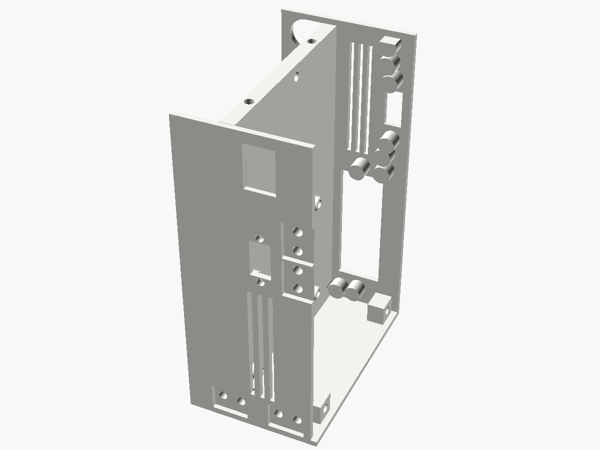

**Ficheros:** `stl/base.stl`

**Qué es:** Suelo, frontal estrecha (XT60, interruptor y rejilla), trasera, tabique central (Pi y convertidor) y los rebajes de las orejas.

**Cuándo:** Siempre.

**Cómo imprimir:** Suelo sobre la cama.

### Tapa

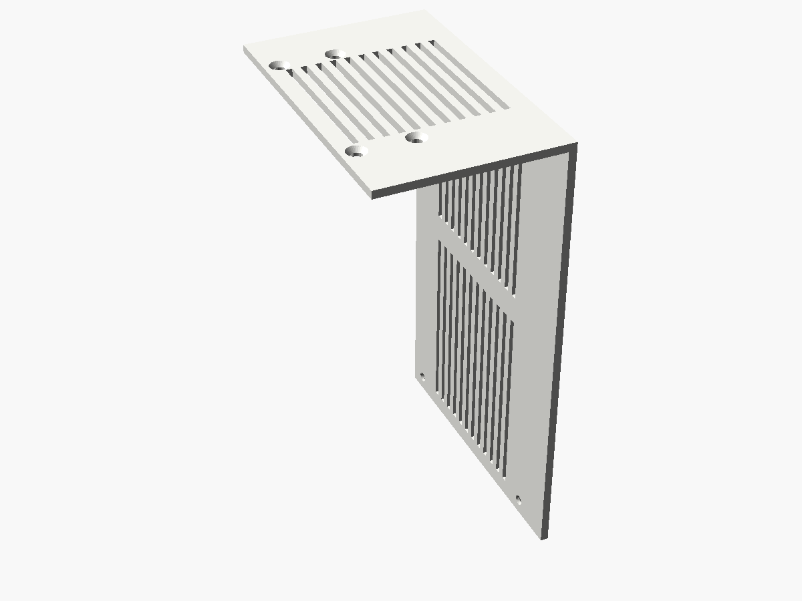

**Ficheros:** `stl/shell.stl`

**Qué es:** Techo y lateral en una pieza que baja desde arriba; la frontal se queda con la base.

**Cuándo:** Siempre.

**Cómo imprimir:** Techo sobre la cama.

### Varilla del pulsador DISPLAY

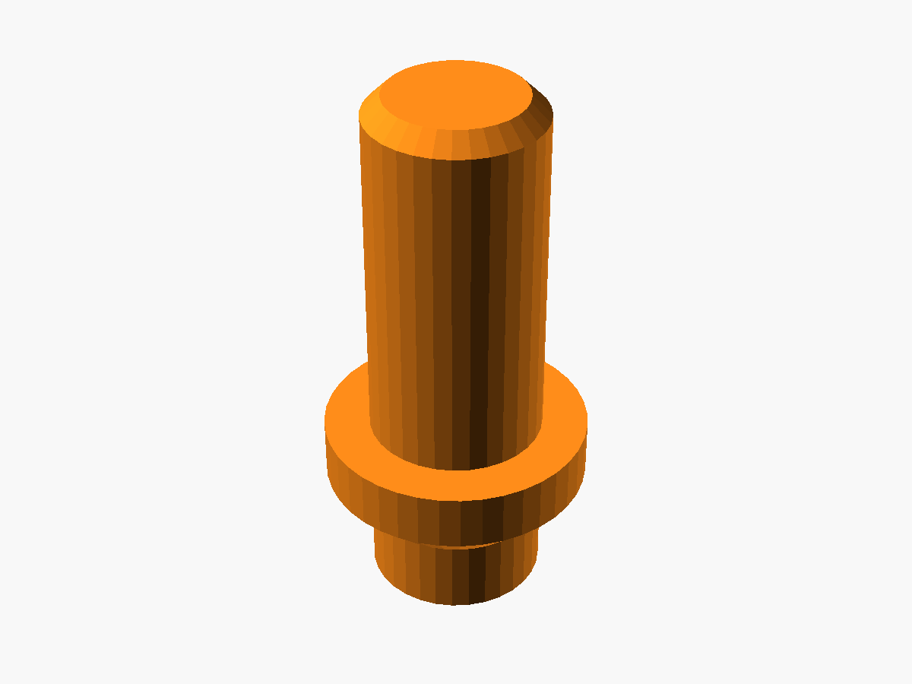

**Ficheros:** `stl/push_rod.stl`

**Qué es:** Atraviesa la pared y pulsa el botón DISPLAY de la placa de la Pico.

**Cuándo:** Siempre.

**Cómo imprimir:** De pie.

### Oreja de fijación

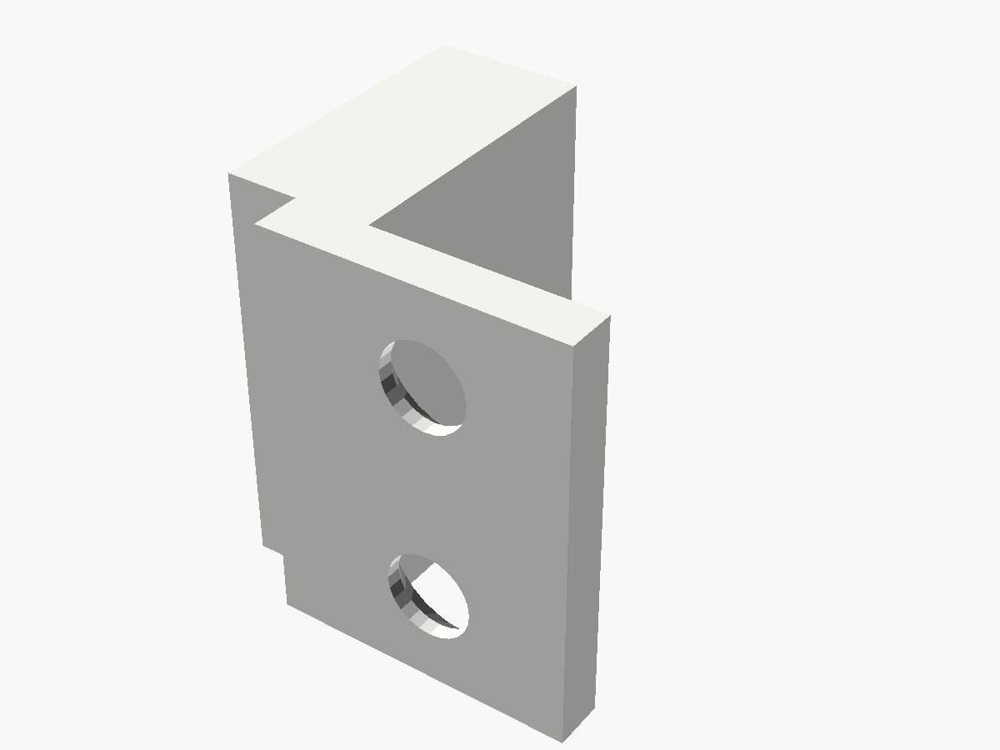

**Ficheros:** `stl/ear.stl`

**Qué es:** Pieza en L que va a ras en un rebaje de la frontal o de la trasera con 2 M3 × 8 avellanados; su lengüeta (agujero de 4,3 mm) se atornilla al R2. Sirve para la caja de pie (4 orejas en los rebajes junto al suelo) o tumbada sobre el lateral de la tapa (4 en los rebajes junto a ese lateral).

**Cuándo:** Siempre: 5 (4 y 1 de repuesto).

**Cómo imprimir:** De canto, con el perfil de la L sobre la cama: cada capa lleva la L entera y no se parte por el codo.

### Tapa ciega de oreja

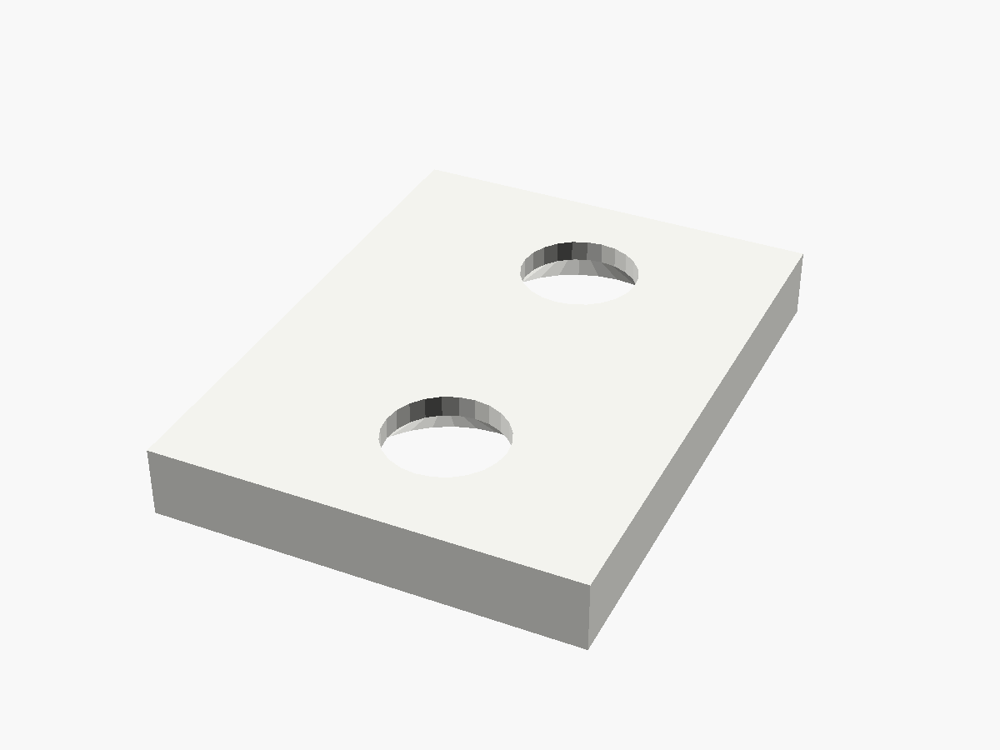

**Ficheros:** `stl/ear_blank.stl`

**Qué es:** La placa de la oreja sin lengüeta: cierra a ras los 4 rebajes que no usas, con sus 2 tornillos.

**Cuándo:** Siempre: 4.

**Cómo imprimir:** Plana, cara vista sobre la cama.

## 3 · Marco trasero (elige uno)

Cierra la ventana de la trasera alrededor de los USB y el Ethernet de la Pi. La Pi 4 y la Pi 5 tienen esos conectores al revés, por eso hay dos.

### Marco para la Pi 4

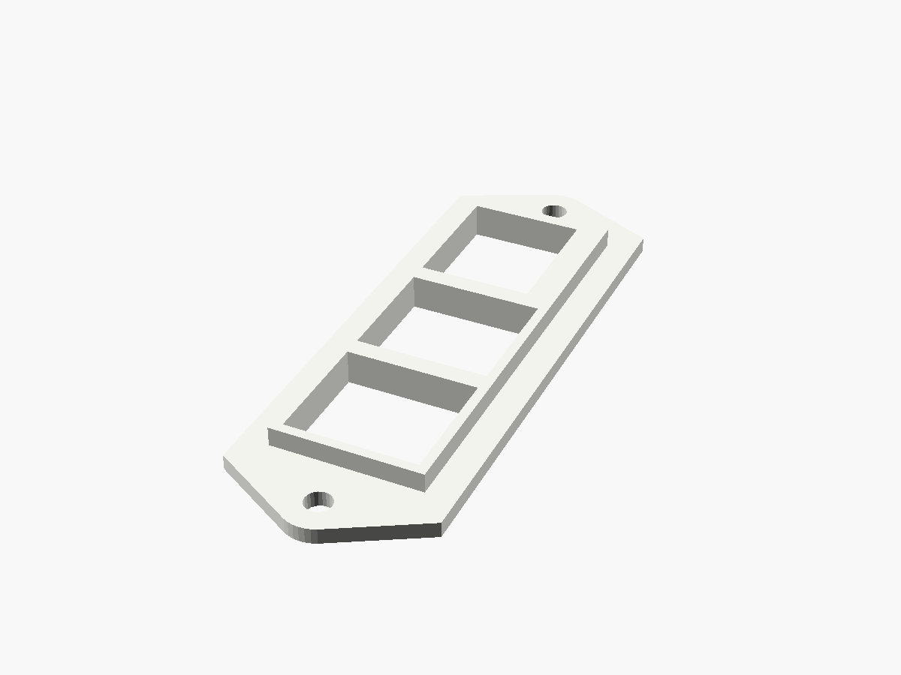

**Ficheros:** `stl/frame_pi4.stl`

**Qué es:** Ethernet arriba, USB abajo.

**Cuándo:** Si montas una Raspberry Pi 4.

**Cómo imprimir:** Cara exterior sobre la cama.

### Marco para la Pi 5

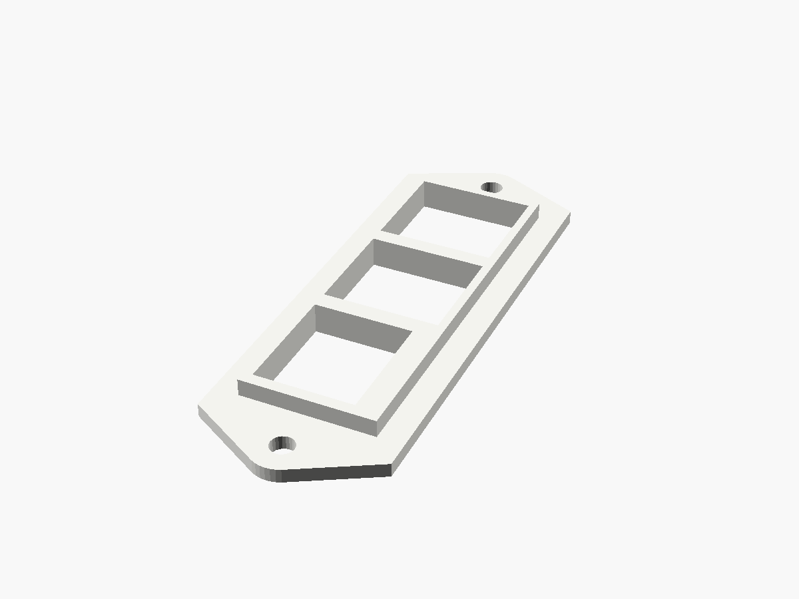

**Ficheros:** `stl/frame_pi5.stl`

**Qué es:** Ethernet abajo, USB arriba.

**Cuándo:** Si montas una Raspberry Pi 5.

**Cómo imprimir:** Cara exterior sobre la cama.

## 4 · HDMI trasero (opcional)

La base ya trae la ventana del HDMI y dos insertos M3. Según lo que pongas ahí:

### Soporte HDMI para kit FPC

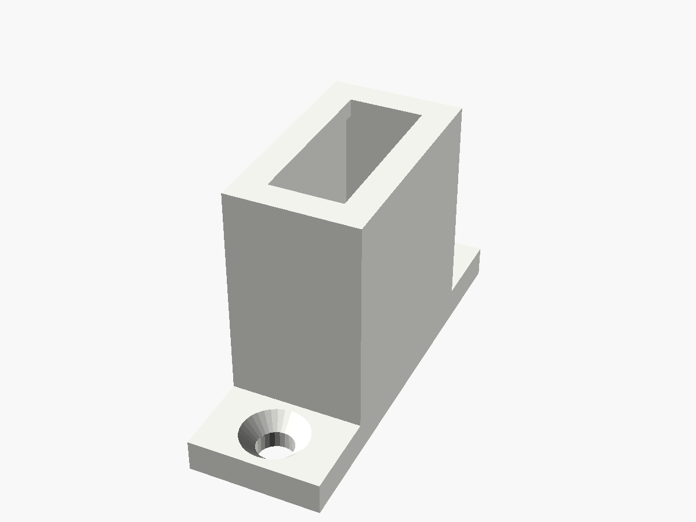

**Ficheros:** `stl/hdmi_holder.stl`

**Qué es:** Capucha que sujeta la placa «A hembra» de un kit HDMI FPC (de FPV): clavija micro-HDMI a 90°, cinta plana y placa HDMI A hembra. La cinta entra por la ventana y va bajo la Pi hasta su HDMI 0.

**Cuándo:** Usas el kit HDMI FPC. Mide la placa A hembra antes de imprimir (`fpc_a` en `hdmi_fpc.scad`).

**Cómo imprimir:** Cara exterior sobre la cama, capucha hacia arriba. 2 × M3 × 8 avellanados.

### Tapa HDMI ciega

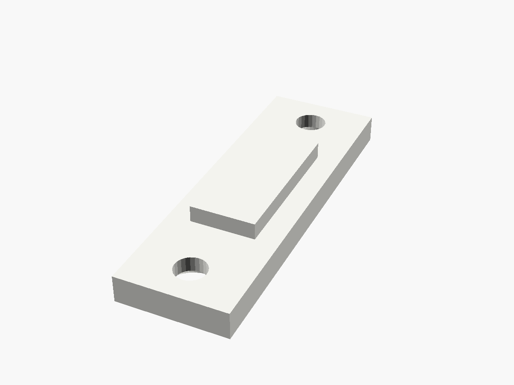

**Ficheros:** `stl/hdmi_cover.stl`

**Qué es:** Tapa la ventana del HDMI con un tapón que la rellena.

**Cuándo:** No pones HDMI.

**Cómo imprimir:** Cara exterior sobre la cama. 2 × M3 × 8 avellanados.

Si usas un **HDMI hembra de panel con brida y 2 tornillos M3**, no hace falta imprimir nada: se atornilla directamente a los insertos de la base.

## Ficheros que no hay que imprimir sueltos

| Fichero | Para qué está |
|---|---|
| `wall.stl`, `logo_navy.stl`, `logo_blue.stl`, `logo_grey.stl` | Son las 4 partes que van dentro de `wall_multicolor*.3mf`. Úsalas solo para montar tu propio proyecto multicolor en un laminador que no lea el 3MF. |
| `leds/wall_led.stl`, `leds/logo_*_led.stl` | Lo mismo para `wall_led_multicolor*.3mf`. |
