 

# ROS2 rack box · Print guide

*En castellano: [GUIA_IMPRESION.md](GUIA_IMPRESION.md)*

Which files to print and when to pick one or another. Only for the rack box (`hardware/ros2_box_rack_v3`). Every file is in its `stl/` folder.

**Up-to-date version:** <https://github.com/BeskarCode/ROS2D2/tree/main/hardware/ros2_box_rack_v3>

## What to print

- **Always:** `base.stl`, `shell.stl` and `push_rod.stl`.
- **One main wall** out of the five options (table below).
- **Lenses** `leds/led_lenses.stl`, only if the wall you pick has LEDs.
- **One back frame:** `frame_pi4.stl` or `frame_pi5.stl`, for your Raspberry Pi.
- **HDMI on the back (optional):** `hdmi_holder.stl` or `hdmi_cover.stl`, or neither (see its section).
- **Ears and blanks:** 5 × `ear.stl` (4 and 1 spare) and 4 × `ear_blank.stl`.
- **Connector blanks (optional):** those in `blanks/` for the connectors you don't use.

### Which wall?

| See the Pico board's LEDs? | Do you have an AMS? | Print |
|---|---|---|
| No | Yes | A · `wall_multicolor_bambu.3mf` |
| No | No | B · `wall_monocolor.stl` (engraved logo, one colour) |
| Yes | Yes | C · `leds/wall_led_multicolor_bambu.3mf` + lenses |
| Yes | No, but I want the logo in colour | D · `no_ams/wall_led_no_ams.stl` + 3 fillings + lenses |
| Yes | No, one colour is fine | E · `leds/wall_led_monocolor.stl` + lenses |

PETG, 0.2 mm layers, 0.4 nozzle, no supports, unless said otherwise. The heat-set inserts and the screws are the same with any wall: see the assembly guide.

## 1 · Main wall (pick one)

The large wall with the OLED window, the DISPLAY button and the bays where the sensors plug in from outside. All five have the same inserts and fit the base and the shell the same way: only the logo and the LEDs change.

### A · Wall with the logo in 4 colours

**Files:** `stl/wall_multicolor_bambu.3mf` · `stl/wall_multicolor.3mf`

**What it is:** Wall without LED holes, navy, blue and grey logo inlaid flush.

**When:** You have an AMS (or any multi-material) and don't need to see the board's LEDs.

**How to print:** Logo face on the bed. AMS: 1 white, 2 navy, 3 blue, 4 grey. `_bambu.3mf` for Bambu Studio; the generic `.3mf` for other slicers.

### B · Single-colour wall

**Files:** `stl/wall_monocolor.stl`

**What it is:** The same wall, with the logo engraved 1 mm instead of inlaid.

**When:** No AMS and no need for the LEDs. The easiest one to print.

**How to print:** Logo face on the bed, one filament.

### C · LED wall, logo in 4 colours

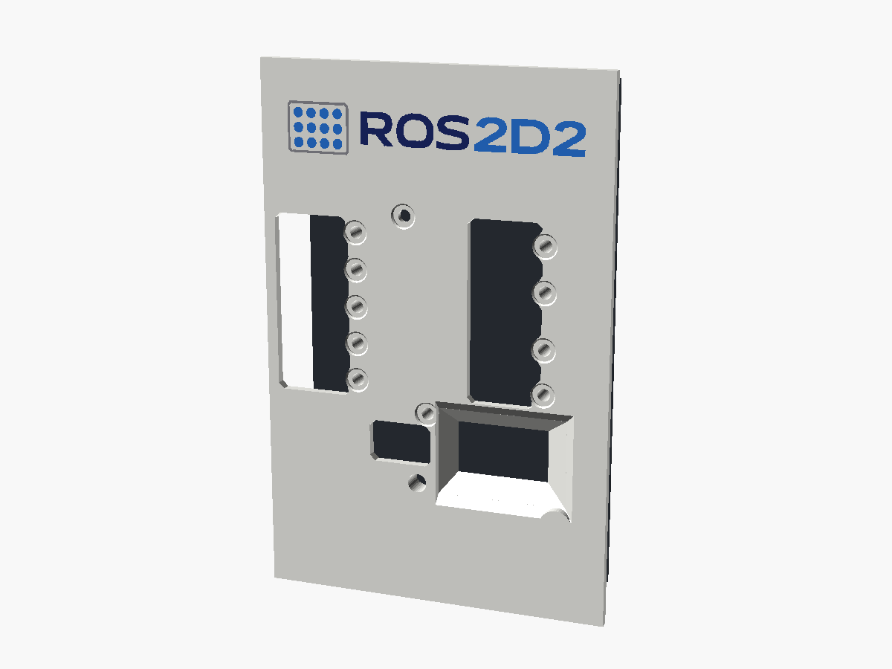

**Files:** `stl/leds/wall_led_multicolor_bambu.3mf` · `stl/leds/wall_led_multicolor.3mf`

**What it is:** A hole over each of the Pico board's 10 LEDs (VL1–VL4, US1–US5, PWR), with a tube inside down to the LED, and one over the Pico's own LED. Each mouth has a 0.4 mm chamfer.

**When:** You want to see from outside which sensors are active, and you have an AMS.

**How to print:** Logo face on the bed. AMS: 1 white, 2 navy, 3 blue, 4 grey. Needs the lenses.

### D · LED wall without AMS

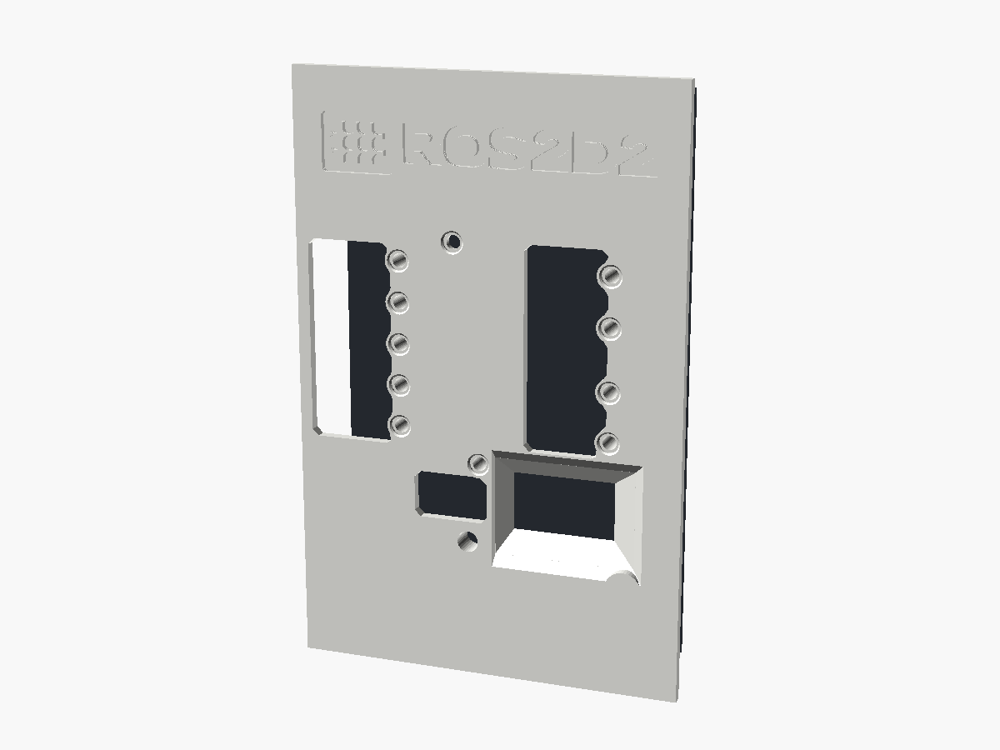

**Files:** `stl/no_ams/wall_led_no_ams.stl`

**What it is:** Wall C with the logo as 1.4 mm pockets, filled with parts printed apart. Same tubes, lenses and inserts as C.

**When:** You want the LEDs and the logo in colour, but your printer has no AMS.

**How to print:** White, logo face on the bed. Needs the 3 fillings and the lenses.

### D · Fillings for the logo

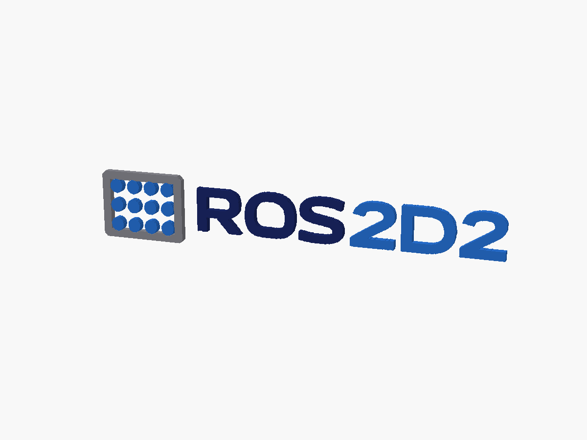

**Files:** `stl/no_ams/inlay_navy.stl` · `stl/no_ams/inlay_blue.stl` · `stl/no_ams/inlay_grey.stl`

**What it is:** Navy: "ROS". Blue: "2D2" and the 12 dots. Grey: the dots' frame, widened inwards to 1.7 mm (1.2 under the bottom row) so it prints and handles. 1.4 mm thick (7 layers), 0.1 mm of play per side, flush with the wall.

**When:** Only with wall D.

**How to print:** One plate per colour, visible face on the bed, 0.2 mm layers, no brim. They come out in place and mirrored: turn them over, press them into their pockets and fix them with a drop of cyanoacrylate.

### E · Single-colour LED wall

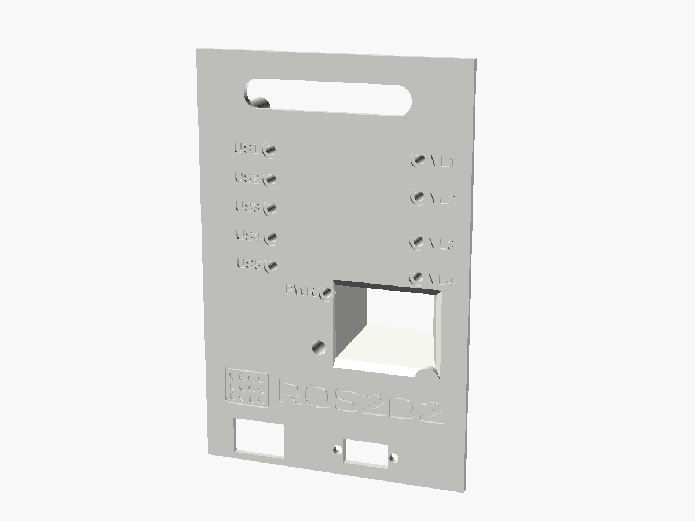

**Files:** `stl/leds/wall_led_monocolor.stl`

**What it is:** Wall C with the logo engraved 1 mm.

**When:** You want the LEDs, no AMS, one colour is fine.

**How to print:** Logo face on the bed, one filament. Needs the lenses.

### LED lenses

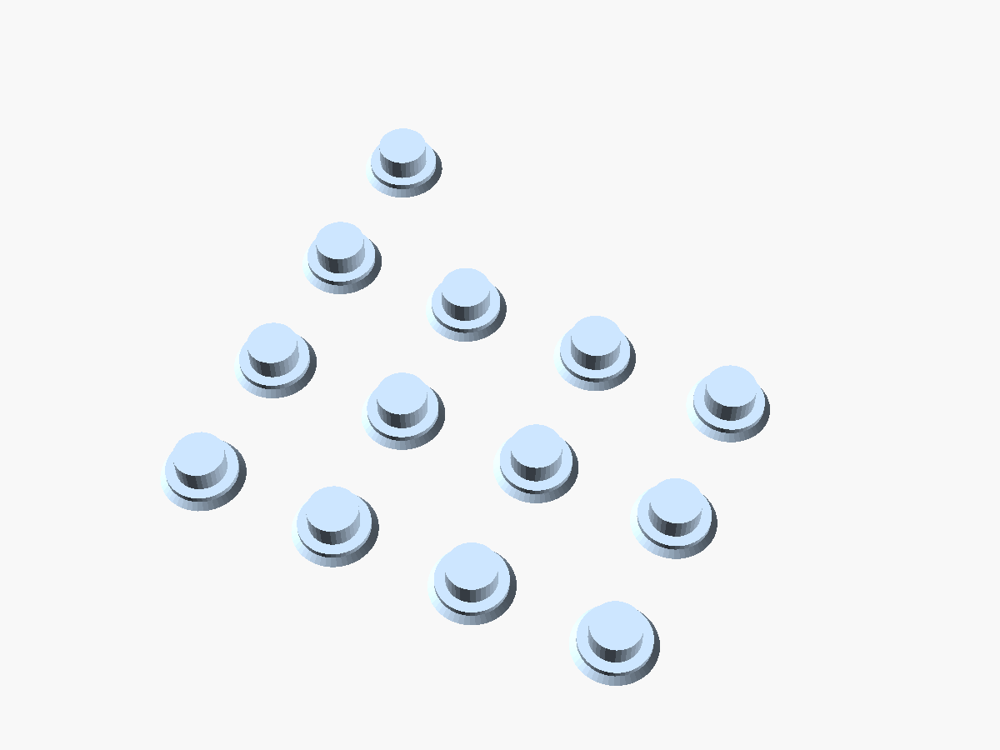

**Files:** `stl/leds/led_lenses.stl`

**What it is:** 13 discs (11 and 2 spares) that drop into the mouth of each hole, flush with the wall, with 0.25 mm of play; if one is loose, a drop of glue.

**When:** With any LED wall: C, D or E.

**How to print:** Translucent PLA (or clear PETG), discs flat on the bed.

## 2 · Common parts (always)

The same with any wall.

### Base

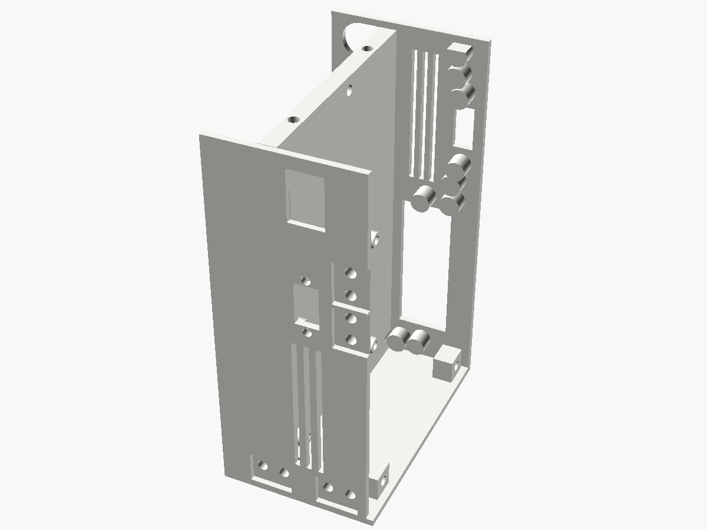

**Files:** `stl/base.stl`

**What it is:** Floor, narrow front (XT60, switch and vent), back, central divider (Pi and converter) and the ear pockets.

**When:** Always.

**How to print:** Floor on the bed.

### Shell

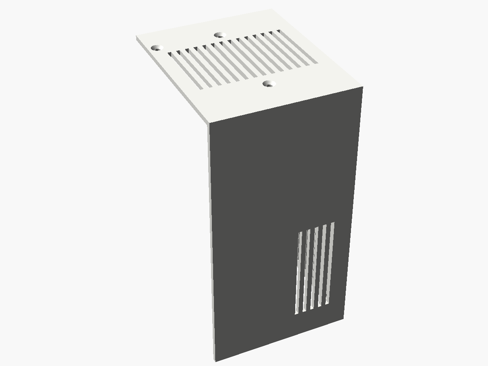

**Files:** `stl/shell.stl`

**What it is:** Roof and side in one piece that slides down from above; the front stays with the base.

**When:** Always.

**How to print:** Roof on the bed.

### DISPLAY push rod

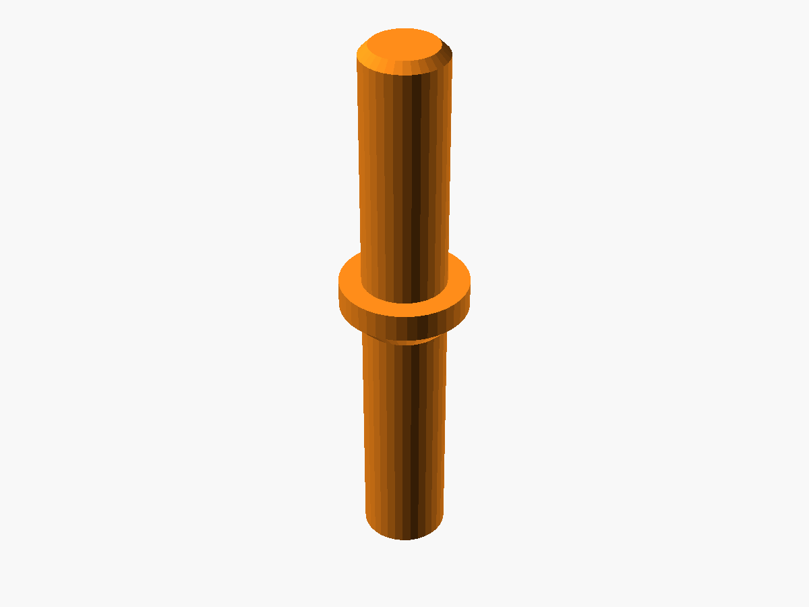

**Files:** `stl/push_rod.stl`

**What it is:** Goes through the wall and presses the Pico board's DISPLAY button.

**When:** Always.

**How to print:** Standing.

### Mounting ear

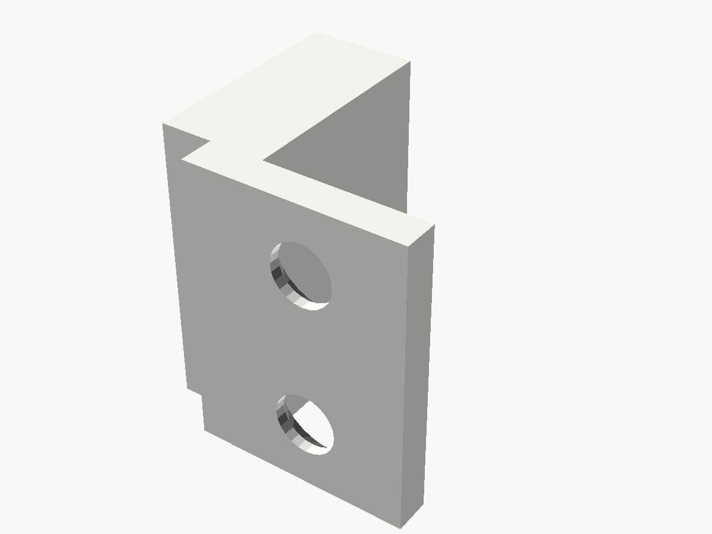

**Files:** `stl/ear.stl`

**What it is:** An L piece flush in a pocket of the front or the back with 2 M3 × 8 countersunk; its lug (4.3 mm hole) screws to the R2. Works with the box standing (4 ears in the pockets by the floor) or lying on the shell's side (4 in the pockets by that side).

**When:** Always: 5 (4 and 1 spare).

**How to print:** On edge, the L's profile on the bed: every layer holds the whole L, so it does not split at the bend.

### Ear blank

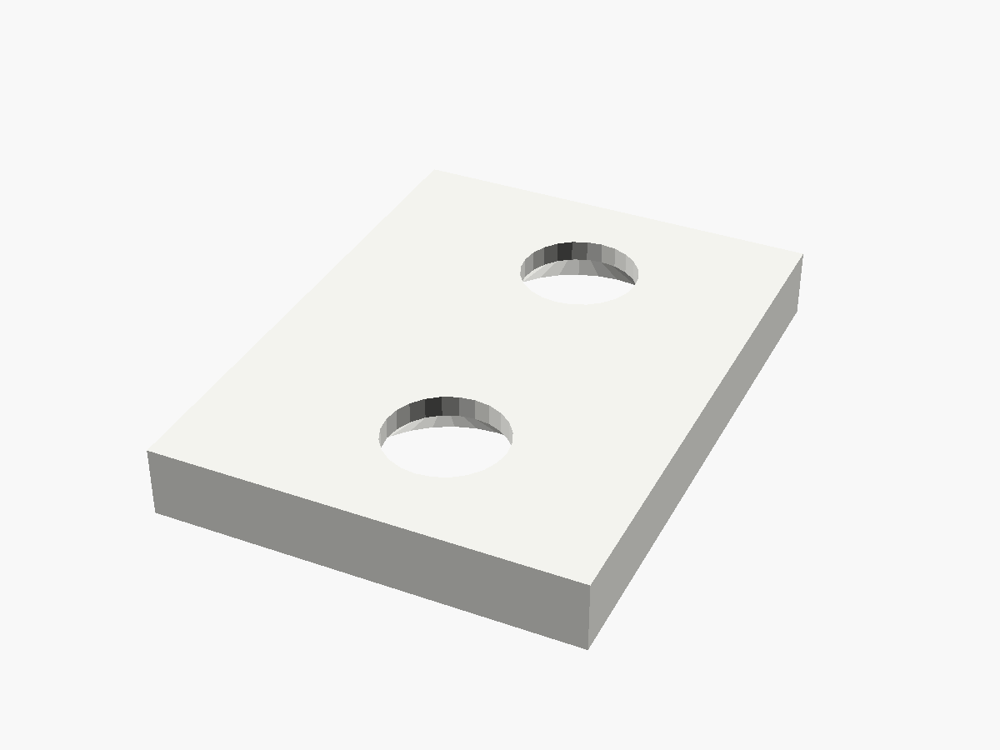

**Files:** `stl/ear_blank.stl`

**What it is:** The ear's plate without the lug: closes the 4 pockets you don't use flush, with its 2 screws.

**When:** Always: 4.

**How to print:** Flat, visible face on the bed.

### Blanks for the unused connectors

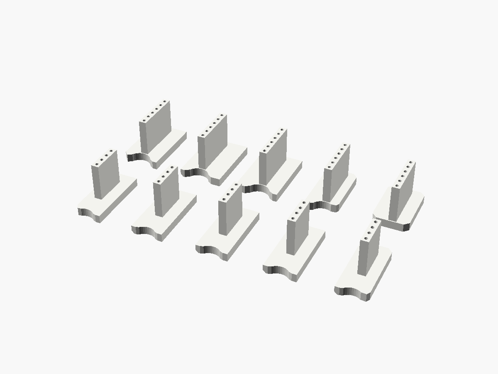

**Files:** `stl/blanks/blank_US1.stl … blank_EXP.stl` · `stl/blanks/blanks_all.stl`

**What it is:** Looks only: one per sensor connector (US1–US5, VL1–VL4, EXP). It plugs onto the connector's pins like a Dupont and closes its strip of the opening flush; the connectors with a sensor stay open. To take it out, put a nail in the chamfer on one edge. If it falls out or goes in too hard, change `blank_pin_d` (1.0 mm) in `params.scad`.

**When:** Optional: those of the connectors you don't use (or `blanks_all.stl`, all ten).

**How to print:** Visible face on the bed, in the wall's colour.

## 3 · Back frame (pick one)

Closes the back window round the Pi's USB and Ethernet jacks. The Pi 4 and the Pi 5 have them the other way round, hence two frames.

### Frame for the Pi 4

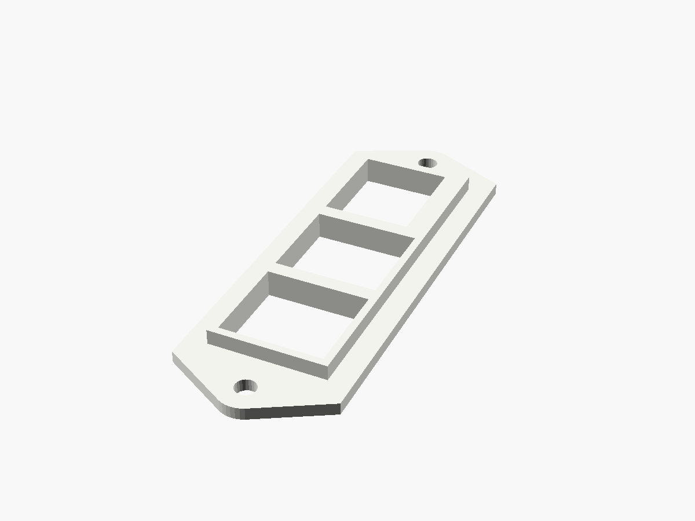

**Files:** `stl/frame_pi4.stl`

**What it is:** Ethernet at the top, USB below.

**When:** If you fit a Raspberry Pi 4.

**How to print:** Outer face on the bed.

### Frame for the Pi 5

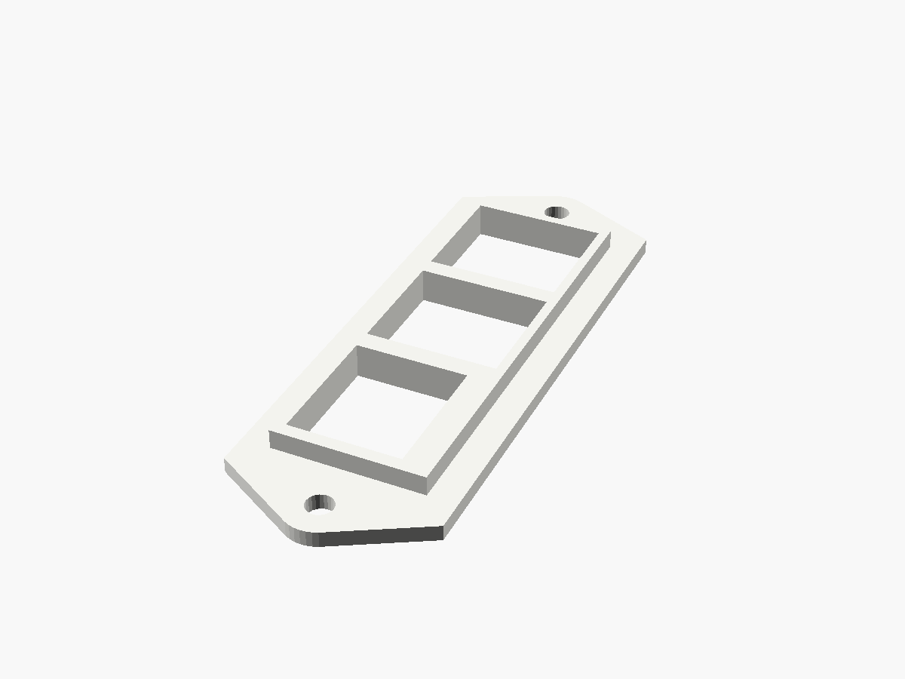

**Files:** `stl/frame_pi5.stl`

**What it is:** Ethernet at the bottom, USB above.

**When:** If you fit a Raspberry Pi 5.

**How to print:** Outer face on the bed.

## 4 · HDMI on the back (optional)

The base already has the HDMI window and two M3 inserts. Depending on what goes there:

### HDMI holder for an FPC kit

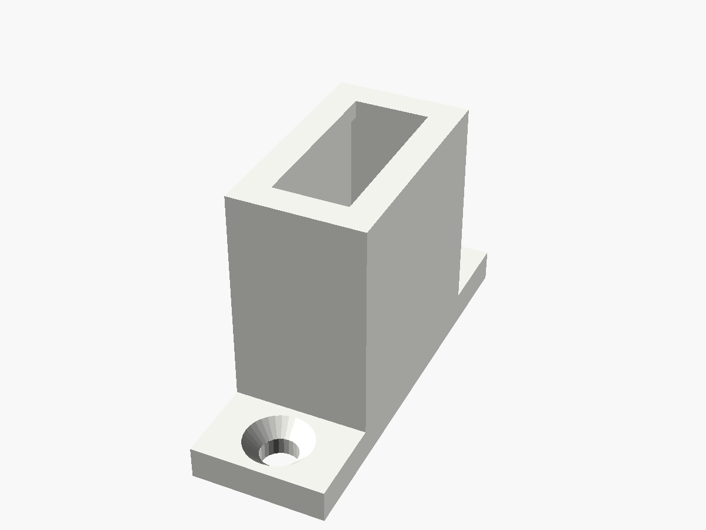

**Files:** `stl/hdmi_holder.stl`

**What it is:** A hood holding the "A Female" board of an FPV FPC HDMI kit: 90° micro-HDMI plug, flat ribbon and HDMI A female board. The ribbon goes in through the window and under the Pi to its HDMI 0.

**When:** You use the FPC HDMI kit. Measure the A Female board before printing (`fpc_a` in `hdmi_fpc.scad`).

**How to print:** Outer face on the bed, hood up. 2 × M3 × 8 countersunk.

### Blank HDMI cover

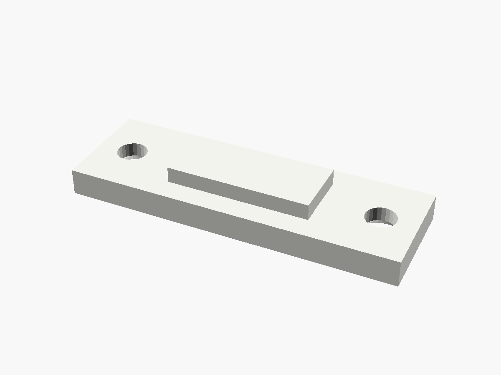

**Files:** `stl/hdmi_cover.stl`

**What it is:** Closes the HDMI window with a plug that fills it.

**When:** No HDMI fitted.

**How to print:** Outer face on the bed. 2 × M3 × 8 countersunk.

With a **panel HDMI female jack with a flange and 2 M3 screws** nothing needs printing: it screws straight onto the base's inserts.

## Files not to print on their own

| File | What it is for |
|---|---|
| `wall.stl`, `logo_navy.stl`, `logo_blue.stl`, `logo_grey.stl` | The 4 bodies inside `wall_multicolor*.3mf`. Use them only to build your own multicolour project in a slicer that can't read the 3MF. |
| `leds/wall_led.stl`, `leds/logo_*_led.stl` | The same for `wall_led_multicolor*.3mf`. |
