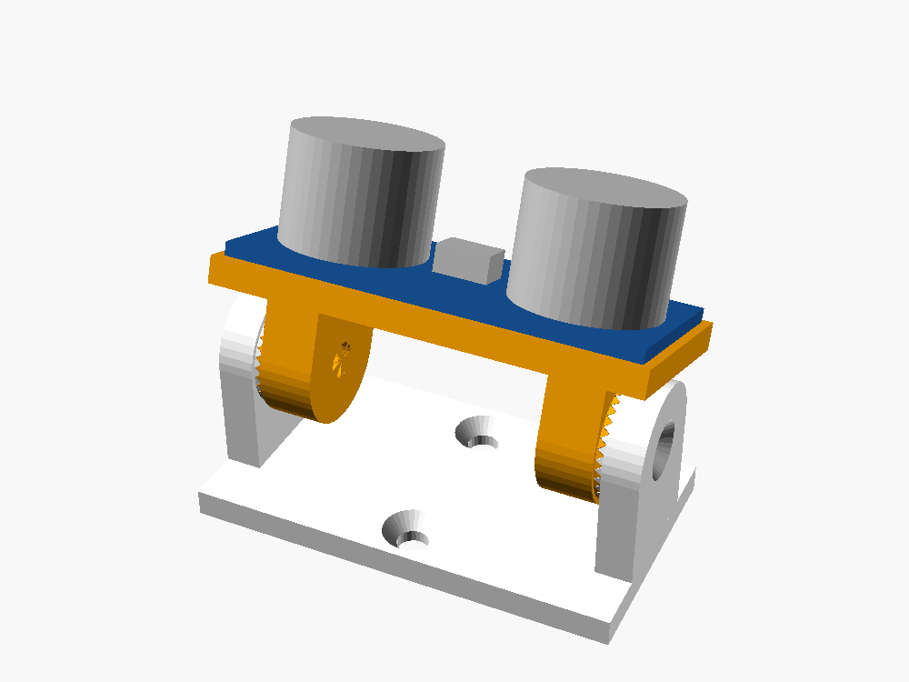
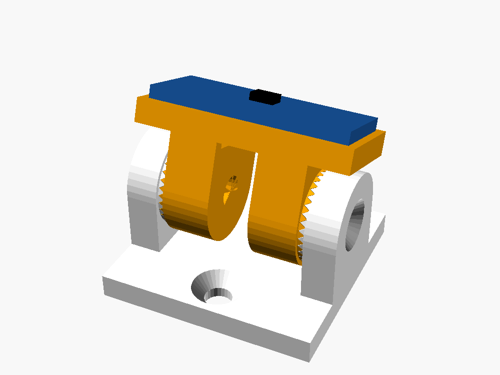
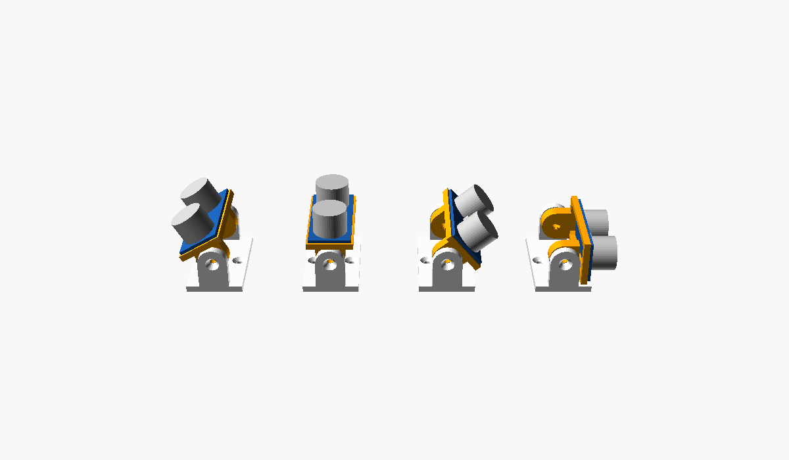
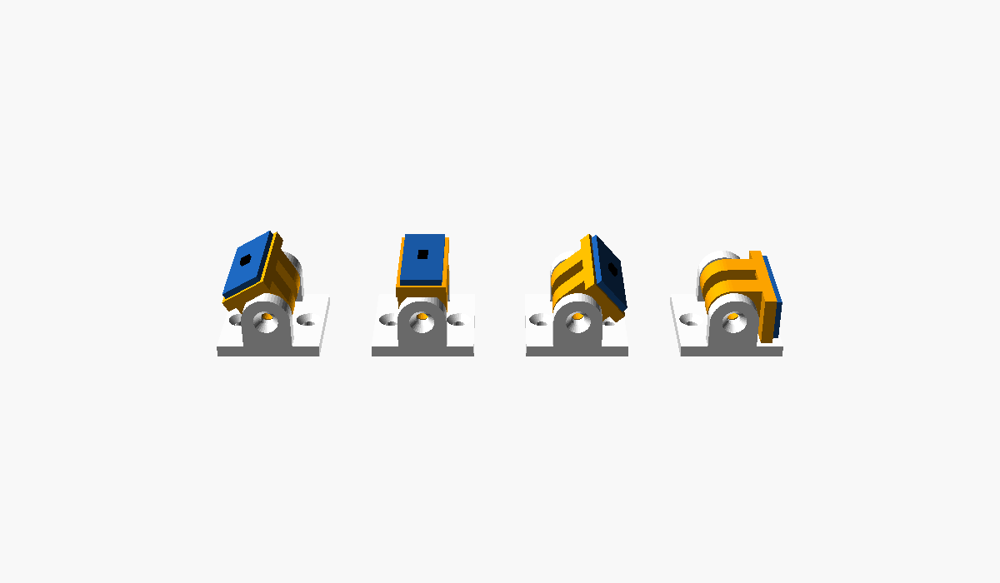
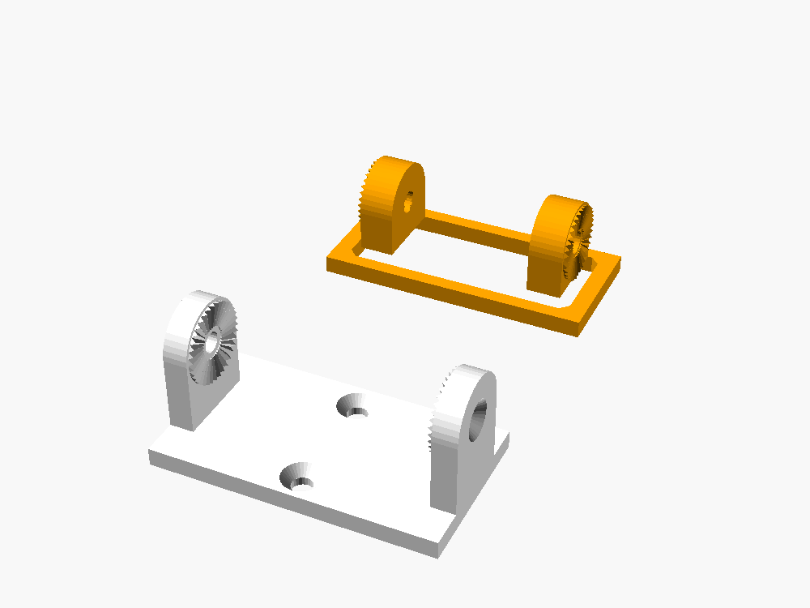
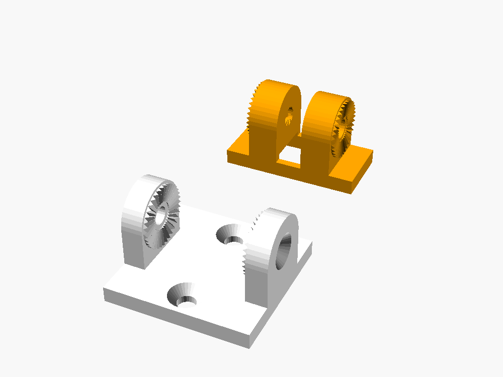

# Tilting mounts for the HC-SR04 and the VL53L0X

*En castellano: [README_es.md](README_es.md)*

Mounts to fix ROS2D2's sensors (5 HC-SR04 and 4 VL53L0X) to the R2, on the skirt or on the legs, and
**tilt each sensor after it is mounted**. Each mount is two parts: a flat **base** screwed to the R2 and a
**cradle** the sensor board is glued to, pivoting on the base's two ears.

**Nothing sticks out past the sensor's width**: the ears sit under the cradle, flush with its sides, and
the cradle's cheeks go inside the ears. The mount is as wide as the board plus 1 mm per side: **47 mm**
for the HC-SR04 and **27 mm** for the VL53L0X.

| HC-SR04 | VL53L0X (GY-VL53L0XV2) |
|---|---|
|  |  |

## How it tilts

The axle is one countersunk M3 per side, in from the outside of the ear (the head sits flush) into a
heat-set insert in the cradle's cheek. The ear and the cheek carry **radial teeth** that mesh: the angle
moves in **10°** steps and does not slip with vibration. To change it, loosen both screws, turn the cradle
and tighten again.

- **0°**: the sensor looks straight out, perpendicular to the base.
- **+90°**: the sensor lies parallel to the base.

## The height depends on the tilt

The more the sensor has to turn, the higher the axle must be for the cradle to clear the base. The range
is chosen when generating the parts with `tilt_min` and `tilt_max`, and the axle height follows:

| Range | HC-SR04: axle / total height at 0° | VL53L0X: axle / total height at 0° |
|---|---|---|
| −30° to +90° (the STLs in `stl/`) | 15 / 39.5 mm | 10.3 / 24.7 mm |
| −30° to +30° | 10.5 / 35 mm | 9.8 / 24.2 mm |

If a sensor only needs a little tilt, generate its base with that range and it sits lower (see below).
The cradle is the same for any range; only the base changes.





## Parts

| STL | What it is | How to print |
|---|---|---|
| `stl/base_hc.stl` | HC-SR04 base (47 × 26.4 mm), tilt −30° to +90° | plate on the bed, ears up |
| `stl/cradle_hc.stl` | HC-SR04 cradle | plate on the bed, cheeks up |
| `stl/base_vl.stl` | VL53L0X base (27 × 26.4 mm), tilt −30° to +90° | plate on the bed, ears up |
| `stl/cradle_vl.stl` | VL53L0X cradle | plate on the bed, cheeks up |

PETG, 0.2 mm layers, 0.4 nozzle, no supports. For the 9 sensors: 5 `_hc` sets and 4 `_vl` sets.

| HC-SR04 | VL53L0X |
|---|---|
|  |  |

## The sensor is glued

The cradle has no screws for the sensor: the board is glued onto it (contact glue, thin double-sided tape
or a dab of hot glue on the edges). The cradle has a **window** for the parts and solder joints on the
board's back, and the board rests on the frame round it:

- **HC-SR04**: 41 × 17 mm window; the board rests on 2 mm at the sides and 1.5 mm top and bottom. The
  pins stay along the bottom edge, off the cradle.
- **VL53L0X**: 13 × 9.6 mm window in the middle; the board is glued by its two ends. Solder the pins
  facing forward, or the wires straight to the board.

## Hardware (per mount)

| | HC-SR04 and VL53L0X |
|---|---|
| Axle | 2 × M3 × 10 countersunk + 2 M3 inserts in the cradle's cheeks |
| Base to the R2 | 2 × M3 countersunk (length to suit the surface) |

The base's two holes are 18 mm apart.

## Assembly

1. Heat-set the two M3 inserts into the cradle's cheeks.
2. Glue the sensor to the cradle.
3. Screw the base to the R2 with the two countersunk M3.
4. Set the cradle on the base with the cheeks between the ears and the teeth meshed at the angle you
   want, and fit the two M3 × 10 of the axle from the outside. Tighten just enough for the teeth not to
   skip.

## Status

Checked on the model (no collisions over the whole range, teeth meshed at every 10° step), but **not
printed or tested yet**: the teeth's fit may need a tweak.

## Generating the files

```bash
openscad -o stl/base_hc.stl -D 'part="base"' -D 'sensor="hc"' -D tilt_min=-30 -D tilt_max=90 sensor_mounts.scad
openscad -o stl/cradle_hc.stl -D 'part="cradle"' -D 'sensor="hc"' sensor_mounts.scad
openscad -o renders/mounted_hc.png -D 'part="photo"' -D 'sensor="hc"' -D tilt=20 sensor_mounts.scad
```

Set `sensor="vl"` for the VL53L0X and `tilt_min` / `tilt_max` for another tilt range (multiples of 10).
The render views: `photo`, `angles` and `parts`; `part="echo"` prints the sizes.
