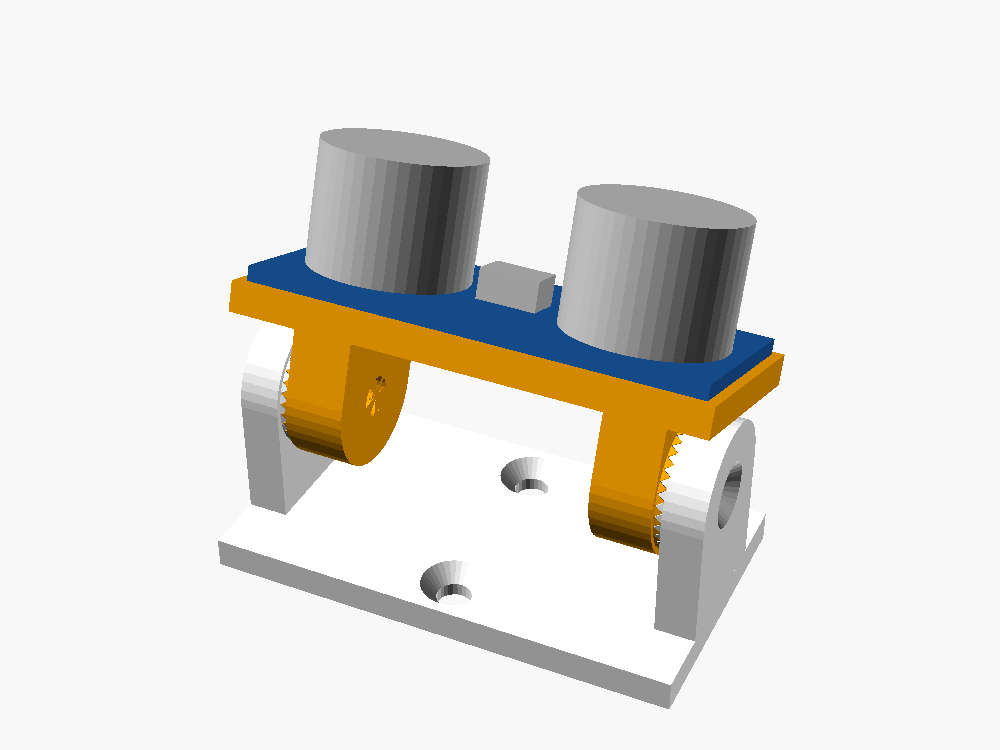
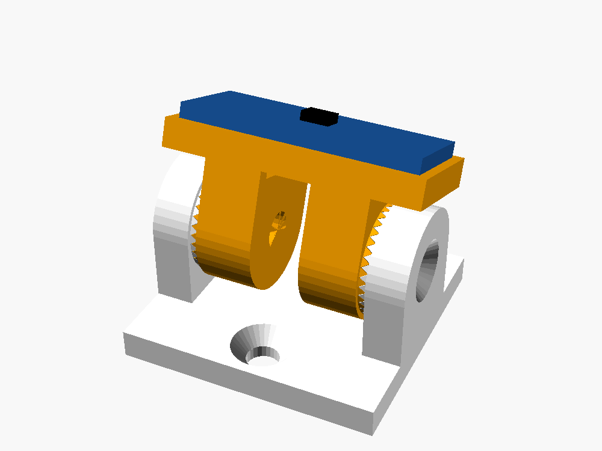
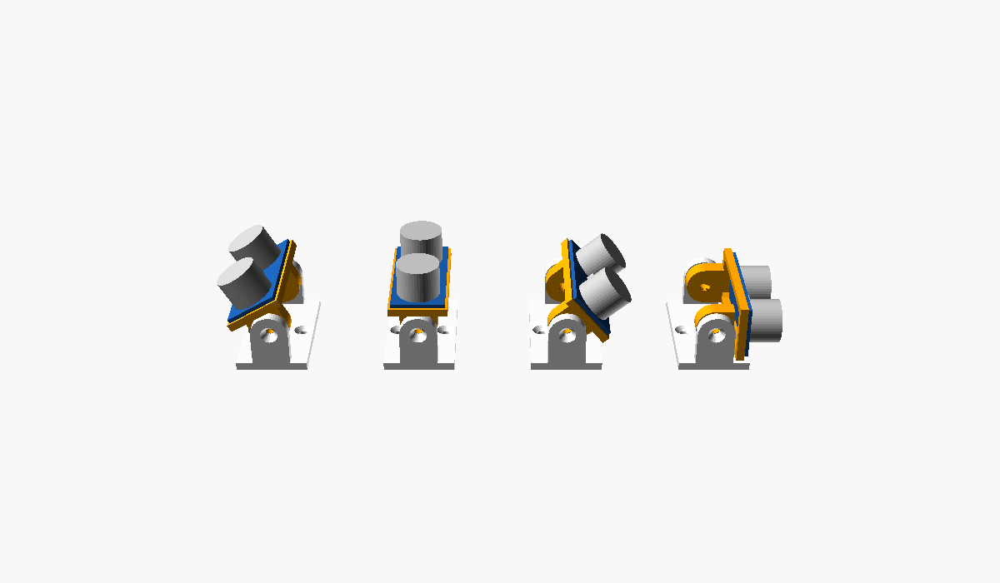
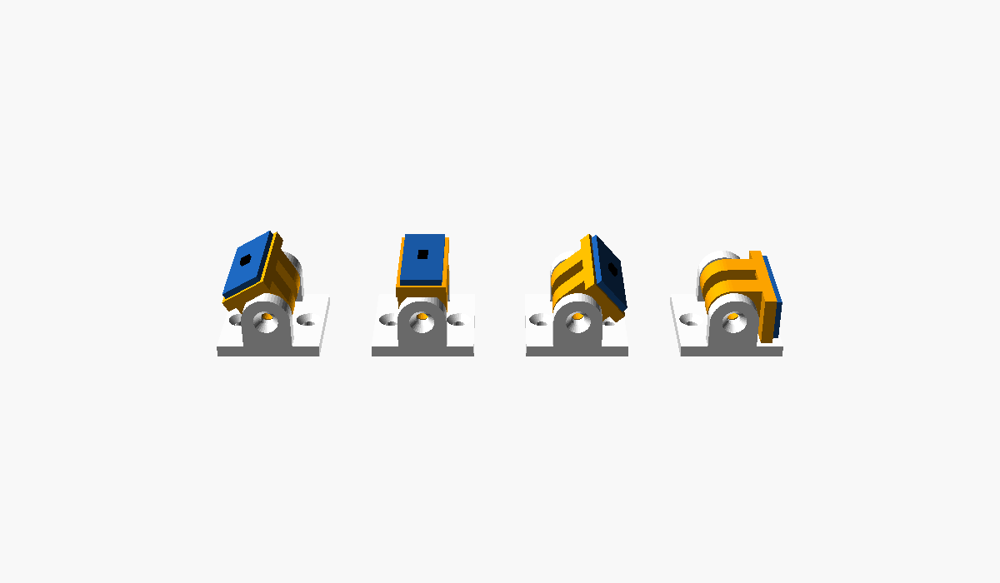
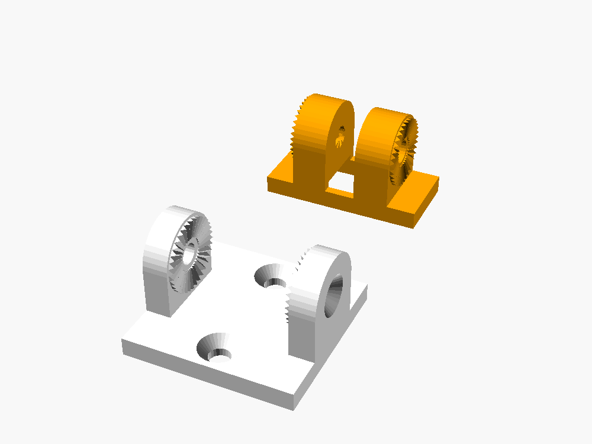

# Soportes orientables para HC-SR04 y VL53L0X

*In English: [README.md](README.md)*

Soportes para fijar los sensores de ROS2D2 (5 HC-SR04 y 4 VL53L0X) al R2, en el faldón o en las patas,
y poder **inclinar cada sensor después de montado**. Cada soporte son dos piezas: una **base** plana
que se atornilla al R2 y una **cuna** donde se pega la placa del sensor y que gira sobre las dos orejas
de la base.

**Nada sobresale del ancho del sensor**: las orejas van debajo de la cuna, a ras de sus lados, y las
mejillas de la cuna van por dentro de las orejas. El soporte mide de ancho lo mismo que la placa más 1 mm
por lado: **47 mm** el del HC-SR04 y **27 mm** el del VL53L0X.

| HC-SR04 | VL53L0X (GY-VL53L0XV2) |
|---|---|
|  |  |

## Cómo se orienta

El eje es un tornillo M3 avellanado por cada lado, que entra por fuera de la oreja (la cabeza queda
enrasada) y rosca en un inserto de la mejilla de la cuna. La oreja y la mejilla tienen **dientes
radiales** que encajan entre sí: el ángulo va a saltos de **10°** y no resbala con las vibraciones. Para
cambiarlo, afloja los dos tornillos, gira la cuna y vuelve a apretar.

- **0°**: el sensor mira de frente, perpendicular a la base.
- **+90°**: el sensor queda paralelo a la base.

## La altura depende del giro

Cuanto más tiene que girar el sensor, más alto tiene que ir el eje para que la cuna no toque la base. El
giro se elige al generar las piezas con `tilt_min` y `tilt_max`, y la altura del eje sale sola:

| Giro | HC-SR04: eje / alto total a 0° | VL53L0X: eje / alto total a 0° |
|---|---|---|
| −30° a +90° (los STL de `stl/`) | 15 / 39,5 mm | 10,3 / 24,7 mm |
| −30° a +30° | 10,5 / 35 mm | 9,8 / 24,2 mm |

Si un sensor solo necesita un poco de giro, genera su base con ese rango y queda más bajo (ver abajo).
La cuna es la misma para cualquier rango; solo cambia la base.





## Piezas

| STL | Qué es | Cómo imprimir |
|---|---|---|
| `stl/base_hc.stl` | base del HC-SR04 (47 × 26,4 mm), giro −30° a +90° | placa sobre la cama, orejas hacia arriba |
| `stl/cradle_hc.stl` | cuna del HC-SR04 | placa sobre la cama, mejillas hacia arriba |
| `stl/base_vl.stl` | base del VL53L0X (27 × 26,4 mm), giro −30° a +90° | placa sobre la cama, orejas hacia arriba |
| `stl/cradle_vl.stl` | cuna del VL53L0X | placa sobre la cama, mejillas hacia arriba |

PETG, capa de 0,2 mm, boquilla de 0,4, sin soportes. Para los 9 sensores: 5 juegos `_hc` y 4 juegos `_vl`.

| HC-SR04 | VL53L0X |
|---|---|
|  |  |

## El sensor va pegado

La cuna no lleva tornillos para el sensor: la placa se pega sobre ella (cola de contacto, cinta de doble
cara fina o una gota de termocola en los bordes). La cuna tiene una **ventana** para los componentes y
las soldaduras de la cara de atrás, y la placa apoya en el marco de alrededor:

- **HC-SR04**: ventana de 41 × 17 mm; la placa apoya en 2 mm por los lados y 1,5 mm arriba y abajo. Los
  pines quedan por el borde de abajo, fuera de la cuna.
- **VL53L0X**: ventana de 13 × 9,6 mm en el centro; la placa se pega por los dos extremos. Los pines
  deben ir soldados hacia delante o con los cables directos a la placa.

## Tornillería (por soporte)

| | HC-SR04 y VL53L0X |
|---|---|
| Eje | 2 × M3 × 10 avellanados + 2 insertos M3 en las mejillas de la cuna |
| Base al R2 | 2 × M3 avellanados (largo según la superficie) |

Los dos agujeros de la base están a 18 mm entre centros.

## Montaje

1. Mete con el soldador los dos insertos M3 en las mejillas de la cuna.
2. Pega el sensor a la cuna.
3. Atornilla la base al R2 con los dos M3 avellanados.
4. Pon la cuna sobre la base con las mejillas entre las orejas y los dientes encajados en el ángulo que
   quieras, y mete los dos M3 × 10 del eje desde fuera. Aprieta lo justo para que los dientes no salten.

## Estado

Diseño comprobado en el modelo (sin choques en todo el rango, dientes encajados en cada paso de 10°),
pero **aún sin imprimir ni probar**: el ajuste de los dientes puede necesitar un retoque.

## Generar los ficheros

```bash
openscad -o stl/base_hc.stl -D 'part="base"' -D 'sensor="hc"' -D tilt_min=-30 -D tilt_max=90 sensor_mounts.scad
openscad -o stl/cradle_hc.stl -D 'part="cradle"' -D 'sensor="hc"' sensor_mounts.scad
openscad -o renders/mounted_hc.png -D 'part="photo"' -D 'sensor="hc"' -D tilt=20 sensor_mounts.scad
```

Cambia `sensor="vl"` para el VL53L0X y `tilt_min` / `tilt_max` para otro rango de giro (múltiplos de
10). Las vistas de los renders: `photo`, `angles` y `parts`; `part="echo"` imprime las medidas.
