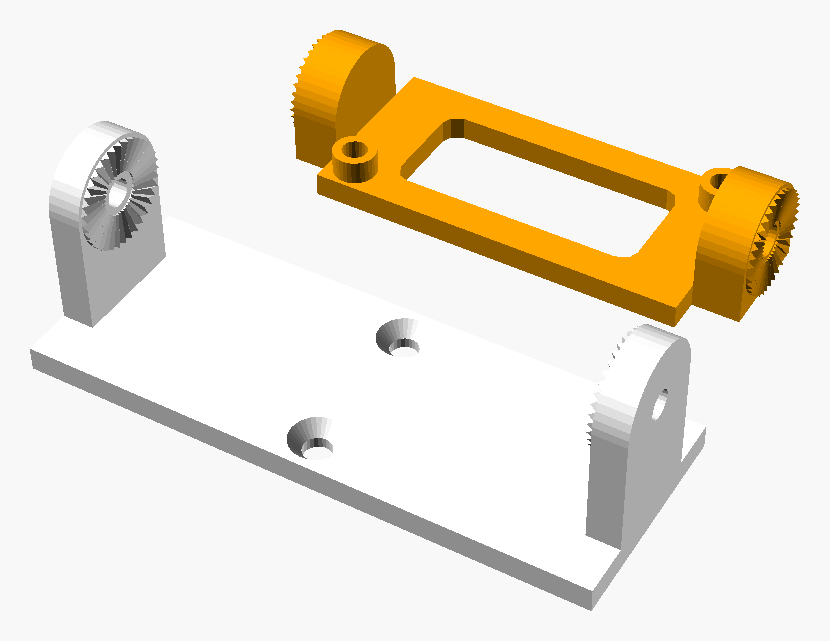

# Soportes orientables para HC-SR04 y VL53L0X

*In English: [README.md](README.md)*

Soportes para fijar los sensores de ROS2D2 (5 HC-SR04 y 4 VL53L0X) al R2, en el faldón o en las patas,
y poder **inclinar cada sensor después de montado**. Cada soporte son dos piezas: una **base** plana
que se atornilla al R2 y una **cuna** que sujeta el sensor y gira entre las dos orejas de la base.

| HC-SR04 | VL53L0X (GY-VL53L0XV2) |
|---|---|
|  |  |

## Cómo se orienta

El eje es un tornillo M3 por cada lado, que pasa por la oreja y rosca en un inserto de la cuna. La oreja
y la cuna tienen **dientes radiales** que encajan entre sí: el ángulo va a saltos de **10°**, de
**−30° a +90°**, y no resbala con las vibraciones. Para cambiarlo, afloja los dos tornillos, gira la cuna
y vuelve a apretar.

- **0°**: el sensor mira de frente, perpendicular a la base.
- **+90°**: el sensor queda paralelo a la base.
- En todo el rango la cuna y el sensor no tocan la base.


## Piezas

| STL | Qué es | Cómo imprimir |
|---|---|---|
| `stl/base_hc.stl` | base del HC-SR04 (69,8 × 26,4 mm) | placa sobre la cama, orejas hacia arriba |
| `stl/cradle_hc.stl` | cuna del HC-SR04 | placa sobre la cama |
| `stl/base_vl.stl` | base del VL53L0X (49,8 × 26,4 mm) | placa sobre la cama, orejas hacia arriba |
| `stl/cradle_vl.stl` | cuna del VL53L0X | placa sobre la cama |

PETG, capa de 0,2 mm, boquilla de 0,4, sin soportes. Para los 9 sensores: 5 juegos `_hc` y 4 juegos `_vl`.

| HC-SR04 | VL53L0X |
|---|---|
|  |  |

## Tornillería (por soporte)

| | HC-SR04 | VL53L0X |
|---|---|---|
| Eje | 2 × M3 × 10 + 2 insertos M3 en la cuna | 2 × M3 × 10 + 2 insertos M3 en la cuna |
| Sensor a la cuna | 2 × M2 × 5 + 2 insertos M2 | 2 × M3 × 6 + 2 insertos M3 |
| Base al R2 | 2 × M3 avellanados (largo según la superficie) | 2 × M3 avellanados |

Los dos agujeros de la base están a 18 mm entre centros. El HC-SR04 va con los transductores hacia fuera y
los pines por el borde de abajo; la cuna tiene una ventana para los componentes y los pines de detrás de
la placa.

## Montaje

1. Mete los insertos con el soldador: los dos M3 de los laterales de la cuna (el eje) y los dos del sensor.
2. Atornilla el sensor a la cuna.
3. Atornilla la base al R2 con los dos M3 avellanados.
4. Pon la cuna entre las orejas con los dientes encajados en el ángulo que quieras y mete los dos M3 × 10
   del eje. Aprieta lo justo para que los dientes no salten.

## Estado

Diseño comprobado en el modelo (sin choques de −30° a +90°, dientes encajados en cada paso de 10°), pero
**aún sin imprimir ni probar**: el ajuste de los dientes puede necesitar un retoque.

## Generar los ficheros

```bash
openscad -o stl/base_hc.stl -D 'part="base"' -D 'sensor="hc"' sensor_mounts.scad
openscad -o stl/cradle_hc.stl -D 'part="cradle"' -D 'sensor="hc"' sensor_mounts.scad
openscad -o renders/mounted_hc.png -D 'part="photo"' -D 'sensor="hc"' -D tilt=20 sensor_mounts.scad
```

Cambia `sensor="vl"` para el VL53L0X. Las vistas de los renders: `foto`, `angulos` y `piezas`.
