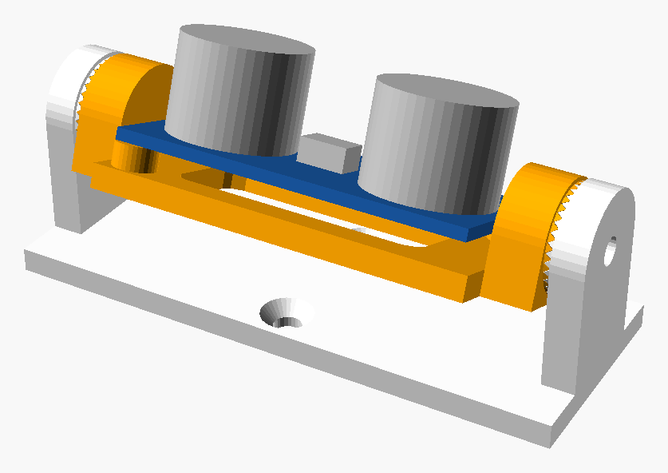
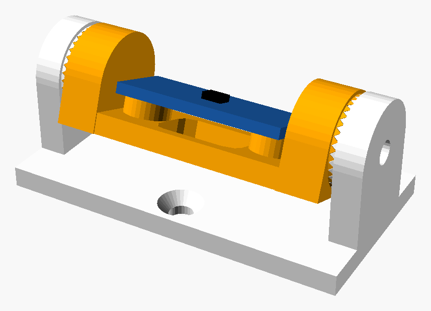
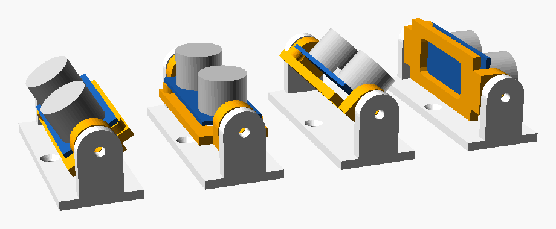
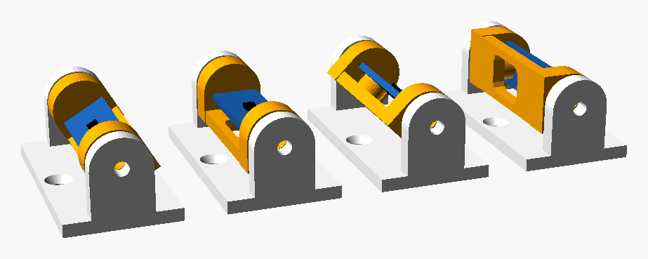
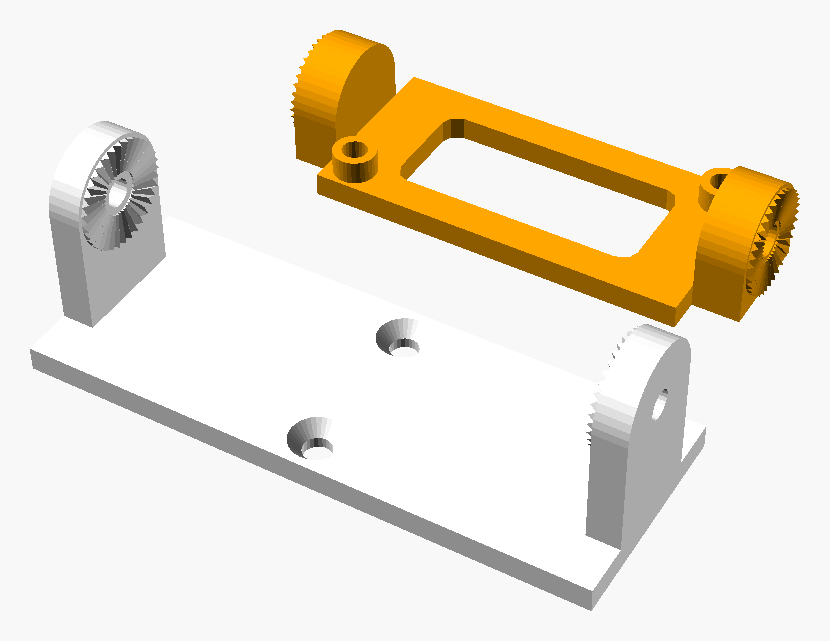
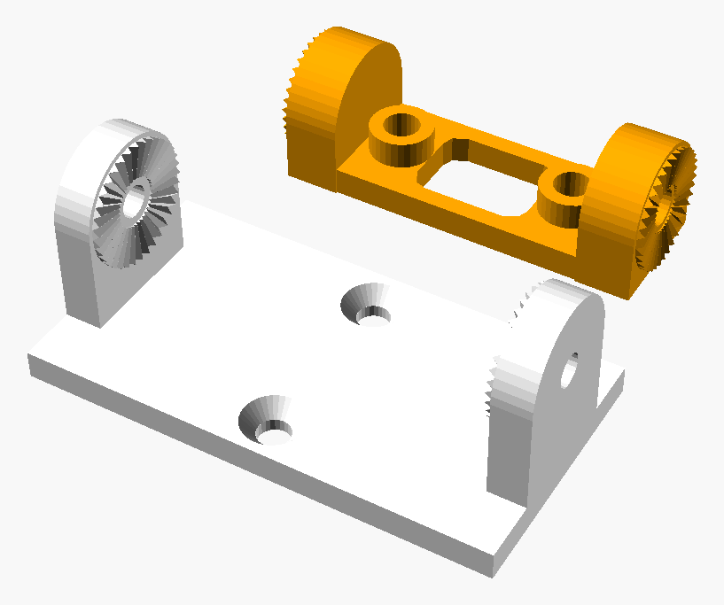

# Tilting mounts for the HC-SR04 and the VL53L0X

*En castellano: [README_es.md](README_es.md)*

Mounts to fix ROS2D2's sensors (5 HC-SR04 and 4 VL53L0X) to the R2, on the skirt or on the legs, and
**tilt each sensor after it is mounted**. Each mount is two parts: a flat **base** screwed to the R2 and a
**cradle** that holds the sensor and pivots between the base's two ears.

| HC-SR04 | VL53L0X (GY-VL53L0XV2) |
|---|---|
|  |  |

## How it tilts

The axle is one M3 screw per side, through the ear into a heat-set insert in the cradle. The ear and the
cradle carry **radial teeth** that mesh: the angle moves in **10°** steps, from **−30° to +90°**, and it does
not slip with vibration. To change it, loosen both screws, turn the cradle and tighten again.

- **0°**: the sensor looks straight out, perpendicular to the base.
- **+90°**: the sensor lies parallel to the base.
- Over the whole range the cradle and the sensor never touch the base.





## Parts

| STL | What it is | How to print |
|---|---|---|
| `stl/base_hc.stl` | HC-SR04 base (69.8 × 26.4 mm) | plate on the bed, ears up |
| `stl/cuna_hc.stl` | HC-SR04 cradle | plate on the bed |
| `stl/base_vl.stl` | VL53L0X base (49.8 × 26.4 mm) | plate on the bed, ears up |
| `stl/cuna_vl.stl` | VL53L0X cradle | plate on the bed |

PETG, 0.2 mm layers, 0.4 nozzle, no supports. For the 9 sensors: 5 `_hc` sets and 4 `_vl` sets.

| HC-SR04 | VL53L0X |
|---|---|
|  |  |

## Hardware (per mount)

| | HC-SR04 | VL53L0X |
|---|---|---|
| Axle | 2 × M3 × 10 + 2 M3 inserts in the cradle | 2 × M3 × 10 + 2 M3 inserts in the cradle |
| Sensor to cradle | 2 × M2 × 5 + 2 M2 inserts | 2 × M3 × 6 + 2 M3 inserts |
| Base to the R2 | 2 × M3 countersunk (length to suit the surface) | 2 × M3 countersunk |

The base's two holes are 18 mm apart. The HC-SR04 goes with its transducers out and its pins along the
bottom edge; the cradle has a window for the parts and pins on the back of the board.

## Assembly

1. Heat-set the inserts: the two M3 on the cradle's sides (the axle) and the sensor's two.
2. Screw the sensor to the cradle.
3. Screw the base to the R2 with the two countersunk M3.
4. Set the cradle between the ears with the teeth meshed at the angle you want and fit the two M3 × 10 of
   the axle. Tighten just enough for the teeth not to skip.

## Status

Checked on the model (no collisions from −30° to +90°, teeth meshed at every 10° step), but **not printed
or tested yet**: the teeth's fit may need a tweak.

## Generating the files

```bash
openscad -o stl/base_hc.stl -D 'part="base"' -D 'sensor="hc"' soportes_sensores.scad
openscad -o stl/cuna_hc.stl -D 'part="cuna"' -D 'sensor="hc"' soportes_sensores.scad
openscad -o renders/montado_hc.png -D 'part="foto"' -D 'sensor="hc"' -D tilt=20 soportes_sensores.scad
```

Set `sensor="vl"` for the VL53L0X. The render views: `foto`, `angulos` and `piezas`.
