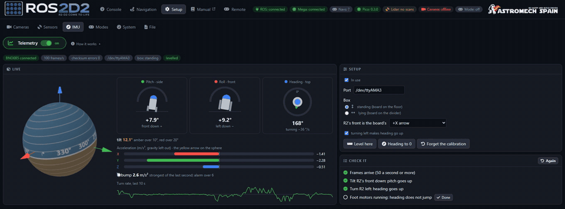

# r2_imu_bno085

*En español: [README_es.md](README_es.md)*

ROS2D2 node for the **Adafruit BNO085** IMU (product 4754) in **UART-RVC** mode: the chip itself
fuses the gyroscope and the accelerometer and sends the finished orientation 100 times a second
over a single wire. It publishes the same as [`r2_imu`](../r2_imu) (the MPU6050 one), so whatever
uses `/imu/data` does not care which IMU R2 has.



UART-RVC facts from CEVA's datasheet (BNO08X, 1000-3927 v1.17, section 1.2.5): 115200 baud, 8N1,
100 frames a second of 19 bytes. Yaw counts **from when the chip powers up**, and this mode does not
use the compass (the magnetometer is not calibrated), which suits us: inside R2 the motors and
batteries would fool it.

## Wiring

| BNO085 (Adafruit 4754) | Raspberry Pi 4 |
|---|---|
| VIN | 3.3 V (pin 1) |
| GND | GND (pin 9) |
| SDA (its **TX** in RVC mode) | GPIO 5, `uart3` RX (pin 29) |
| P0 | 3.3 V (pin 17): selects UART-RVC (P1 stays at GND, as shipped) |

The mode is read when the chip starts: after changing P0, power it off and on.

On the Pi, enable `uart3` (it leaves the UART on pins 8 and 10, which has the Linux console, alone):

```
# /boot/firmware/config.txt
dtoverlay=uart3
```

Reboot and check its name: `ls /dev/ttyAMA*`. On a Pi 4 with Ubuntu it is `/dev/ttyAMA3`, the one in
`config/imu.yaml` (checked with the board: 100 frames a second, none bad). The user must be in the
`dialout` group.

**If nothing arrives** (the node says "no BNO085 frames"):
- The board's green LED must be on: if not, VIN or GND makes no contact.
- All four wires go on the Pi's odd row (the one towards the middle of the board), counting from the
  end away from the USB ports: VIN on the 1st pin, GND on the 5th, P0 on the 9th and SDA on the
  **15th** (pin 29; the 14th is pin 27, the wrong one).
- With a multimeter (DC, black on the board's GND): VIN, P0 and SDA about 3.2 V; P1 0 V.
- `sudo grep "^3:" /proc/tty/driver/ttyAMA`: the `rx:` count must go up about 1900 bytes a second.

**Where to mount it:** in the ROS2 box, on the `imu_bracket` screwed to the Pi (see
`hardware/ros2_box_rack_v3`), or in the body, flat, centred and as close to the foot's axis as possible, with
the X arrow pointing forward. Held with thick double-sided tape or foam so the motors' vibration
does not reach it.

## Use

```
ros2 launch r2_imu_bno085 imu.launch.py
```

| Topic | Type | What it is |
|---|---|---|
| `/imu/data` | `sensor_msgs/Imu` | Orientation (from the chip), turn rate and acceleration (m/s²) |
| `/imu/tilt` | `std_msgs/Float32` | Degrees from level |

- RVC mode sends no turn rate: the node works it out from two frames in a row (the time comes from
  the frame counter, not from when they arrive).
- `zero_yaw`: yaw is 0 where R2 points when the node starts.
- `invert_yaw`: if turning R2 left makes yaw go down, set it to `true`.
- If no frames arrive, or they arrive with a wrong checksum, the node says so in the log (P0, wire
  or baud rate).

## Setup from the console

The console's **Setup → IMU** sets it up, levels it and shows what it measures. The droid's launch starts
this node always: with no board its status says "not connected".

- **Settings file:** `~/.config/ros2d2/imu.yaml`, written by the console, wins over `config/imu.yaml`:
  `in_use`, `port`, `box` (`standing` | `lying`), `front` (which of the board's arrows points to R2's
  front: `+x`, `-x`, `+y`, `-y`), `invert_yaw` and `level`. They change live with `ros2 param set /imu ...`
  and are saved. With `in_use: false` the node keeps reporting but publishes no `/imu/data`.
- **Levelling:** with R2 still on a flat floor, `ros2 service call /imu/level_here std_srvs/srv/Trigger`
  stores the board's tilt (the box's ~10°, or the upside-down board of the lying box) as 0. `/imu/data`
  comes out in R2's axes: attitude, turn rate and acceleration. `/imu/forget_calibration` drops it.
- **Heading 0:** `/imu/heading_zero` makes where R2 points now heading 0, **until the node restarts**:
  in UART-RVC the yaw counts from when the chip powers up, so it is not saved.
- **Status:** `/imu/status` (`std_msgs/String`, JSON twice a second): connected, port, frames a second,
  bad frames, levelled, the settings, the last frame's age, the strongest knock of the last second (m/s²).
- **No board:** `ros2 run r2_imu_bno085 bno085_node --ros-args -r __node:=imu -p simulate:=true` (or
  `sim:=true` in the droid's launch) runs a pretend IMU to try the console.

## Still to try with the board

- The yaw direction (`invert_yaw`), and that it does not jump near the foot motors.
- Feeding it to the filter (robot_localization) with the lidar odometry (`rf2o`).

## Tests

```
cd ros2_ws/src/r2_imu_bno085 && python -m pytest test
```

They include the example frame from CEVA's datasheet.
